# 開場：不是選哪套，而是熟悉一套

> 工具會一直換，但各家 AI Agent 的底層使用邏輯非常接近

## 新工具天天出，每個都要學嗎？

### 😰 AI 焦慮
- AI 發展速度非常快，常常一覺醒來又有`新工具誕生`、`新功能發表`
- 很多人都在焦慮：是不是每個都要學？不會用就要被淘汰嗎？
- 以前的我也是這樣

### 💡 我的心得：熟悉一套 AI Agent
- 過去 3 年來，我嘗試過`上百款` AI 工具
- 最終的心得：熟悉一套 AI Agent，比追任何流行的名詞都更重要
- 不管是哪家產品，`底層的使用邏輯`都非常接近
- 只要在一套工具上扎實走過一遍，之後換到任何 AI Agent 都能短時間上手

> **為什麼這堂課用 Claude 當範例？**
> 我們以 Claude 為範例，帶你看它在不同情境下能帶來哪些幫助。
> 學的是一套工具，練的是`所有 AI Agent 共通`的用法。

## 三種情境，對應三種工具

### 🧭 先看使用時機

| 情境 | 範例 | 使用 |
| --- | --- | --- |
| 線上任務 | 回覆客戶信件、整理過往合作脈絡、上網查資料填表單 | `網頁版` |
| 資料存在你的電腦裡 | 彙整專案資料夾的文件生成報告、把收據照片整理成報帳用的 Excel | `桌面版 App` |
| 做出能長期使用的工具 | 報價單網頁、排班系統 | `Claude Code`（終端機） |

> **不會寫程式，也能做出自己的工具**
> 現在就算你不會寫程式，也能靠終端機的 Claude Code 把工具做出來。

---

# Claude 網頁版：日常任務中心

> 從網頁版開始，一步步解鎖 AI 的潛在能力

## 用連接器讓 AI 連上你的外部工具

### 😓 痛點：往來信件散落在多個討論串
- 跟客戶往來的信件，常常散落在`多個討論串`
- 甚至橫跨好幾個月
- 過去不管回信還是整理脈絡，都是一件痛苦的事情

### 🔌 連接器（Connector）是什麼？
- 讓 AI 有能力連上你的`信箱`、`行事曆`、`雲端硬碟`或 `Notion 知識庫`這些外部工具
- 接上 AI 後，你只要決定`回信的方向`與`整理的格式`
- 稍等一段時間，AI 就會把內容彙整給你

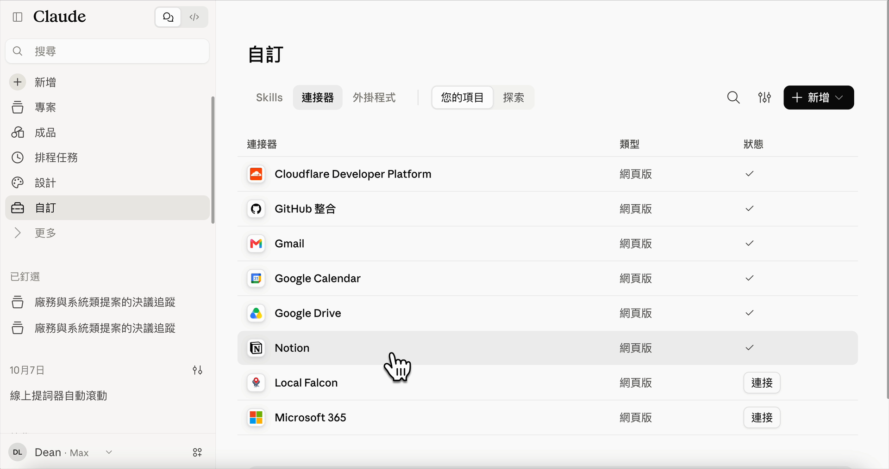

```prompt [label="整理客戶合作脈絡並視覺化"]
幫我整理信箱中 [Blackbao AI] 的合作，將討論過程視覺化
```

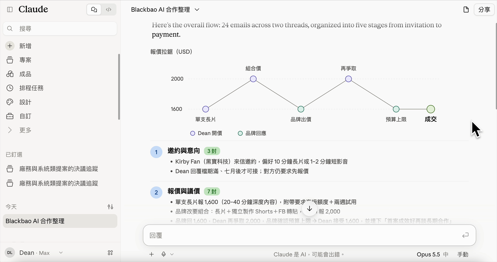

## 用專案保存指令與背景資訊

### 😓 痛點：對話越長品質越差，開新視窗又失憶
- 想讓 AI 有出色的表現，需要`設計好的指令`，並提供`完整的背景資訊`
- 在一般對話窗操作：隨著內容變長，AI 的回覆品質會逐步下降
- 開一個新視窗：它又會忘記過去設定的限制與背景資訊

> **這個痛點，可以靠專案（Project）解決**
> 把指令與背景資訊存在專案裡，專案中的每個新對話都會自動帶上。

### 🗂️ 建立專案的流程
[flow]
1. 建立專案 — 填寫專案名稱與專案描述
2. 設定專案指令 — 告訴 AI 要扮演的角色、不同任務要參考的文件、回覆的原則
3. 上傳參考文件 — 產品資訊、範例文案、報告格式等文件
[/flow]

### 🏷️ STEP 1：建立專案
- 以品牌行銷職位為例，開一個專案並設定以下資訊：

```prompt [label="專案名稱與描述"]
專案名稱：保養品牌行銷文案
專案描述：依照品牌語氣和產品資料，快速寫出資訊正確、好讀的粉專貼文與檔期文案。
```

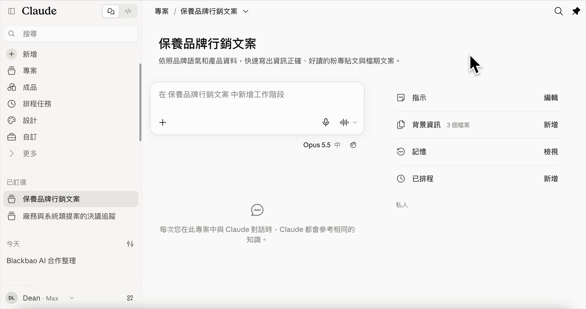

### 📋 STEP 2：設定專案指令
- 讓 AI 了解自己要`扮演的角色`
- 不同任務要`參考的文件`
- 以及`回覆的原則`

```prompt [label="專案指令"]
你是一個保養品牌的資深社群行銷文案夥伴。這個專案專門處理粉專貼文、檔期文案、產品介紹等行銷文字。

# 品牌背景
- 台灣 MIT 保養品牌，主打美白精華霜、抗老精華液、防曬隔離霜、保濕露
- 品牌口吻：像懂保養的好朋友——親切、專業、有溫度，不誇大

# 參考文件怎麼用
- 「品牌語氣指南」：決定怎麼說話。用字、稱呼、禁用字一律以它為準
- 「產品規格表」：唯一的事實來源。成分、容量、檢驗與功效測試結果只能從這裡引用，表裡沒有的就不要寫
- 「熱賣文案範例」：學它的開場、段落節奏、Emoji 與 CTA 寫法；可以模仿結構，不可以複製原句

# 固定規則
- 功效敘述須符合化粧品廣告規範，禁用「治療、修復受損細胞、消除、保證、100%」等字眼；遇到疑似風險用語，主動提醒我
- 事實有衝突時，以「產品規格表」為準，並告訴我哪裡不一致
- 價格、折扣、贈品、活動期間屬於檔期資訊，我沒提供就不要自行假設

# 工作方式
- 資訊不足（產品、平台、檔期、字數、留言關鍵字）時，先問我 1–2 個問題再動筆
- 每次產出後，用一行列出「這篇引用了規格表的哪些資訊」，方便我核對

# 輸出慣例
- 繁體中文（台灣用語），短句、一行一個重點，段落之間空一行
- 粉專貼文結尾依慣例用「📩留言區輸入【關鍵字】私訊給您優惠連結」導流，關鍵字由我指定
```

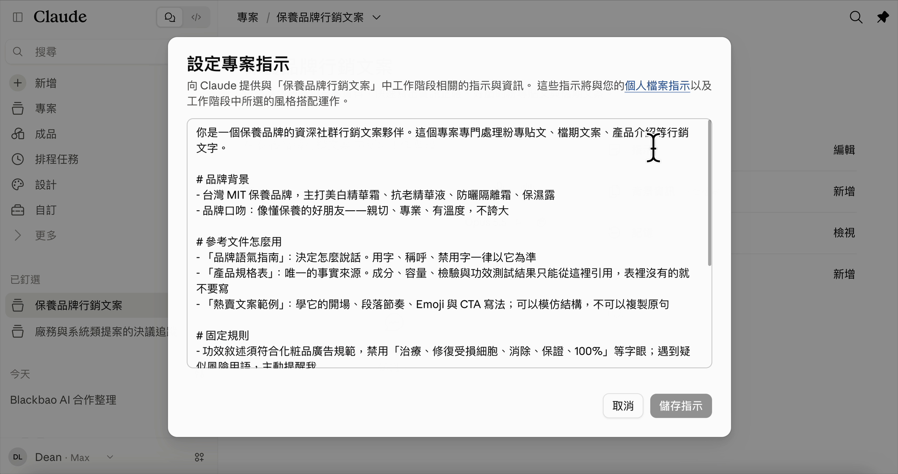

### 📎 STEP 3：上傳參考文件
- 上傳`產品資訊`、`範例文案`、`報告格式`等文件
- 對應專案指令裡提到的「品牌語氣指南」「產品規格表」「熱賣文案範例」

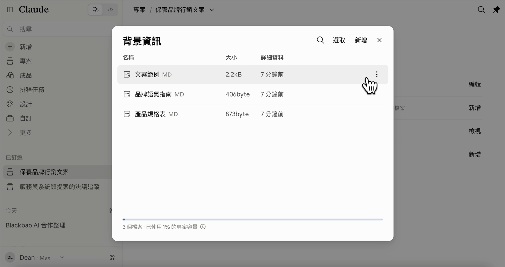

### ✅ 之後每個新對話，直接交代任務就好
- 在專案的每個新對話，AI 都清楚自己要做的事情
- 不需要再重新交代背景，能`大幅減少 AI 幻覺`

```prompt [label="在專案中寫一篇粉專貼文"]
幫「保濕露」寫一篇粉專貼文，主打夏天用也不黏的長效保濕。
檔期：買 2 入送保濕面膜 2 片；留言關鍵字【水嫩夏天】。
```

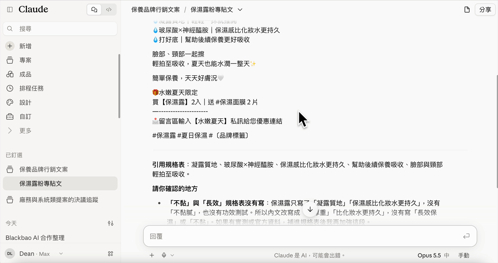

> **手上有不同性質的任務怎麼辦？**
> 根據主題`建立對應的專案`來處理，每個專案各自保存自己的角色與背景資訊。

## 用 Chrome 外掛讓 AI 替你操作網頁

### 🧩 Claude Chrome 外掛
- 在瀏覽器安裝 Claude 外掛，讓它`替你操作網頁`
- Claude 會像一個真實的助手：自己開分頁搜尋、點擊連結，最後將結果回填到表單中

### 🛠️ 示範：查社群帳號並回填 Google Sheet
[flow]
1. 開啟一份 Google Sheet 表單
2. 請 Claude 查詢資料，並指定要填入的欄位
3. Claude 自己開分頁搜尋、點擊連結
4. 最後將結果回填到表單中
[/flow]

```prompt [label="查社群帳號並回填表單"]
林鼎淵有哪些社群平台帳號？
找到後填到這份 Google Sheet 的欄位
並且每個帳號要附上前五筆內容的連結
```

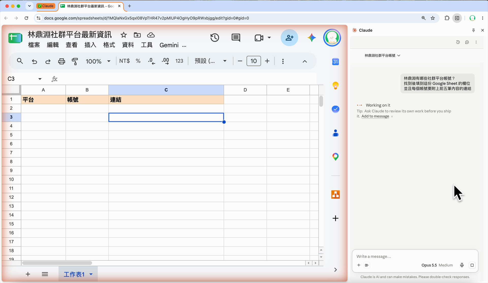

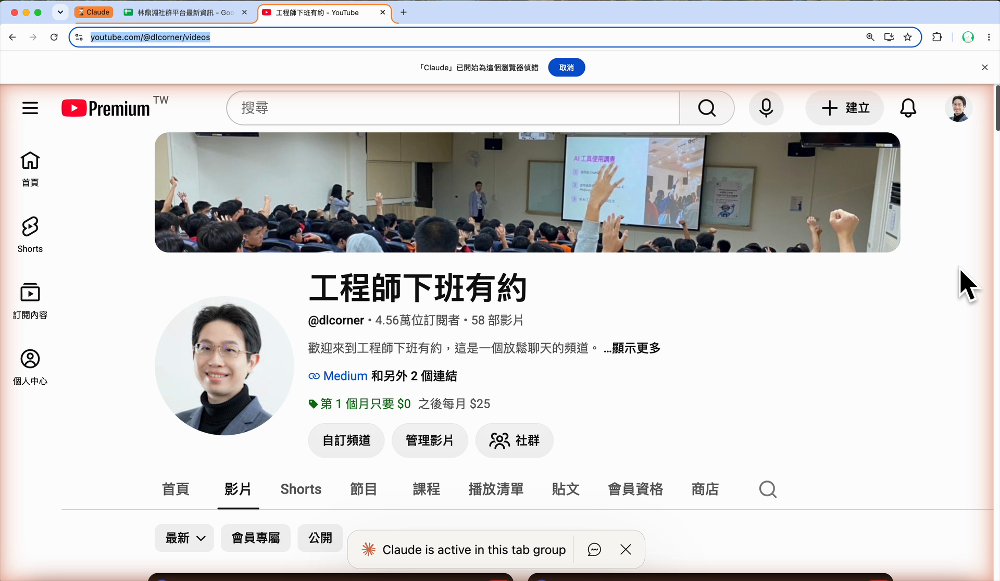

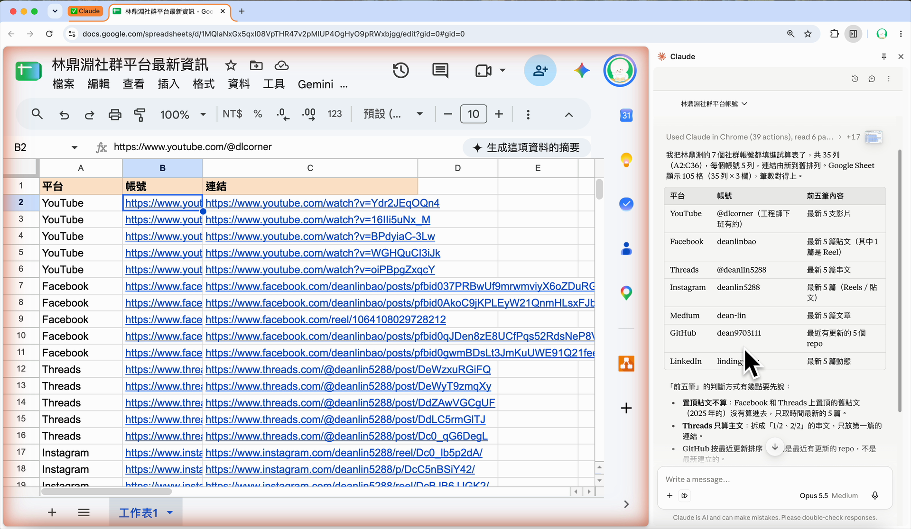

### 🎯 適用情境
- `調查競品`
- `整理潛在合作對象`的資訊
- Facebook、Instagram、Threads 這類平台都禁止爬蟲，但真的開啟網頁操作，就能繞過這個限制

### ⚡ 平行處理，提升生產力
- AI 操作的過程中，你可以去做其他的事
- 甚至開新視窗安排其他工作，給 AI 平行處理

```prompt [label="另開視窗平行處理其他工作"]
我是自媒體創作者，正在找題材
列出 Claude 目前在社群上討論度最高的 5 個工具
```

> **AI 在操作網頁時，你不用在旁邊等**
> 多開幾個視窗平行處理，可以`大幅提升你的生產力`。

---

# Claude 桌面版：把電腦雜事交出去

> 網頁版主要處理線上資訊；檔案躺在自己電腦裡時，就換桌面版 App 上場

## 讓 AI 讀取專案資料夾

### 😫 痛點：一小時後要報告專案進度
- 主管臨時要你在`一小時後`報告專案的執行進度
- 專案資料夾內可能有 Word、Excel、PDF、PPT 等多種格式
- 甚至存在 V1／V2 等多個版本
- 如果要手動彙整，絕對會讓人抓狂

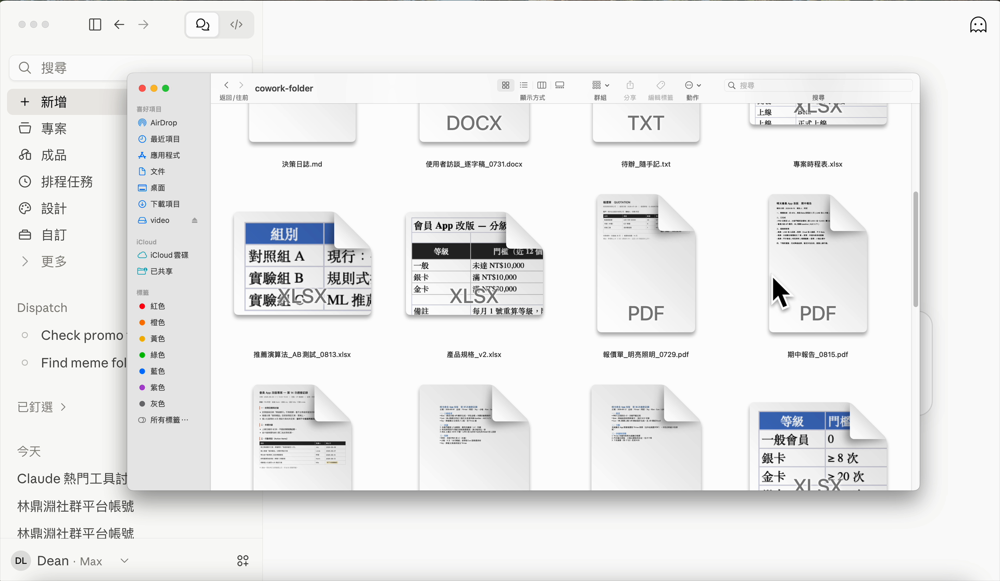

### 📁 直接讓 AI 讀取專案資料夾
- 使用 Claude 桌面版 App，賦予 AI `讀寫電腦資料`的權限
- 讓 AI 讀取專案資料夾，彙整出指定格式的報告

```prompt [label="彙整專案進度報告"]
用摘要告訴我：「這是什麼專案、現在進度到哪、誰負責什麼、最近發生過什麼決定。」每個結論都標出處（檔名）。
```

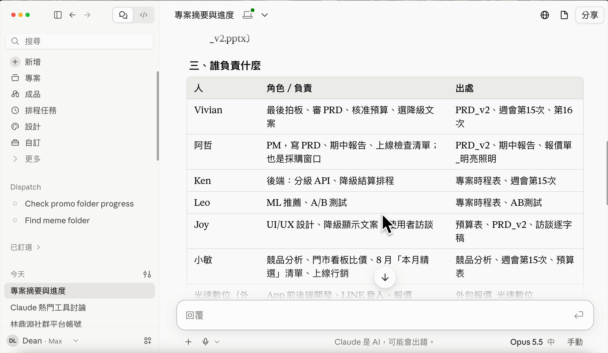

## 用圖片辨識自動報帳

### 🧾 收據照片 → Excel
- 除了基礎的文件處理，桌面版還有`圖片辨識`的功能
- 過去：報帳要手動 Key-in 到 Excel
- 現在：把要報帳的收據整理到一個資料夾，AI 辨識圖片資訊後`自動寫入 Excel`

```prompt [label="收據照片自動填入報銷表"]
讀取[費用報銷表.xlsx]裡面的欄位後：
1. 逐張辨識[收據]內的照片
2. 一張照片填一列，最後一欄寫來源檔名
3. 看不清楚或不確定的欄位留空並標黃，不要猜
4. 核對沒有遺漏後，另存為[費用報銷表_已填寫.xlsx]
讀寫 Excel 任務請設計成 Python 腳本
```

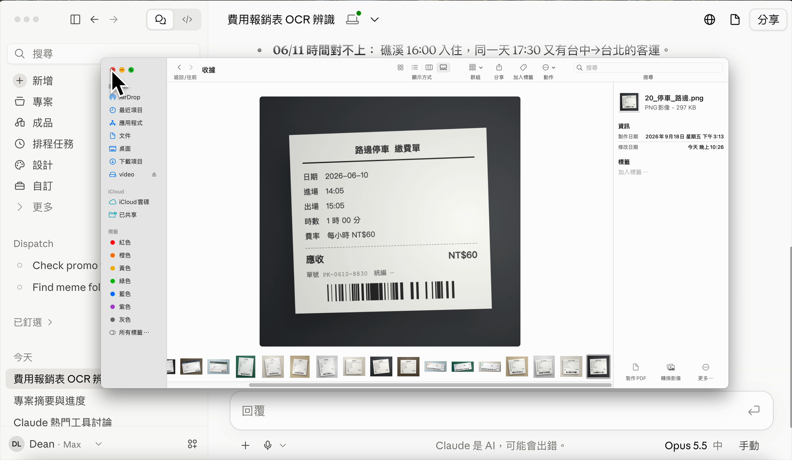

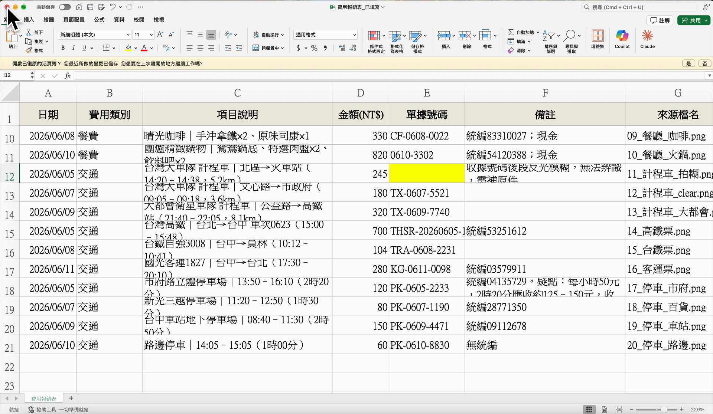

## 把例行任務封裝成 Skill

### 🧠 為什麼要 AI 寫 Python 腳本？
- 辨識收據、整理文件這類`例行性任務`，可以再進一步設計成 Skill
- 前面的報帳任務，我特別要求 AI 撰寫 `Python 腳本`來完成
- 第一次執行時間較久，但完成後可以把`程式腳本`與`執行的 SOP` 封裝成 Skill

[flow]
1. 第一次執行 — AI 撰寫 Python 腳本完成任務，時間較久
2. 封裝成 Skill — 把程式腳本與執行的 SOP 打包起來
3. 日後直接執行 — 第二次執行時間縮短許多
[/flow]

```prompt [label="把工作流設計成 Skill"]
幫我將這個工作流設計為 Skill
```

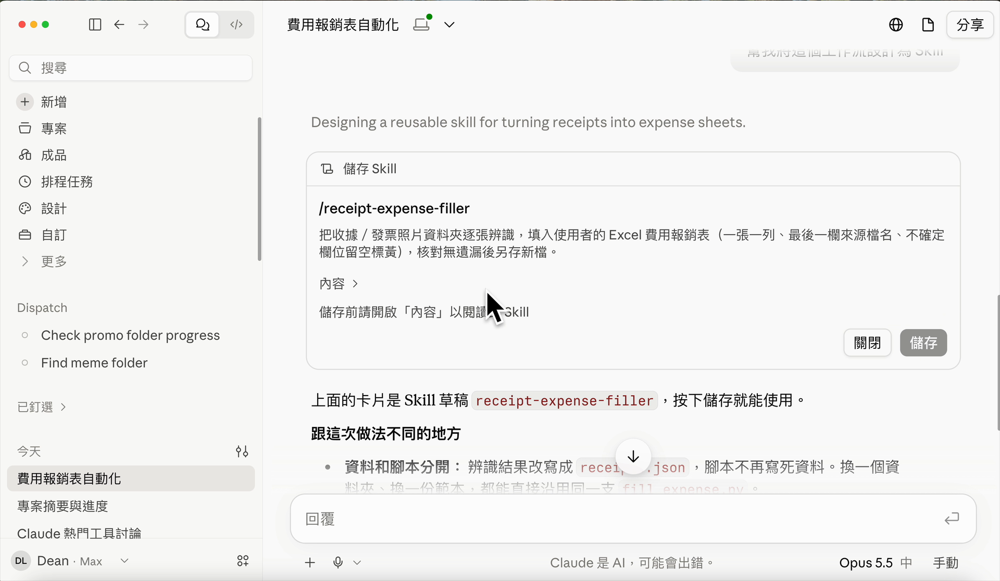

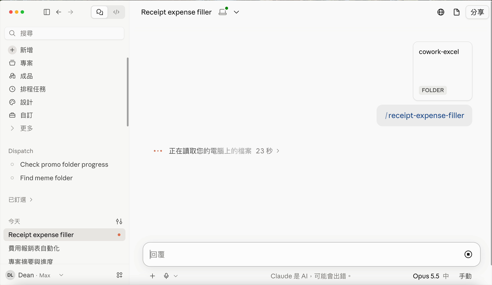

> **為什麼第二次執行會快這麼多？**
> 因為 AI 不需要`從頭開始想解決方案`，照著 Skill 裡的腳本與 SOP 執行就好。

### 💬 我的心得：最寶貴的是多輪對話的過程
- 使用 AI 一段時間後，你會發現它並沒有社群媒體吹捧的那麼神奇
- 想得到期待的結果，往往需要經過`多輪的對話`
- 在多輪對話中，你會向 AI 分享自己`做事的流程`、`判斷好壞的方法`
- 而這一切都很適合設計成 Skill

> **這堂課的目標，不是要你成為我**
> 而是讓 AI 成為`你的分身`。

---

# Claude Code：做出自己的工具

> 在 AI 時代，就算完全沒寫過程式，也能打造出自己的工具

## 什麼時候需要 Claude Code？

### 🆚 網頁版／桌面版 vs Claude Code

| 你需要的是 | 使用 |
| --- | --- |
| 簡單的視覺化網頁 | `網頁版`、`桌面版`就夠用 |
| 有功能性、未來會持續使用與優化的工具 | `Claude Code` |

[image-text position="right" width="30"]
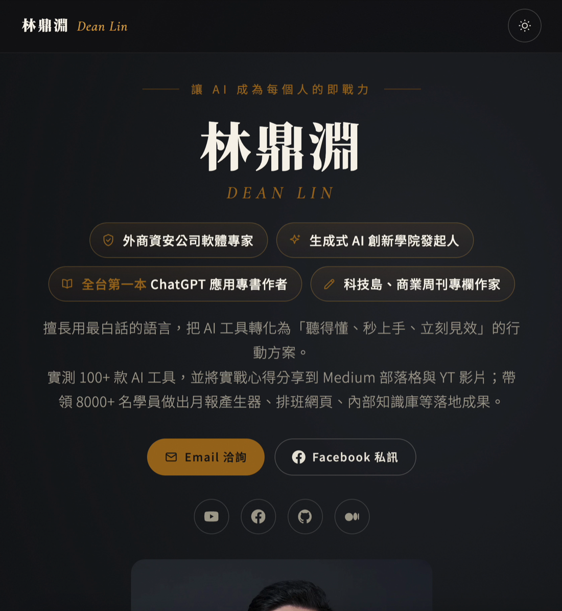
- 只是要`呈現資訊`的頁面（ex: 個人介紹頁），網頁版、桌面版就夠用
- 要`有功能`、會`持續使用與優化`的工具，才需要 Claude Code
[/image-text]

### 🧰 從零開始準備開發環境
[flow]
1. 設定 Mac 與 Windows 系統的開發環境
2. 安裝程式碼編輯器
3. 認識什麼是終端機
[/flow]
- 跨過對新工具恐懼的門檻，之後就能開始打造自己的工具

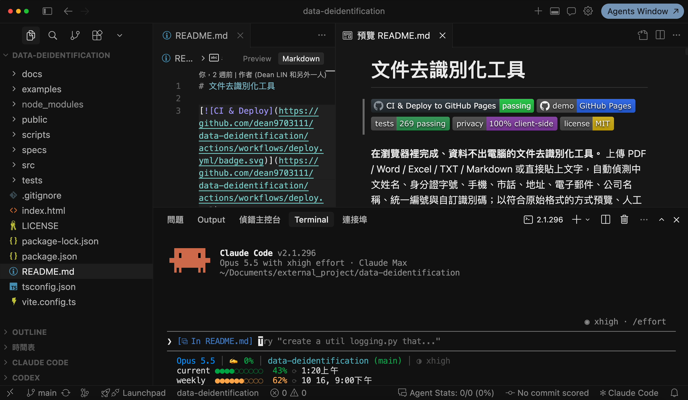

## 打造你的專屬工具

### 🧮 客製化報價網頁
- 工作常需要對外報價時適用
- 選取項目與數量後，`自動計算總價`
- 匯出能給客戶的報價單

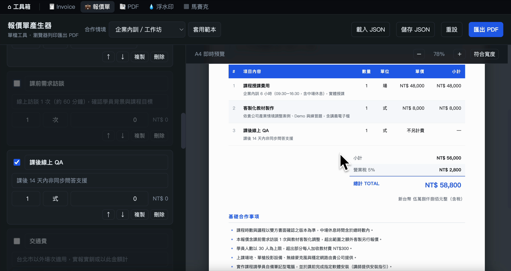

### 📅 排班系統
- 團隊有排班需求時，也能建立對應的排班系統

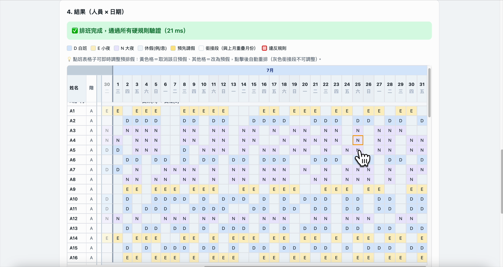

## 用 Git 當保命工具

### ⚠️ 工具製作的過程不會總是順利
- AI 時常會把正常的功能`改壞`
- 或是`理解錯`你的需求

### 💾 Git = 打電動的存檔點
- Git 是`版本控制`工具
- 每完成一個功能，就存檔一次
- 之後不管怎麼改壞，都能退回上一個能動的版本

> **為什麼 Git 是保命工具？**
> AI 會改壞東西是常態，有存檔點，你就`永遠有退路`。

---

# 總結：根據情境使用工具

> 三款工具的能力都是互通的，只是有各自最佳的使用時機

## 三款工具的使用時機

### 🌐 網頁版：資料在線上
- 設定好`連接器`，AI 就能存取外部工具
- 不想每次對話從頭開始，用`專案`保存指令與背景資訊
- 在瀏覽器安裝`外掛`，讓 AI 自動操作網頁

### 💻 桌面版 App：資料在電腦裡
- 能讀寫檔案、彙整資訊、辨識圖片
- 也能將重複的流程封裝成 `Skill`

### ⌨️ Claude Code：要設計持續使用的工具
- 終端機的 Claude Code，搭配 `Git 版本控制`與`程式碼編輯器`
- 就能把需求做成完整的產品

## 一張表看懂三款工具

### 📊 三款工具比較表

| 比較項目 | 網頁版 | 桌面版 App | Claude Code |
| --- | --- | --- | --- |
| 使用時機 | 幫我查／幫我回 | 這件事你幫我完成 | 幫我做一個工具 |
| 資料來源 | 上傳檔案、對話內容、連接服務 | 電腦資料夾的檔案 | 程式專案、Git Repository、終端機 |
| 直接讀寫電腦檔案 | ⚠️ 需手動上傳 | ✅ 可以 | ✅ 可以 |
| 一次處理大量檔案 | ⚠️ 需整理後提供 | ✅ 很適合 | ✅ 很適合 |
| 需要會寫程式 | 不用 | 不用 | 🎓 要掌握基礎知識 |
| 上手門檻 | ⭐ | ⭐⭐ | ⭐⭐⭐ |
| 最大優勢 | 打開瀏覽器就能用 | 把電腦裡的雜事外包給 AI | 做出能長期使用、持續優化的工具 |

## 學到的是所有 AI Agent 共通的底層邏輯

### 🧠 走過一遍之後
- 你學到的不只是 Claude 這個工具如何使用
- 而是所有 AI Agent `共通的底層邏輯`
- 下次又有新的 AI 工具發布時，你不會再焦慮是不是又要重學一次

> **新工具發布時，為什麼不用再焦慮？**
> 因為你很清楚：工具會一直換，但`底層邏輯`已經會了。

[summary]
- 🔌 **連接器** | 讓 AI 連上信箱、行事曆、雲端硬碟、Notion 知識庫
- 🗂️ **專案** | 保存指令與背景資訊，新對話不必重新交代、減少幻覺
- 🧩 **Chrome 外掛** | 讓 AI 自己開分頁搜尋、操作網頁、回填表單
- 📁 **桌面版 App** | 讀寫電腦檔案、彙整專案資料、辨識收據圖片
- 🧠 **Skill** | 把腳本與 SOP 封裝起來，例行任務第二次起更快
- ⌨️ **Claude Code ＋ Git** | 不會寫程式也能做出長期使用的工具，改壞也能退回
[/summary]
