[time]
- label: 第 1 堂｜ChatGPT
  date: 11/23
  time: 19:00~21:00
  des: **釐清需求，建立專屬的教學助理**：認識網頁版與桌面版、三家 AI 功能對標，學會去識別化與 Prompt，生成教材圖片，再用記憶、外掛程式與專案打造教學助理。
  link: [查看講義](../chatgpt/index.html)
- label: 第 2 堂｜Codex
  date: 11/24
  time: 19:00~21:00
  des: **讓 AI 動手處理檔案，用 Skill 交付教材**：安裝 ChatGPT 桌面版，讓 AI 直接讀資料夾、把手寫報名表照片轉成 Excel；再用白話生成報名表登記、每週回顧與寫信風格的 Skill，最後切到 Codex，用資訊卡、線上講義、校園簡報 Skill 交出成品。
  link: [查看講義](../codex/index.html)
- label: 第 3 堂｜Claude
  date: 11/26
  time: 19:00~21:00
  des: **串接工具、建立知識庫，把好方法變 SOP**：先把學生名冊去識別化，再用連接器整理信件與行事曆、用 Project 建立活動知識庫、把家長通知流程存成 Skill。
  link: [查看講義](../claude/index.html)
  active: true
- label: 第 4 堂｜Cowork
  date: 11/27
  time: 19:00~21:00
  des: **讓 AI 交付成品，替自己做班級小工具**：用 Cowork 把簽收表照片轉 Excel、整理活動資料並設定排程，再用 Vibe Coding 做出班級抽籤分組工具，搭配 Git 存檔點，改壞了也能回到上一版。
  link: [查看講義](../cowork/index.html)
[/time]

# 🙋 課前回顧：5 分鐘掌握前兩堂的重點

## 第 1 堂 ChatGPT：把需求說清楚，守住資料

### 💬 先學會用對話把事情做好

[flow]
- **生成式 AI 的本質是文字接龍** - 目前 AI 無法避免幻覺，課綱、法規、考題解析都可能是錯的，`得到答案後一定要查證`
- **帳號、工具、資料三道門** - 關閉模型訓練、開啟多重驗證；學生資料要交給 AI，先做`去識別化`
- **Prompt 六個技巧** - 角色、語氣與受眾、符號與格式、專有名詞、請 AI 優化 Prompt、先反問再動手
- **不用每次重講的三個功能** - `記憶與自訂`讓 AI 認識你、`外掛程式`連上 Gmail 與行事曆、`專案`放進指令與知識庫
[/flow]

> **主流 AI Agnet 功能雷同**
> 名字不同、邏輯相同，`熟悉一個最重要`；今天用 Claude 示範給大家看。

## 第 2 堂 Codex：讓 AI 動手，把流程存成 Skill

### 📂 從回答問題，到交出檔案

[flow]
- **桌面版直接讀資料夾** - 選一個資料夾當工作範圍，文件不用上傳；成果直接`寫成檔案`
- **照片也能彙整** - 手寫報名表照片轉成 Excel，看不清楚的格子`留空標黃、不要猜`
- **Skill 的四種做法** - 把既有流程存起來、用白話生成、讓 AI 讀你寫過的信做出自己的版本、匯入別人做好的技能包
- **用到程式的 Skill 交給 Codex** - 資訊卡、線上簡報、模板簡報，成品直接寫進資料夾
[/flow]

> **專案放知識，Skill 放步驟**
> AI 說做完了，還是要自己打開檔案核對；`別忘記 AI 無法幫人背黑鍋`。

### 🧳 這堂課會帶走的 5 個成果

[flow]
1. Claude 基礎設定 — 隱私、個人偏好、能力開關
2. 隱私資訊識別化 — 隱藏 `Word / Excel / PDF` 等格式文件的敏感資料（姓名、學號、地址、點話...）
3. 信件分類與行程 — 用連接器連接外部工具，信件`分類標籤`、寫`回覆草稿`，彙整資訊`建立行程`
4. 讓 Project 成為第二大腦 — 記憶不可靠、資料雜亂拿找；可以把相關資訊放到專案，`降低 AI 幻覺`
5. 把工作 SOP 轉成 Skill — 把自己的工作流與判斷邏輯交給 AI，`不要把時間浪費在重複的事`
[/flow]

---

# 起手式：AI 的能力，取決於你給它哪些工具

> **為什麼別人的 AI 比我的強？**
> 如果僅用聊天視窗與 AI 對話，那遠遠`無法發揮它的潛力`。

## 認識 Claude 的功能與模型

### 🧭 使用時機

| 你做的事 | 使用 [width:170] | 一句話搞懂 |
| --- | --- | --- |
| 讓 AI 讀我的信箱 / 行事曆 / 雲端檔案 | `連接器` | 給它「眼睛跟手」去碰你的工具 |
| 不想每次重講背景、限制、語氣 | `Project` | 給它「參考資訊」與身分設定 |
| 把一套有效流程變成一鍵重複 | `Skill` | 給它「SOP 手冊」照步驟做 |
| 讓它真的去整理檔案、產出成品 | `桌面版` | 給它「工作桌」自己動手 |
| 固定時間要執行的任務 | `Scheduled` | 給它「鬧鐘」時間到自己跑 |
| 規則固定、要反覆用、不能有意外 | `Claude Code` | 請它做一個「工具」給你用 |

### 🧩 認識常見名詞

- **AI Agent**：不只是問一句答一句的聊天機器人，而是能`理解任務、操作你的檔案、自己串好步驟、把事情從頭做完的助手`
- **Token**：AI 的`計費與容量單位`，可以想成 AI 的「貨幣」，不同付費方案的額度不同
- **Model**：AI 的「大腦」，不同模型的`智商不同`，消耗的 Token 也不同；`越聰明的模型，花的 Token 越多`

### 🤖 模型選擇

| [width:150] | `Fable` | `Opus` | `Sonnet` | `Haiku` |
| --- | --- | --- | --- | --- |
| **聰明程度** | ⭐⭐⭐⭐ | ⭐⭐⭐ | ⭐⭐ | ⭐ |
| **回應速度** | 中等 | 較慢 | 中等 | 最快 |
| **適合處理** | 最困難的分析、需要推理的複雜任務 | 複雜分析、長篇寫作、程式開發 | 日常任務主力，多數工作都能勝任 | 簡單問答、摘要、大量重複的小任務 |

## 上一堂設過的，Claude 也設一次

### 🆚 ChatGPT VS Claude 設定

| 設定 | ChatGPT | Claude |
|---|---|---|
| 不讓資料拿去訓練 | 頭像 → 個人化 → 資料控制 | 頭像 → 設定 → 隱私權 |
| 讓 AI 認識你 | 個人化 → 自訂指令、暱稱、職業 | 設定 → 帳戶：暱稱、工作、給 Claude 的指示 |
| 記憶 | 個人化 → ChatGPT 記憶 | 設定 → 記憶 |
| 能力開關 | 無 | 設定 → 功能 |

> **用 AI 之前，先完成設定**
> 隱私、個人偏好、能力開關設定好後，接下來練習才會`安心順利`。

### 🔒 調整隱私權限

**使用網頁版**: 到[官網登入](https://claude.ai/)。
**下載桌面版**: 到[官網下載桌面 App](https://claude.ai/downloads)。
**操作路徑**: 左下角頭像 → 設定 → 隱私權 → 將「位置中繼資料、協助改善我們的 AI 模型」關閉

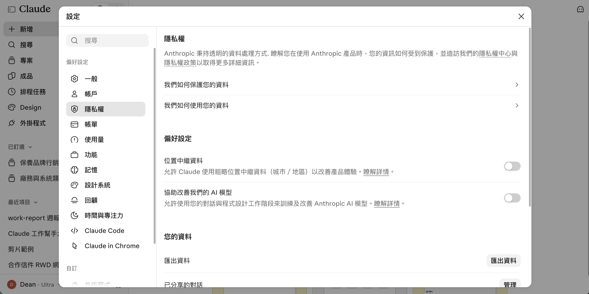

## 讓 Claude 更懂你、更能幹

### 🧑‍💻 讓 Claude 更了解你

**操作路徑**: 左下角頭像 → 設定 → 帳戶
- **哪一項最符合您的工作?**: 選擇最接近自己的工作
- **給 Claude 的指示**: 你希望如何與 AI 協作

```prompt [label="希望如何與 AI 協作的指令"]
- 優先拆解需求
- 避免冗長理論與空泛描述
- 語氣親切清楚，適合與家長、同事溝通
- 我提供的資訊不足時，適時提出 1 至 2 個反問，不要自行補上日期、費用或人名
```

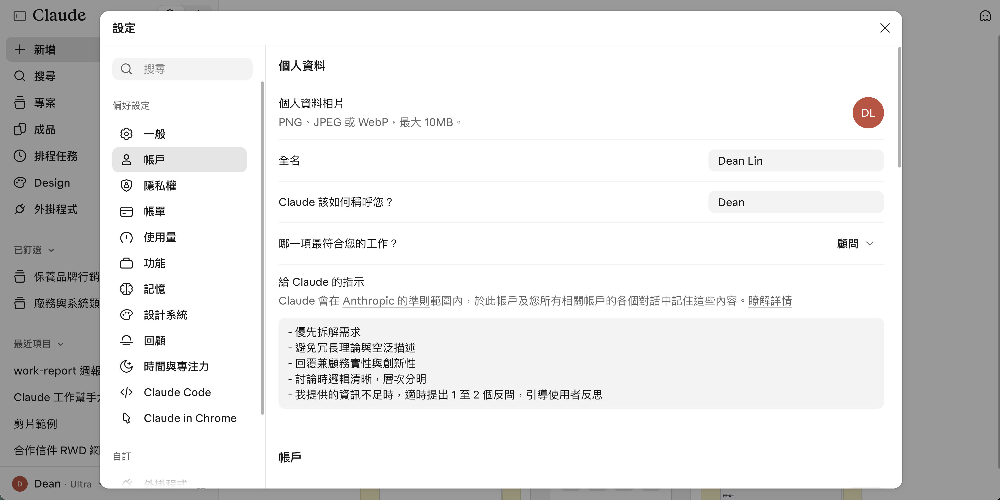

### 🧠 讓 AI 會越用越懂你

**操作路徑**: 左下角頭像 → 設定 → 記憶
- 現在 AI 回答問題時，會參考過去你跟它的`聊天紀錄`。

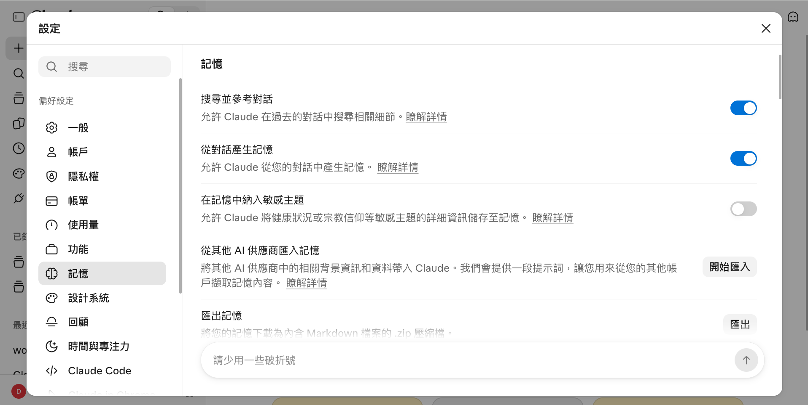

```prompt [label="讓 AI 總結它認識的你"]
根據我們過去所有的對話，請你深入挖掘、分析並總結我的性格、專長與獨特之處，並用具有說服力、吸引力且讓人眼睛一亮的方式來介紹我！
```

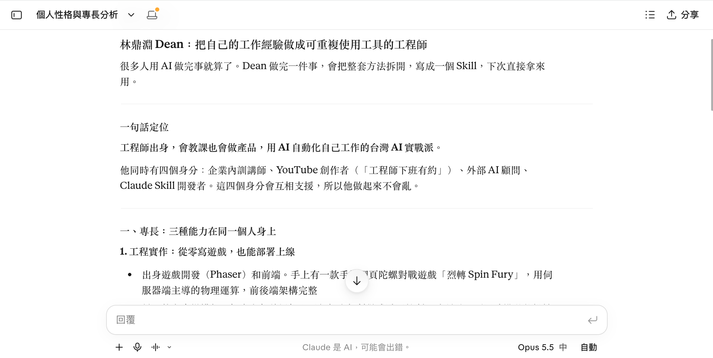

### 🦾 賦予 Claude 能力

**操作路徑**: 左下角頭像 → 設定 → 功能

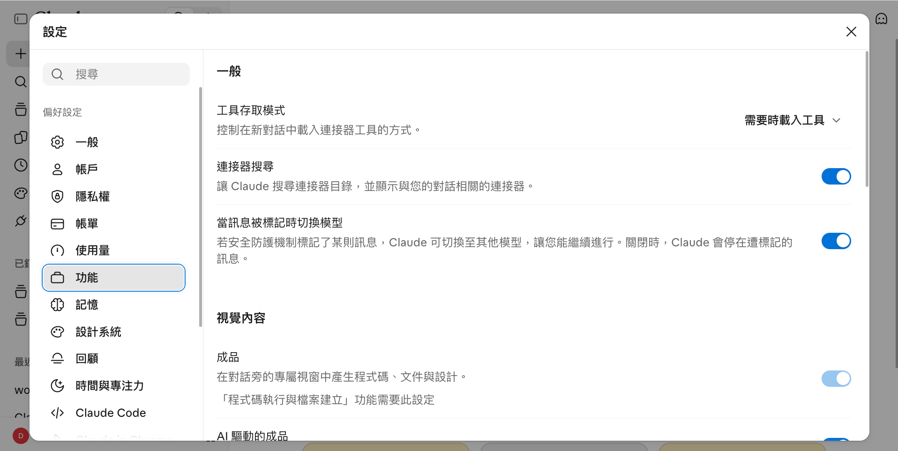

| 設定[width:200] | 可以做什麼 | 建議 |
| --- | --- | --- |
| **工具存取模式** | 決定新對話裡的連接器工具怎麼載入 | 維持預設 `需要時載入`；如果全部載入可能浪費 Token 額度 |
| **連接器搜尋** | 主動推薦跟對話相關的工具（ex: 討論排會議時，建議你連接行事曆） | 開啟 |
| **當訊息被標記時切換模型** | 訊息被安全機制標記時，自動換另一個模型繼續回答 | 開啟，避免工作到一半卡住 |
| **視覺內容** | 可以直接從對話預覽程式渲染成果 | 全部開啟 |
| **程式碼執行與檔案建立** | 執行程式、建立與編輯 Excel、Word、PowerPoint、PDF，並做資料分析 | 開啟 |

---

# 資料安全：上傳學生資料前，先做去識別化

> **關掉模型訓練，資料就安全了嗎？**
> 關閉只代表資料不會拿去訓練，檔案還是`上傳到外部服務`了。
> 名冊、輔導紀錄這類資料交給 AI 前，先把姓名、身分證字號、電話換成代號，這個動作就是`去識別化`。

## 認識去識別化

### 😓 想請 AI 幫忙，但資料裡都是個資

這些情境，你應該都遇過：

- **把資料交給 AI 之前**
  - **Word**：想請 AI 把一學期的輔導紀錄整理成摘要，但裡面有`學生姓名、家長電話、住址`
  - **Excel**：想請 AI 統整家長問卷的回覆，但每一列都有`家長姓名、電話、Email`
  - **PDF**：想請 AI 幫你抓出學生評估報告的重點，但裡面有`姓名、學號`
- **IEP（個別化教育計畫）的應用**
  - 個案研討會議要討論學生的 IEP，得先把`名字、學校、家人`代換掉
  - 同事想參考你寫的 IEP 當範本，不能把真實的學生資料直接給出去

### ⚠️ 我知道要去識別化，但工具呢？

沒有對應的工具，所以很多人是用土法煉鋼的方式`手動逐個處理`。

| 檔案 | 常見的手動做法 | 會踩到的坑 |
|---|---|---|
| Word | 用「取代」功能一個一個換 | 要取代的內容一多就`很容易漏`；沒有設計對照表，改完就`回不去了` |
| Excel | 處理完第一個工作表 | `後面幾個工作表`忘了處理 |
| PDF | 畫一個白框蓋上去 | 表面上遮掉了，但框選起來複製貼上，`資料還在` |

> **為什麼不要隨便用網路上搜到的「去識別化工具」？**
> 除非你了解服務背後使用的技術架構，否則你原本的目標是去識別化，結果卻`直接把機敏資料送給對方`。
>
> **檔案會不會離開你的電腦，是選工具的第一個重點。**

### 🛠️ 免費的資料去識別化工具

[資料去識別化工具](https://deanlin.net/data-deidentification)是我自己設計的免費工具。

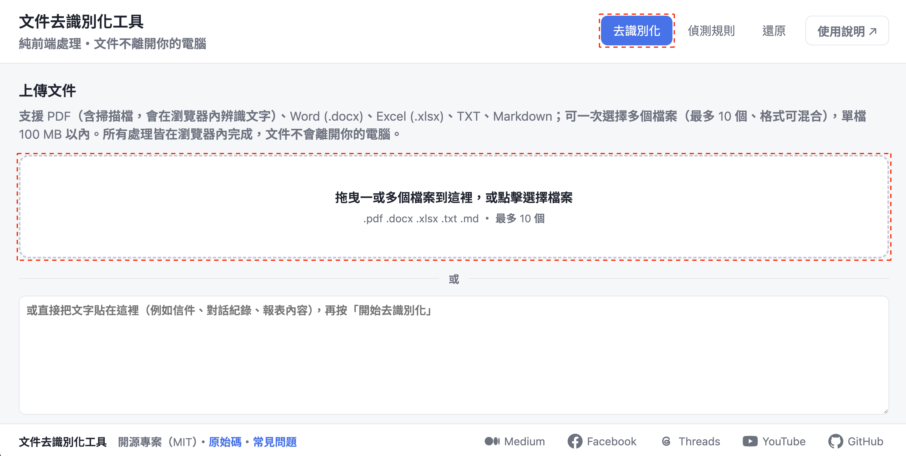

[flow]
- 檔案不會離開你的電腦 — 以純前端網頁設計，所有處理都在瀏覽器內完成
- 支援常見格式 — Word（.docx）、Excel（.xlsx）、PDF、TXT、Markdown，一次最多 10 個檔案；信件或對話紀錄也可以`直接貼上文字`
- 自動辨識常見隱私資訊 — 姓名、身分證字號、手機、市話、地址、Email、出生日期等；辨識錯誤或遺漏的地方，可以手動增加或取消
- 還能還原回來 — 下載時附一份 CSV 編碼表，AI 處理完後可以把代號換回原文
[/flow]

## 用學生名冊實作一次

### 📊 多工作表的學生名冊

[download file="assets/學生名冊-虛構.xlsx" label="下載「學生名冊」練習檔" desc="虛構的 12 位學生名冊 Excel，含基本資料、家長聯絡、說明三個工作表"]

#### STEP 1：上傳名冊，每個工作表都看一眼

- 打開[資料去識別化工具](https://deanlin.net/data-deidentification)，停在`去識別化`分頁
- 把 `學生名冊-虛構.xlsx` 拖進虛線區（或點擊選擇檔案），預覽上方會出現`基本資料`、`家長聯絡`、`說明`三個工作表頁籤

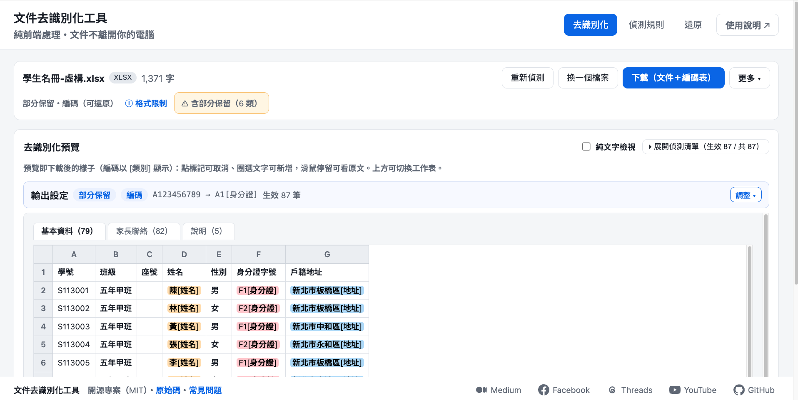

#### STEP 2：學號沒被隱藏，新增自訂規則

- 學號是每間學校自己訂的格式，`內建規則不認得`
- 兩個工作表加起來 24 格，`一格一格圈選`太慢，改用規則一次處理

[flow]
1. 開啟表單 — 到`偵測規則`分頁，按`＋ 新增自訂規則`
2. 複製提示詞 — 不會寫規則沒關係，按`複製 AI 提示詞`
3. 請 Claude 寫 — 貼給 Claude，把第一行改成學號的樣子
4. 貼回表單 — 把回覆的名稱、類別、規則、測試文字填進對應欄位
5. 新增規則 — 測試文字下方顯示命中的學號，按`新增規則`
[/flow]

```prompt [label="貼上提示詞後，只改第一行"]
請幫我寫一個 JavaScript 正規表達式，偵測文件中的：學號，大寫 S 開頭接 6 位數字（例如 S113001）

限制：以 new RegExp(規則, 'gu') 搜尋整份文件；不要加斜線、flags、^ 或 $；不可比對空字串；避免誤抓一般文字。

請只回覆以下四項：
1. 名稱
2. 類別（姓名／身分證／手機／市話／地址／電子郵件／公司／統編／識別碼／國際電話／信用卡／SSN／IBAN／IP／生日 擇一）
3. 規則
4. 測試文字：一段 2～3 句的文字，同時包含應命中與不應命中的例子
```

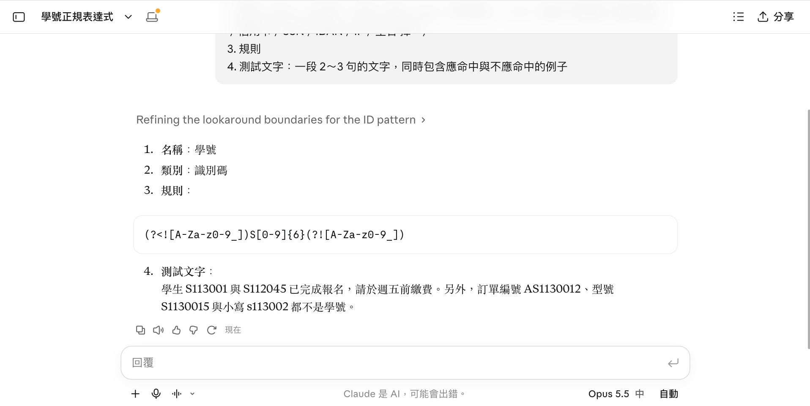

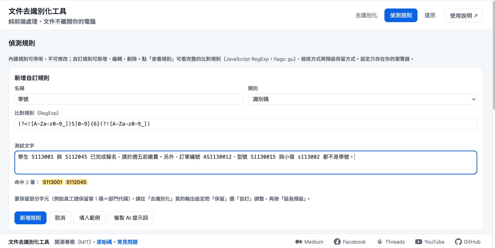

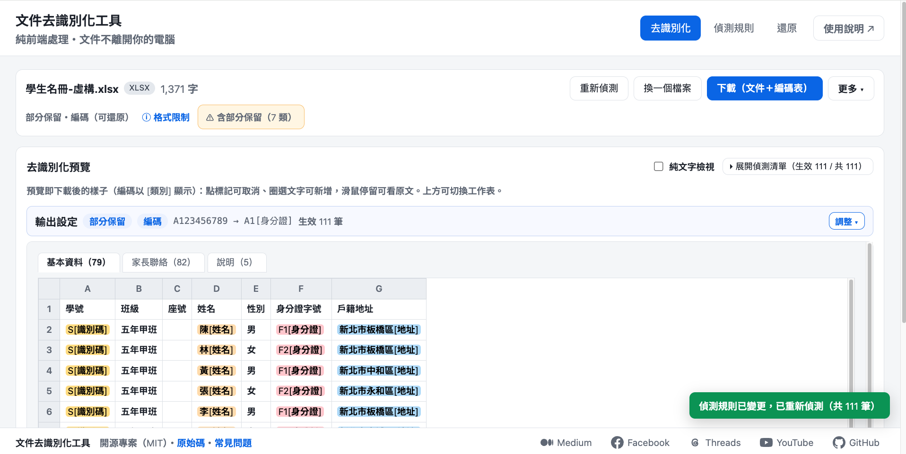

#### STEP 3：下載，只把去識別化的檔案交給 Claude

- 按`下載（文件＋編碼表）`會拿到兩個檔案：`學生名冊-虛構.deid.xlsx` 交給 Claude，`學生名冊-虛構.mapping.csv` 編碼表`留在自己的電腦`
- 不管是放進對話，還是之後放進 Project 的知識庫，用的都是 `.deid` 這一份

```prompt [label="請 Claude 統計行政區、找出聯絡資料缺漏"]
附件是已經去識別化的學生名冊，有「基本資料」「家長聯絡」兩個工作表。
方括號標記（例如 [姓名:66ddd7]）是被隱藏的資料，請連同前後的文字原樣保留，不要猜測或改寫。

請幫我做兩件事：
1. 依「戶籍地址」的行政區，統計各行政區的學生人數
2. 找出「家長聯絡」中手機或 Email 空白的列，列出學號、學生姓名與缺少的欄位

請把結果整理成一份 Excel 檔，兩件事各放一個工作表。
```

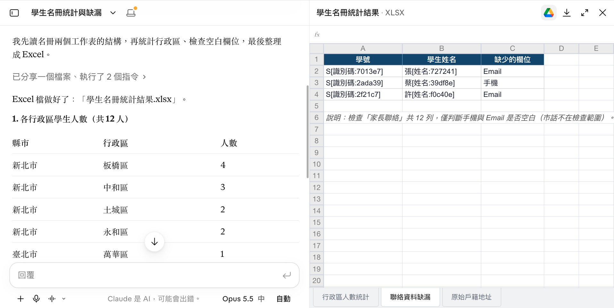

#### STEP 4：用編碼表還原

- 下載 Claude 產出的 Excel，回到工具的`還原`分頁
- 「1. 去識別化文件」放 Claude 給的檔案，「2. 編碼表 (CSV)」放剛剛的 `學生名冊-虛構.mapping.csv`
- 畫面可以看到缺漏名單變回實際名字

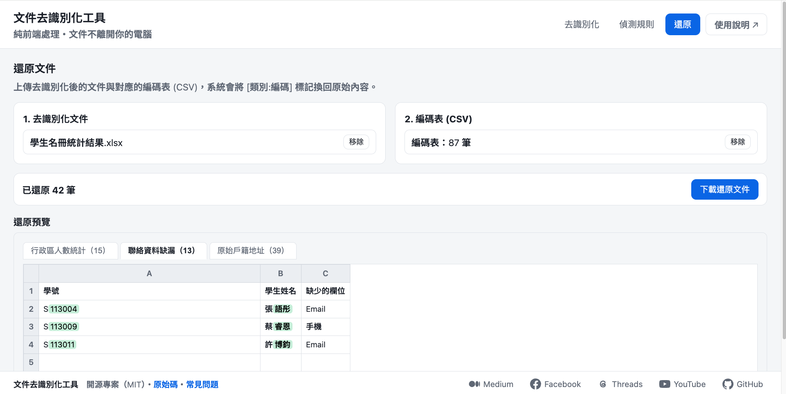

[warning title="去識別化不等於匿名"]
- 班級、座號、性別、特殊事件這些沒被隱藏的資訊組合起來，還是可能`認得出是誰`
- 能不能把真實學生資料交給 AI，仍然依學校規定
- 編碼表可以還原所有資料，不要一起上傳給 AI
- 自動偵測會有漏抓與誤判；Excel 裡以數值儲存的儲存格（ex: 純數字的學號）工具不會處理，下載前自己再檢查一遍
[/warning]

---

# 串接日常工具：透過連接器讓 AI 長出眼睛和手

> **將不同工具操作的任務集中到 Claude 處理**
> 以前寫信、建立行程、搜尋檔案都要去不同應用程式。
> 現在設定好連接器就能`在 Claude 集中管理`。

## 整理信件、建立標籤

> **信箱爆炸，重要的信被淹沒**
>
> - 研習通知、校內公告、副本信太多，真正`要回的信被埋在下面`
> - 信件沒有分類，要找之前的信只能`靠記憶搜尋`
> - 刪除信件太繁瑣，`容量快速耗盡`

### 📥 讓 AI 幫你分類郵件、建立標籤

#### 將 Gmail 加入連接器

**操作路徑**: 外掛程式 → 連接器 → 選擇 Gmail

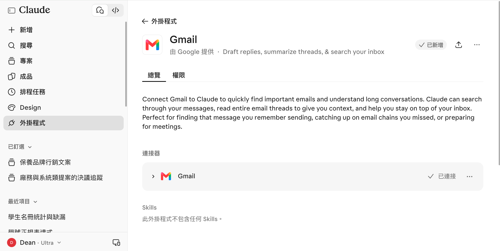

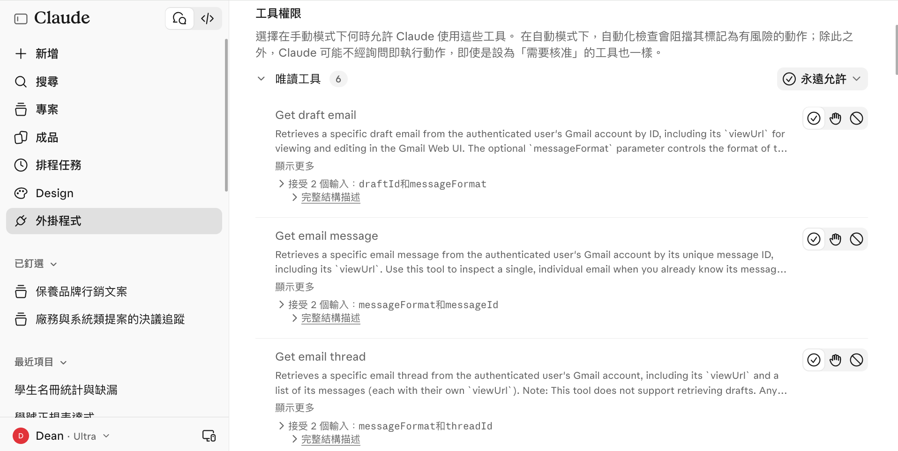

#### 分類郵件建立標籤

[flow]
- 🔴 重要 - 需要你回覆、處理或做決定的信（ex: 家長詢問、主任交辦、組長請你確認的事），每天`先看這一區`。
- 📁 封存 - 研習通知、校內公告、副本、已處理完的信，不用回但之後可能要查，可以直接封存。
- 🗑️ 刪除候選 - 過期的研習通知、活動通知、電子報，由你`確認後再決定`要不要刪除；刪除後 30 天會永久消失。
[/flow]

```prompt [label="我的示範：分類工作信件並建立標籤"]
幫我整理信箱最近 7 天內未標籤的信件（前 [50] 封），步驟如下：

## 第一步：分類
閱讀每封信的寄件人、主旨（不需閱讀內容），依下列規則分類：

- 🔴 重要：主管、同事、客戶或廠商直接寄給我，需要我回覆、處理或做決定
- 📁 封存：系統通知、公告、我只是副本（CC）、已處理完不需回覆
- 🗑️ 刪除候選：電子報、促銷、過期的通知或會議邀請

有疑慮時，優先歸入「封存」而非「刪除候選」。

## 第二步：建立標籤並說明
如果信箱還沒有這 3 個標籤就先建立，並用表格列出分類結果：
| 寄件者 | 主旨 | 標籤 | 判斷理由 |

## ⚠️ 執行前確認
先給我清單讓我確認，我明確說「確認執行」後，才套用標籤。
不要刪除或移動任何信件。
```

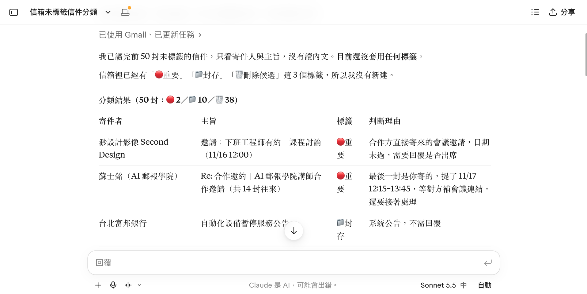

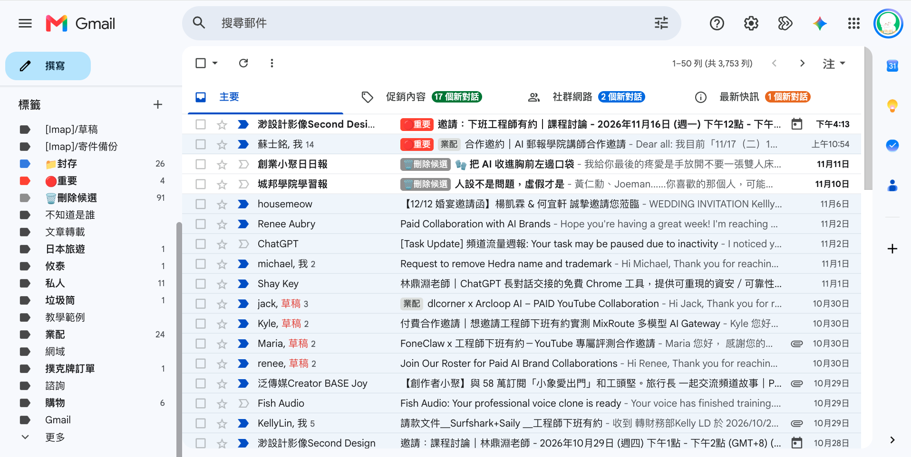

如果是老師，可以換成下面這個版本：

```prompt [label="老師版本：分類學校信件並建立標籤"]
幫我整理信箱最近 7 天內未標籤的信件（前 [50] 封），步驟如下：

## 第一步：分類
閱讀每封信的寄件人、主旨（不需閱讀內容），依下列規則分類：

- 🔴 重要：家長、主任、同事直接寄給我，需要我回覆、處理或做決定
- 📁 封存：研習通知、校內公告、我只是副本（CC）、已處理完不需回覆
- 🗑️ 刪除候選：電子報、廠商促銷、過期的通知或活動邀請

有疑慮時，優先歸入「封存」而非「刪除候選」。

## 第二步：建立標籤並說明
如果信箱還沒有這 3 個標籤就先建立，並用表格列出分類結果：
| 寄件者 | 主旨 | 標籤 | 判斷理由 |

## ⚠️ 執行前確認
先給我清單讓我確認，我明確說「確認執行」後，才套用標籤。
不要刪除或移動任何信件。
```

> **使用提醒**
> 建立與 Gmail 的連結後，Claude 可以`閱讀信件、建立草稿、建立標籤`
> 但`刪除信件`這類高風險操作，建議由人類在標籤建立後自己判斷；有些系統通知依舊重要。
> 建議`小範圍`測試（先 50 封），沒問題後再擴大測試範圍、調整判斷規則。

#### 舉一反三：將 Microsoft 365 加入連接器

> **學校信箱是 Outlook？改接 Microsoft 365**
> 一次打通 `Outlook、Teams、OneDrive、SharePoint`。

**操作路徑**: 外掛程式 → 連接器 → 選擇 Microsoft 365 → 用公司的 Microsoft 帳號登入

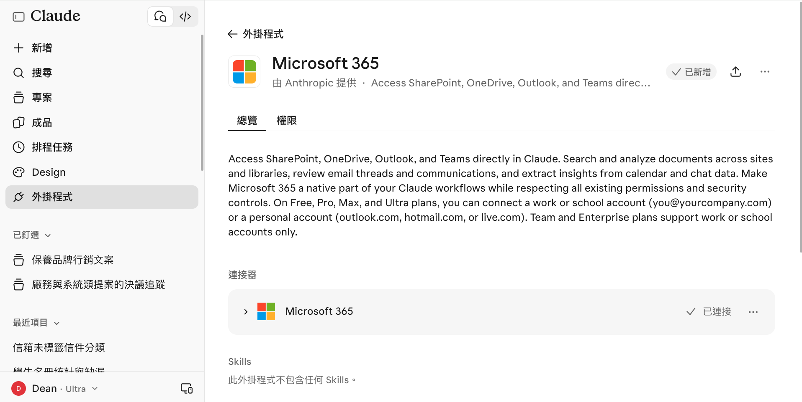

[warning title="Microsoft 365 連不上？請找 IT 開通"]
Microsoft 365 登入後如果出現`需要管理員授權`之類的訊息，代表權限還沒開通。
- **Microsoft**：Administrator 要先同意授權
- **Claude**：組織擁有者（Owner）要在後台加入 Microsoft 365
- 官方設定說明：[Set up the Microsoft 365 connector](https://support.claude.com/zh-TW/articles/12542951-%E8%A8%AD%E5%AE%9A-microsoft-365-%E9%80%A3%E6%8E%A5%E5%99%A8)
[/warning]

### 🔎 彙整特定主題信件脈絡

與同事、客戶的信件通常有`多段來回、細節持續調整`，而且每一段可能都有`重要資訊`。

甚至討論過程可能`不在同一封 Email 而是散落成多封`。

```prompt [label="我的示範：彙整信件脈絡"]
幫我整理信箱中 [Blackbao AI] 合作的過程
```

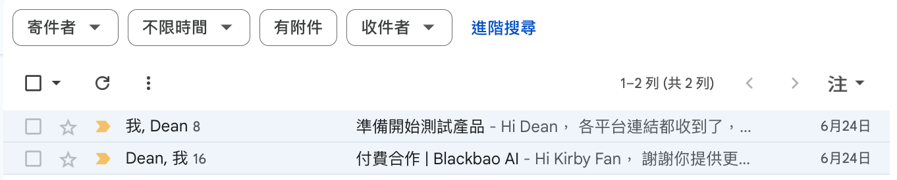

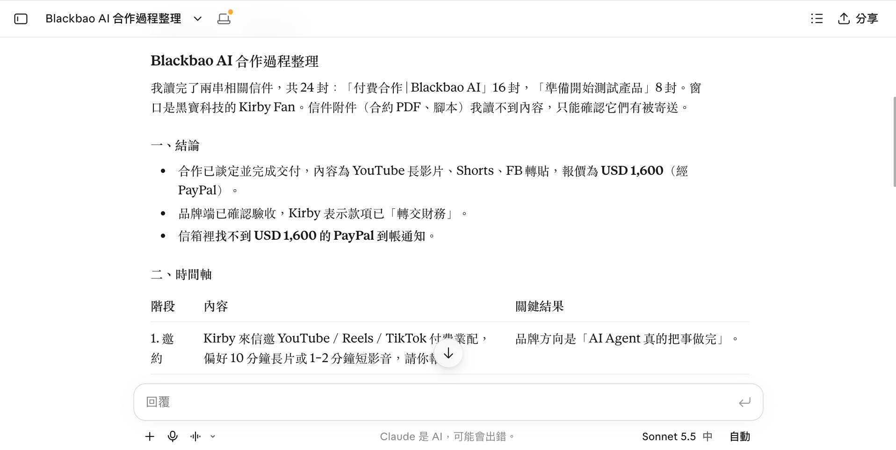

```prompt [label="撰寫回覆草稿"]
我目前還沒有收到款項，幫我擬一封信確認入帳時間
```

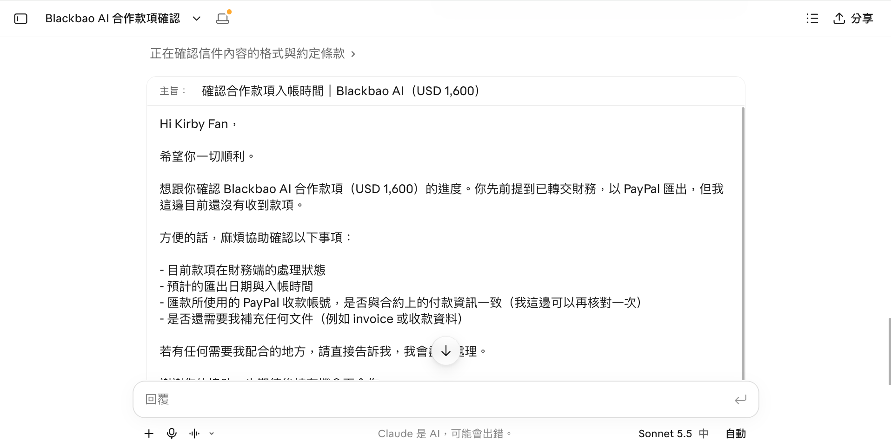

## 寫入日曆與參考資訊

> **資訊散落，行程要「貼來貼去」**
>
> - 會議`時間、地點、文件`可能散落在信箱討論串，建一個行程要反覆確認
> - 手動彙整資訊，容易`遺漏且每次格式不一`

### 📅 把零散資訊彙整為完整行程

#### 將 Google Calendar 加入連接器

**操作路徑**: 外掛程式 → 連接器 → 選擇 Google Calendar

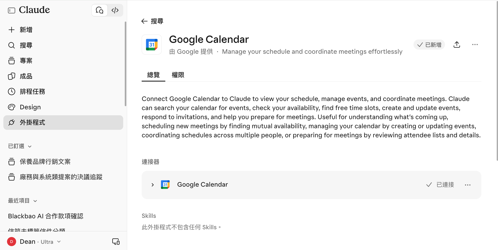

#### Gmail + Google Calendar 讓 AI 統整信件細節、加入行事曆

[flow]
1. 彙整資訊 — 讓 AI 讀取信件討論串
2. 帶入參考資訊 — 把會議連結、議程、注意事項一起寫進事件說明
3. 加入與會人員 - 取出信件討論人員，設定為 attendees
[/flow]

```prompt [label="我的示範：把 Mail 討論轉成行事曆事件"]
從信箱找出[雙 11 新品活動｜上線滿月成效初步整理]信件，並在日曆上建立事件：
- 抓出最後會議的日期、時間、地點
- 在事件說明裡附上議程重點
- 取出信件討論人員，設定為 attendees
- 如果時間和我現有行程衝突，先提醒我
建立事件前，請先提供草稿讓我過目
```

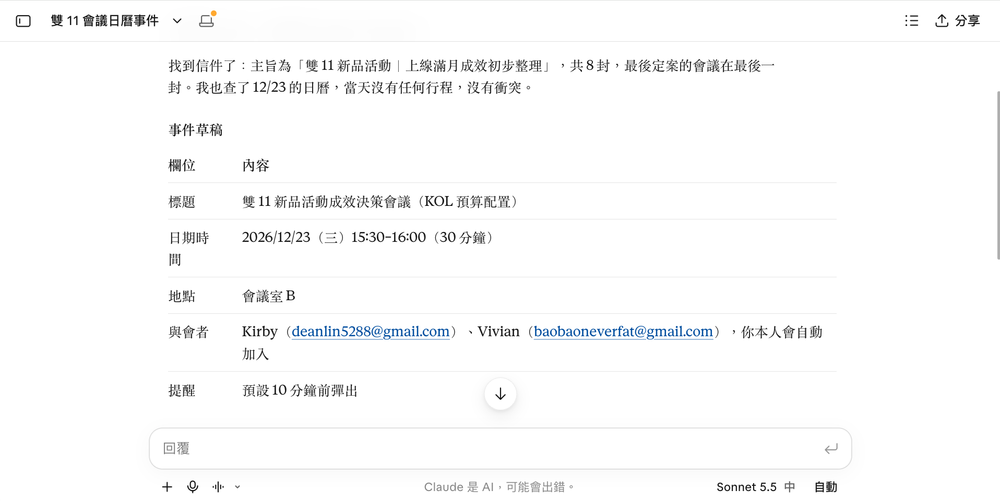

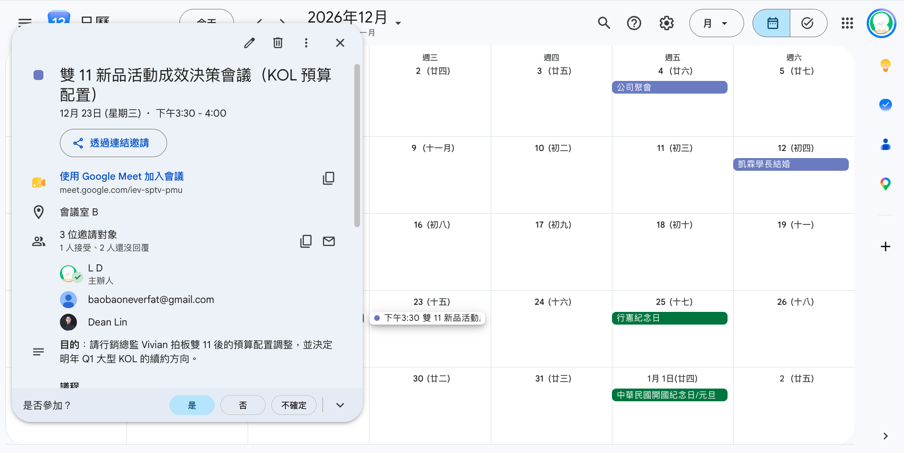

[warning title="使用提醒"]
Claude 是真的會`建立行程`，行程也會`出現在參與人日曆`，執行前請確認
[/warning]

### 🎬 延伸學習：Manus 也有連接器

[flow]
- Manus 示範影片 — 接上 Gmail、行事曆、Notion，讓 AI Agent 完成任務
- 學會一個就通用 — 連接器已經是主流 AI Agent 的標配，未來換到其他工具也都用得上
[/flow]

[youtube id="gNVkDO6-7Jo" title="【Manus 連接器教學】接上 Gmail、行事曆、Notion 讓 AI Agent 完成任務"]

---

# 建立專屬知識庫：建立 Project 不必每次重講背景

## 上一堂的專案，換到 Claude

> **AI 有記憶能力，但不是無限的**
> 儘管現在 AI 已經具備記憶能力，回答時會參考你過去與它的對話，但`非常隨機`。
> 而 Project 的設計，就是讓`隨機變成穩定`。

### 🧠 根據不同情境建立對應專案

[flow]
- **不同專案扮演的角色不同** - 導師、科任、學年召集人、行政組長、活動承辦
- **手上有多個任務在跑** - 班級經營、學年課務、行政文件、校慶等不同活動
[/flow]

> **專案（Project）就像第二大腦**
> 現在的工作通常都是`多工進行`，但人類切換到另一個專案時大腦會混亂。
> 既然如此，就讓 AI 幫你記住`專案的細節、自己扮演的角色`

## 把過去的通知放進同一個專案

> **「上次那份通知放在哪裡？」**
>
> - **通知、公告每年都要發**，檔案卻散在電腦、雲端與群組，不確定哪一份是`最後發出去的版本`
> - **新接手的導師或組長**不知道以前怎麼寫，`找不到範例`
> - **拿舊檔來改**，舊的日期與地點容易`留在新通知裡`忘記改

### 🧠 建立第一個專案

**操作路徑**: 專案 → 新增專案

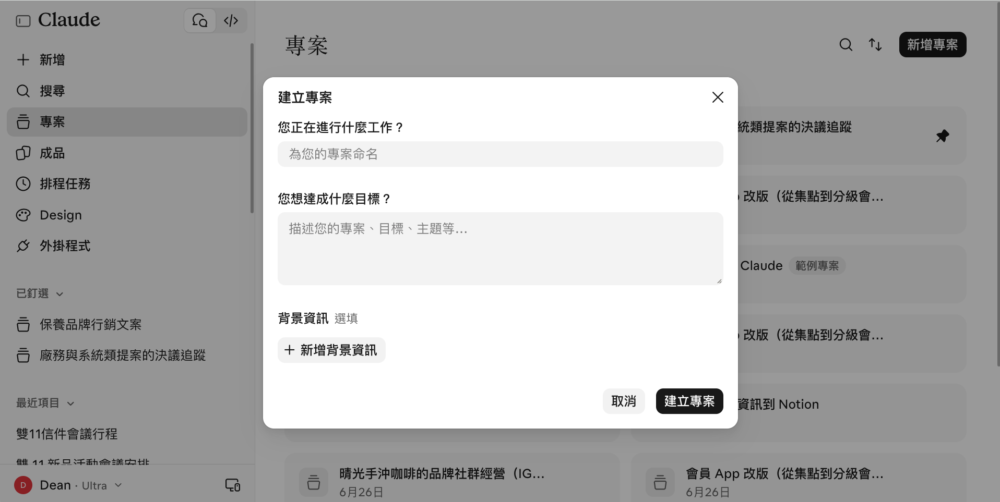

- **您正在進行什麼工作？**: `行政文件案例庫`
- **您想達成什麼目標？**: `把過去發過的通知與這學期的活動安排集中在一個地方；查得到以前怎麼寫；文件沒寫的就老實說沒有`

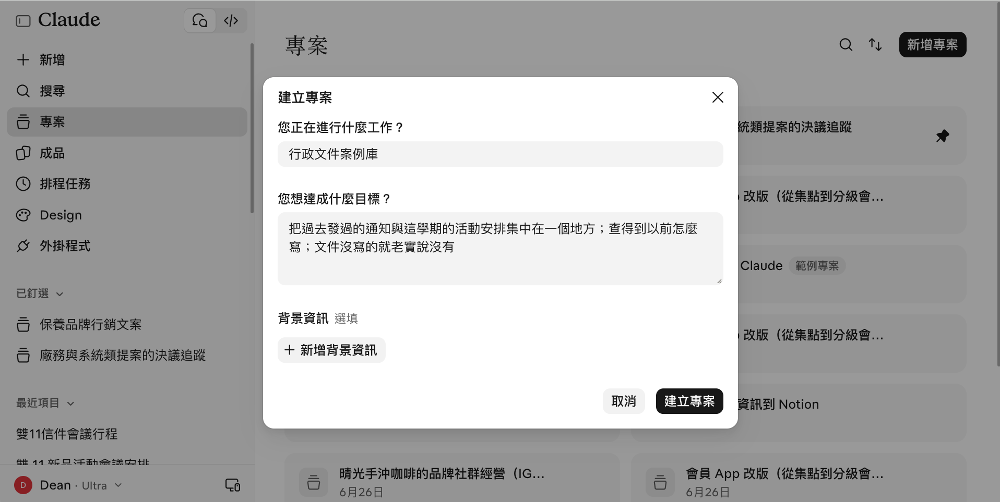

- **指示** — 設定成「行政文件助理」：回答以文件為準、要附出處、找不到就說沒有、過去的資訊不當成這學期的安排
- **背景資訊** — 分兩步放：`定版的文件直接上傳`（過去發過的 9 份通知與公告），`會變動的表格放 Google Drive 用連結參考`（本學期活動一覽）

#### 設計專案指示

> **要告訴 AI「什麼問題去哪份文件找」**
> 明確告訴他：`案例記過去怎麼寫、活動一覽是記這學期的安排`，這樣就不會拿過去的日期來回答這學期的事。
> 把`檔名規則`寫進去，AI 就分得出每份案例是哪一類、哪一年的版本。

```prompt [label="instructions：行政文件助理"]
## 角色設定

你是我的行政文件助理，你的任務是幫我「查找過去的案例、核對這學期的安排」，而不是自己發明內容。

## 知識庫怎麼查

- 案例的檔名規則是「類型-主題-學年度」，例如「活動通知-校外教學-114」是 114 學年度的校外教學通知
- 過去怎麼寫、發出後家長問了什麼 → 找同類型、同主題的案例
- 同一個主題有多個學年度時，以最新的版本為準；舊版本只用來對照改了什麼
- 這學期的活動日期、時間、地點、確認狀態 → 本學期活動一覽

## 回答原則

1. 回答一律以知識庫內的文件為準，並標明出處（檔名）。
2. 知識庫裡找不到答案時，明說「目前文件沒有記錄」，不要臆測或補完。
3. 案例裡的日期、時間、地點、費用是過去的資訊，不能當成這學期的安排。
4. 活動一覽標「待確認」的項目，不能寫成已經確定。

## 輸出格式
- 查找類問題：先給「一句話結論」，再附「出處」與「原文摘錄」。
- 整理類問題：用條列或表格。
```

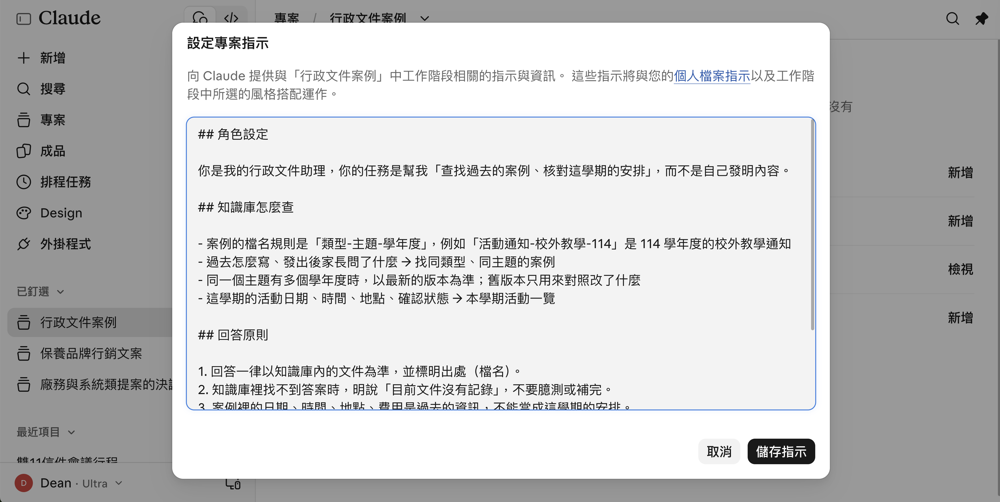

### 📄 第一步：上傳定版的文件

**哪些文件算「定版」？**
- 已經公告的`通知`、簽核完的`決議`，發出去就不會再改，要改也是另出新版本。

[download dir="admin-cases" label="下載「行政文件案例庫」練習素材" desc="9 份 Word 檔的通知與公告"]

> **檔案命名要有邏輯**
> 範例的檔名照「類型-主題-學年度」命名，這樣一看就知道是`哪一類、哪個主題、哪一年`，你找得到，AI 也找得準。
> 如果原始檔案的命名雜亂，下一堂課會帶大家`讓 AI 直接動手整理`。

#### 加入專案知識庫（Context）

把素材包裡的 9 份 Word 檔拖進專案

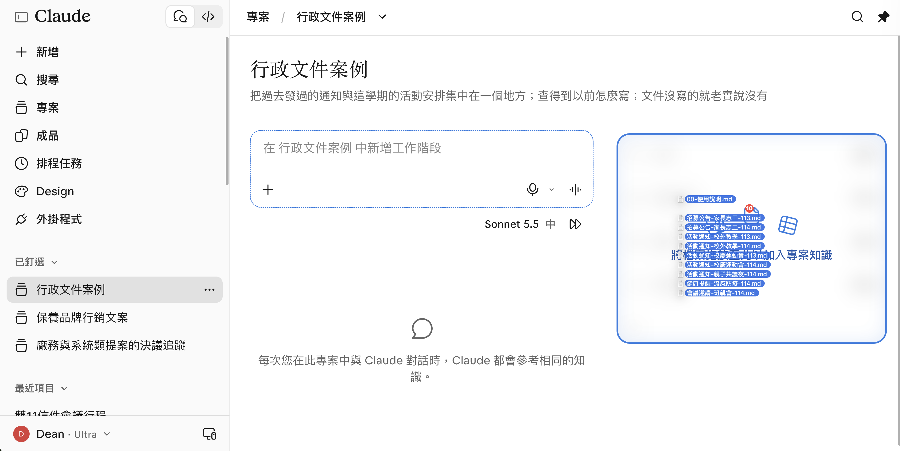

#### 分門別類，看出哪一版最新

```prompt [label="驗證分得出類型與版本"]
案例庫裡有哪些類型的通知？用表格整理；同一個主題有好幾個學年度的，說明新版本改了什麼
```

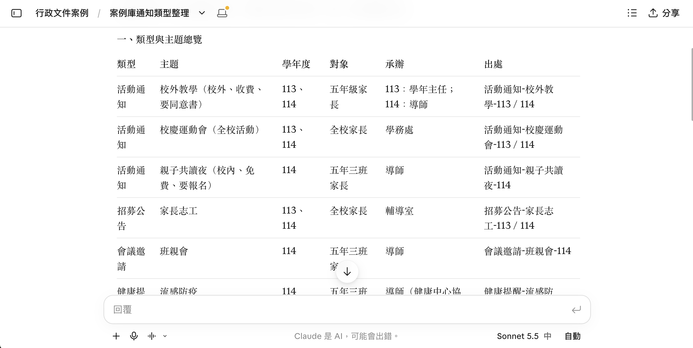

> **案例庫會越存越好用**
> 每一年的`紀錄`，就是未來可以`使用或優化`的地方。

#### 出處可追溯

```prompt [label="驗證可找出處"]
上次校外教學的通知發出後，家長問最多的是什麼？下次要改哪裡？
```

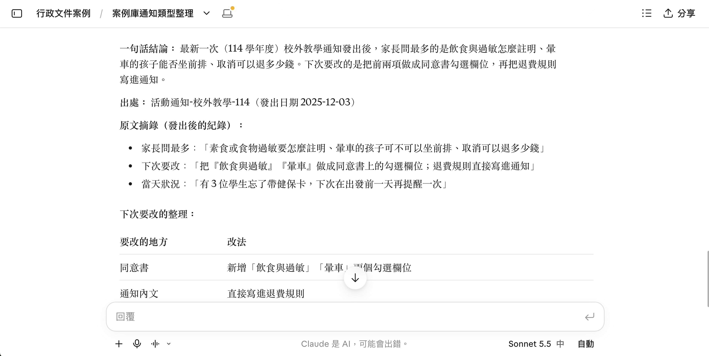

> **不要再依靠大腦記憶了**
> 過去要回想「上次家長問了什麼」，得自己翻聯絡簿與群組訊息。
> 建好 Project 後，問一句連出處（哪一份文件）都一起附上。

#### 不知道的問題會誠實回覆

```prompt [label="故意問不存在的資訊"]
以前有發過畢業典禮的通知嗎？當時的費用是多少？
```

案例庫裡沒有畢業典禮的通知，AI 應該回覆「目前文件沒有記錄」，而不是拿別的活動拼出一份。

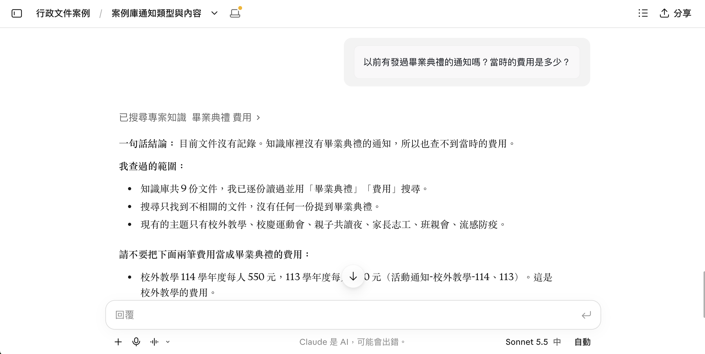

> **AI 時代很少有人看過全文，所以要盡可能減少幻覺**
> 在專案的`指示`要求他誠實說「目前文件沒有記錄」，可以**大幅減少幻覺**。

## 會變動的資料放雲端，改完 AI 就讀到新的

### ☁️ 第二步：會變動的文件放雲端，用連結參考

> **為什麼要上傳到雲端？**
> `本學期活動一覽`隨著籌備進度可能會持續更新。
> 上傳固定檔案，無法取得最新資訊。
> 放 Google Drive 用連結參考，雲端改完，AI 下次回答就是新的。**團隊共用同一份來源，不會各拿各的舊檔**

#### 將 Google Drive 加入連接器

**操作路徑**: 外掛程式 → 連接器 → 選擇 Google Drive

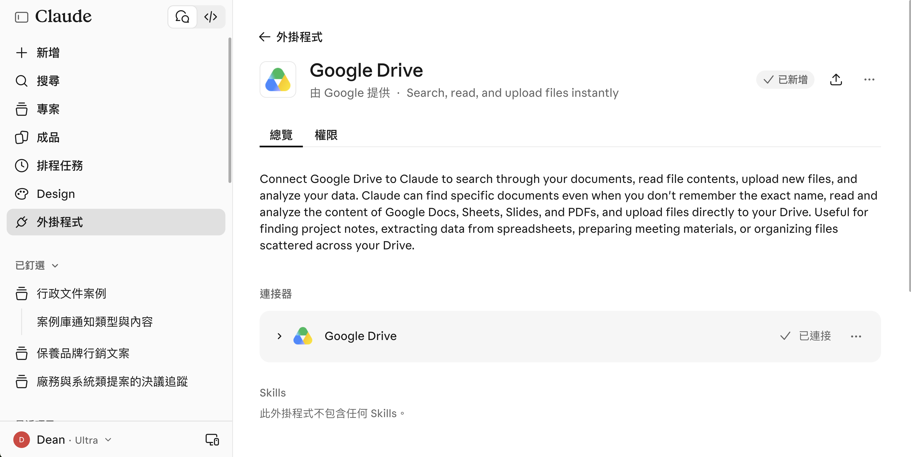

#### 把表格放到雲端硬碟

[download file="assets/本學期活動一覽.csv" label="下載「本學期活動一覽」練習檔" desc="4 項活動的日期、時間、地點與確認狀態，部分項目還在待確認"]

- 把 `本學期活動一覽.csv` 上傳到 Google Drive
- 選擇`使用「Google 試算表」開啟`，這才能讀取
- 上傳後可以複製連結，這樣比較精準

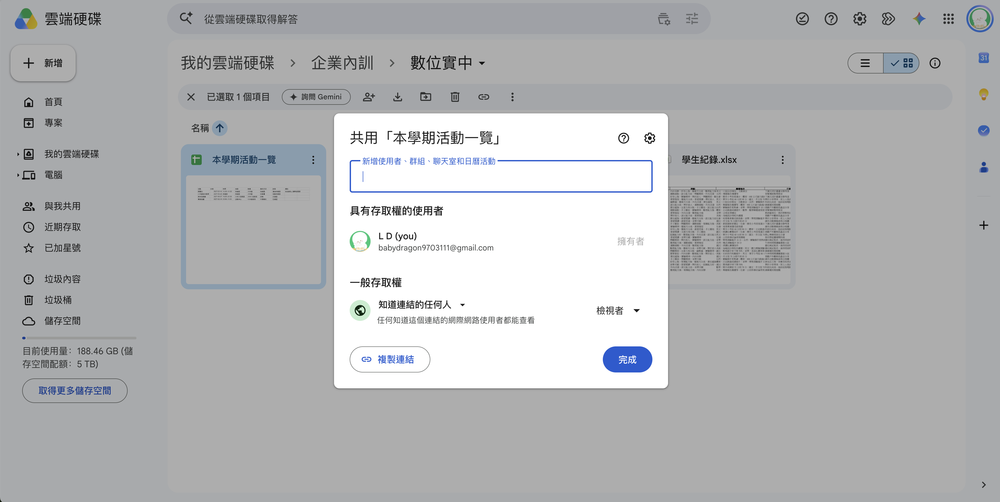

#### 用連結加入知識庫

- 在背景資訊點擊「新增」→ Drive → 貼上這份試算表的連結

```prompt
https://docs.google.com/spreadsheets/d/1FW-aAPrJFghQQWCKRvXtofIWk1vy5MKHNwhZu3IGGK4/edit?usp=sharing
```
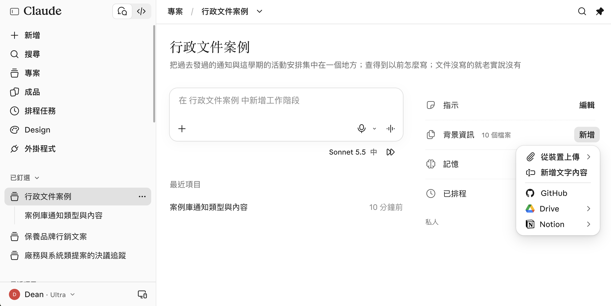

#### 過去的資訊，不會被當成這學期的安排

```prompt [label="驗證分得清過去與現在"]
這學期的班親會是哪一天？可以直接沿用上次通知的時間嗎？
```

AI 從`活動一覽`回答 `6/7 19:00–20:30`，並提醒案例裡的 `9 月 19 日`是過去的資訊，不能沿用。

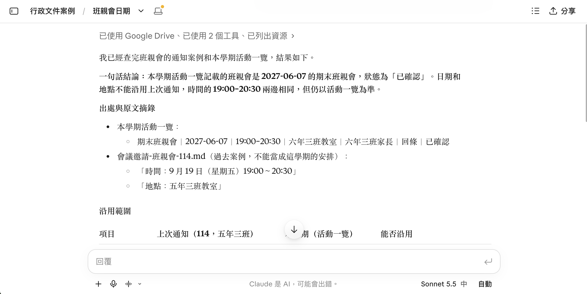

#### 雲端改完，AI 馬上讀到新的

到 Google 試算表，把「閱讀日」的地點改成 `多功能教室`、狀態改成「已確認」，然後問同一個問題：

```prompt [label="驗證雲端即時更新"]
閱讀日的場地確認了嗎？還有哪些項目待確認？
```

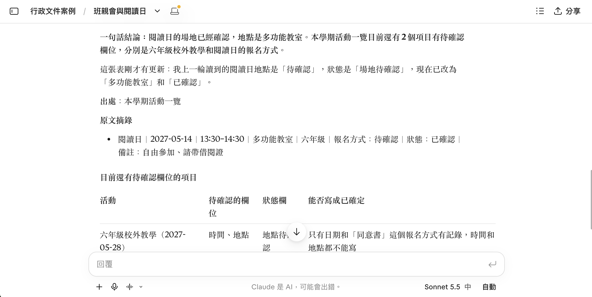

> **這就是兩種放法的差別**
> 第一步上傳的文件，改了要`回來重傳`；第二步連結的雲端文件，`改完就生效`。
> 資料分類：`定版的用上傳、會改的放雲端`。

[warning title="Claude 個人版無法分享專案"]
- Pro、Max 等`個人方案`建立的專案只有自己看得到，`無法分享`給同事
- 想讓整個學年或處室共用同一個專案，需要 `Team 或 Enterprise` 方案
- 個人版也能共用資料：各自建立專案，`連結同一份 Google Drive 文件`
[/warning]

### 🎬 延伸學習：Manus 也有專案

[flow]
- Manus 示範影片 — 我錄了一支影片完整示範 Manus 的專案：背景交代一次，讓 AI 變成你的第二大腦
- 名稱不同、觀念相同 — `指令＋知識庫`，換個工具一樣適用
[/flow]

[youtube id="oiPBpgZxqcY" title="【Manus 專案教學】別再重新交代背景！建立專案讓 AI 變成你的第二大腦"]

---

# 把好方法變成 SOP：設計 Skill 站在更高的起點

> **用 Skill 把最好的一次，變成未來的每一次**
> 使用方式跟 ChatGPT / Codex 大同小異，概念都是通用的。

## 用白話生成「找範本來改」的 Skill

> **Project 放案例，Skill 負責找範本與改寫**
> **Project 讓 AI「知道事實」** — 過去發過的通知、家長問過什麼、這學期的安排
> **Skill 讓 AI「知道步驟」** — 找最接近的案例、照它改寫、過去的資訊不沿用、缺的標「待確認」

### 😓 拿舊通知來改，每次都是同一套步驟

[flow]
1. 找檔案 — 翻出上次發的那一份
2. 換資訊 — 把日期、時間、地點、費用改成這一次的
3. 檢查有沒有漏 — 日期改了、星期沒改；費用改了、繳費期限還是舊的
4. 回想上次的狀況 — 家長問過什麼，這次要不要先寫進去
[/flow]

> **步驟每次都一樣，就值得存成 Skill**
> 案例已經在剛剛的`行政文件案例庫`專案裡；現在把這四個步驟交給 Skill。

### 📝 用白話文建立行政範本 Skill

Skill 可以先用`一段白話`描述需求，讓 Claude 內建的 `skill-creator` 幫你生成雛形，這次我們直接在專案裡面新增 Skill。

```prompt [label="把找範本、改寫、檢查的步驟講清楚"]
/skill-creator
名稱[admin-template]
我要寫家長通知、活動公告這類行政文件時，先從專案背景知識找出最接近的過去案例，再照它改寫成這一次的版本
步驟：
1. 先告訴我選了哪一份案例、為什麼選它；沒有相近的案例就直接說，不要硬套
2. 沿用案例的段落順序與語氣，內容換成我這次提供的資訊，或專案裡這學期的安排
3. 案例裡的日期、時間、地點、費用、聯絡方式一律不沿用；查不到的項目標「待確認」
4. 案例有「發出後的紀錄」時，把上次家長問最多的問題先寫進這次的通知；資訊不夠就提醒我補上
5. 最後列出三件事：[沿用了什麼、改了什麼、哪些待確認]
6. 給我最後版本（與參考版本相同的檔案格式）
```

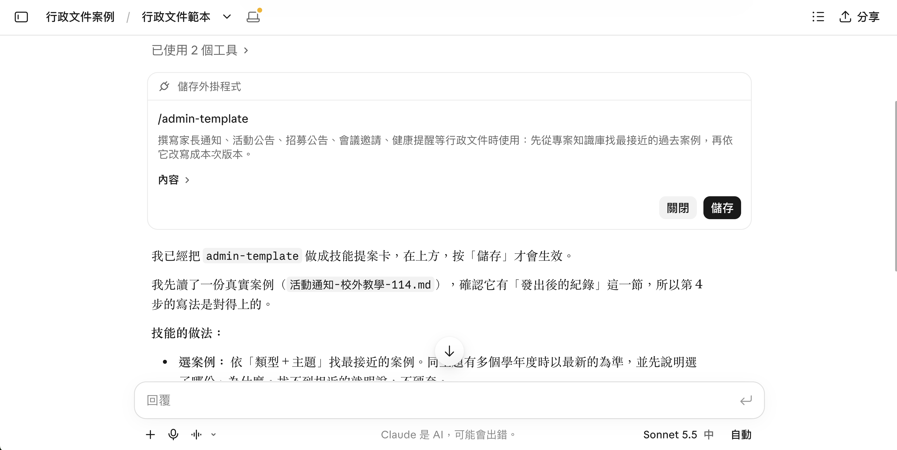

### ▶️ 進到專案再呼叫：寫這學期的閱讀日通知

Skill 建立完成後，有 2 種方式觸發：

[flow]
- 用「意圖、關鍵字」觸發 — 盡可能設計成`被動觸發`，因為 Skill 會越來越多，要記住每個名稱並不現實。
- 輸入「/skill-name」指定觸發 — 也可以`主動觸發`，當一段對話中想綜合多個 Skills 功能時，這個方案較為穩定。
[/flow]

> **為什麼要進到專案裡再觸發？**
> 專案上傳的檔案與指令`只在那個專案裡`看得到；在一般對話呼叫 Skill，它`找不到`你的案例。
> 想用案例庫寫通知，就要`進到那個專案`再觸發。

```prompt [label="在「行政文件案例庫」專案開新對話"]
/admin-template
幫我寫這學期閱讀日的家長通知
```

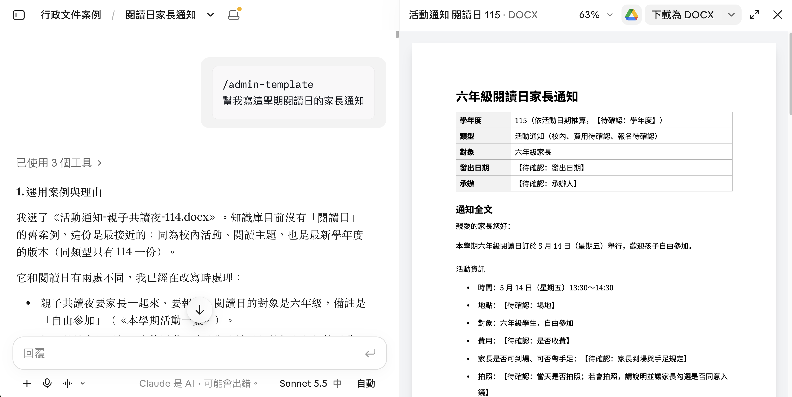

[warning title="照範本改寫的通知，發出前先核對"]
- 舊案例的日期、星期、地點、費用最容易`混進新通知`，發出前逐一對照這次的正式決議
- AI 可能把「看起來合理」的資訊補成`事實`；標「待確認」的地方要補齊才能發
- 尚未核定的預算與費用，`不要寫進通知`
- 學生姓名、座號、輔導紀錄這類個資，`不要貼給 AI`，也不要放進案例庫
[/warning]

> **連接器、專案、Skill 一起用，才是完整的助理**
> 連接器與專案補齊`資料來源與過去的案例`，Skill 固定`步驟、格式與檢查項目`。
> 這樣 AI 才不會寫錯、亂補，也`不用再大改`。

## 換成你：哪個流程值得存成 Skill

### 🎬 我的剪片 Skill，是一支支影片優化出來的

[flow]
- 過去 — 一支 10 分鐘的影片大概要剪 `1 天`：移除 NG、上字幕、加資訊卡、設計情境動畫、配音效，繁瑣又重複
- 現在 — 照自己的習慣建立 AI 剪片工作流，`用白話文就能剪片`，我只負責最後的品質把關
- 每一支都在優化 — 發現哪個細節能做得更好，就把經驗寫回 Skill，讓`下一支影片站在更高的起點`
[/flow]

> **不要一開始就想設計完美的 Skill**
> 先在 AI 的輔助下做出`雛形`，再從一次次的實踐中`優化細節`；這份線上講義也是靠 Skill 輔助生成，版本`迭代超過 100 次`。
> AI 設計的 Skill 也常`過度設計、資訊冗贅`，用實戰結果來修剪就好。

---

# 分享與深入：把 Skill 傳出去，也看懂它怎麼運作

> **做好的 Skill 不只自己用**
> 先學會`分享與匯入`，再看懂它`裡面長什麼樣`，最後知道`哪些 Skill 值得裝`。

## 分享 & 匯入 Skill

### 💾 將 Skill 下載為壓縮檔

**操作路徑**: 外掛程式 → Skills → 選擇要分享的 Skill（ex: `admin-template`）→ 右上角「⋮」→ Download

<!-- 待補圖片：claude-skill-download-school.png｜外掛程式 → Skills → admin-template 右上角「⋮」→ Download（虛線紅框；側欄不要出現真實專案名稱） -->
<!--  -->

- 下載的壓縮檔可以傳給同事，也可以匯入其他支援 Skill 的 AI 工具

### 🤝 匯入上一堂的資訊卡 Skill

- 上一堂在 ChatGPT 與 Codex 用過 `info-card-generator`；同一個壓縮檔，今天匯入 Claude
- 上一堂下載過就不用再下載；沒有的話從這裡拿：[下載「資訊卡」技能包](../codex/assets/info-card-generator.zip)

**操作路徑**: 外掛程式 → Skills → Add → Upload a skill
- 可接受 Markdown 格式、`.zip` 壓縮檔、`.skill` 匯出檔

<!-- 待補圖片：claude-skill-upload2-school.png｜Upload skill 視窗，提示可接受 Markdown、.zip、.skill 檔（虛線紅框標出拖放區） -->
<!--  -->

```prompt [label="用匯入的 Skill，把今天的重點做成複習圖卡"]
/info-card-generator
主題：「換一家 AI 做同樣的事：Claude 這堂課的 5 個重點」

1. 開工設定。左下角頭像 → Settings：Privacy 關閉「Help improve our AI models」；Account 填工作類型與協作指令；Capabilities 原則上全開。
2. 去識別化。學生名冊交給 AI 之前，先把姓名、身分證字號、電話換成代號；學號用自訂規則一次處理；編碼表留在自己的電腦。
3. 連接器讓 AI 長出眼睛和手。信件分成重要、封存、刪除候選三類；先給清單、確認後才套用標籤；建立行程前先看草稿、檢查衝突。
4. Project 不用每次重講背景。指令告訴 AI 什麼問題去哪份文件找；定版的文件上傳、會變動的放雲端；文件沒寫的要誠實說沒有。
5. Skill 把好方法變成 SOP。用白話就能建立；把過去的通知放進 Project，讓 Skill 找最接近的案例來改寫，舊資訊不沿用、缺的標「待確認」。

結尾卡放一句話：名字不同、邏輯相同，熟悉一個最重要。
```

<!-- 待補圖片：claude-card-generator-school.png｜Claude 用匯入的 info-card-generator 產出今天重點的複習圖卡 -->
<!--  -->

<!-- 講師備註：達和內訓版的 info-card-generator 在 Claude 跑過；第 2 堂的教師版壓縮檔還沒在 Claude 實測，授課前跑一次。產圖用到程式，Settings → Capabilities 的「Code execution and file creation」要開啟。 -->

> **同一個技能包，三個地方都能用**
> 上一堂在 ChatGPT、Codex，今天在 Claude；匯入前先看一眼內容，`不明來源的 Skill 不要匯入`。

## 深入認識 Skill

### 🎒 Skill 的結構

把技能包的壓縮檔解開，會看到一份 `SKILL.md`（純文字的說明檔）；像資訊卡這種複雜一點的 Skill，還會多出 `scripts/`、`reference/` 資料夾，`admin-template` 這種簡單的 Skill 不一定有。

[html src="./html/skill-anatomy.html"]

### 🔍 Skill 的三個執行階段

[flow]
1. Discovery（發現） - AI 讀取技能名稱與描述，判斷是否與任務相關
2. Activation（啟動） - 匹配成功後，才完整讀取整份 Skill 文件
3. Execution（執行） - 根據文件描述逐步執行任務
[/flow]

> **Skill 為什麼能節省 Token？**
> Project 的指令每次對話都會整份讀進去；Skill 在匹配需求前`只讀標題與描述（Metadata）`。
> 就像 Google 搜尋時先看標題摘要，確認相關再點進去。

## Skill 使用經驗

### 🧩 上一堂的提醒，換到 Claude 一樣適用

[flow]
- **同類型的 Skill，擇優安裝一個** - 裝了兩個以上，需求命中時常常一起觸發，增加 Token 消耗，也容易讓 AI 卡住或走偏
- **看起來有用，不等於真的有用** - 有些 Skill 描述很厲害，實際使用時`效果卻不穩定`；裝太多沒用到的，AI 的行為會更難預測
- **來路不明的不要裝** - `SKILL.md` 與程式腳本都可能被動手腳，匯入前先看內容、看發佈者是否可信
- **不同 AI Agent 都有 Skill** - 學會一次，換工具也用得上；延伸學習：[Manus Skill 技能教學](https://youtu.be/lKiwb381mfU)、[Antigravity Agent Skills 教學](https://youtu.be/xe00zJEtuMo)
[/flow]

> **別人的 SOP 是參考，自己的工作流才是答案**
> 有持續在用的 Skill，一定會持續優化；放著不改的，通常也是沒在用的。

---

# 📌 課程總結：讓 AI 長出眼睛、記得背景、照 SOP 做事

[summary]
- 🗺️ **換一家做同樣的事** | 外掛程式＝連接器、專案＝Project、技能＝Skill；名字不同、邏輯相同
- 🛡️ **設定與資料安全** | 關閉模型改善、設好個人偏好與能力開關；名冊先去識別化，學號用自訂規則一次處理
- 🔌 **連接器** | 分類信件貼標籤、彙整脈絡、寫回覆草稿；小範圍測試、先看草稿再執行，刪除與建立行程由人把關
- 🗂️ **Project** | 指令告訴 AI 什麼問題去哪份文件找；定版的上傳、會改的放雲端，沒寫的要讓它誠實說沒有
- 📋 **Skill** | 用白話生成行政範本 Skill；進到 Project 再呼叫，找最接近的案例改寫，過去的資訊不沿用、缺的標「待確認」
- 🎒 **分享與結構** | 下載壓縮檔分享、匯入前先看內容；Skill 先讀名稱與描述，符合才載入全文
[/summary]

> **下一堂：讓 Claude 動手交付成品**
> 今天的連接器、Project、Skill 都在對話裡完成；第 4 堂換成 `Cowork`，指定電腦資料夾讓它整理檔案、設定排程，再用 Vibe Coding 做出班級抽籤分組工具。

[qa-session title="Q&A 時間"]
[/qa-session]
