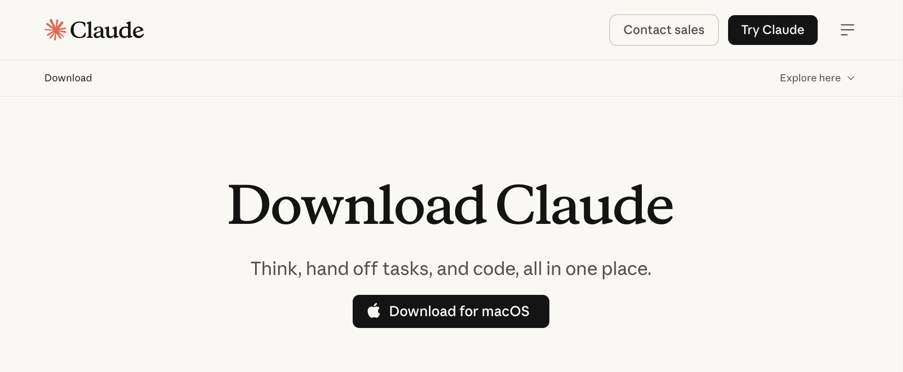
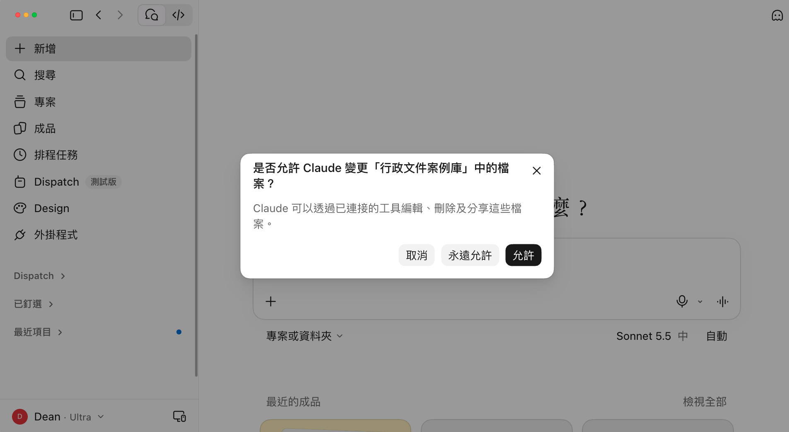
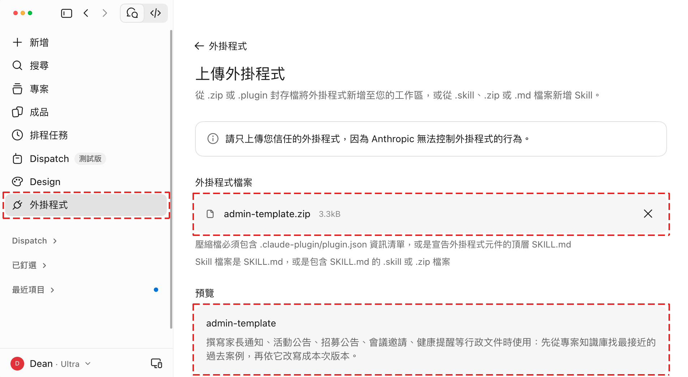
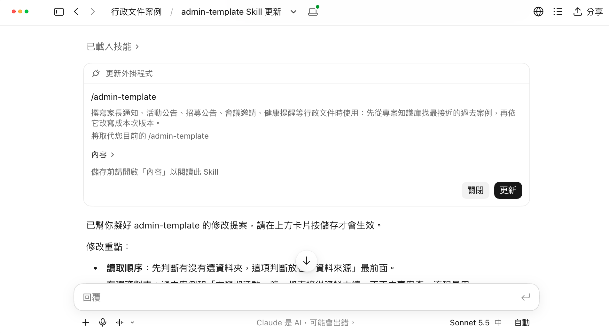
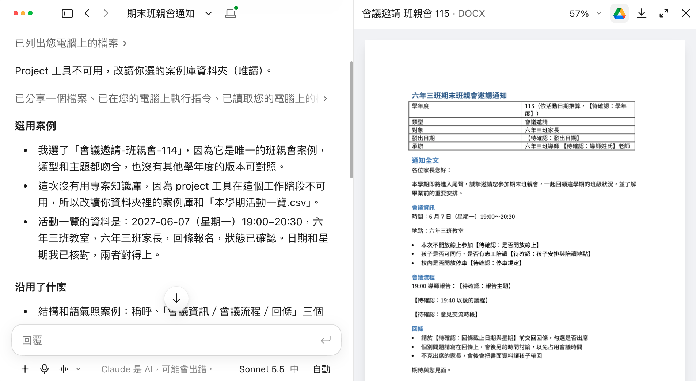
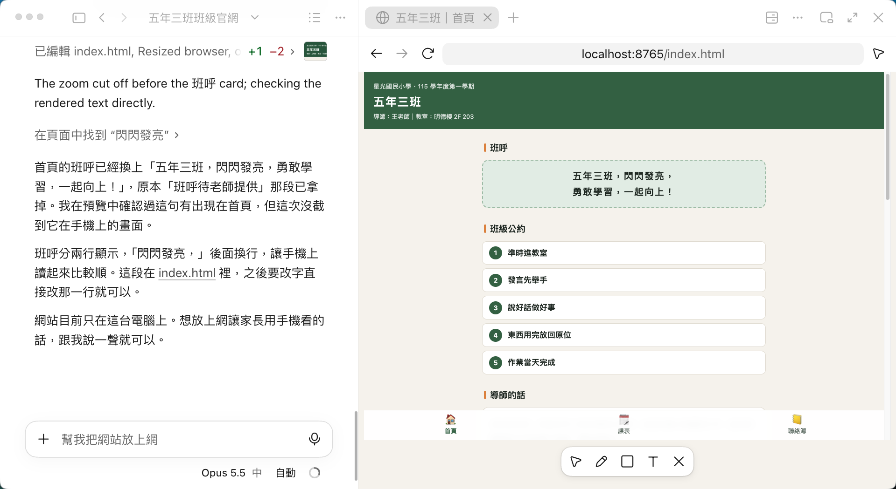
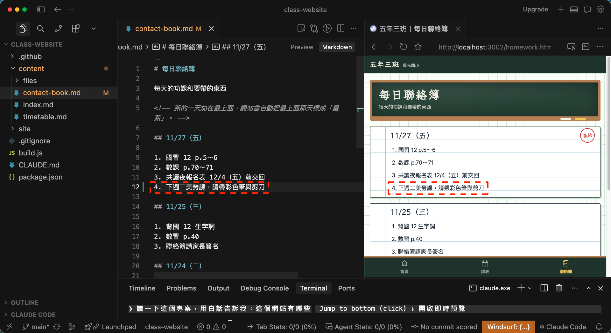
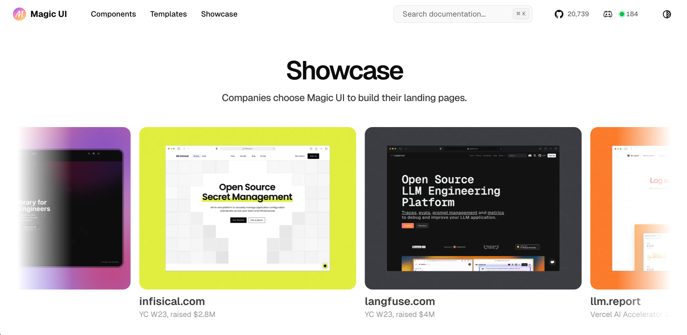
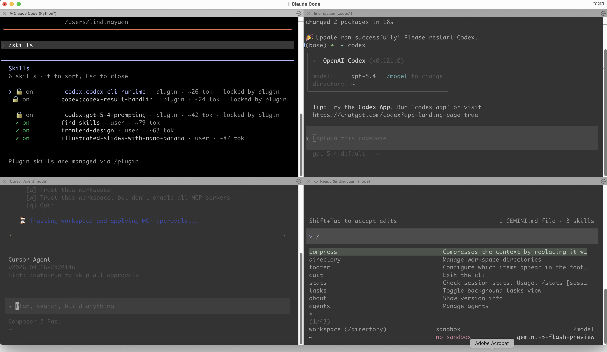

[time]
- label: 第 1 堂｜ChatGPT
  date: 11/23
  time: 19:00~21:00
  des: **釐清需求，建立專屬的教學助理**：認識網頁版與桌面版、三家 AI 功能對標，學會去識別化與 Prompt，生成教材圖片，再用記憶、外掛程式與專案打造教學助理。
  link: [查看講義](../chatgpt/index.html)
- label: 第 2 堂｜Codex
  date: 11/24
  time: 19:00~21:00
  des: **讓 AI 動手處理檔案，用 Skill 交付教材**：安裝 ChatGPT 桌面版，讓 AI 直接讀資料夾、把手寫報名表照片轉成 Excel；再用白話生成報名表登記、每週回顧與寫信風格的 Skill，最後切到 Codex，用資訊卡、線上講義、校園簡報 Skill 交出成品。
  link: [查看講義](../codex/index.html)
- label: 第 3 堂｜Claude
  date: 11/26
  time: 19:00~21:00
  des: **串接工具、建立知識庫，把好方法變 SOP**：先把學生名冊去識別化，再用 Connector 整理信件與行事曆、用 Project 建立活動知識庫、把家長通知流程存成 Skill。
  link: [查看講義](../claude/index.html)
- label: 第 4 堂｜Claude Code
  date: 11/27
  time: 19:00~21:00
  des: **讓 AI 動手整理檔案，做出班級官網**：用 Claude 桌面版直接讀取電腦裡的資料夾，沿用上一堂的 Skill 把活動通知存成 Word 檔；再切到 Code 分頁，請 AI 檢查並安裝環境，做出用 Markdown 編輯的班級官網，加上 Git 存檔點並發布到 GitHub Pages。
  link: [查看講義](../claudecode/index.html)
  active: true
[/time]

# 🙋 課前回顧：5 分鐘掌握上一堂的重點

## 串接工具、建立知識庫、設計 SOP

### 🧠 讓 AI 長出眼睛、記得背景、照 SOP 做事

[flow]
- **工具設定與去識別化** - 關閉模型訓練；學生名冊交給 AI 之前，先把姓名、學號`換成代號`
- **連接器（Connector）** - 連上 Gmail 與行事曆，做信件分類、建立行程；`執行前請確認`
- **專案（Project）** - 把文件放進背景資訊；定版的上傳、會變動的放雲端，`回答附出處`
- **Skill** - 用白話建立 `admin-template`，找專案最接近的案例，改寫成這一次的通知
[/flow]

> **專案放案例，Skill 放步驟**
> 上一堂的案例庫與 Skill，今天都會`接著用`。

## 用什麼工具、帶走什麼成果

### 🆚 AI 工具互相對標

| 要做的事[width:240] | 第 2 堂（ChatGPT） | 今天（Claude） |
| --- | --- | --- |
| 直接讀寫電腦裡的資料夾 | ChatGPT 桌面版 | Claude 桌面版 |
| 寫程式、執行程式 | Codex | Claude Code |

> **工具不同，方法相同**
> 第 2 堂先用桌面版讀資料夾，再切到 Codex；今天`操作類似`，只是換成 Claude。

### 🧳 這堂課會帶走的 4 個成果

[flow]
1. 資料夾取代上傳 — 上一堂放進專案的案例庫，今天選好資料夾就能直接問
2. 直接交出 Word 通知 — 上一堂的 Skill 可以直接使用，寫好的通知直接存進資料夾
3. 班級官網 — 不用寫程式，做出首頁、課表、每日聯絡簿三個分頁，內容用 Markdown 就能改
4. 網址與更新流程 — 用 Git 留存檔點、發布到 GitHub Pages，之後改完內容，線上就會更新
[/flow]

---

# 讓 AI 直接動手：不用上傳，AI 直接讀你的資料夾

> **網頁版 🆚 桌面版**
> **網頁版**只能處理`你上傳的檔案`；**桌面版**能在`你選定的電腦資料夾`裡讀檔、改檔，把成品直接存進去。

## 安裝 Claude 桌面版

### 💻 到官網下載 App

- 到 [Claude 官網](https://claude.com/download) 下載桌面版 App（macOS、Windows 都有），安裝後打開
- 上一堂已經安裝過的話，直接打開就好



## 上一堂的專案，改成直接讀資料夾

### 📥 同一批文件，這次不用上傳

[download dir="行政文件案例庫" label="下載「行政文件案例庫」練習素材" desc="上一堂放進專案的 9 份 Word 通知，加上「本學期活動一覽」"]

- 解壓後會得到 `行政文件案例庫` 資料夾
- 9 份範例通知 Word + 本學期活動一覽 CSV

### 📁 只選這一個資料夾，設定好 AI 的工作範圍

[flow]
1. 開新對話 — 在 Claude 桌面版開一個`新對話`，點擊`新增資料夾`選 `行政文件案例庫`
2. 只選這一個 — 不選整個桌面或下載資料夾
3. 確認選好 — 輸入框附近`看得到資料夾名稱`，才算選好
[/flow]



[warning title="使用提醒"]
桌面版是有能力`新增、修改、刪除`電腦檔案的。

能力越大風險越大，你可以想想`如果事情做到一半，但額度沒了會發生什麼事`。

所以原始資料要另留副本，練習資料夾只放自己確認過的虛構資料。
[/warning]

### 🆚 網頁版 VS 桌面版

| | 🌐 上一堂：網頁版專案 | 💻 今天：桌面版資料夾 |
| --- | --- | --- |
| 怎麼給資料 | 建立專案 → 9 份 Word `拖進去`，活動一覽放雲端再貼連結 | 選一次資料夾，裡面的檔案`都讀得到` |
| 文件更新了 | 上傳的文件要重新上傳 | 改完存檔，AI 下次讀到的就是新版 |
| AI 的成品 | 在對話裡，要自己下載、再放回資料夾 | 直接存成檔案，`出現在資料夾裡` |
| 適合 | 用手機查、跨裝置使用 | 檔案多、常更新、要交出檔案 |

> **網頁版專案沒有被取代**
> 人在外面想用手機查，還是網頁版專案方便；在電腦上處理一整包檔案、要交出 Word，直接讀資料夾最順。

### ▶️ 用上一堂的問題驗證一次

```prompt [label="驗證出處、過去與現在、誠實度"]
回答下面三個問題，每一題都附上出處的檔名；文件沒寫的就說「目前文件沒有記錄」，不要推測。
1. 上次校外教學的通知發出後，家長問最多的是什麼？下次要改哪裡？
2. 這學期的班親會是哪一天？可以直接沿用上次通知的時間嗎？
3. 以前有發過畢業典禮的通知嗎？當時的費用是多少？
```


## Skill 直接使用：在桌面版直接交出通知

> **上一堂在網頁版做的 Skill，今天不用重做**
> Skill 存在你的`帳號`裡：網頁版建立的，打開桌面版一樣找得到。
> 差別在於成品：上一堂的通知要從對話下載，今天`直接存進資料夾`。

### 🔁 確認 Skill 已經在桌面版

- 在輸入框打 `/admin-template`，看得到就代表它跟著過來了


#### Skill 不存在就下載匯入就好

[download file="assets/admin-template.zip" label="下載「admin-template」Skill" desc="上一堂建立的行政範本 Skill：找最接近的過去案例，照它改寫成這一次的通知"]

**操作路徑**: 外掛程式 → Skills → 新增 → 上傳外掛程式 → 選擇剛剛下載的 `admin-template.zip`



### 🛠️ 更新 Skill：資料夾裡的案例也能用

> **為什麼 Skill 要先改？**
> 上一堂的 Skill 寫的是「去`專案`找案例，不要去電腦裡找」，成品也是讓你從對話下載。
> 照原本的寫法，它會跑去雲端專案找，`看不到資料夾裡的檔案`。

```prompt [label="更新 Skill：雲端專案與資料夾都能用"]
幫我更新 admin-template 這個 Skill：
有選資料夾時，資料直接從資料夾讀取；沒有選資料夾時，才去專案找
```



> **Skill 記的是做事的步驟，工作環境換了，步驟就要跟著更新**
> 改一次就好；之後不管在雲端專案還是資料夾，同一個 Skill 都能用，`不用每次重新交代`。

### 📝 用 Skill 撰寫期末班親會的通知

```prompt [label="呼叫更新後的 Skill，成品直接存進資料夾"]
/admin-template
幫我寫這學期期末班親會的通知。
```



### 🏷️ 檔名雜亂的資料夾，也可以請它整理

- 上一堂說過`檔案命名要有邏輯`；今天的案例庫已經照「類型-主題-學年度」整理好，新通知也自動照這個規則命名
- 自己電腦裡那些 `新增文件 (3).docx`、`通知_final_改2.docx`，回去可以用下面的方式整理；先`複製一份資料夾`再練習

```prompt [label="先列對照表，確認後才改名"]
這個資料夾的檔名很亂。請讀過每份檔案的內容，照「類型-主題-學年度」的規則提出新檔名。
先列出「原檔名 → 新檔名」的對照表給我確認，我說可以再改名。
只改檔名，不要刪除或搬移任何檔案。
```

> **為什麼要先看對照表，不直接讓它改？**
> 改名、搬移、刪除，都是`做了就不容易復原`的動作。
> 先看計畫再放行，花不到一分鐘；`按下同意，責任就是你的`。

---

# 班級官網：每天都要發的訊息，給它一個固定的家

<!-- 講師備註：本章約 12 分鐘：Vibe Coding 概念與風險 3、排班故事與為什麼選官網 4、Markdown 與六個步驟 5。時間不夠時先縮短概念與風險，保留「內容與版面分開」的比喻與六個步驟總覽。 -->

> **學 Vibe Coding 不是為了成為工程師**
> 是為了解決`你目前遇到的痛點`，這個痛點可能存在於`班級、處室、學年團隊、個人`，但一直沒有解決。
> 而這個單元，就是讓大家了解，在 AI 時代`我們能靠自己`踏出第一步。

## Vibe Coding 是什麼？

> **透過白話文跟 AI 對話，逐步完善成品的流程**
> - **優點**：可以快速完成初版
> - **缺點**：結果較不可控、未來較難維護
> 若沒有程式背景，`把想做的事、期待的結果講清楚`是最重要的事

### 🧪 是「玩具」還是能用的「工具」？

[flow]
- 一句話就能生成「看起來可以用」的網站 — 這樣的東西，你真的敢`直接把網址傳給家長`嗎？
- 改壞不是最可怕的 — 最可怕的是`你不知道它被改壞了`；過去人寫程式也會有一樣的問題，只是 AI `速度太快`，把問題加倍放大
- 等一下做的`班級官網` — 重點並不是做出來好開心，而是`審視 AI 犯了哪些錯誤`（ex: 公告日期抄錯、課表填錯一格，家長會照著錯的資訊準備）
[/flow]

> **看起來能用的東西，才是最危險的**
> `AI 的快，不是你的快；但 AI 的錯，會全部算在你頭上`。所以關鍵內容，還是需要人來把關。

## 從自己的需求出發

### 🏥 我做的排班工具，護理長一試就找出問題

[flow]
1. 第一版很快 — 幫醫院的 Vibe Coding 課準備教材時，我用 Claude Code 很快就做出「排班工具」第一版
2. 試用才浮現 — 哪些班別不能接在一起、包班人員怎麼安排、跨月的夜班接白班怎麼檢查，這些細節我`完全沒想到`
3. 現場最懂規則 — 護理長卻能明確說出`調整方向與背後的規則`
[/flow]

> **為什麼班級的東西，由老師自己做最合適？**
> 過去要會寫程式才能做工具，`做工具的人往往不是真正的使用者`；就像一位主管在課前訪談跟我說的：「**開發的人不用系統，用系統的人不會開發。**」
> 現在懂現場的人，也能用 Vibe Coding 做出幫助自己的成品，並`根據使用細節持續優化`。
> 家長最常問什麼、哪些資訊不能公開、聯絡簿要怎麼寫孩子才看得懂，最清楚的就是老師。

## 為什麼第一個作品選班級官網

### 😓 班級的訊息，散落在各個地方

- 聯絡簿抄在黑板，孩子漏抄一項，家長晚上就來訊息問
- 公告發在群組，`兩天後就被洗到找不到`
- 課表是開學時傳的一張照片，要用的時候得往上滑很久
- 報名表弄丟了，只能再跟老師要一張

> **同樣的問題，為什麼每個月都要回答一次？**
> 「明天要帶什麼？」「報名表哪裡下載？」這些問題的答案其實都有，只是`沒有一個固定找得到的地方`。
> 班級官網就是這個地方：`一個網址`，家長隨時查得到最新的版本。

### 🧰 班級裡還有這些，都可以自己做

| 成品[width:130] | 用在哪裡 | 只有你知道的隱性規則（ex） |
| --- | --- | --- |
| 🌐 班級官網 | 公告、課表、聯絡簿的固定入口 | 哪些資訊不能公開、聯絡簿怎麼寫孩子才看得懂 |
| 🎲 抽籤與分組 | 點人回答、小組討論 | 剛被抽過的先跳過、哪些學生不適合同組 |
| 🙋 課堂搶答 | 單元複習、親子活動 | 錯最多的題目放後面、只公布小組分數 |
| 🪑 座位表 | 排座位、換座位 | 視力、身高、需要坐在老師附近的學生 |
| 🧹 輪值表 | 值日生、打掃區域 | 每個人輪到的次數要平均 |
| 🏆 班級集點 | 小組加分、全班目標 | 加減分要留紀錄，避免爭議 |

- 別再拿「記帳軟體、番茄鐘」當練習題，`缺少挫折的練習幫助有限`；從班上真的用得到的開始，你才`分辨得出對錯`，遇到錯誤也`有動力解決`
- 今天做`班級官網`，因為它每天都會用到，而且做完就有一個網址可以帶回去
- 官網做起來之後，上面這些小工具都可以`一個一個加進去`

[interactive title="是什麼驅動你嘗試"]
**Vibe Coding 最需要什麼？**
`A` 有程式基礎 `B` 熟悉多種 AI 工具
`C` 擅長與人溝通 `D` 眼前有困擾許久的問題
[/interactive]

## 先認識幾個名詞：你寫原稿，其他交給工具

### 📰 把班級官網想成一份班刊

| 名詞[width:150] | 比喻 | 它負責什麼 |
| --- | --- | --- |
| Markdown | 原稿 | 用純文字加幾個符號寫內容，`像打字一樣`，不用管版面 |
| 轉換程式 | 印刷廠 | 把原稿套上版面，變成網頁；這支程式由 AI 來寫 |
| Git | 存檔點 | 記下每一版，改壞了可以回到上一版 |
| GitHub | 雲端的檔案櫃 | 把你電腦裡的每一版，放一份到網路上 |
| GitHub Pages | 公布欄 | 把網頁公開成一個網址，家長用手機就能看 |
| GitHub Actions | 自動送印的小幫手 | 你一交出新的原稿，它就`自動送印、貼上公布欄` |

> **為什麼內容要用 Markdown 寫，不直接請 AI 改網頁？**
> 網頁檔裡內容和版面混在一起，改一個字都可能弄壞版面。
> 把內容抽成 Markdown，`你只管寫字，版面交給程式`；每個分頁一份檔案，想改哪一頁就開哪一份。

### 🗺️ 今天要蓋的網站：三個分頁，三份原稿

| 分頁 | 對應的 Markdown | 放什麼內容 |
| --- | --- | --- |
| 首頁 | `index.md` | 班呼、導師的話、最新公告 |
| 課表 | `timetable.md` | 一週課表；先寫「即將公布」，最後一步再補上 |
| 每日聯絡簿 | `contact-book.md` | 每天的作業與提醒，最新的一天在最上面 |

### 🪜 六個步驟，每一步只做一件事

[flow]
1. 第 0 步：規劃與環境 — 把目標講完整，請 AI 說明要安裝、註冊什麼，並檢查你的電腦
2. 第 1 步：生成網站 — 先在自己的電腦看到三個分頁
3. 第 2 步：用 Markdown 編輯 — 親手改一次聯絡簿，知道內容放在哪裡
4. 第 3 步：加入 Git — 替網站留下第一個存檔點
5. 第 4 步：發布到 GitHub Pages — 網站有了網址，用手機打開
6. 第 5 步：更新內容 — 改聯絡簿、公告附檔案、補上課表，線上跟著更新
[/flow]

[warning title="班級官網是公開的，只放可以公開的內容"]
放上 GitHub Pages 的網站，`全世界都看得到`，不是只有你們班的家長。

- 不放`學生姓名、學生照片、座號對應的個人資料`；榮譽榜、活動相簿這類內容，今天先不做
- 聯絡方式只放`學校總機與分機`，不放私人手機
- 正式使用前，先確認學校對班級網站的規範
[/warning]

---

# 動手做：一步一步蓋出班級官網

<!-- 講師備註：本章約 65 分鐘：換到 Code 分頁 3、第 0 步 9、第 1 步 11、第 2 步 8、第 3 步 8、第 4 步 12、第 5 步 14。授課前確認見 sources.md：① Windows 的 Code 分頁（Local）是否需要先裝 Git for Windows；② AI 安裝 Node.js、Git、GitHub CLI 時的核准畫面，Mac、Windows 各跑一次；③ GitHub 登入（瀏覽器輸入驗證碼）能否在 Code 分頁內完成；④ AI 能否把 Pages 的來源設成 GitHub Actions；⑤ Code 分頁的權限模式名稱與位置。學員的生成結果會和講義略有不同，驗收以每一步的驗收表為準。 -->

> **為什麼要先做 MVP？**
> `先求有、再求好`。MVP（Minimum Viable Product）是`最小可行產品`：先做出「能用的最簡版本」，再一次加一樣東西。
> 今天的官網只有三個分頁，每完成一步都要`親手驗收`，確認沒問題才往下走。

## 換到 Code 分頁：這次 AI 用的是你電腦上的工具

### 💻 為什麼要換到 Code 分頁？

- 前半段寫通知，選好資料夾就能請 Claude 動手；要做網站，得`寫程式、執行程式、用 Git`，這些交給專門做這件事的 `Claude Code`
- Claude Code 就在 Claude 桌面版裡面，也就是「Code」分頁，`不用另外安裝`；需要付費方案
- 它直接在你選的資料夾裡工作，做出來的檔案都在你的電腦上

[download dir="班級官網素材" label="下載「班級官網素材」" desc="兩份活動通知（Word）、親子共讀夜報名表（PDF）與五年三班課表（圖片），全部為虛構資料"]

- 在桌面新建一個資料夾，取名 `class-website`
- 把下載解壓縮後的 `班級官網素材` 整個資料夾，放進 `class-website` 裡

**操作路徑**: 左側欄上方「Code」→ 輸入框下方的環境選「Local」→ 旁邊的資料夾選「Open folder…」→ 選桌面的 `class-website`

- 權限模式選「Accept edits」：改檔案會直接進行；安裝工具這類指令`多半還是會先問你`，看清楚再允許

<!-- 待補圖片：claude-code-open-folder.png｜Claude 桌面版的 Code 分頁，以虛線紅框標出輸入框下方的環境「Local」、資料夾「class-website」與權限模式（用乾淨帳號拍攝，側欄不要出現其他專案） -->
<!--  -->

### 🧰 這裡沒有備好的工具箱，缺什麼就請 AI 裝

[flow]
- **前半段寫通知時** - Claude 有一套`備好工具的隔離環境`，讀 Word、寫 Word 都不用你操心
- **Code 分頁的 Local** - 用的是`你電腦上的工具`，第一次做網站時，多半會缺幾樣
- **缺東西就請 AI 裝** - 第 2 堂在 Codex 遇過一樣的事：過去安裝環境很折磨人，現在 AI 可以`先檢查、再幫你裝好`
[/flow]

[warning title="安裝前先看清楚"]
- 安裝時會跳出核准提示；看不懂就先問 AI `這個工具是做什麼用的`，不要全部同意
- 只安裝 AI 說明過用途、而且`這次任務需要`的工具
- `按下同意，責任就是你的`
[/warning]

## 第 0 步：把目標講完整，先讓 AI 檢查環境

### 🧭 先說終點在哪裡，但不要它動手

```prompt [label="說明做法與需要的工具，先不要動手"]
我想做五年三班的班級官網，給家長和學生用手機看，分頁有：首頁（班呼、導師的話、最新公告）、課表、每日聯絡簿。
每個分頁是一份獨立的 Markdown，我改完 Markdown 就能轉成網頁。
之後要用 Git 管理版本、放上 GitHub Pages，並用 GitHub Actions 在每次更新後自動產生網頁。
我沒有程式背景。先不要動手：
1. 用白話說明整個做法，以及需要安裝哪些工具、註冊哪些帳號，各自做什麼用
2. 檢查這台電腦目前已經有哪些、還缺哪些
```

<!-- 待補圖片：claude-code-step0-plan.png｜Claude 說明做法並列出「已安裝／還缺」工具清單的畫面，以虛線紅框標出環境檢查結果 -->
<!--  -->

AI 列出的清單通常會有這幾項（名稱可能略有不同）：

| 工具或帳號[width:150] | 白話用途 | 誰來處理 |
| --- | --- | --- |
| Node.js | 執行「把 Markdown 轉成網頁」的程式 | AI 安裝，你核准 |
| Git | 替資料夾留存檔點 | AI 安裝，你核准 |
| GitHub CLI | 讓 AI 能幫你登入 GitHub、建立專案 | AI 安裝，你核准 |
| GitHub 帳號 | 放網站的地方 | `你自己註冊`，AI 不代辦 |

> **為什麼第 0 步就要講到 Git 和 GitHub？**
> AI 知道終點在哪裡，才會`一開始就選對做法`，也才能一次列出所有要準備的東西。
> 做到一半才說「我還要放上網路」，常常得整個重來。

### 🔧 缺的工具一項一項裝，帳號自己註冊

```prompt [label="缺的工具一項一項安裝"]
缺的工具一項一項幫我安裝，每裝一項前先說明它是做什麼用的，我同意再裝。
全部裝完後再檢查一次，確認都能使用。
```

- 到 [github.com](https://github.com) 註冊帳號，有 Email 就能辦，免費
- 帳號名稱會出現在官網的網址裡（`https://你的帳號.github.io/class-website/`），取一個`適合給家長看`的名稱
- 學校的電腦`不能自行安裝軟體`時，AI 會裝不起來：今天先看講師示範，回家用自己的電腦照講義做一次

<!-- 待補圖片：claude-code-step0-install.png｜AI 安裝工具前跳出的核准提示，以虛線紅框標出要執行的指令與核准按鈕（Mac、Windows 各一張） -->
<!--  -->

> **為什麼不照著網路教學自己裝？**
> 每台電腦的狀況不一樣，教學的版本也常常過期；AI 會`先檢查你的電腦，再決定怎麼裝`。
> 但核准的人是你：看不懂的指令，`先問清楚再同意`。

## 第 1 步：生成網站，先在自己的電腦看到成果

### 📋 把這一版的範圍說具體

| 項目 | 這一版的範圍 |
| --- | --- |
| 使用者 | 家長與學生，主要用手機看 |
| 分頁 | 首頁、課表（先放「即將公布」）、每日聯絡簿 |
| 內容來源 | 最新公告從 `班級官網素材` 的兩份活動通知整理 |
| 邊界 | 不放學生姓名、照片與私人電話 |

```prompt [label="建立三個分頁的班級官網"]
照剛剛的做法建立網站：
- 三個分頁：首頁、課表、每日聯絡簿；課表先放「課表即將公布」
- 每個分頁一份 Markdown，放在 content 資料夾，檔名固定為 index.md（首頁）、timetable.md（課表）、contact-book.md（每日聯絡簿）
- 產生的網頁放在 site 資料夾；我要能直接雙擊 site/index.html 用瀏覽器打開，不需要另外啟動任何程式，分頁之間的連結用相對路徑
- 首頁有班呼、導師的話、最新公告；最新公告從「班級官網素材」資料夾的兩份活動通知整理，每則一句話加日期
- 聯絡簿最新的一天放最上面，先放三天的範例
- 每頁上方有導覽列，手機上看得清楚
- 建立 CLAUDE.md，寫下之後都要遵守的規則：網站是公開的，不放學生姓名、照片與私人電話；聯絡簿最新的放最上面
完成後告訴我怎麼在電腦上預覽。
```

<!-- 待補圖片：class-website-v1.png｜第一版班級官網的首頁（手機寬度與電腦寬度各一），以虛線紅框標出導覽列的三個分頁 -->
<!--  -->

#### 親手驗收第 1 步

到 `class-website` 的 `site` 資料夾，雙擊 `index.html` 用瀏覽器開啟，照下表逐項檢查：

| 檢查什麼 | 應該看到 |
| --- | --- |
| 點導覽列的三個分頁 | 首頁、課表、每日聯絡簿都打得開，也回得來 |
| 首頁的最新公告 | 親子共讀夜是 12/11（五）、校外教學是 12/23（三），和通知寫的一致 |
| 每日聯絡簿 | 最新的一天在最上面 |
| 把瀏覽器視窗拉窄 | 字沒有被切掉，不用左右捲動 |
| 整個網站 | 沒有出現任何學生姓名 |

> **我的畫面和旁邊的老師不一樣，是哪裡做錯了嗎？**
> 沒有做錯。同樣的指令，`每次生成的結果都會有差異`，配色、版面不同很正常。
> 要核對的是`驗收表上的每一項`，不是長得一不一樣。

## 第 2 步：學會用 Markdown 更新內容

### ✍️ 五種寫法，就能寫出一頁

| 你打的字 | 網頁上的效果 |
| --- | --- |
| `# 每日聯絡簿` | 最大的標題，一頁一個 |
| `## 11/27（五）` | 小標題 |
| `- 數學：課本第 70～71 頁` | 一項條列 |
| `**12/4 前交回**` | 粗體 |
| `[報名表下載](files/報名表.pdf)` | 可以點的連結 |

```prompt [label="請 AI 說明怎麼更新內容"]
教我怎麼更新網站內容：每個分頁對應哪一份 Markdown、改完之後要怎麼重新產生網頁。
```

### 🖐️ 親手改一次聯絡簿

- 到 `class-website` 的 `content` 資料夾，用「記事本」（Mac 是「文字編輯」）打開 `contact-book.md`
- 在第一個日期的上面，加上今天的內容，然後`直接存檔`（不要另存新檔，檔名要維持 `contact-book.md`）：

```code [label="contact-book.md：在最上面加上今天"]
## 11/27（五）

- 國語：習作第 12 課，完成第 5～6 頁
- 數學：課本第 70～71 頁
- 親子共讀夜報名表，12/4（五）前交回
```

```prompt [label="改完之後，請 AI 重新產生網頁"]
我改了聯絡簿，幫我重新產生網頁。
```

- 回到瀏覽器按重新整理，11/27 出現在最上面，就代表成功了

<!-- 待補圖片：class-website-edit-md.png｜左邊是記事本打開的 contact-book.md，右邊是重新整理後的聯絡簿分頁，以虛線紅框標出新增的 11/27 -->
<!--  -->

> **為什麼要自己改一次，不全部交給 AI？**
> 當然可以請 AI 改；但親手改過一次，你才知道`內容放在哪裡、長什麼樣子`。
> 之後 AI 改錯了，你看得出來；AI 額度用完了，你也改得動。

## 第 3 步：加入 Git，替網站留下存檔點

### 🛟 沒跟上的話，從完成範例接著做

[download dir="班級官網完成範例" label="下載「班級官網完成範例」" desc="已經生成好的網站：三份 Markdown、轉換程式與說明檔"]

- 前面有跟上的老師`不用下載`，直接往下做
- 把桌面上做到一半的 `class-website` 改成別的名字（ex: `class-website-舊`），再把解壓縮後的資料夾改名為 `class-website`
- 把 `班級官網素材` 資料夾放進新的 `class-website`，後面的練習會用到
- 在 Code 分頁開啟這個資料夾，跟 Claude 說「安裝這個專案需要的套件並產生網頁」，就能從這一步接著做

### 🎮 Git 就像遊戲的存檔點

- 打 Boss 前先存檔，打輸了就`讀檔重來`；Git 就是替資料夾裡的檔案`存檔`的工具
- AI 改東西很快，改壞也很快；有了存檔點，`改壞了就回到上一版`
- 你不用背指令，用白話跟 Claude 說就好

| 你想做的事[width:180] | 跟 Claude 這樣說 | Git 的說法 |
| --- | --- | --- |
| 把目前的版本存起來 | 「幫我存檔，說明寫…」 | commit（提交） |
| 看過去存了哪些版本 | 「列出所有存檔點」 | log（紀錄） |
| 這次改壞了，不要了 | 「回到上一個存檔點」 | restore（還原） |
| 把存檔點放一份到 GitHub | 「推上 GitHub」 | push（推送） |

> **你不用背指令，但要掌握三個時機**
> `驗收通過才存檔`、`動手改之前確認有存檔`、`驗收沒過就回到上一版`。
> 指令交給 Claude，判斷留給你。

### 💾 建立第一個存檔點

```prompt [label="加入 Git，建立第一個存檔點"]
幫這個網站加上 Git 版本控制：
1. 不需要放上網路的東西不要納入：安裝下來的套件、產生出來的網頁、「班級官網素材」資料夾
2. 需要設定名稱與信箱時，先問我的 GitHub 帳號名稱；信箱不要用我的私人信箱，改用 GitHub 提供的不公開信箱
3. 設定前，把要用的名稱與信箱列給我確認
4. 建立第一個存檔點，說明寫「班級官網第一版」
5. 完成後，用白話列出目前所有的存檔點，以及哪些檔案有被存進去
```

<!-- 待補圖片：claude-code-first-save.png｜Code 分頁中 Claude 回報已建立第一個存檔點「班級官網第一版」並列出存進去的檔案（虛線紅框標出存檔說明） -->
<!--  -->

#### 親手驗收第 3 步

| 檢查什麼 | 應該看到 |
| --- | --- |
| 存檔點清單 | 有一筆「班級官網第一版」 |
| 存進去的檔案 | 有 `content` 裡的三份 Markdown 與轉換程式 |
| 沒存進去的東西 | `班級官網素材`、安裝的套件、`site` 資料夾都不在裡面 |

> **為什麼信箱不能用私人信箱？**
> 每個存檔點都會記下「誰存的」。等一下專案要公開，`存檔紀錄裡的信箱也會跟著公開`。
> GitHub 有提供一組不公開的信箱，請 AI 幫你設定就好。

## 第 4 步：發布到 GitHub Pages，官網有了網址

### 🌐 從你的電腦，到家長的手機

[flow]
1. 登入 GitHub — AI 會給你一組驗證碼並打開瀏覽器；你在瀏覽器登入、貼上驗證碼、按下授權，再回到 Claude。`密碼只在瀏覽器裡輸入`，不要貼給 AI
2. 建立公開專案 — 把電腦裡的存檔點，推一份到 GitHub
3. GitHub Actions 自動產生網頁 — 每次有新的存檔點推上來，它就把 Markdown 轉成網頁
4. GitHub Pages 發布 — 網頁公開成一個網址
[/flow]

[warning title="公開專案全世界都看得到，推上去之前先檢查"]
- AI 列出「會被公開的檔案」時要認真看：`推上去之後才刪掉，舊的存檔紀錄裡還是找得到`
- 學生名冊、成績、真實的聯絡簿，`絕對不能`放進公開專案
- 一起放上去的檔案，一律用`可以公開`的版本（ex: 空白的報名表，不是家長填好的）
- 不確定的檔案，就先不要放
[/warning]

```prompt [label="放上 GitHub，並自動發布到 GitHub Pages"]
把網站放上 GitHub，並用 GitHub Pages 發布：
1. 先檢查你這邊是否已經登入我的 GitHub 帳號；還沒登入就一步一步帶我完成，登入後告訴我是哪個帳號
2. 專案是公開的。推上去之前，先列出所有會被公開的檔案給我確認，我說可以再繼續
3. 建立公開的專案「class-website」，把目前的存檔點推上去
4. 設定 GitHub Actions：每次推上新的存檔點，就自動把 Markdown 產生成網頁並發布到 GitHub Pages
5. 完成後給我網址，並告訴我去哪裡看發布有沒有成功
```

<!-- 待補圖片：github-login-device.png｜GitHub 登入時瀏覽器顯示輸入驗證碼的畫面，以虛線紅框標出驗證碼輸入欄 -->
<!--  -->

<!-- 待補圖片：github-actions-success.png｜GitHub 專案的 Actions 頁面，以虛線紅框標出綠色勾勾與發布完成的那一筆 -->
<!--  -->

#### 親手驗收第 4 步

| 檢查什麼 | 應該看到 |
| --- | --- |
| GitHub 專案的「Actions」頁面 | 最新一筆是`綠色勾勾` |
| 用`手機`打開 AI 給的網址 | 看到班級官網的首頁 |
| 在手機上點三個分頁 | 都打得開，內容和電腦上預覽的一樣 |
| GitHub 專案的檔案列表 | 沒有 `班級官網素材` 資料夾 |

- Actions 頁面出現`紅色叉叉`，或等了五分鐘網址還打不開：把畫面截圖貼給 Claude，跟它說「發布失敗了，幫我找原因並修好」

<!-- 待補圖片：class-website-phone.png｜手機瀏覽器打開 GitHub Pages 網址的班級官網首頁，以虛線紅框標出網址列 -->
<!--  -->

> **網頁不是放在我的電腦上嗎，為什麼關機了還看得到？**
> 推上 GitHub 之後，`網頁是 GitHub 的電腦在提供`，和你的電腦開不開機無關。
> 你的電腦只負責「改內容、存檔、推上去」這三件事。

## 第 5 步：更新內容，線上跟著更新

### 🔁 之後每一次更新，都是同一個循環

[flow]
1. 改 Markdown — 自己改，或請 AI 改
2. 預覽 — 在自己的電腦先看一次
3. 存檔 — 驗收通過，建立存檔點（commit）
4. 推上 GitHub — 把存檔點推上去（push）
5. 等 1～2 分鐘 — GitHub Actions 自動產生網頁
6. 重新整理網址 — 家長看到的就是新版
[/flow]

### 📒 練習一：把今天的聯絡簿更新上線

- 用第 2 步的方式打開 `contact-book.md`，在 11/27 底下補一項提醒並存檔（ex: `- 下週二美勞課，請帶彩色筆與剪刀`）
- 從完成範例接著做的老師，聯絡簿還沒有 11/27，在這裡把整天的內容加上去
- 這時用手機打開網址，還看不到這一項：`改在你電腦上的內容，要存檔、推上去才會上線`

```prompt [label="預覽沒問題，再存檔並推上 GitHub"]
我在聯絡簿補了內容。先重新產生網頁讓我預覽，我確認沒問題，你再存檔並推上 GitHub，說明寫「補充 11/27 聯絡簿」。
```

- 等 1～2 分鐘，在手機上重新整理，新的那一項出現了，就完成第一次線上更新

### 📎 練習二：公告附上報名表，讓家長自己下載

```prompt [label="新增一則附檔案的公告"]
在首頁的最新公告新增一則：「親子共讀夜報名表開放下載，請於 12/4（五）前交回」。
把「班級官網素材」裡的「親子共讀夜報名表.pdf」附在這則公告，家長點了就能下載。
先重新產生網頁讓我預覽，我確認沒問題，你再存檔推上 GitHub。
```

| 檢查什麼 | 應該看到 |
| --- | --- |
| 電腦預覽時點公告的連結 | 打開的是空白報名表，不是別的檔案 |
| 推上去後，用手機點連結 | 一樣打得開、可以下載 |

### 🗓️ 練習三：拖入課表圖片，轉成 Markdown

- 把 `班級官網素材` 裡的 `五年三班課表.png` 拖進對話框，再貼上下面的 prompt

```prompt [label="課表圖片轉成 Markdown"]
把這張課表轉成課表分頁的 Markdown，取代「課表即將公布」。
科任課要保留老師與教室，表格下方的備註也要保留；看不清楚的格子寫「待確認」，不要猜。
先重新產生網頁讓我預覽，我確認沒問題，你再存檔推上 GitHub。
```

<!-- 待補圖片：class-website-timetable.png｜左邊是原始課表圖片，右邊是轉成 Markdown 後的課表分頁，以虛線紅框標出週三下午與表格下方的備註 -->
<!--  -->

對照原本的圖片，逐項核對：

| 檢查什麼 | 應該看到 |
| --- | --- |
| 總節數 | 一週 32 節：週一、二、四、五各 7 節，週三 4 節 |
| 週三下午 | 寫的是「12:40 放學」，不是空白，也沒有被填上課程 |
| 大下課、午餐與午休 | 時間有保留（10:10、12:00），沒有被當成一節課 |
| 科任課 | 英語、自然、體育、音樂、資訊、閩南語都有老師；有教室的也有保留 |
| 備註 | 週四第七節是班會、雨天體育課改到活動中心、週二美勞要帶彩色筆與剪刀 |

> **為什麼課表要轉成文字，不直接把圖片貼上去？**
> 圖片在手機上要放大才看得清楚，而且`改一節課就得重做一整張圖`。
> 轉成 Markdown 之後，哪一格要改就改哪一格；下學期換課表，也只要再拖一張圖進來。

### 💊 改壞了？回到上一個存檔點

- **還沒存檔就發現改壞了**：預覽時覺得不對，直接丟掉這次的修改

```prompt [label="還沒存檔：丟掉這次的修改"]
這次的修改我不要了，請把資料夾還原成最近一個存檔點的樣子，再重新產生網頁讓我確認。
還原後告訴我目前是哪一個存檔點，不要刪除任何存檔紀錄。
```

- **已經推上去才發現錯了**：線上的網站也要退回去

```prompt [label="已經上線：把網站退回上一版"]
剛剛推上去的那一版有錯，請把網站內容退回前一個存檔點的樣子。
先告訴我會影響哪些檔案，我確認後再存檔並推上 GitHub，不要刪除任何存檔紀錄。
```

> **為什麼不直接請 AI 修好就好？**
> 小錯誤可以請它修；但改了兩三輪還越修越亂，就該`回到上一版重新交代`，比在壞掉的版本上縫縫補補更快。
> 有存檔點，你才`敢放手讓 AI 試`。

## 案例回顧

### 🧭 我們到底做了什麼

[flow]
1. 先講終點 — 第 0 步就把目標說完整，讓 AI `說明做法、檢查環境`，不急著動手
2. 環境請 AI 裝 — 缺的工具一項一項裝，`每一項都先問用途`再核准
3. 先做最小版本 — 三個分頁先能看，課表先放「即將公布」
4. 內容與版面分開 — 內容寫在 Markdown，`改字不會弄壞版面`
5. 存檔點當後悔藥 — `驗收通過才存檔`，改壞了就回到上一版
6. 推上去就更新 — GitHub Actions 自動產生網頁，`同一個循環`重複用
[/flow]

### 💡 Vibe Coding 重要心法

- **驗收要在真實環境**：AI 的「完成了」是它自己說的，`成品一定要親手打開`，而且要用家長會用的手機看
- **修 Bug 靠方法，不靠運氣**：描述不出技術細節沒關係，`換個問法、附上截圖、調高 Model 與 Effort、或是開一個新對話`
- **專業是最後一哩路**：你對班級的熟悉度（ex: 家長最常問什麼、哪些資訊不能公開），正是把成品`從 80 分推到 100 分的關鍵`

> **你不需要會寫程式，但一定要驗收**
> 整個過程我們`沒有寫一行程式`；但結果需要`親自驗收`，並在遇到問題時`引導 AI`。

> **進階：分支與 PR**
> 今天只有你一個人維護官網，`存檔點加上推送就夠用了`。
> 哪天學年的老師要一起維護同一個網站，才需要`分支（branch）`與 `PR（Pull Request）`：先在草稿分支改，確認沒問題再合併回正式版。

---

# 規格驅動開發：複雜的工具，先畫設計圖再蓋房子

<!-- 講師備註：約 2 分鐘，只分享觀念、不實作；兩支影片是課後延伸，課堂不播放。 -->

> **蓋小木屋可以邊做邊改，蓋大樓一定要先有設計圖**
> 三個分頁的班級官網很小，用白話文一步加一樣東西就夠了。
> 但功能一多、規則一複雜，就適合先寫好`規格`（要做什麼、規則是什麼、怎麼驗收），再請 AI 照規格開工，這就是`規格驅動開發（SDD，Spec-Driven Development）`。

### 📐 其實你今天已經寫過迷你規格

- 第 0 步那段「分頁有哪些、怎麼更新、要發布到哪裡」，就是`最小的規格`
- 每一步的驗收表，就是規格裡的`驗收標準`
- SDD 把這些寫成文件，讓 AI `每次迭代都有依據`，換了對話也不會走偏

### 🎬 延伸學習：用 Claude Code 實作規格驅動開發

- 我有錄一支影片完整示範：用 Claude Code 搭配 Spec-Kit，從寫規格開始做出全端專案
- 想看另一套規格工具 OpenSpec，可以看這支：[【Claude Code 實戰】一次搞懂 OpenSpec，讓專案每次迭代都有依據](https://youtu.be/FeQv7mngg6Q)

[youtube id="16IIi5uNx_M" title="【Claude Code × Spec-Kit 教學】用規格驅動開發全端專案"]

---

[interactive title="AI 時代的焦慮指數"]
**Q1｜看到一堆新工具、新名詞冒出來，你的想法是？**
`A` 興奮，想趕快學　`B` 焦慮，怕跟不上
`C` 無感，先觀望

**Q2｜你最大的擔心是？**
`A` 學不完、學了就忘　`B` 自己會被取代
`C` 不知從何開始
[/interactive]

# 📌 課程總結：Work Smart, Don't Work Hard

## 技術更新好快，我好焦慮

> **在未來，工具學習成本應該越來越低**
> AI 工具更新，通常是為了**降低學習難度**
> 我們其實`不需要去背`工具有哪些功能，大多時候有需要時`AI 會自動調用`
> 很多時候`不是因為工具更新焦慮，而是因為看到販賣焦慮的文章`

### 😰 出現新名詞很焦慮

Hermes Agent、loop engineering、Agency Agent、HyperFrames...

[flow]
1. 先觀察一段時間 - 工具剛推出時往往`不完善、沒有教學，上手難度也高`
2. 是否有具體案例 - 是話題性產品，還是有具體的成功案例
3. 對你有幫助嗎 - 工具再好，也要自己用得上才有意義
[/flow]

> **培養批判性思考能力**
> 人的精力有限，`技術是學不完的`；要先培養出辨識問題的能力，然後思考如何解決，`工具只是在過程中學會罷了`。
> 現場遇到的問題都是不同的，沒有現成的解決方案，就要`自己設計`出來。

### 🪞 「是我太爛嗎？」不，Demo 都是挑過的

- 滑社群覺得人人都是 AI 大神，自己一試卻`處處碰壁`
- 網路上漂亮的展示，是`精心挑選過`的結果，不是日常
- 教學看不懂不代表你不行，很多時候只是每個人的`背景與基礎`不一樣

#### 漂亮精美的網頁其實是框架的功勞：[Magic](https://magicui.design/)、[Aceternity](https://ui.aceternity.com/)



#### 一堆 AI Agent 同時執行，未必會更好



> **導入 AI，不代表全交給 AI**
> 把`AI 能做到的事`跟`人必須負責的判斷`分清楚。
> 讓 AI Agent 執行很久，不一定最強；我不認為對專案毫無掌控度是件好事。
> **好的結果，不該靠消耗 Token 拼運氣；而是靠清楚的方向、可重複的工作流、以及人類在關鍵節點的決策。**

### 🔄 經驗不會歸零，只是換了賽道

> **讓自己變得「獨特」，比讓自己變得「更強」更重要**
> AI 對新人來說是`彎道超車`的機會，而對資深老師與行政同仁來說是`放大自己`的時機。

[flow]
- 過去累積的判斷力，正是 AI 缺乏的 - AI 的出現，不是把你過去十年清空，而是給你一個`放大過去十年的機會`
- 過去職業是單一價值體系 - 技術強不強，對就對、錯就錯，比較很簡單
- 現在偏向多價值體系 - 教學現場熟悉度 × 會不會說故事 × 能不能設計流程 × 願不願意分享 × 能否自己做出工具
- 單一技能容易比高下，綜合技能不容易比 - 這對資深的老師反而是機會
[/flow]

### 🔧 AI 降低「踏出第一步」的成本

- 過去想要一個小工具，得排隊`等工程師`，甚至需要花上`幾萬到數十萬`；現在 AI 讓你有機會先`自己做出雛形`
- 別因為「怕犯錯」就不敢碰：做中學，你才會真正知道 `AI 能做什麼、不能做什麼`

> **AI 就像一面鏡子，它會放大你原本的樣子**
> 如果思維清晰，AI 會放大你的清晰；如果思維混亂，AI 也會忠實放大這份混亂。
>
> 關鍵從來`不是工具多強，而是你是否了解自己要什麼`。

## Work Smart, Don't Work Hard

### ⚡ 把該省的力氣省下來

- 在 AI 時代，做`只有人才能辦到的事`更有價值
- 不要讓你對教學的熱情，被那些`不難但很煩的瑣事`一點點消耗掉

### 🙌 不要有預設立場，先讓 AI 試試看

[flow]
- 我不確定 AI 能不能做到 - 如果腦海冒出這個想法，就`直接讓 AI 嘗試看看`
- 把執行交給 AI，把判斷留給自己 — 這才是`從容的節奏`
[/flow]

## 回顧：這個系列走過的路

### 🧭 從聊天工具，升級成工作幫手

[flow]
1. 第 1 堂 ChatGPT — 認識網頁版與桌面版、三家 AI 功能對標，練習 Prompt 與圖片生成，再用記憶、外掛程式與專案建立教學助理
2. 第 2 堂 Codex — 讓 AI 直接讀資料夾、把手寫報名表照片轉成 Excel，再用現成 Skill 交付信件、配圖、資訊卡、線上講義與校園簡報
3. 第 3 堂 Claude — 用 Connector 串接工具、Project 固定背景，再把好方法做成 Skill
4. 第 4 堂 Claude 桌面版 — 選定資料夾就不用上傳，沿用上一堂的 Skill，把通知直接存成 Word 檔
5. 做出班級官網 — 請 AI 檢查並安裝環境，用 Markdown 寫內容，做出首頁、課表、每日聯絡簿
6. 發布與更新 — 用 Git 留存檔點、發布到 GitHub Pages，改完內容推上去，線上就更新
[/flow]

[summary]
- 💬 **ChatGPT** | 把需求說清楚，用 Prompt、圖片生成、記憶、外部工具與專案建立專屬教學助理
- 🖥️ **Codex** | 用現成 Skill 交付教材，讓 AI 動手處理資料夾裡的檔案
- 🔌 **Connector／Project／Skill** | 串接工具、固定背景、把好流程變 SOP
- 🗂️ **Claude 桌面版** | 選定電腦資料夾就不用上傳，Skill 跟著帳號走，成品直接存進資料夾
- 🌐 **班級官網** | 從自己的需求出發，內容用 Markdown 寫、版面交給程式，AI 負責做、你負責驗收
- 💾 **Git 與 GitHub Pages** | 驗收通過才存檔，推上去就自動發布；改壞了就回到上一版
[/summary]

### 🪞 AI 就像是一面鏡子：讓它回頭看看「你」

這個系列都在分享`AI 的技巧`，但如果你已經使用了一段時間，過去`問過的問題、踩過的坑、在意的細節`都已經默默被 AI 記錄了。

你可以讓 AI 幫你**復盤**：看清自己怎麼思考、如何解決問題，再把那些`一再重複的提問，變成下一個專屬於你的 Skill`。

> **你問 AI 的問題，藏著你最想解決的事**
> 成長，不是學會多少新功能，而是越來越`清楚自己要什麼`。

這段 prompt 要在`你平常使用的帳號`執行，累積的對話越多，復盤越有內容；才剛開始用的話，過一個月再回來跑。

```prompt [label="讓 AI 復盤你的成長軌跡"]
把最近一個月我跟你的對話抓出來，著重在使用者（我）的問題。

幫我復盤最近學了什麼，並回答以下問題：

1. 我向你詢問哪些種類的知識
2. 我使用了哪些工具
3. 我正在解決什麼樣的問題
4. 我是怎麼解決問題的？切入點是什麼？在意的地方是什麼？都是怎麼下指令？
5. 有哪些我很常問的問題，但沒有建立成 Skill 的？
6. 你對我，有什麼有趣的洞見/長期的觀察

把以上的復盤，寫成 6 份不同的 .md 報告，並且裡面會需要把對話紀錄分門別類。
```

<!-- 待補圖片：ai-summary.png｜Claude 產出 6 份復盤報告的畫面（要用有一個月以上對話紀錄的帳號重拍，全新帳號沒有歷史、跑不出結果；原圖含講師個人工作內容，重拍後遮蔽客戶名稱與個資再放） -->
<!--  -->

### 🚀 下課後的第一步：先把一件小事跑順

[flow]
1. 挑一件事 — 經常重複、格式固定，而且`你有能力判斷對錯`的任務（ex: 行政週報、家長通知、每日聯絡簿）
2. 跑順第一個流程 — 跑順一次，就會知道`怎麼跟 AI 交代任務、怎麼驗證結果`
3. 套用到其他情境 — 把這套方法帶到下一件事，好用的流程存成 Skill 或做成工具
[/flow]

> **最後要為結果負責的，是你自己**
> AI 完成任務後，還是要`親自驗證`資訊是否正確；這是四堂課一路提醒的事，也是我最想留給你的一句話。

[qa-session title="Q&A 時間"]
- Q: 班級官網可以放學生的照片和姓名嗎？
  A: 今天做的網站是公開的，任何人拿到網址都看得到，所以先不要放。想放活動照片或榮譽榜，要先確認學校的規範並取得家長同意，或改用需要登入的平台。
- Q: 放在 GitHub 要付費嗎？AI 的額度用完了，還能更新網站嗎？
  A: 公開專案使用 GitHub Pages 是免費的。內容都在 Markdown 裡，額度用完時，可以直接在 GitHub 網頁上編輯那份 Markdown 並存檔，GitHub Actions 一樣會自動產生網頁。
- Q: 第一版做出來不能用，是不是工具選錯？
  A: 先釐清需求與實際的錯誤，用「我做了什麼、實際看到什麼、預期看到什麼」請 AI 修正。如果需求涉及登入、多人權限或正式的校務資料，就需要資訊人員評估。
[/qa-session]
