[time]
- label: 第 1 堂｜ChatGPT
  date: 11/23
  time: 19:00~21:00
  des: **釐清需求，建立專屬的教學助理**：認識網頁版與桌面版、三家 AI 功能對標，學會去識別化與 Prompt，生成教材圖片，再用記憶、外掛程式與專案打造教學助理。
  link: [查看講義](../chatgpt/)
- label: 第 2 堂｜Codex
  date: 11/24
  time: 19:00~21:00
  des: **讓 AI 動手處理檔案，用 Skill 交付教材**：手寫報名表拍張照就變 Excel；把常做的事存成 Skill，照你的語氣寫信，交出資訊卡、講義與簡報。
  link: [查看講義](../codex/)
- label: 第 3 堂｜Claude
  date: 11/26
  time: 19:00~21:00
  des: **串接工具、建立知識庫，把好方法變 SOP**：先把學生名冊去識別化，再用 Connector 整理信件與行事曆、用 Project 建立活動知識庫、把家長通知流程存成 Skill。
  link: [查看講義](../claude/)
- label: 第 4 堂｜Claude Code
  date: 11/27
  time: 19:00~21:00
  des: **讓 AI 動手整理檔案，做出班級官網**：把雜亂的班級資料夾整理乾淨，再做出改文字就能更新、改壞也能還原的班級官網，家長用手機就能看。
  link: [查看講義](../claudecode/)
  active: true
[/time]

# 🙋 課前回顧：5 分鐘掌握上一堂的重點

## 串接工具、建立知識庫、設計 SOP

### 🧠 讓 AI 長出眼睛、記得背景、照 SOP 做事

[flow]
- **工具設定與去識別化** - 關閉模型訓練；學生名冊交給 AI 之前，先把姓名、學號`換成代號`
- **連接器（Connector）** - 連上 Gmail 與行事曆，做信件分類、建立行程；`執行前請確認`
- **專案（Project）** - 把文件放進背景資訊；定版的上傳、會變動的放雲端，`回答附出處`
- **Skill** - 用白話建立 `admin-template`，找專案最接近的案例，改寫成這一次的通知
[/flow]

> **專案放案例，Skill 放步驟**
> 上一堂的案例庫與 Skill，今天都會`接著用`。

## 用什麼工具、帶走什麼成果

### 🆚 AI 工具互相對標

| 要做的事[width:240] | 第 2 堂（ChatGPT） | 今天（Claude） |
| --- | --- | --- |
| 直接讀寫電腦裡的資料夾 | ChatGPT 桌面版 | Claude 桌面版 |
| 寫程式、執行程式 | Codex | Claude Code |

> **工具不同，方法相同**
> 第 2 堂先用桌面版讀資料夾，再切到 Codex；今天`操作類似`，只是換成 Claude。

### 🧳 這堂課會帶走的 5 個成果

[flow]
1. 資料夾取代上傳 — 上一堂放進專案的案例庫，今天選好資料夾就能直接問
2. 直接交出 Word 通知 — 上一堂的 Skill 更新一次就能沿用，寫好的通知直接存進資料夾
3. 整理雜亂資料夾 — 照規則改檔名，盤點能公開放上官網的素材
4. 班級官網 — 用挑好的素材，用白話文做出首頁、課表、每日聯絡簿三個分頁，內容調整 Markdown 就能改
5. 網址與更新流程 — 用 Git 留存檔點、發布到 GitHub Pages，之後改完內容，線上就會更新
[/flow]

---

# 讓 AI 直接動手：不用上傳，AI 直接讀你的資料夾

## 安裝 Claude 桌面版

### 💻 到官網下載 App

- 到 [Claude 官網](https://claude.com/download) 下載桌面版 App（macOS、Windows 都有），安裝後打開
- 上一堂已經安裝過的話，直接打開就好


## 將專案改成直接讀資料夾

### 📥 同一批文件，這次不用上傳

[download dir="行政文件案例庫" label="下載「行政文件案例庫」練習素材" desc="上一堂放進專案的 9 份 Word 通知，加上「本學期活動一覽」"]

- 解壓縮後會得到 `行政文件案例庫` 資料夾

### 📁 只選這一個資料夾，設定好 AI 的工作範圍

[flow]
1. 開新對話 — 在 Claude 桌面版開一個`新對話`，點擊`新增資料夾`選 `行政文件案例庫`
2. 只選這一個 — 不選整個桌面或下載資料夾
3. 確認選好 — 輸入框附近`看得到資料夾名稱`，才算選好
[/flow]


[warning title="使用提醒"]
桌面版是有能力`新增、修改、刪除`電腦檔案的。

能力越大風險越大，你可以想想`如果事情做到一半，但額度沒了會發生什麼事`。

所以原始資料要另留副本，練習資料夾只放自己確認過的虛構資料。
[/warning]

### 🆚 網頁版 VS 桌面版

| [width:20%] | 🌐 上一堂：網頁版專案[width:40%] | 💻 今天：桌面版資料夾[width:40%] |
| --- | --- | --- |
| 怎麼給資料 | 建立專案 → 9 份 Word `拖進去`，活動一覽放雲端再貼連結 | 選一次資料夾，裡面的檔案`都讀得到` |
| 文件更新了 | 上傳的文件要重新上傳 | 改完存檔，AI 下次讀到的就是新版 |
| AI 的成品 | 在對話裡，要自己下載、再放回資料夾 | 直接存成檔案，`出現在資料夾裡` |
| 適合 | 用手機查、跨裝置使用 | 檔案多、常更新、要交出檔案 |

> **網頁版專案沒有被取代**
> 人在外面想用手機查，還是網頁版專案方便；而在如果想處理多格式檔案、彙整報告，桌面版直接讀資料夾最順。

### ▶️ 用上一堂的問題驗證一次

```prompt [label="驗證出處、過去與現在、誠實度"]
回答下面三個問題，每一題都附上出處的檔名；文件沒寫的就說「目前文件沒有記錄」，不要推測。
1. 上次校外教學的通知發出後，家長問最多的是什麼？下次要改哪裡？
2. 這學期的班親會是哪一天？可以直接沿用上次通知的時間嗎？
3. 以前有發過畢業典禮的通知嗎？當時的費用是多少？
```

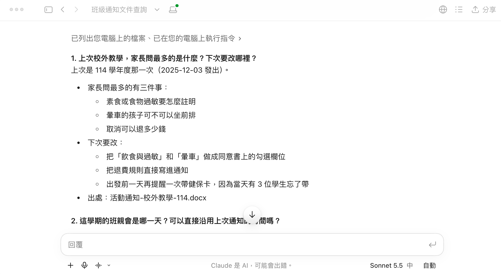

## 優化並使用 Skill 生成檔案

> **上一堂在網頁版做的 Skill，今天不用重做**
> Skill 存在你的`帳號`裡：網頁版建立的，打開桌面版一樣找得到。

### 🔁 確認 Skill 已經在桌面版

- 在輸入框打 `/admin-template`，看得到就代表它跟著過來了

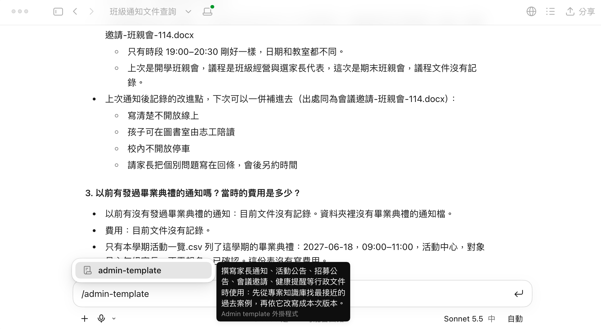

#### Skill 不存在就下載匯入就好

[download file="assets/admin-template.zip" label="下載「admin-template」Skill" desc="上一堂建立的行政範本 Skill：找最接近的過去案例，照它改寫成這一次的通知"]

**操作路徑**: 外掛程式 → Skills → 新增 → 上傳外掛程式 → 選擇剛剛下載的 `admin-template.zip`


### 🛠️ 更新 Skill：資料夾裡的案例也能用

> **為什麼 Skill 要先改？**
> 上一堂的 Skill 寫的是「去`專案`找案例，不要去電腦裡找」。
> 照原本的寫法，它會跑去雲端專案找，`看不到資料夾裡的檔案`。

```prompt [label="更新 Skill：雲端專案與資料夾都能用"]
幫我更新 admin-template 這個 Skill：
有選資料夾時，資料直接從資料夾讀取；沒有選資料夾時，才去專案找
```


> **Skill 記的是做事的步驟，工作環境換了，步驟就要跟著更新**
> 改一次就好；之後不管在雲端專案還是資料夾，同一個 Skill 都能用，`不用每次重新交代`。

### 📝 用 Skill 撰寫期末班親會的通知

```prompt [label="呼叫更新後的 Skill，成品直接存進資料夾"]
/admin-template
幫我寫這學期期末班親會的通知。
```


## 彙整雜亂的資料夾

### 🗂️ 亂放的班級資料夾，先請它盤點

- 我們都知道檔名要有邏輯，人和 AI 才好找；但`真實的資料夾通常不是這樣`
- 下面這個練習資料夾，模擬一位導師一學期下來隨手存的東西：
   - 看不出內容的檔名：`文件1.docx`
   - 同一份通知好幾個版本：`校外教學通知_final_改2.docx`
   - 各種照片和截圖：手機照片、LINE 截圖、黑板照片

[download dir="五三班務" label="下載「五三班務」練習資料夾" desc="亂放的班級資料夾：31 個檔案，Word、Excel、PDF、照片、LINE 截圖都有"]

- 這些素材最後要做成`班級官網`；網站是公開的，所以第一步先盤點`哪些能放、哪些不能放`
- 解壓縮後開一個新對話，點擊`新增資料夾`選 `五三班務`，再貼上下面的 prompt

```prompt [label="先盤點，不要動手"]
確認資料夾的所有檔案後，列三張表給我：
1. 可以公開給家長的內容
2. 不能公開的檔案，說明原因
3. 互相矛盾或過期、需要我決定的地方
```

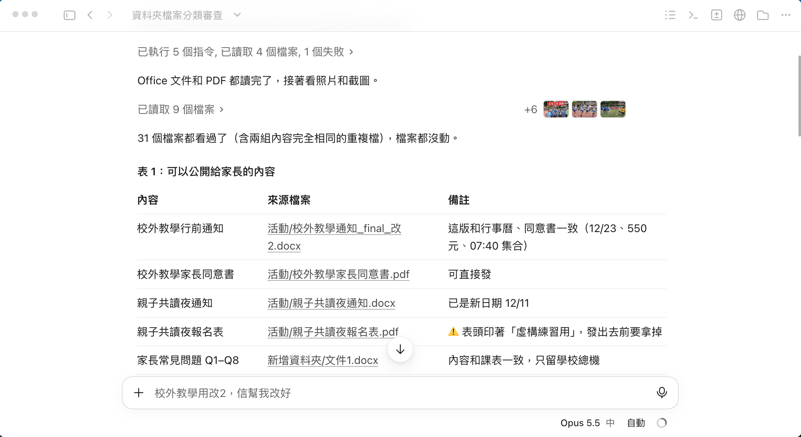

> **為什麼要先列表，不直接請它做網站？**
> 直接做網站，放什麼內容就由 AI 決定，舊版日期、學生個資可能就這樣`被放上網`。
> 先列表，版本、日期、個資這些`只有你能拍板`的事，才會一次攤在你面前。

### 🏷️ 盤點完，先請它提出新檔名對照表

- 像 `新增文字文件 (2).txt` 這種檔名，打開前沒人知道裡面是什麼
- 不用開新對話，在同一個對話接著請它照「類型-主題-學年度」的規則提出新檔名

```prompt [label="先列對照表，確認後才改名"]
這個資料夾的檔名很亂。請讀過每份檔案的內容，照「類型-主題-學年度」的規則提出新檔名。
先列出「原檔名 → 新檔名」的對照表給我確認，我說可以再改名。
看不出學年度的不要猜，學年度先寫「待確認」，並在表格說明你是怎麼判斷的。
只改檔名，不要刪除或搬移任何檔案。
```

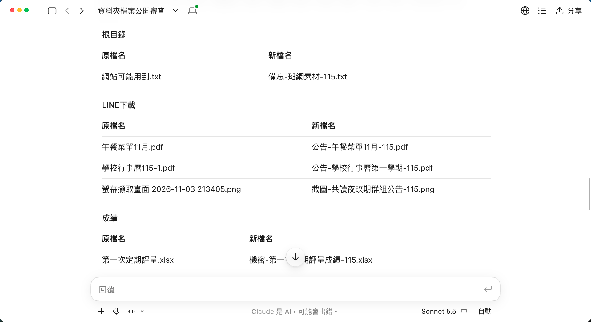

> **個人經驗**
> 如果沒有特別要求，AI 有很高的機率把`沒有線索的檔案都歸到今年`。
> 所以我會先講好：`不確定的先標「待確認」`，由我來補。

### ✅ 對照表確認後，再讓它動手改名

- 對照表看過一輪，`要調整的地方一次講清楚`再請它改（ex: 同一份文件的多個版本怎麼命名）
- 標「待確認」的學年度，也在這時候告訴它

```prompt [label="請 AI 調整"]
OK，照對照表改名，有兩個地方要調整：
1. 標「待確認」的檔案都是這學期的，學年度用 115；四年三班的舊資料用 114
2. 同一份文件有好幾版的，最新版用正式檔名，舊版在檔名最後加「舊版」
```

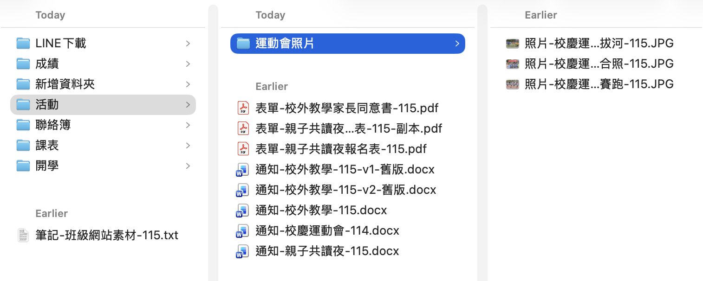

> **為什麼要先看對照表，不直接讓它改？**
> 改名、搬移、刪除，都是`做了就不容易復原`的動作。
> 先看計畫再執行，花一點時間但是更安全；`按下同意，責任就是你的`。

### 📦 告訴它要做班級官網，把能用的素材放進新資料夾

- 在同一個對話，貼上下面的 prompt
- 版本在改名時已經處理了；剩下`檔案之間對不上的日期`、`還沒決定的內容`，在第 2 點拍板
- 只有部分內容能用的檔案（ex: 開學信裡有私人手機），請它`把能用的段落另存一份`，不要整份複製

```prompt [label="建立官網素材資料夾，只放可以公開的"]
我想做一個班級官網。新增一個「website-materials」資料夾，把可以公開給家長的內容「複製」進去：
1. 不能公開的檔案一律不放；只有部分內容能用的，把能用的段落另存成新檔，私人聯絡方式與草稿備註不要帶進去
2. 檔名有「舊版」的不放；不同檔案的日期對不上時，以最新的通知為準；還沒決定的內容先不要放
3. 原本的檔案不要移動、修改或刪除
完成後列出放了哪些檔案，以及每一份來自哪裡。
```

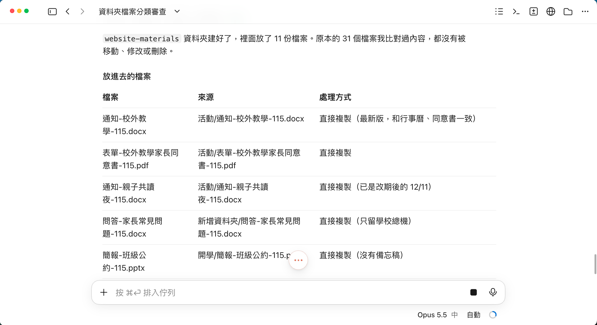

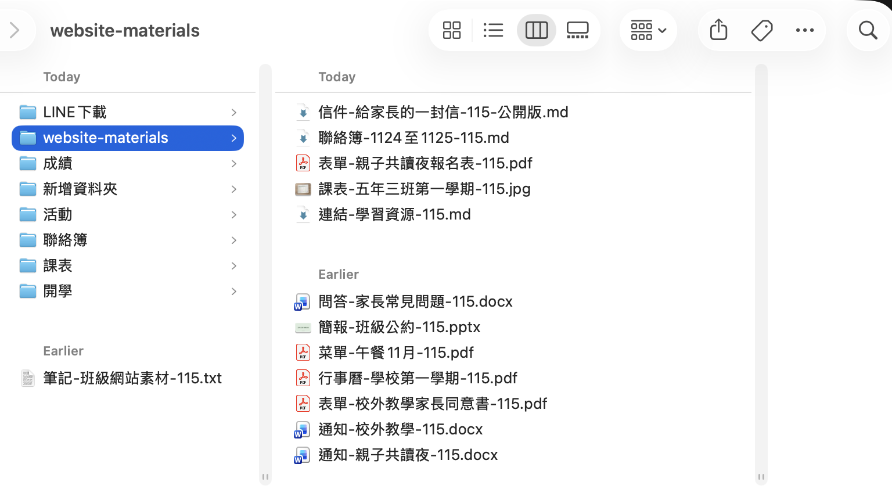

> **為什麼要另外建一個資料夾，不直接拿原本的做網站？**
> 原本的資料夾是你的`正本`，裡面有學生資料、成績；官網素材 `website-materials` 只放`確定可以公開`的東西。
> 等一下做網站，只把這個資料夾交給 AI，`看不到的東西，就不會被放上網`。

---

# 班級官網：可以持續擴充的家園

> **學 Vibe Coding 不是為了成為工程師**
> 是為了解決`你目前遇到的痛點`，這個痛點可能存在於`班級、處室、學年團隊、個人`，但一直沒有解決。
> 而這個單元，就是讓大家了解，在 AI 時代`我們能靠自己`踏出第一步。

## Vibe Coding 是什麼？

> **透過白話文跟 AI 對話，逐步完善成品的流程**
> - **優點**：可以快速完成初版
> - **缺點**：結果較不可控、未來較難維護
> 若沒有程式背景，`把想做的事、期待的結果講清楚`是最重要的事

### 🧪 是「玩具」還是能用的「工具」？

[flow]
- 一句話就能生成「看起來可以用」的網站 — 但未來想調整文字、優化細節時該怎麼辦？
- 改壞不是最可怕的 — 最可怕的是`你不知道它被改壞了`；過去人寫程式也會有一樣的問題，只是 AI `速度太快`，把問題加倍放大
- 等一下做的`班級官網` — 重點並不是做出來好開心，而是`自己對它有多少掌控力`
[/flow]

> **看起來能用的東西，才是最危險的**
> `AI 的快，不是你的快；但 AI 的錯，會全部算在你頭上`。所以關鍵內容，還是需要人來把關。

## 從自己的需求出發

### 🏥 我做的排班工具，護理長一試就找出問題

[flow]
1. 第一版很快 — 幫醫院的 Vibe Coding 課準備教材時，我用 Claude Code 很快就做出「排班工具」第一版
2. 試用才浮現 — 哪些班別不能接在一起、包班人員怎麼安排、跨月的夜班接白班怎麼檢查，這些細節我`完全沒想到`
3. 現場最懂規則 — 護理長卻能明確說出`調整方向與背後的規則`；下面兩張圖，就是照這些回饋調整後的版本
[/flow]

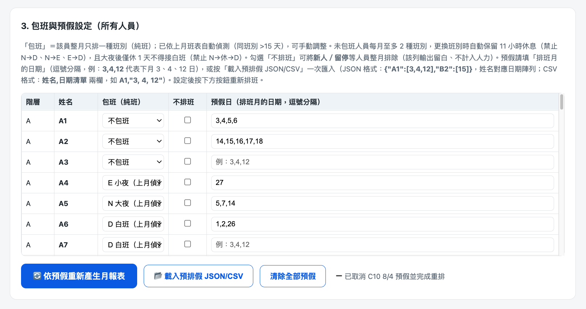

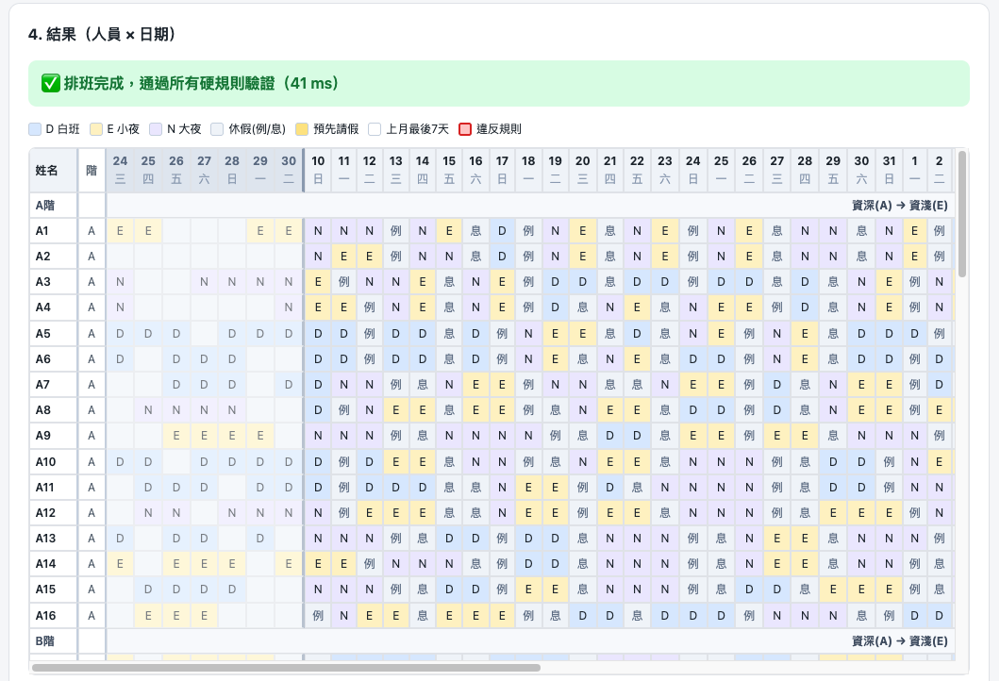

> **為什麼班級的東西，由老師自己做最合適？**
> 過去要會寫程式才能做工具，`做工具的人往往不是真正的使用者`；就像一位主管在課前訪談跟我說的：「**開發的人不用系統，用系統的人不會開發。**」
> 現在懂現場的人，也能用 Vibe Coding 做出幫助自己的成品，並`根據使用細節持續優化`。

## 為什麼第一個作品選班級官網

### 😓 班級的訊息，散落在各個地方

- 聯絡簿抄在黑板，孩子漏抄家長`晚上就來訊息問`
- 家長常見問題（ex: 請假怎麼請、週三幾點放學），`每位家長都問一次，你就要回一次`
- 班級課表發過紙本，要用的時候`找不到在哪裡`
- 最新公告發在群組，`兩天後就被洗到找不到`

> **答案都有，只是沒有固定找得到的地方**
> 「明天要帶什麼？」「報名表哪裡下載？」這些答案都有，只是散在黑板、群組和紙本裡。
> 班級官網要做的，就是成為這個`固定找得到的地方`。

### 💡 站在第一線的你，一定有更多需求

[flow]
- 上面四個是我想得到的 — 每天在現場的你，一定知道還有`很多可以做的事情`
- 別拿用不到的主題練習 — 用不到、或已經有現成工具的東西（ex: 記帳軟體、番茄鐘）別再重做了，`練習幫助有限`
- 從班上真的用得到的開始 — 你才`分辨得出對錯`，遇到錯誤也`有動力解決`
- 班級官網只是一個起點 — 未來你想到的其他需求都可以`一個一個加進去`
[/flow]

[interactive title="是什麼驅動你嘗試"]
**Vibe Coding 最需要什麼？**
`A` 有程式基礎 `B` 熟悉多種 AI 工具
`C` 擅長與人溝通 `D` 眼前有困擾許久的問題
[/interactive]

## 先認識幾個名詞

### 📰 把班級官網想成一份班刊

| 名詞[width:150] | 比喻 | 它負責什麼 |
| --- | --- | --- |
| Markdown | 原稿 | 用純文字加幾個符號寫內容，`像打字一樣`，不用管版面 |
| 轉換程式 | 印刷廠 | 把原稿套上版面，變成網頁；這支程式由 AI 來寫 |
| Git | 存檔點 | 記下每一版，改壞了可以回到上一版 |
| GitHub | 雲端的檔案櫃 | 把你電腦裡的每一版，放一份到網路上 |
| GitHub Pages | 公布欄 | 把網頁公開成一個網址，學生與家長用手機就能看 |
| GitHub Actions | 自動送印的小幫手 | 你一交出新的原稿，它就`自動送印、貼上公布欄` |

[html src="./html/publish-flow.html"]

> **為什麼內容要用 Markdown 寫，不直接請 AI 改網頁？**
> 網頁檔裡內容和版面混在一起，改一個字都可能弄壞版面。
> 把內容抽成 Markdown，`你只管寫字，版面交給程式`；每個分頁一份檔案，想改哪一頁就開哪一份。

### 🗺️ 先從三個基礎分頁開始

| 分頁 | 對應的 Markdown | 放什麼內容 |
| --- | --- | --- |
| 首頁 | `index.md` | 班呼、導師的話、最新公告 |
| 課表 | `timetable.md` | 一週課表，從素材裡的課表圖片轉成表格 |
| 每日聯絡簿 | `contact-book.md` | 每天的作業與提醒，最新的一天在最上面 |

### 🪜 一步只做一件事

[flow]
1. 第 1 步：說出需求 — 先在自己的電腦看到三個分頁，檢查後再一項一項優化
2. 第 2 步：轉成 Markdown — 符合期待後，把內容和版型分開
3. 第 3 步：加入 Git — 請 AI 檢查並安裝 Git，替網站留下第一個存檔點
4. 第 4 步：推上 GitHub — 註冊帳號，請 AI 協助連線，把存檔點放一份到雲端
5. 第 5 步：發布到 GitHub Pages — GitHub Actions 自動產生網頁，網站有了網址
6. 第 6 步：請 AI 更新內容 — 新增聯絡簿、公告附檔案、核對課表，線上跟著更新
7. 第 7 步：換到編輯器 — 請 AI 安裝終端機版的 Claude Code，用編輯器把專案下載回來
8. 第 8 步：自己改一版 — 親手改內容、即時看預覽，再推上去
[/flow]

[warning title="班級官網是公開的，只放可以公開的內容"]
放上 GitHub Pages 的網站，`全世界都看得到`，不是只有你們班的家長。

- 考量到隱私，不建議放`學生姓名、學生照片、座號對應等個人資料`
- 聯絡方式只放`學校總機與分機`，不放私人手機
- 正式使用前，先確認學校對班級網站的規範
[/warning]

---

# 完成初版：用白話文做出能用的班級官網

> **為什麼要先做 MVP？**
> `先求有、再求好`。MVP（Minimum Viable Product）是`最小可行產品`：先做出「能用的最簡版本」。
> 今天的官網只有三個分頁，每完成一步都要`親手驗收`，確認沒問題才往下走。

## 換到 Code 分頁：這次 AI 用的是你電腦上的工具

### 💻 為什麼要換到 Code 分頁？

- 前半段寫通知，選好資料夾就能請 Claude 動手；要做網站，得`寫程式、執行程式、用 Git`，這些交給專門做這件事的 `Claude Code`
- Claude Code 就在 Claude 桌面版裡面，也就是「Code」分頁，`不用另外安裝`；但需要付費方案

- 在桌面新增一個資料夾，取名 `class-website`
- 把剛剛在 `五三班務` 裡建好的 `website-materials` 整個資料夾，複製一份放進 `class-website` 裡
- 前面沒整理完的老師，下載下面的備用包，解壓縮後一樣放進 `class-website`

[download dir="website-materials" label="下載「website-materials」備用包" desc="前面沒整理完的老師用：12 個可以公開的檔案，有活動通知、報名表與同意書、課表、行事曆、午餐菜單、家長常見問題、開學信公開版與聯絡簿"]

**操作路徑**: 左側欄上方「Code」→「新增」→ 選擇環境 → 新增環境
- 名稱 `class-website` 
- 資料夾選桌面的 `class-website`

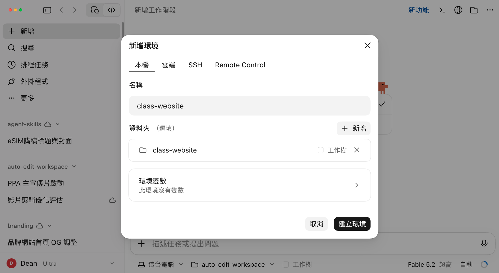

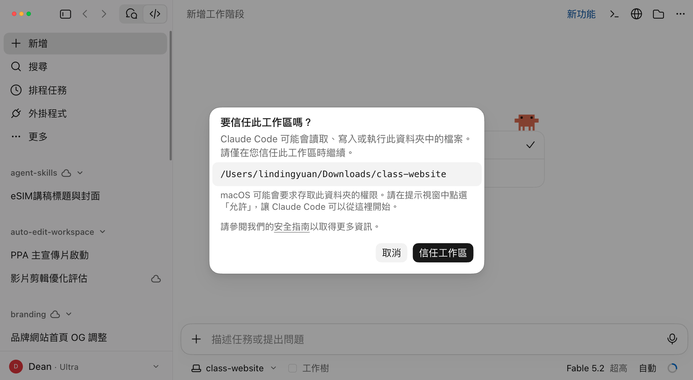

### 🧰 缺什麼就請 AI 裝

[flow]
- **前半段寫通知時** - Claude 用的是`雲端的電腦`，工具都預先備好了，讀 Word、寫 Word 都不用你操心
- **Code 分頁的本機環境** - 用的是`你電腦上的工具`，第一次做網站時，多半會缺東缺西
- **缺東西就請 AI 裝** - 第 2 堂在 Codex 遇過一樣的事：過去安裝環境很折磨人，但現在 AI 可以`先檢查、再幫你裝好`
[/flow]

[warning title="安裝前先看清楚"]
- 安裝時會跳出核准提示；看不懂就先問 AI `這個工具是做什麼用的`，不要全部同意
- 只安裝 AI 說明過用途、而且`這次任務需要`的工具
- `按下同意，責任就是你的`
[/warning]

## 第 1 步：說出需求，先在自己的電腦看到成果

### 📋 先說具體需求，做法交給 AI

```prompt [label="說出需求，做出第一版"]
我想做「五年三班」的班級官網，給家長和學生用手機看。
分頁有：首頁（班呼、導師的話、最新公告）、課表、聯絡簿。
內容從「website-materials」取得。
網站是公開的，不要放學生姓名、照片與私人電話。
```

| 項目 | 這一版的需求 |
| --- | --- |
| 使用者 | 家長與學生，主要用手機看 |
| 分頁 | 首頁、課表、聯絡簿 |
| 內容來源 | 從 `website-materials` 整理|
| 邊界 | 不放學生姓名、照片與私人電話 |


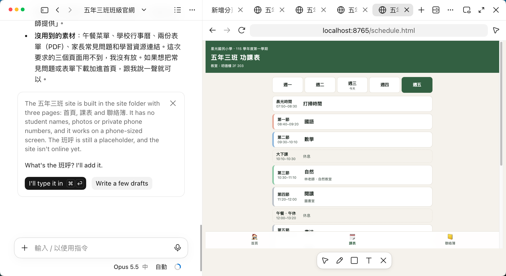

```prompt [label="指定班呼"]
班呼用「五年三班，閃閃發亮，勇敢學習，一起向上！」
```


> **為什麼一開始不提 Markdown、Git、GitHub？**
> 一次交代太多，哪裡不對你也很難分辨。
> 先把`看得到的需求`做到符合期待，再一次加一樣東西；每一步都驗收過，出問題就知道是哪一步。

#### 驗收第 1 步

複製`右側瀏覽器網址`，貼到一般的瀏覽器。下面是第一版`常見的狀況`，不一定會遇到，但每一項都要看過：

| 檢查什麼[width:170] | 怎麼檢查 | 有狀況的話，跟 AI 這樣說 |
| --- | --- | --- |
| 分頁能不能切換 | 導覽列的三個分頁各點一次，再點回首頁 | 「＿＿分頁打不開，請修正」 |
| 手機上好不好讀 | 把瀏覽器視窗`拉窄到手機的寬度`，看字有沒有被切掉 | 「視窗拉窄後，＿＿超出畫面，請調整成手機也好讀」 |
| 有沒有不該公開的資料 | 整個網站看一遍，有沒有學生姓名、照片、私人電話 | 「請拿掉＿＿」 |

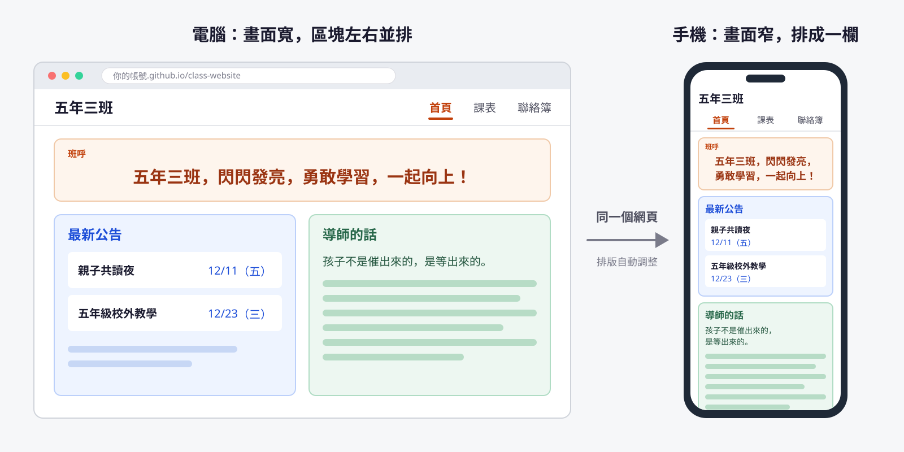

> **我的畫面和旁邊的老師不一樣，是哪裡做錯了嗎？**
> 同樣的指令，`每次生成的結果都會有差異`，配色、版面不同很正常。
> 要核對的是`AI 呈現的資訊`，是否跟你的期待相同。

### 🔁 有狀況就描述現象，一次改一件事

- 不用知道原因，也不用懂術語：說出`在哪裡、看到什麼、希望變成怎樣`就好
- 說不清楚，就`截圖貼給 AI`
- 一次改一件事，改完再檢查一次；表格每一項都看過了，才往下一步

```prompt [label="描述你看到的狀況（括號換成你的內容）"]
（哪一個分頁的哪個地方）看起來（怎麼了）。
我希望（變成怎樣），其他地方不要動。
```

### 🎨 想要更好看？安裝 Skill 來優化

- Skill 記的是`做事的方法`；除了自己做，也可以`安裝別人做好的`
- Anthropic 官方的 `frontend-design` 是網頁設計的 Skill，裝好之後請它優化配色、字體與版面

**操作路徑**: 左側欄「外掛程式」→ 搜尋 `frontend-design` → 新增

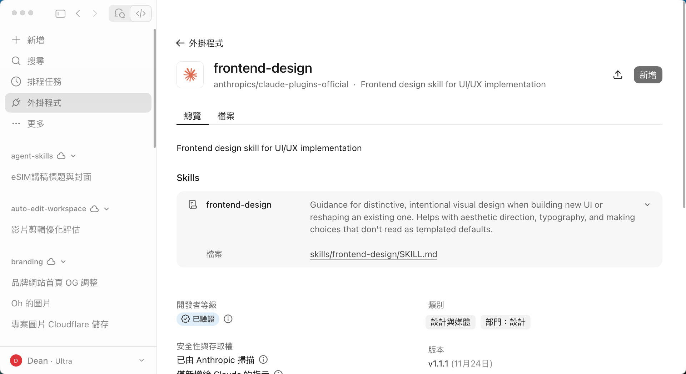

```prompt [label="用設計 Skill 優化版面"]
用 frontend-design 優化班級官網的版面，風格要適合國小班級，電腦手機都要有好的表現。
```

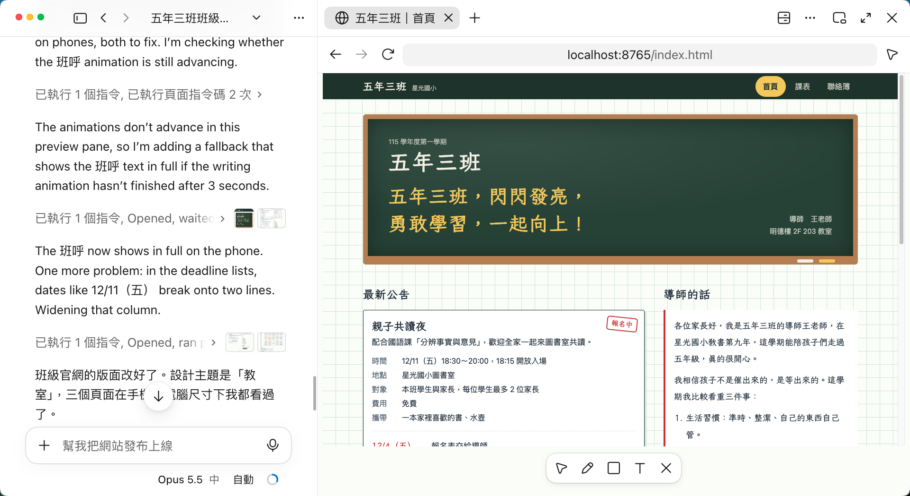

## 第 2 步：符合期待後，把內容轉成 Markdown

### 🔄 內容歸內容，版型歸版型

[flow]
- 現在混在一起 — 內容和版型放在同一個網頁檔，`很難調整細節`
- 把內容抽出來 — 抽成 Markdown 之後只改文字就好，`版型可以重複使用`
- 過程要裝工具 — 這一步通常要裝工具（ex: Node.js），照前面的原則：`先問用途再核准`
[/flow]

```prompt [label="符合期待了，再把內容轉成 Markdown"]
網站的樣子我滿意了，接下來內容我想自己改。
把每個分頁的內容抽成一份 Markdown，放在 content 資料夾：index.md（首頁）、timetable.md（課表）、contact-book.md（每日聯絡簿）。
我調整 Markdown 就能及時改變網頁，版面維持現在的樣子，一樣能直接用瀏覽器打開。
需要安裝工具時，先說明用途，我同意再裝。
把「產生網頁」和「即時預覽」的指令寫進 package.json，完成後告訴我各是什麼指令。
再把這個網站的呈現規則寫進 CLAUDE.md（給 AI 看的規則檔）：日期怎麼寫、公告與聯絡簿的格式。
```

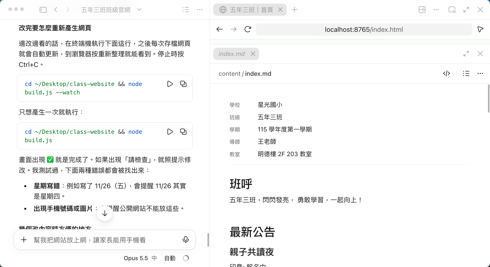

### 🗂️ 轉換之後，資料夾會長這樣

[html src="./html/project-structure.html"]

---

# 版本控制：用 Git 留存檔點，再推上 GitHub

> **為什麼做網站需要版本控制？**
> 接下來每一步都會動到檔案。先替網站`留下存檔點`，改壞了回得去；
> 再把存檔點`放一份到 GitHub`，換電腦、電腦壞了都找得回來。

## 第 3 步：加入 Git，替網站留下存檔點

### 🛟 沒跟上的話，從完成範例接著做

> 前面有跟著教材做的，可以跳過這步

[download dir="班級官網完成範例" label="下載「班級官網完成範例」" desc="做到第 2 步的網站：三份 Markdown、轉換程式、指令清單、產生好的網頁，素材也放在裡面"]

### 🎮 Git 就像遊戲的存檔點

- 打 Boss 前先存檔，打輸了就`讀檔重來`；Git 就是替資料夾裡的檔案`存檔`的工具
- AI 改東西很快，改壞也很快；有了存檔點，`改壞了就回到上一版`

| 你想做的事[width:180] | 跟 Claude 這樣說 | Git 的說法 |
| --- | --- | --- |
| 把目前的版本存起來 | 「幫我存檔，說明寫…」 | commit（提交） |
| 看過去存了哪些版本 | 「列出所有存檔點」 | log（紀錄） |
| 這次改壞了，不要了 | 「回到上一個存檔點」 | restore（還原） |
| 把存檔點放一份到 GitHub | 「更新到 GitHub」 | push（推送） |

> **你不用背指令，但要掌握三個時機**
> `驗收通過才存檔`、`動手改之前確認有存檔`、`驗收沒過就回到上一版`。
> 現在用白話文就可以做到版本控制了。

### 🧰 請 AI 檢查並安裝 Git

- Git 是要`裝在電腦上`的工具：多數 Mac 已經內建，Windows 通常要另外安裝
- 不用自己上網找安裝檔，照前面的原則，請 AI `先檢查、再幫你裝`
- 安裝過程跳出的核准提示與安裝視窗，一樣`看懂再同意`

```prompt [label="檢查有沒有 Git，沒有就帶我安裝"]
檢查這台電腦有沒有安裝 Git。
沒有的話，幫我安裝；並在裝好後確認可以使用。
```

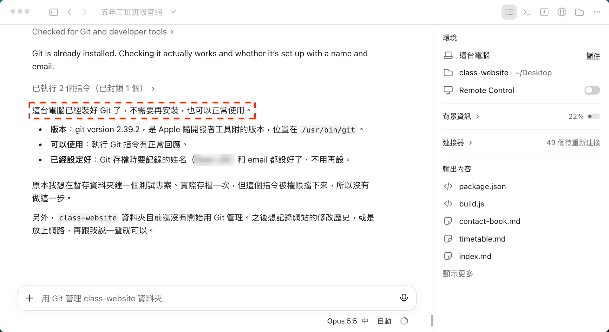

### 💾 建立第一個存檔點

- Git 準備好了，就能替網站留下第一個存檔點

```prompt [label="加入 Git，建立第一個存檔點"]
幫專案建立第一個存檔點，說明寫「班級官網第一版」。
涉及敏感資訊、會自動建立、不需要上傳的不要加入版本控制
```

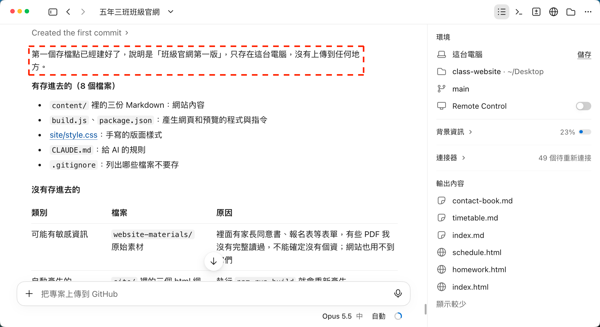

## 第 4 步：推上 GitHub，放一份到雲端

### 📝 註冊 GitHub 帳號

- 到 [github.com](https://github.com) 註冊，有 Email 就能辦，免費
- 帳號名稱會出現在官網的網址裡（`https://你的帳號.github.io/class-website/`）

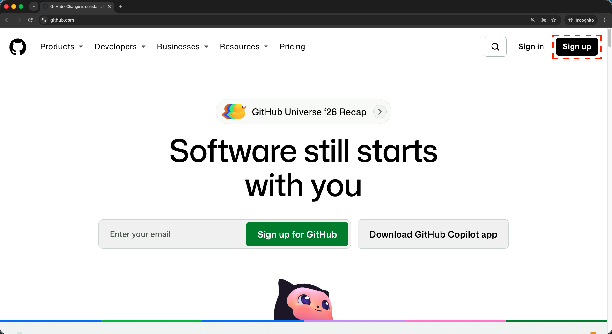

### 🔗 請 AI 協助連線，把第一版推上去

```prompt [label="連上 GitHub，推送第一版"]
把這個網站推上 GitHub，建立公開專案「class-website」。
完成後給我專案的網址。
```

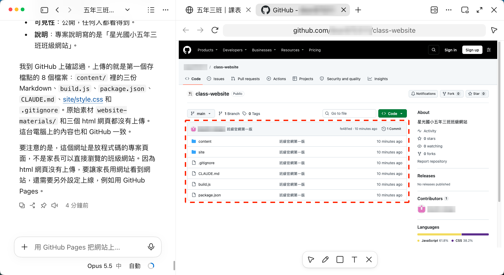

> **小提醒**
> 第一次操作時，AI 要先`裝好工具、登入帳號`，才有辦法替你執行；之後再推送就不用重來

[flow]
1. 安裝連線工具 — AI 會先下載 `GitHub CLI`（讓 AI 能替你操作 GitHub 的工具）這類工具，看懂用途再同意安裝
2. 登入 GitHub — AI 會給你一組驗證碼並打開瀏覽器；你在瀏覽器登入、貼上驗證碼、按下授權，再回到 Claude。`密碼只在瀏覽器裡輸入`，不要貼給 AI
3. 建立公開專案 — 在你的 GitHub 帳號底下，建立 `class-website` 專案
4. 推送第一版 — 把電腦裡的存檔點，放一份到 GitHub
[/flow]

[warning title="公開專案全世界都看得到，推上去之前先檢查"]
- 學生名冊、成績、真實的聯絡簿，`絕對不能`放進公開專案
- 一起放上去的檔案，一律用`可以公開`的版本（ex: 空白的報名表，不是家長填好的）
- 不確定的檔案，就先不要放
[/warning]

---

# 發布上線：GitHub Pages 讓官網有了網址

> **推上 GitHub，還不等於家長看得到**
> GitHub 上現在放的是`原稿與轉換程式`；要變成一個網址，還需要 `GitHub Actions 自動送印`、`GitHub Pages 貼上公布欄`。

## 第 5 步：發布到 GitHub Pages，官網有了網址

### 🤖 網頁交給 GitHub Actions 自動產生

```prompt [label="用 GitHub Pages 發布，之後自動更新"]
我要讓家長用手機看這個網站，請用 GitHub Pages 發布
產生出來的網頁不要存進 Git，使用 GitHub Actions 在我每次推送後，自動把 Markdown 轉成網頁並發布
完成後給我網址，並告訴我在 GitHub 的哪裡可以看到發布結果。
```

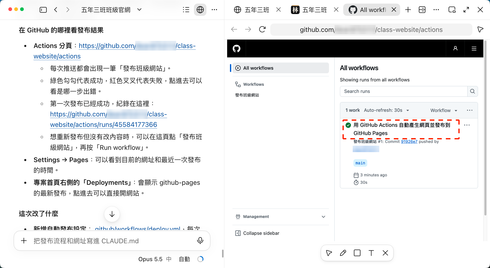

[flow]
1. 你推上新的存檔點 — 推上去的只有`原稿（Markdown）與轉換程式`
2. GitHub Actions 自動送印 — 在 GitHub 的電腦上執行轉換程式，把 Markdown 變成網頁
3. GitHub Pages 貼上公布欄 — 網頁公開成一個`固定的網址`
[/flow]

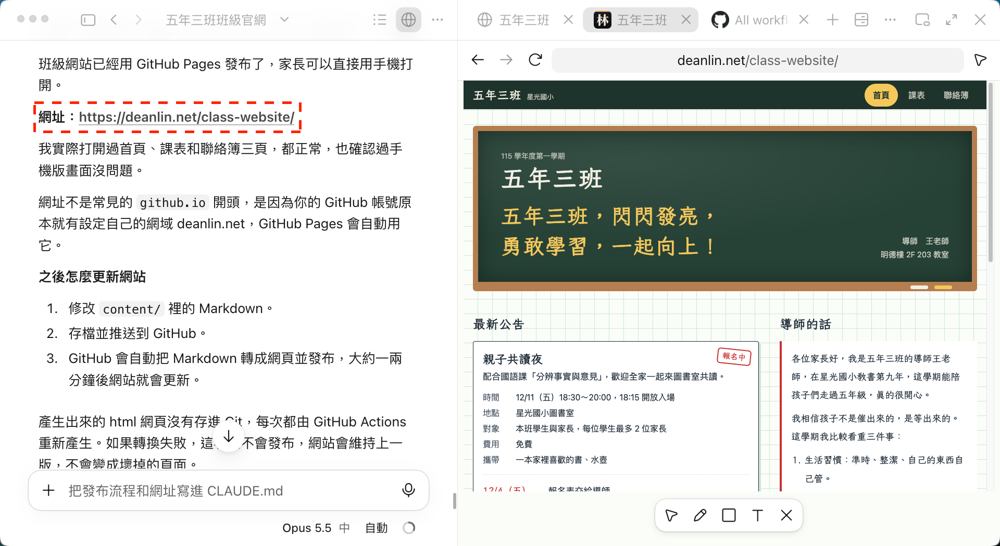

## 第 6 步：更新內容，線上跟著更新

### 🔁 之後每次更新步驟都一樣

[flow]
1. 改 Markdown — 自己改，或請 AI 改
2. 預覽 — 在自己的電腦先看一次
3. 存檔 — 驗收通過，建立存檔點（commit）
4. 推上 GitHub — 把存檔點推上去（push）
5. 等 1～2 分鐘 — GitHub Actions 自動產生網頁
6. 重新整理網址 — 家長看到的就是新版
[/flow]

### 📒 練習一：請 AI 新增一天的聯絡簿

```prompt [label="新增一天的聯絡簿，更新到線上"]
在聯絡簿新增 11/27（五）：
- 國語：習作第 12 課，完成第 5～6 頁
- 數學：課本第 70～71 頁
- 親子共讀夜報名表，12/4（五）前交回
先重新產生網頁讓我預覽，我確認沒問題，你再存檔並推上 GitHub，說明寫「新增 11/27 聯絡簿」。
```

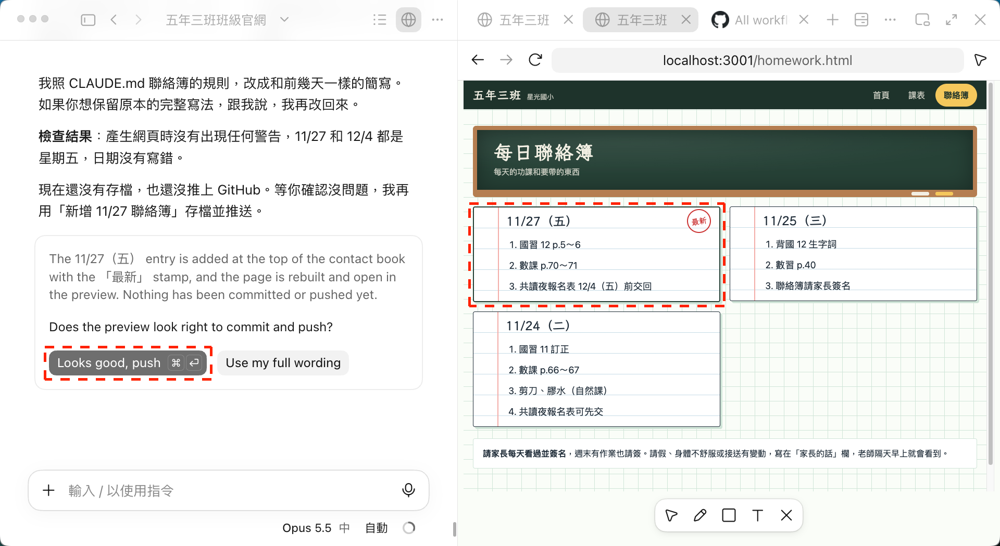

### 📎 練習二：公告附上報名表，讓家長自己下載

```prompt [label="新增一則附檔案的公告"]
在首頁的最新公告新增一則：「親子共讀夜報名表開放下載，請於 12/4（五）前交回」。
把「website-materials」裡的親子共讀夜報名表（PDF）附在這則公告，家長點了就能下載。
先重新產生網頁讓我預覽，我確認沒問題，你再存檔推上 GitHub。
```

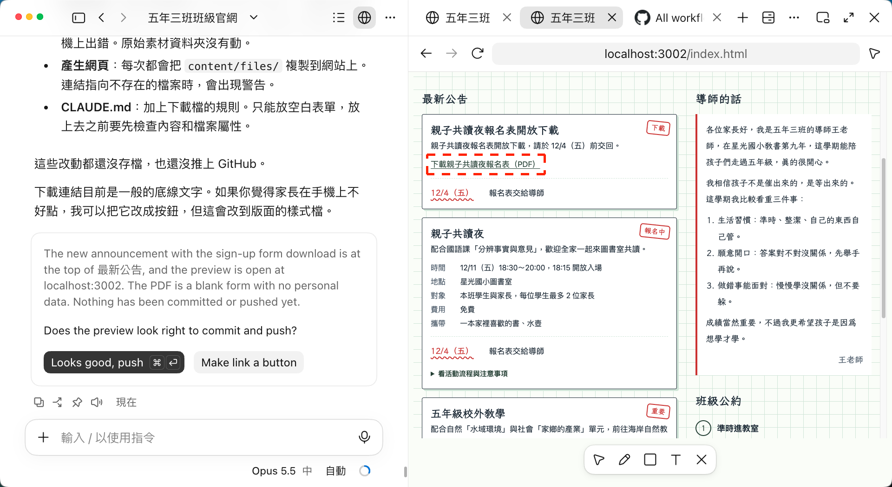

### 💊 改壞了？回到上一個存檔點

- **還沒存檔就發現改壞了**：預覽時覺得不對，直接丟掉這次的修改

```prompt [label="還沒存檔：丟掉這次的修改"]
這次的修改我不要了，還原成最近一個存檔點的樣子，再重新產生網頁讓我確認。
還原後告訴我目前是哪一個存檔點。
```

- **已經推上去才發現錯了**：線上的網站也要退回去

```prompt [label="已經上線：把網站退回上一版"]
剛剛推上去的那一版有錯，請把網站內容退回前一個存檔點的樣子。
```

> **為什麼不直接請 AI 修好就好？**
> 小錯誤可以請它修；但如果改了兩三輪還越修越亂，就該`回到上一版重新交代`，比在壞掉的版本上縫縫補補更快。
> 有存檔點，你才`敢放手讓 AI 試`。

---

# 自己動手：換到程式碼編輯器，改一版推上去

> **為什麼要使用程式碼編輯器？**
> - 小細節想修改時，自己動手比較快
> - 自己修改不會消耗額度
> - 程式碼編輯器可以最完整檢視資訊

## 第 7 步：準備編輯器，把專案從 GitHub 下載回來

### ⌨️ 安裝終端機版的 Claude Code

```prompt [label="請 AI 安裝終端機版的 Claude Code"]
如果這台電腦終端機尚未安裝 Claude Code 就幫我安裝
裝好後告訴我怎麼在終端機啟動它
```

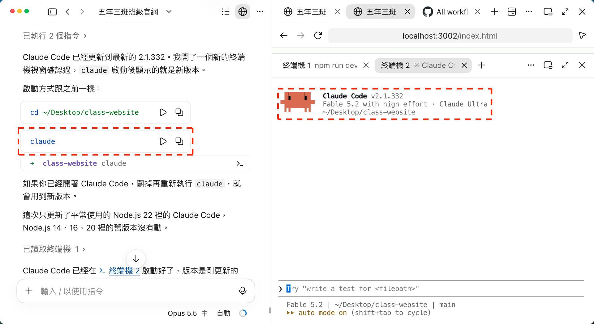

### 💻 下載程式碼編輯器

- **[Cursor](https://cursor.com/)**、**[VS Code](https://code.visualstudio.com/)**、**[Antigravity](https://antigravity.google/)** — 安裝`任一款`即可，Windows 與 Mac 都能用
- 三款的介面與操作大同小異，今天用 `Cursor` 示範
- 雖然名字裡有「程式碼」，但今天只拿它來`改 Markdown`，不用寫程式

### 📥 用編輯器的介面，把專案下載回來

- 專案已經在 GitHub 上，任何一台電腦都能`下載一份完整的回來`，這個動作叫 clone（複製）
- 不用打指令，編輯器的介面就能做；第 3 步裝好的 Git，在這裡派上用場
- 為了不和桌面上原本的 `class-website` 混在一起，建議下載到另一個位置（ex: 「文件」資料夾）

**操作路徑**: Cursor 歡迎頁「Clone repo」→ 貼上專案網址 → 選存放位置 → 開啟

> 專案網址就是第 4 步 AI 給你的那一個（`https://github.com/你的帳號/class-website`）

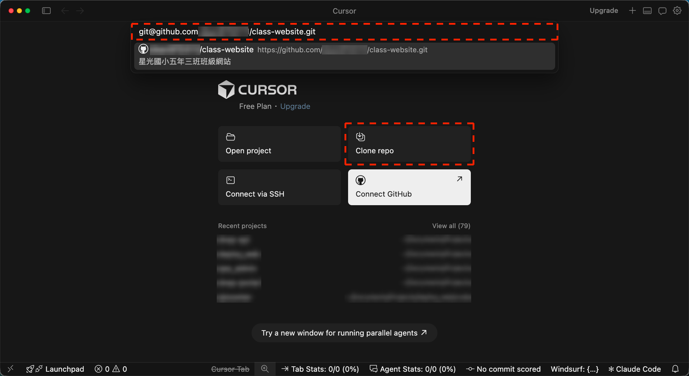 

> **下載回來的資料夾，為什麼沒有 website-materials？**
> 因為當初沒有把它推上 GitHub。`沒推上去的東西，GitHub 上就沒有`，這也再驗證一次：不該公開的素材確實沒有外流。
> 換一台電腦（ex: 家裡的電腦）要繼續維護官網，也是用同樣的方式把專案拿回來。

### 📦 package.json 是專案的指令清單

- 左邊檔案清單裡的 `package.json`，記著這個專案`有哪些指令可以用`；第 2 步請 AI 寫進去的就是這一份

```code [label="package.json 裡的指令（範例，你的內容可能不同）"]
"scripts": {
  "build": "node build.js",
  "dev": "node build.js --serve"
}
```

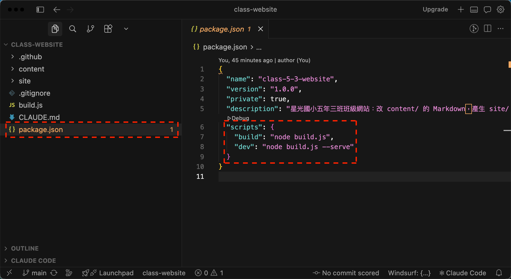

### ▶️ 在編輯器的終端機啟動 Claude Code

**操作路徑**: 上方選單「Toggle Panel」→ 輸入下面的指令，按 Enter

```terminal [label="啟動 Claude Code"]
claude
```

- 第一次啟動會要求登入，照畫面到瀏覽器完成授權
- 看到輸入框之後，用法和桌面版一樣：用白話文說你要做什麼

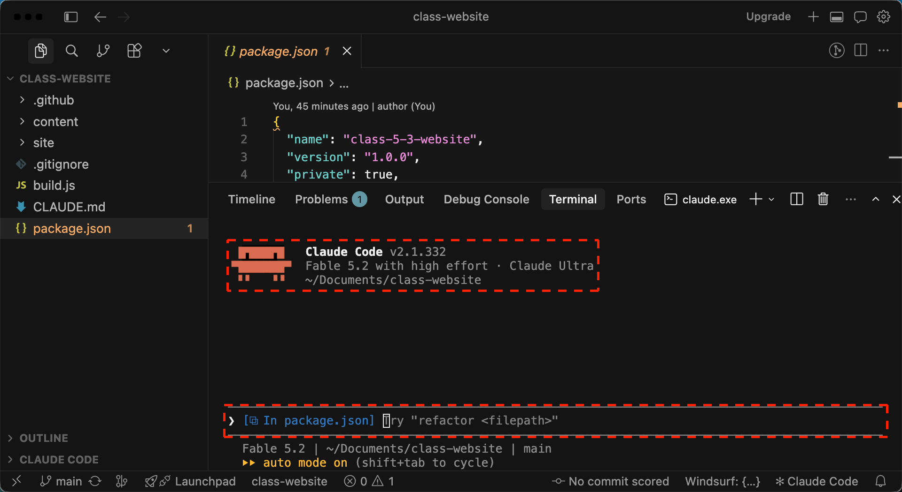

```prompt [label="請 Claude Code 讀懂專案，開啟即時預覽"]
讀一下這個專案，用白話告訴我：這個網站有哪些分頁、指令
然後用裡面的指令開啟即時預覽
```

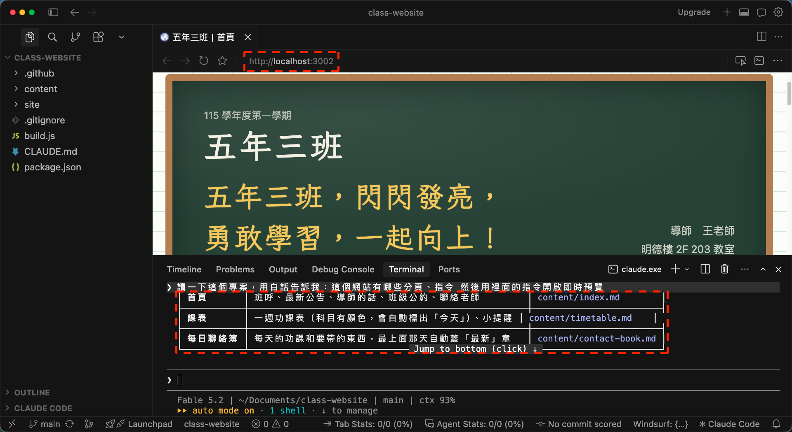

## 第 8 步：自己改內容，改一版推上去

### 🖐️ 親手改聯絡簿，即時看預覽

- 在編輯器左邊點開 `content` 資料夾，打開 `contact-book.md`
- 在 11/27 底下補一項提醒，按 `Ctrl + S`（Mac 是 `Cmd + S`）存檔，`瀏覽器的預覽會自動更新`：

```code [label="contact-book.md：在 11/27 底下補一項"]
4. 下週二美勞課，請帶彩色筆與剪刀
```


### 🚀 改好了，推一版上去

[flow]
1. 打開 Source Control — 點左側的`分岔圖示`，上面的數字是這次改了幾個檔案
2. 看改了什麼 — 點清單裡的 `contact-book.md`，綠色是新增、紅色是刪除；確認`只有你改的那一項`
3. 寫存檔說明 — 在上方的輸入框寫「補充 11/27 聯絡簿」
4. 按「Commit」 — 建立存檔點
5. 按「Sync Changes」 — 把存檔點推上 GitHub
[/flow]


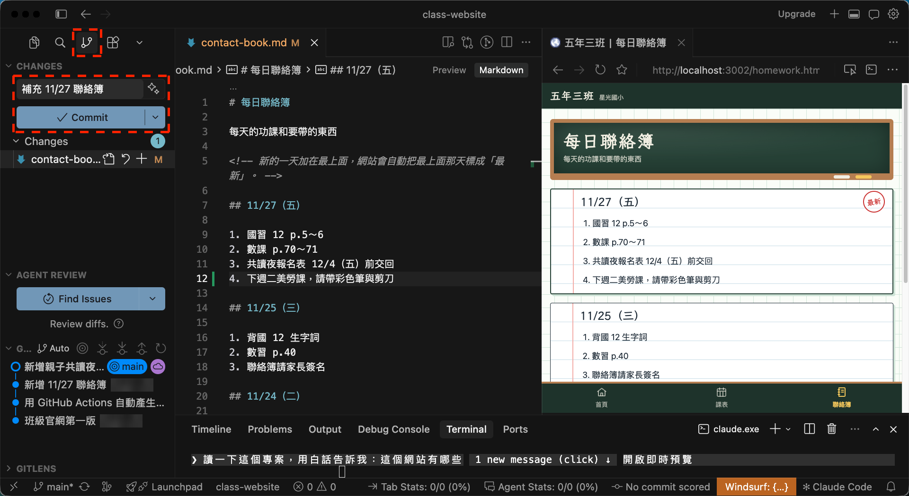

> **桌面版和終端機，之後要用哪一個？**
> 兩個是同一個 Claude Code，挑順手的就好：只想用說的，留在`桌面版的 Code 分頁`；
> 想自己改、邊改邊看，就用`編輯器加上終端機`。

## 案例回顧

### 🧭 我們到底做了什麼

[flow]
1. 先說具體需求 — 給誰看、有哪些分頁、資料從哪來，`做法交給 AI`
2. 環境請 AI 裝 — 缺的工具一項一項裝，`每一項都先問用途`再核准
3. 檢查後再優化 — 第一版出來先逐項檢查，`有狀況就描述現象`，還能安裝 Skill 讓它更好看
4. 內容與版面分開 — 內容寫在 Markdown，`改字不會弄壞版面`，用編輯器自己就改得動
5. 存檔點當後悔藥 — `驗收通過才存檔`，改壞了就回到上一版
6. 推上去就更新 — GitHub Actions 自動產生網頁，`同一個循環`重複用
[/flow]

### 💡 Vibe Coding 重要心法

- **驗收要在真實環境**：AI 的「完成了」是它自己說的，`成品一定要親手打開`，而且要用家長會用的手機看
- **修 Bug 靠方法，不靠運氣**：描述不出技術細節沒關係，`換個問法、附上截圖、調高 Model 與 Effort、或是開一個新對話`
- **專業是最後一哩路**：你對班級的熟悉度（ex: 家長最常問什麼、哪些資訊不能公開），正是把成品`從 80 分推到 100 分的關鍵`

> **你不需要會寫程式，但一定要驗收**
> 整個過程我們`沒有寫一行程式`；但結果需要`親自驗收`，並在遇到問題時`引導 AI`。

### 🎬 延伸學習：用 Claude Code 實作規格驅動開發

- 我有錄一支影片完整示範：用 Claude Code 搭配 Spec-Kit，從寫規格開始做出全端專案
- 想看另一套規格工具 OpenSpec，可以看這支：[【Claude Code 實戰】一次搞懂 OpenSpec，讓專案每次迭代都有依據](https://youtu.be/FeQv7mngg6Q)

[youtube id="16IIi5uNx_M" title="【Claude Code × Spec-Kit 教學】用規格驅動開發全端專案"]

---

# 📌 課程總結：Work Smart, Don't Work Hard

## 技術更新好快，我好焦慮

> **在未來，工具學習成本應該越來越低**
> AI 工具更新，通常是為了**降低學習難度**
> 我們其實`不需要去背`工具有哪些功能，大多時候有需要時`AI 會自動調用`
> 很多時候`不是因為工具更新焦慮，而是因為看到販賣焦慮的文章`

### 😰 出現新名詞很焦慮

Hermes Agent、loop engineering、Agency Agent、HyperFrames...

[flow]
1. 先觀察一段時間 - 工具剛推出時往往`不完善、沒有教學，上手難度也高`
2. 是否有具體案例 - 是話題性產品，還是有具體的成功案例
3. 對你有幫助嗎 - 工具再好，也要自己用得上才有意義
[/flow]

> **培養批判性思考能力**
> 人的精力有限，`技術是學不完的`；要先培養出辨識問題的能力，然後思考如何解決，`工具只是在過程中學會罷了`。
> 現場遇到的問題都是不同的，沒有現成的解決方案，就要`自己設計`出來。

### 🪞 「是我太爛嗎？」不，Demo 都是挑過的

- 滑社群覺得人人都是 AI 大神，自己一試卻`處處碰壁`
- 網路上漂亮的展示，是`精心挑選過`的結果，不是日常
- 教學看不懂不代表你不行，很多時候只是每個人的`背景與基礎`不一樣

#### 漂亮精美的網頁其實是框架的功勞：[Magic](https://magicui.design/)、[Aceternity](https://ui.aceternity.com/)


#### 一堆 AI Agent 同時執行，未必會更好


> **導入 AI，不代表全交給 AI**
> 把`AI 能做到的事`跟`人必須負責的判斷`分清楚。
> 讓 AI Agent 執行很久，不一定最強；我不認為對專案毫無掌控度是件好事。
> **好的結果，不該靠消耗 Token 拼運氣；而是靠清楚的方向、可重複的工作流、以及人類在關鍵節點的決策。**

### 🔄 經驗不會歸零，只是換了賽道

> **讓自己變得「獨特」，比讓自己變得「更強」更重要**
> AI 對新人來說是`彎道超車`的機會，而對資深老師與行政同仁來說是`放大自己`的時機。

[flow]
- 過去累積的判斷力，正是 AI 缺乏的 - AI 的出現，不是把你過去十年清空，而是給你一個`放大過去十年的機會`
- 過去職業是單一價值體系 - 技術強不強，對就對、錯就錯，比較很簡單
- 現在偏向多價值體系 - 教學現場熟悉度 × 會不會說故事 × 能不能設計流程 × 願不願意分享 × 能否自己做出工具
- 單一技能容易比高下，綜合技能不容易比 - 這對經驗豐富的人反而是機會
[/flow]

### 🔧 AI 降低「踏出第一步」的成本

- 過去想要一個小工具，得排隊`等工程師`，甚至需要花上`幾萬到數十萬`；現在 AI 讓你有機會先`自己做出雛形`
- 心裡冒出「AI 做得到嗎？」就直接讓它試：做中學，你才會真正知道 `AI 能做什麼、不能做什麼`

> **AI 就像一面鏡子，它會放大你原本的樣子**
> 如果思維清晰，AI 會放大你的清晰；如果思維混亂，AI 也會忠實放大這份混亂。
>
> 關鍵從來`不是工具多強，而是你是否了解自己要什麼`。

## 把力氣留給只有人能做的事

### ⚡ 把該省的力氣省下來

- 在 AI 時代，做`只有人才能辦到的事`更有價值
- 不要讓你對教學的熱情，被那些`不難但很煩的瑣事`一點點消耗掉

## 回顧：這個系列走過的路

[summary]
- 💬 **ChatGPT** | 把需求說清楚，用 Prompt、圖片生成、記憶、外部工具與專案建立專屬教學助理
- 🖥️ **Codex** | 用現成 Skill 交付教材，讓 AI 動手處理資料夾裡的檔案
- 🔌 **Claude** | 串接工具、固定背景、把好流程變 SOP
- 🗂️ **Claude 桌面版** | 選定資料夾就不用上傳；盤點、改檔名、挑出可公開素材，成品直接存進資料夾
- 🌐 **班級官網** | 從自己的需求出發，內容用 Markdown 寫、版面交給程式，AI 負責做、你負責驗收
- 💾 **Git 與 GitHub Pages** | 驗收通過才存檔，推上去就自動發布；改壞了就回到上一版
[/summary]

### 🔍 讓 AI 幫你復盤：回頭看看「你」

這個系列都在分享`AI 的技巧`，但如果你已經使用了一段時間，過去`問過的問題、踩過的坑、在意的細節`都已經默默被 AI 記錄了。

你可以讓 AI 幫你**復盤**：看清自己怎麼思考、如何解決問題，再把那些`一再重複的提問，變成下一個專屬於你的 Skill`。

> **你問 AI 的問題，藏著你最想解決的事**
> 成長，不是學會多少新功能，而是越來越`清楚自己要什麼`。

這段 prompt 要在`你平常使用的帳號`執行，累積的對話越多，復盤越有內容。

```prompt [label="讓 AI 復盤你的成長軌跡"]
把最近一個月我跟你的對話抓出來，著重在使用者（我）的問題。

幫我復盤最近學了什麼，並回答以下問題：

1. 我向你詢問哪些種類的知識
2. 我使用了哪些工具
3. 我正在解決什麼樣的問題
4. 我是怎麼解決問題的？切入點是什麼？在意的地方是什麼？都是怎麼下指令？
5. 有哪些我很常問的問題，但沒有建立成 Skill 的？
6. 你對我，有什麼有趣的洞見/長期的觀察
```

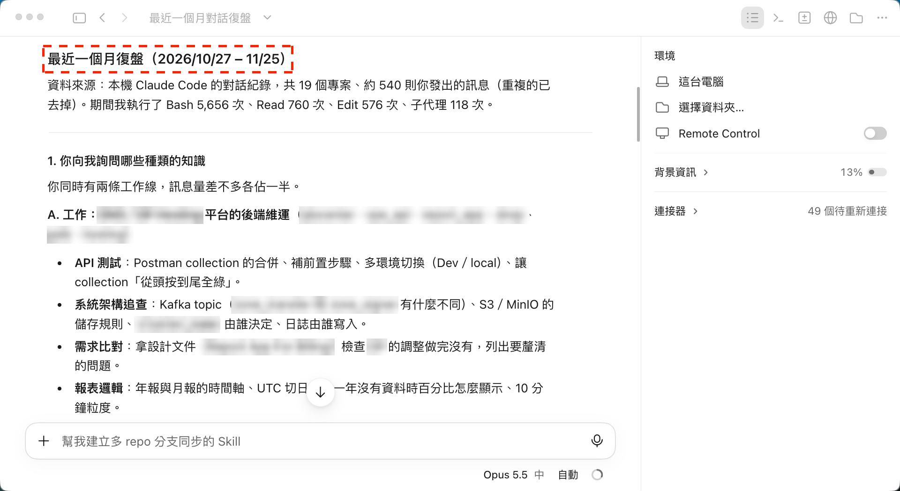

### 🚀 下課後的第一步：先把一件小事跑順

[flow]
1. 挑一件事 — 經常重複、格式固定，而且`你有能力判斷對錯`的任務（ex: 行政週報、家長通知、每日聯絡簿）
2. 跑順第一個流程 — 跑順一次，就會知道`怎麼跟 AI 交代任務、怎麼驗證結果`
3. 套用到其他情境 — 把這套方法帶到下一件事，好用的流程存成 Skill 或做成工具
[/flow]

> **最後要為結果負責的，是你自己**
> AI 完成任務後，還是要`親自驗證`資訊是否正確；這是四堂課一路提醒的事，也是我最想留給你的一句話。

[qa-session title="Q&A 時間"]
[/qa-session]