[time]
- label: 第 1 堂｜ChatGPT
  date: 11/23
  time: 19:00~21:00
  des: **釐清需求，建立專屬的教學助理**：認識網頁版與桌面版、三家 AI 功能對標，學會去識別化與 Prompt，生成教材圖片，再用記憶、外掛程式與專案打造教學助理。
  link: [查看講義](../chatgpt/index.html)
- label: 第 2 堂｜Codex
  date: 11/24
  time: 19:00~21:00
  des: **讓 AI 動手處理檔案，用 Skill 交付教材**：安裝 ChatGPT 桌面版，讓 AI 直接讀資料夾、把手寫報名表照片轉成 Excel；再用白話生成報名表登記、每週回顧與寫信風格的 Skill，最後切到 Codex，用資訊卡、線上講義、校園簡報 Skill 交出成品。
  link: [查看講義](../codex/index.html)
  active: true
- label: 第 3 堂｜Claude
  date: 11/26
  time: 19:00~21:00
  des: **串接工具、建立知識庫，把好方法變 SOP**：先把學生名冊去識別化，再用 Connector 整理信件與行事曆、用 Project 建立活動知識庫、把家長通知流程存成 Skill。
  link: [查看講義](../claude/index.html)
- label: 第 4 堂｜Cowork
  date: 11/27
  time: 19:00~21:00
  des: **讓 AI 交付成品，替自己做班級小工具**：用 Cowork 把簽收表照片轉 Excel、整理活動資料並設定排程，再用 Vibe Coding 做出班級抽籤分組工具，搭配 Git 存檔點，改壞了也能回到上一版。
  link: [查看講義](../cowork/index.html)
[/time]

# 🙋 課前回顧：5 分鐘掌握上一堂的重點

## 它能做什麼、會錯在哪

### 🤖 它是文字接龍，答案不一定正確

[flow]
- **生成式 AI 的本質是文字接龍** - ChatGPT、Claude、Gemini 都一樣，所以`相同的指令會有不同的結果`
- **幻覺依舊嚴重** - 課綱條文、法規編號、考題解析都可能是錯的，`得到答案後一定要查證`
- **文件裡可以藏指令** - 人看不到、AI 讀得到，就能左右 AI 的回答；`關鍵文件永遠要人工複核`
- **對話型 AI 是大腦，不是手腳** - 你問它答；`AI Agent` 才會動手把事情做完，今天的主角就是它
- **先想清楚導入目標** - 行政瑣事讓 AI `生成初版`、歷史文件讓 AI `歸檔查找`、備課命題讓 AI `產出草案`，你負責審核與決定
[/flow]

> **快，是 AI 的本事；對，是你的責任**
> 今天產出的每一份檔案，都要自己打開核對。

## 選對工具，守住資料

### 🧭 網頁版你把資料拿給 AI，桌面版 AI 走進你的資料夾

| | 💬 對話 | 🧳 工作 | 🧑‍💻 Codex |
|---|---|---|---|
| 擅長 | 快速問答、搜尋、發想 | 做出`文件、試算表、簡報` | 寫程式、執行指令 |
| 比喻 | 隨問隨答的同事 | 行政秘書 | 資訊組 |
| 電腦資料夾 | ❌ 要你上傳 | ✅ 桌面版可用 | ✅ 桌面版可用 |
| 方案 | 所有方案 | Plus 以上 | 所有方案（免費版額度有限） |

> **三家 AI 功能幾乎都有對標**
> 專案、記憶、連接外部工具、Skill，名字不同、邏輯相同；`熟悉一個最重要`

### 🛡️ 帳號、工具、資料，三道門都要守

[flow]
- **工具** - 從`官方連結`下載，少用來路不明的第三方工具
- **帳號** - 頭像 → `個人化` → `資料控制`關閉模型訓練；`安全性與登入`開啟`多重驗證 (MFA)`
- **資料** - 學生姓名、成績、輔導紀錄不要直接貼進 AI；真的要用，先用我設計的免費[資料去識別化工具](https://deanlin.net/data-deidentification)處理，檔案不會離開你的電腦
[/flow]

## 把需求說清楚：Prompt 與圖片生成

### 💬 六個技巧，讓 AI 知道你要什麼

[flow]
1. 角色 — 請 AI 扮演具體的專家（ex: 國小高年級資深導師）
2. 語氣、風格、受眾 — 寫給誰看、用什麼口吻
3. 符號與格式 — 用 `[ ]`、標題、條列標出重點與輸出格式
4. 專有名詞 — 一個名詞帶出一整套方法（ex: 5E 教學模式、Rubric）
5. 請 AI 優化 Prompt — 不會寫，就先問 AI 該怎麼問
6. 先反問再動手 — 讓 AI 用選擇題把缺的資訊問清楚
[/flow]

### 🎨 同樣的技巧，也能用來畫圖

- **入口**：對話框左側的「+」→ `創作圖像`，把`用途、受眾、風格、比例`說清楚
- **老師最常用的四種圖**：懶人包、行程表、流程圖、活動海報
- **守住底線**：不生成知名角色、不拿真實學生的臉孔生圖；中文字、日期、地點生成後逐一核對
- 常用的長 Prompt 都可以存成 `Skill`，之後一句話就能重複使用；今天會示範怎麼做

## 讓 AI 更懂你：個人化、外部工具與專案

### 🧠 三個功能，都是為了不用每次重講

| 功能 | 解決什麼 | 上一堂怎麼做 |
|---|---|---|
| 記憶與自訂 | AI 不認識你 | 在`個人化`填暱稱、職業與回覆偏好；不想被記住就用`臨時聊天` |
| 外掛程式 | 工具切來切去 | 連上 Gmail 與 Google Calendar，彙整信件、建立行程 |
| 專案 | 背景每次重講 | 放進`指令`與`知識庫`，回答附出處 |

> **AI 是真的會動手**
> 行程會出現在參與者的日曆；今天它還會讀寫你的檔案，動手前先看清楚。

## 今天怎麼接著用

### 🧳 這堂課會帶走的 5 個成果

[flow]
1. 資料夾問答與資料彙整 — 安裝桌面版，文件不用上傳直接讀，去年與今年、格式不同的備課資料彙整成今年的備課總覽，再用視覺化呈現
2. 照片彙整成 Excel — 手機拍的報名表新增到名單，看不清楚的格子標黃、不亂猜；再把規則存成 Skill
3. 用白話生成 Skill — 報名表登記、每週回顧，再讓 AI 讀你寫過的信，整理成你的寫信風格 Skill
4. 匯入現成的 Skill — 下載資訊卡技能包，一份通知變成家長願意看完的圖卡
5. Codex 交付教材 — 資訊卡、線上講義、線上簡報，用到程式的交給 Codex
[/flow]

---

# 桌面版起手式：不用上傳，AI 直接讀你的資料夾

> **網頁版 🆚 桌面版**
> **網頁版**處理你`貼進去或上傳的內容`，**桌面版**能直接在你`選定的電腦資料夾`裡讀檔、寫檔

## 安裝 ChatGPT 桌面版

### 💻 下載、登入、認識三種模式

- 到 [ChatGPT 官網](https://chatgpt.com/download) 安裝桌面版
- 輸入框上方可以切換`對話`與`工作`；左上的選單還可以切換到 `Codex`

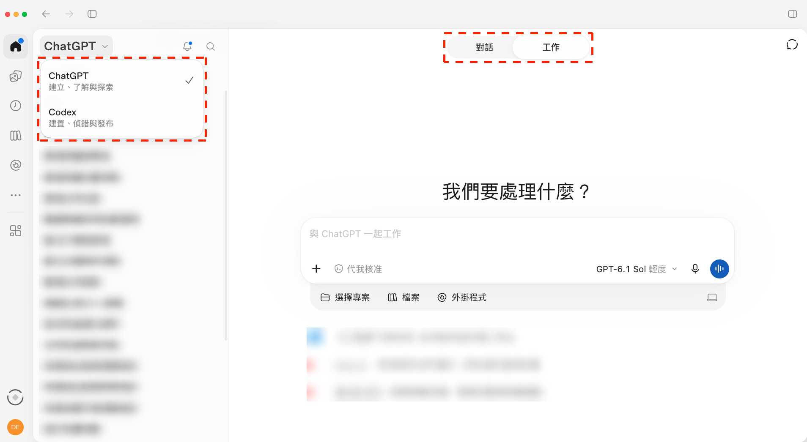

### 📁 選一個 AI 工作範圍的資料夾

[download dir="行動研究" label="下載「行動研究」練習素材" desc="上一堂放進專案的 4 份虛構文件：研究計畫書、分工與共備記錄、文獻與背景資料、評量規準與學習單格式"]

- 解壓後會得到 `行動研究` 資料夾，裡面就是上一堂的 4 份文件
- 在桌面版選擇這個資料夾，**只選這一個**，不選整個桌面或校務共用磁碟
- 預設權限為`代我核准`，若不放心可調整為`要求核准`

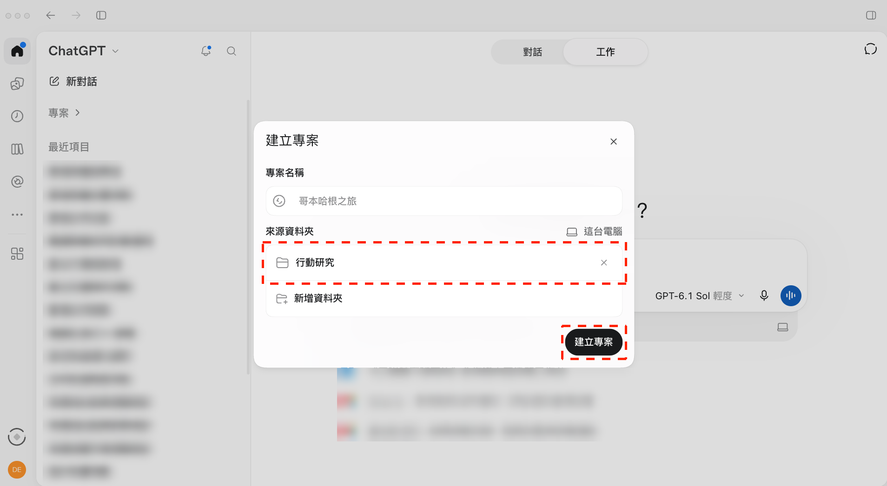

[warning title="使用提醒"]
桌面版是有能力`新增、修改、刪除`電腦檔案的。

能力越大風險越大，你可以想想`如果事情做到一半，但額度沒了會發生什麼事`。

所以原始資料要另留副本；遇到看不懂的權限要求，先請它用白話解釋，不要一路按同意。`按下同意，責任就是你的。`
[/warning]

## 上一堂的專案，改成直接讀資料夾

### 🆚 同一批文件，兩種給 AI 的方式

| | 🌐 上一堂：網頁版專案 | 💻 今天：桌面版資料夾 |
|---|---|---|
| 怎麼給資料 | 建立專案 → 把 4 份文件`一份份拖進去` | 選一次資料夾，裡面的檔案`都讀得到` |
| 文件更新了 | 要重新上傳新版 | 改完存檔，AI 下次讀到的就是新版 |
| AI 的成品 | 在對話裡，要自己複製或下載 | 直接新增、更新文件 |
| 適合 | 跨裝置使用、和同事共用 | 檔案多、常更新、要交出檔案 |

> **線上專案沒有被取代**
> 人在外面想用手機查、想分享給同事，還是線上專案方便；而在電腦上處理一整包檔案，使用專案資料夾最直覺。

### ▶️ 用上一堂的問題驗證一次

```prompt [label="驗證出處、決議與誠實度"]
1. 這次行動研究的研究對象是誰？要教哪幾個閱讀策略？
2. 策略教學現在每週上幾節？後測確定改成線上施測了嗎？
3. 這個研究有申請經費嗎？金額是多少？
```

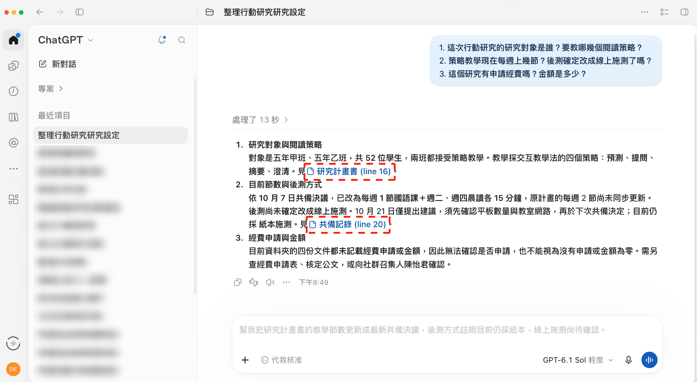

| 問題 | 應該出現的結果 |
|---|---|
| 研究對象與策略 | 答得出對象與四個閱讀策略，並附上文件名稱 |
| 節數與後測 | 節數已從每週 2 節改為 `1 節加晨讀`；線上施測只是`提議`，尚待確認 |
| 經費 | 回覆「目前文件沒有記錄」，而不是編一個數字 |

```prompt [label="把成品寫成檔案"]
設計第 3 週的學習單初稿，存成 Word 檔。
```

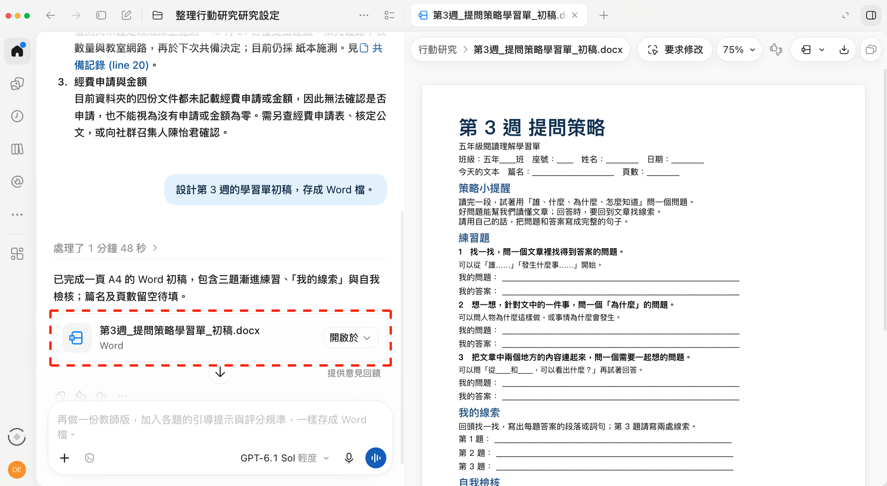

> **為什麼要使用相同素材？**
> 同樣的文件、同樣的問題，`但這次沒有上傳任何東西`。
> 而且 AI 不只回答，還會把成果`寫成檔案`放進你的資料夾。

## 新學年備課：同一個單元，今年要再教一次

> **王老師的情境**
> - 去年的教案是 `4 節`，今年只有 `3 節`
> - 課本改版，`頁碼和補充閱讀`都換了
> - 去年哪裡教得順、學生哪一題錯最多，要打開`教案的課後省思`和 `Excel 統計`才知道
> - 共備會議又多了幾件`還沒定案`的事

### 🗂️ 把這個單元的資料夾交給 AI

[download dir="國語五上_事實與意見" label="下載「分辨事實與意見」備課資料夾" desc="王老師的學年共用資料夾：Word、Excel、CSV、文字檔與掃描圖混在一起"]

- 剛剛的`行動研究`都是文字檔；這一包是會持續累積的資料，格式都不一樣
- 解壓後開一個`新對話`，資料夾改選 `國語五上_事實與意見`

| 檔案 | 格式 | 哪一年 | 備課時想從裡面知道什麼 |
|---|---|---|---|
| 114教案_分辨事實與意見.docx | Word | 去年 | 去年怎麼上、課後省思寫了什麼 |
| 114學習單_事實或意見_掃描.jpg | 掃描圖 | 去年 | 學習單出了哪些題目 |
| 114學習單作答統計.xlsx | Excel（2 個工作表） | 去年 | 學生哪幾題錯最多 |
| 115教師手冊重點_分辨事實與意見.md | 文字 | 今年 | 新版課本的目標、節數與頁碼 |
| 115教學進度表_五上國語.xlsx | Excel（2 個工作表） | 今年 | 哪一週上、有幾節、會不會撞到學校活動 |
| 115共備會議紀錄_1117.txt | 文字 | 今年 | 哪些已經決議、哪些只是提議、誰負責 |
| 115補充閱讀_吃不完的營養午餐.txt | 文字 | 今年 | 今年要換的補充閱讀短文 |
| 影音與網站連結.csv | 表格 | 兩年共用 | 影片和線上資源還能不能用 |

```prompt [label="彙整成今年的備課總覽"]
我今年要再教這個單元。把去年和今年的資料彙整成一份備課總覽，哪些可以沿用、哪些要調整、哪些還沒確定，幫我標出來
```

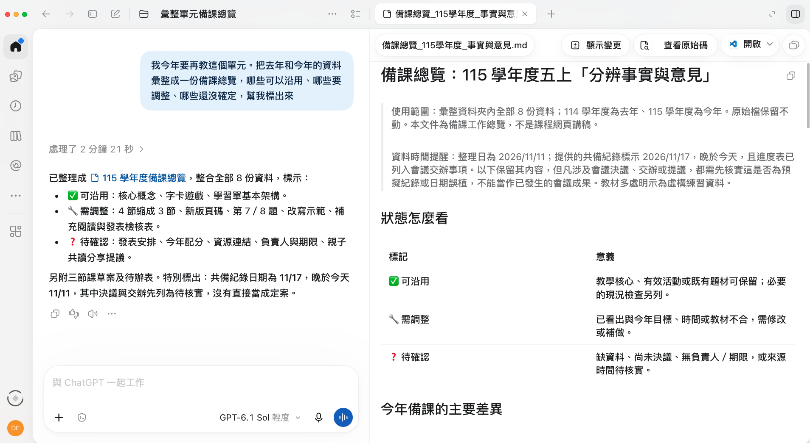

```prompt [label="變成好讀的視覺化內容"]
用視覺化的方式呈現資訊，讓我更容易了解
```

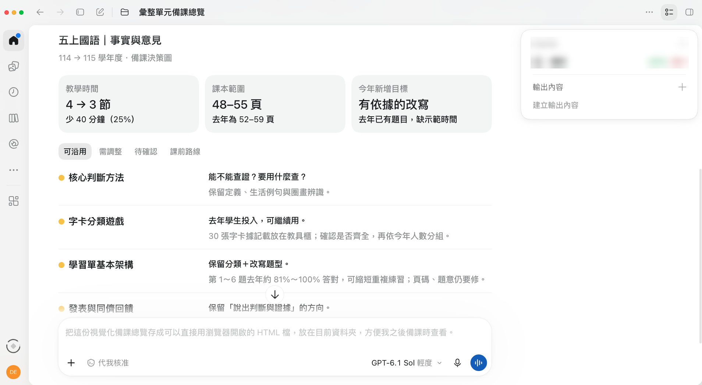

> **把最多時間花在驗證**
> 我備課時，花最多時間的不是生成，而是`驗證`：案例合不合理、資訊對不對。
> 畢竟內容出錯，責任還是要自己承擔。

---

# 照片也能彙整：掃描檔、手機拍的文件，直接彙整到 Excel

> **很多文件是以照片形式存在**
> 掃描存檔的文件、手機拍下來的回條和報名表，都是`圖片`，不能搜尋、也不能複製。

## 過去要手動彙整掃描檔和照片

> **一疊掃描檔、一堆照片，要用的時候只能一張張打開**
>
> - 想找某一筆資料，得`一張張翻`
> - 想統計或彙整，只能`看著照片重新打一次`，手寫字又容易看錯、漏打
> - 量一大（一班三十張、全校幾百張），`一整天都耗在 key-in`

### 📷 是照片也沒關係，AI 看得懂

[flow]
- **過去只能靠人工判讀** - 掃描的文件、手機拍的回條、手寫打勾的表單，內容都是`圖片`
- **AI 本身有圖片辨識能力** - 剛剛備課資料夾裡的`學習單掃描圖`，它就是這樣讀出題目的
- **不建議每一次都重新讀圖片** - 讀圖片消耗的額度比讀文字高
- **讀一次，轉成文字或表格存起來** - 之後要查詢、統計、彙整，都用這份檔案，可以`重複利用`
- **告訴它遇到例外怎麼做** - 看不清楚的欄位留白、標黃，不要自己猜
[/flow]

## 用一疊報名表照片練習

### 📥 下載 6 張報名表照片與名單範例

[download dir="報名表照片" label="下載「報名表照片」練習素材" desc="6 張手機拍的虛構手寫報名表，加上一份有欄位、內容空白的 Excel"]

- 解壓後會得到 `報名表照片` 資料夾：6 張家長交回的`親子共讀夜報名表`照片，都是手機拍的，有的歪、有的暗
- `報名名單範例.xlsx` 只有第一列的欄位、內容是空的；它是給 AI 看的`格式範例`，等一下請 AI 照這些欄位`建立一份新的名單`
- 開一個`新對話`，資料夾改選 `報名表照片`

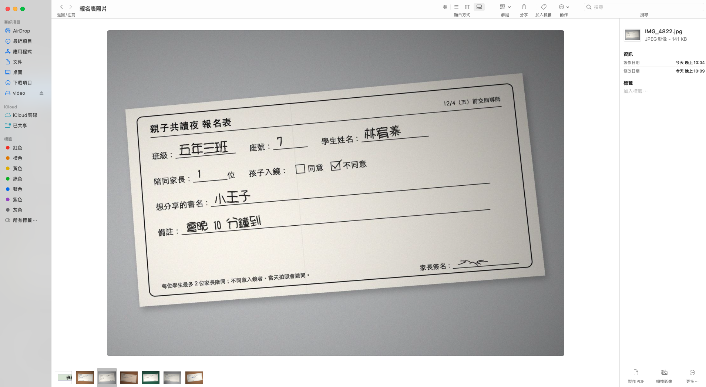

```prompt [label="把報名表照片寫進新的名單"]
請讀取這個資料夾裡的報名表照片，建立一份新的「親子共讀夜報名名單.xlsx」：
① 欄位照「報名名單範例.xlsx」的第一列，一張照片一列
② 「來源照片」填照片檔名
③ 看不清楚或不確定的格子留空、標黃，不要自己猜，原因寫在「待確認事項」；勾在兩格中間也算不確定
④ 最後告訴我：總共幾筆、哪幾格需要我確認
```

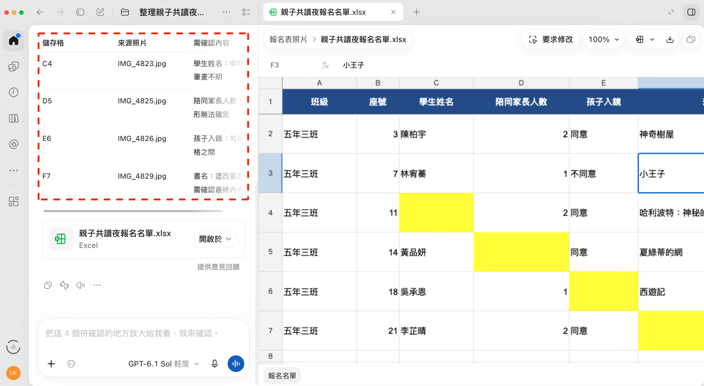

### ⚠️ 辨識圖片要注意的事項

[flow]
- **先用 3～5 張試跑** - 剛開始先用少量照片，確認它`會漏什麼、哪裡需要補規則`，再逐步增加數量
- **把例外怎麼處理講清楚** - 字跡潦草、勾在兩格中間、有塗改，都要先說好`留空標黃、不要猜`；試跑時發現新的狀況，就把規則補進 Prompt
- **每次執行的結果可能不太一樣** - 同一批照片再跑一次，讀出來的字、標黃的格子不一定相同，不要因為上次沒問題就直接採用
- **標黃的格子，回頭對照原照片** - AI 標出來的是它沒把握的地方，由你來決定該填什麼
- **沒標黃的也要抽查** - AI 很有把握不代表一定正確，姓名、數字這類不能錯的欄位要多看幾筆
[/flow]

> **AI 完成後，還是要人工驗證**
> 一格看錯，整張名單都要重對。別忘了，最後要為結果負責的是`你自己`。

### 🔁 同樣的事，換一個 AI Agent 也做得到

- **不是 ChatGPT 的專利**：`資料夾彙整`、`讀照片彙整成 Excel`，大部分能操作電腦的 AI Agent 都做得到
- **學會的是方法，不是工具**：今天的做法換到其他 Agent 一樣適用，差別只在介面
- **想看另一個工具怎麼做**：我錄過 `Manus 桌面版`的完整示範，同樣的任務可以對照著看

[youtube id="WGHQuCI3iJk" title="【Manus 桌面版教學】讓 AI 操作電腦，從資料夾彙整報告、辨識圖片寫 Excel、自動填表單"]

---

# 認識 Skill：把做事的步驟，存成 AI 的 SOP

> **Skill 是把你最好的一次，變成每一次**
> 你摸索出最順的流程後，只要成功過一次，就能把它存成 Skill，未來不用從零開始。

## 為什麼需要 Skill？

### 🤯 流程都在某個人腦袋裡

[flow]
- **關鍵人物不在，流程就卡住** - 「家長通知怎麼寫？校外教學的流程怎麼跑？」如果答案全在某位`資深老師`的腦袋；他一請假、調校，這一切就需要`重新摸索`。
- **交接靠口耳相傳，品質全憑運氣** - 新接手的老師只拿到`零散檔案`和`口頭經驗`；通知、公告、簡報……每個人的`格式、品質`都不一樣。
- **需要手把手教，難以擴散** - 好方法要`實際示範`才學得會，所以就算有人做得很好，也很難複製到`其他班級、其他處室`。
[/flow]

### 📋 提示詞一直複製貼上

[flow]
- **存了一堆 Prompt，要用時翻半天** - 提示詞散落在`記事本、LINE、聊天記錄`；真的要用時，光是找出`最後一版`就浪費一堆時間。
- **換個情境就得手動調整** - 同一套通知 Prompt，從校外教學換成班親會、從 Email 改成聯絡簿，都得`重新微調`。
- **規則改了，舊版本卻沒跟著改** - 多了一條`不能寫的話`，但同一段 Prompt 已經`被複製到十個地方`；漏改一處，錯的版本就`默默繼續產出`。
[/flow]

## Skill 和 Prompt、專案差在哪

### 📝 Skill 就像學校的 SOP 手冊

| | 📖 學校的 SOP 手冊[width:30%] | 🧩 給 AI 的 Skill[width:45%] |
|---|---|---|
| 給誰用 | 新接手業務的同事 | AI |
| 裡面有什麼 | 步驟、範本、注意事項 | 一個資料夾：`SKILL.md`（步驟與規則）、範本與參考資料，必要時再附`小程式` |
| 什麼時候用 | 遇到這項業務就翻開 | 遇到符合的任務，AI 會照著做 |
| 帶來什麼 | 換人接手，做法也一樣 | `格式一致`、`不用每次重講` |
| 怎麼傳下去 | 交接給下一位同事 | 技能包可以`下載與分享` |

> **新手也能用前輩的方法**
> 剛接觸的新手，用前輩設計好的技能，也能做出符合期待的成果。

### 🆚 Prompt、專案、Skill 各放什麼

| 功能 | 存什麼 | 比喻 | 校園例子 |
|---|---|---|---|
| Prompt | 這一次的需求 | 口頭交代 | 「幫我把這份通知改短」 |
| 專案（Project） | 背景知識與文件 | 活動資料夾 | 行動研究的計畫書與共備記錄 |
| Skill | 做事的步驟與範本 | SOP 手冊 | 「回覆家長」的步驟、語氣與不能說的話 |

> **專案放知識，Skill 設計流程**
> **專案讓 AI「知道事實」** — 你的角色、活動辦法、共備決議
> **Skill 讓 AI「知道步驟」** — 報名表登記、每週回顧、信件、資訊卡、簡報要遵守的 SOP

---

# 如何使用 Skill：用白話文就能生成，也可匯入別人做好的

[warning title="ChatGPT 的技能需要付費版"]
技能目前需要付費版，並在`工作`模式使用，免費版看不到技能頁面。
[/warning]

> **Skill 怎麼來？四種做法，由淺入深**

[flow]
1. 把既有流程變成 Skill — 報名表登記：剛剛做過一次、規則可以接受，請 AI 存起來
2. 用白話生成 Skill — 每週回顧：還沒有流程，直接描述你要的結果
3. 建立自己的 Skill — 寫信風格：讓 AI 讀你寫過的信，做出只屬於你的版本
4. 匯入別人做好的 Skill — 資訊卡：下載技能包，匯入就能用
[/flow]

## 把既有流程變成 Skill

### 💬 規則可以接受了，就請 AI 把它變成 Skill

- 報名表、同意書、調查表：表單不一樣，`登記的規則都一樣`
- 剛剛那一段規則已經試過、結果你也能接受；回到`剛剛登記報名表的對話`，直接用白話說

```prompt [label="把判斷邏輯設計成 Skill"]
幫我把流程變成 Skill [form-photos-to-excel]，之後想把報名表、同意書、調查表寫入 Excel 時可以共用
```

- AI 會把對話裡的規則整理成一份 Skill，內容看過沒問題，就依畫面提示`儲存`

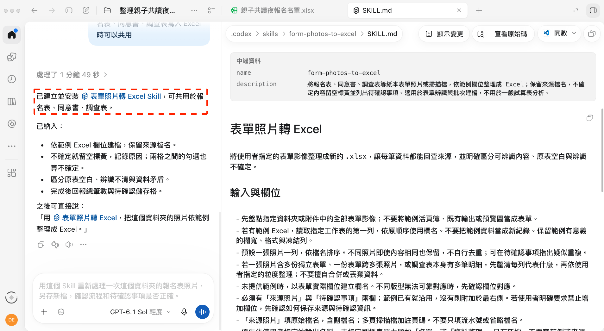

### ▶️ 呼叫：直接說需求，或輸入 @ 選技能

- **被動觸發**：直接描述需求，符合技能描述時，AI 會自己選用；技能越來越多，要記住每個名稱並不現實
- **主動呼叫**：在輸入框打 `@`，從清單選技能，再接著寫需求；一段對話想用多個技能時，這個方式比較穩定

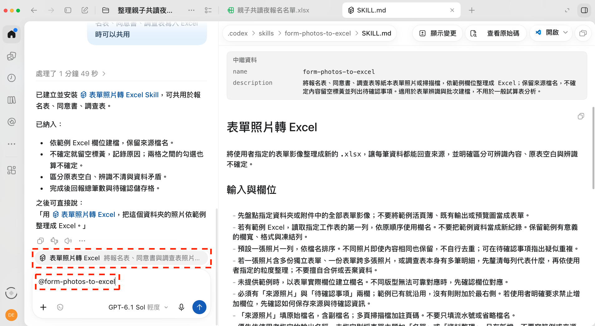

### ✅ 驗證：隔天又收到 4 張報名表

[download dir="報名表照片_第二批" label="下載「報名表照片（第二批）」練習素材" desc="4 張新的報名表照片"]

- 在同個資料夾中`開啟新對話`
- 把這些照片拖曳到前面`報名表照片`資料夾中

```prompt [label="用一句話登記新的報名表"]
把新的報名表登記到名單
```

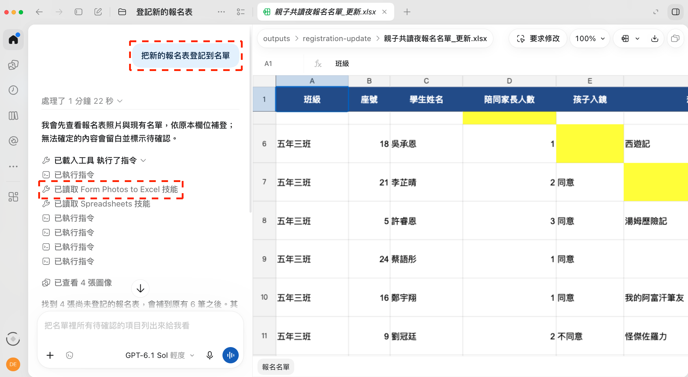

## 用白話生成 Skill

### 📝 把期待的格式講清楚，而不是讓 AI 自由發想

- 報名表的 Skill 是把`已經做過的流程`存起來；「回顧我這週做了什麼」還沒有流程，直接用`一段白話`描述你要的結果
- Skill 的資料來源不只對話：它可以搭配`外掛程式`，把上一堂連好的 `Gmail`、`Google Calendar` 一起讀進來
- 方括號裡的內容，換成你自己的習慣
- 開新對話後，`不需要在專案裡面做`

```prompt [label="用一段白話建立每週回顧 Skill"]
我想要建立一個 Skill：[weekly-review]
根據我與 AI 的對話紀錄、Gmail 的往來信件、Google Calendar 的行程，幫我回顧這段時間做了什麼，這份回顧是寫給我自己看的
只整理工作方面的資訊，產出前請先取得當下時間；沒有指定期間時，預設回顧[最近一週]，我也可以指定上週或這個月
內容分成四個部分：[完成了哪些事、推進了哪些事、做了什麼重要決策、下一步是什麼]，並遵循下面規則：
- 避免流水帳，同一件事的信件、會議與對話合併成一項
- 不要把未完成的事寫成已完成，也不要編造對話、信件與行事曆中沒有的內容
- 讀不到 Gmail 或行事曆時先告訴我，不要用猜的補上
- 請使用繁體中文，用條列呈現，讓我一分鐘內看完
- 直接輸出回顧，不需要額外解釋
```

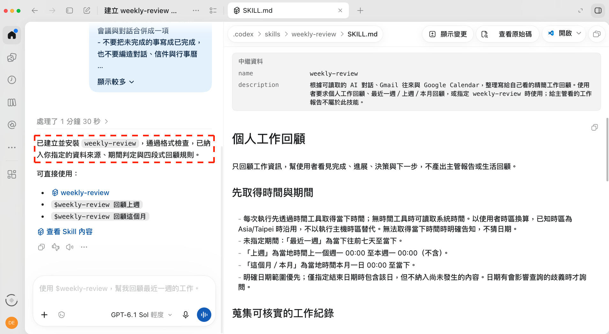

> **個人心得**
> AI 設計的 Skill 有時會有`過度設計、冗贅資訊`的問題，可以根據實戰結果`調整細節`。

### ✅ 開新對話驗證

```prompt [label="測試被動觸發"]
回顧我上週做了什麼
```

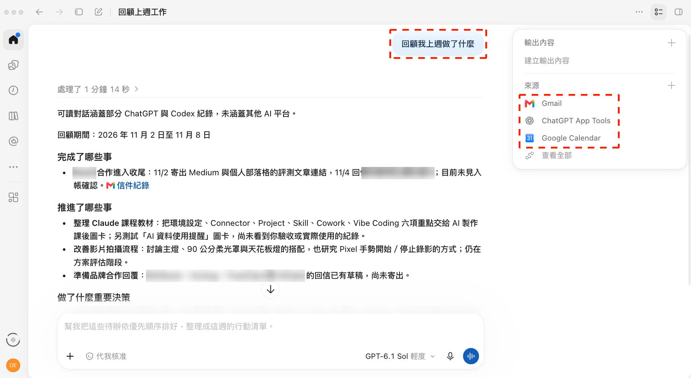

## 建立自己的 Skill

### ✉️ 拿我自己舉例：合作邀約

- 我常收到品牌的`合作邀約`，每一封都要回，但回法不只一種：`接受`、`婉拒`、`先詢問細節`、`討論時程`、`報價`
- 要回得好，AI 得先知道我的`個人背景`：
  - **報價**：不同合作形式各是多少、哪些可以談
  - **合作方式**：我接哪些形式、不接哪些類型、目前檔期排到什麼時候
  - **過去成效**：做過哪些案例、可以附上哪些成果當參考
- 這些資訊，別人的「寫信 Skill」都不會有

### 🗂️ 我的回信 Skill 裡放了什麼

這個 Skill 是從我 `真實往來信件`歸納出來的：

| 檔案 | 內容 | 為什麼只有我自己寫得出來 |
|---|---|---|
| SKILL.md | 流程：解析來信 → 調查品牌 → 判斷回應類型 → 產出草稿 → 自我檢查 | 這是我實際回信的順序 |
| 決策框架 | 什麼情況接受、婉拒、詢問、先試用、報價 | 判斷標準來自我的頻道定位 |
| 報價紀錄 | 各種合作形式的現行報價與歷史紀錄 | 報價是我的，AI `不能自己編` |
| 回信模板 | 中文、英文各一份，每種回應類型的寫法 | 語氣是從我寄出去的信整理的 |
| 婉拒紀錄 | 不接的品類、過去婉拒過誰與原因 | 每次做完決定都會`回寫`一筆 |

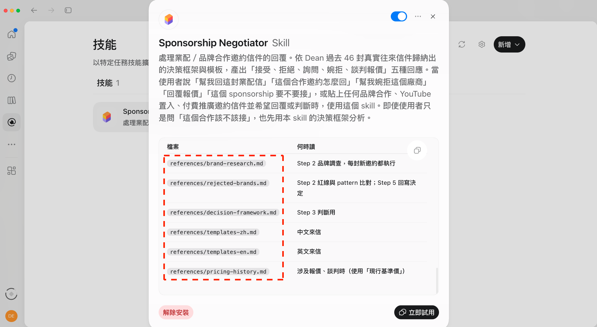

### ▶️ 示範：從 Gmail 找出邀約信，交給我的 Skill

```prompt [label="講師示範：用 @ 叫出 Skill，直接從 Gmail 找信"]
@sponsorship-negotiator 到 Gmail 找出 BlackBaoBao 寄來的合作邀約，先告訴我建議怎麼回、理由是什麼；我確認後再寫回信草稿
```

[flow]
1. 找到信件 — 從 Gmail 讀出這封邀約，整理對方要的合作形式、時程與提問
2. 調查與判斷 — 先調查品牌，給我`建議的回應類型與理由`
3. 對照我的資料 — 報價引用我的`報價紀錄`，查不到就留空請我填；檔期依我目前的排程建議接、延後或婉拒；附上我做過的參考案例
4. 等我決定 — 我確認後才寫回信草稿，決定還會`回寫進紀錄`
[/flow]

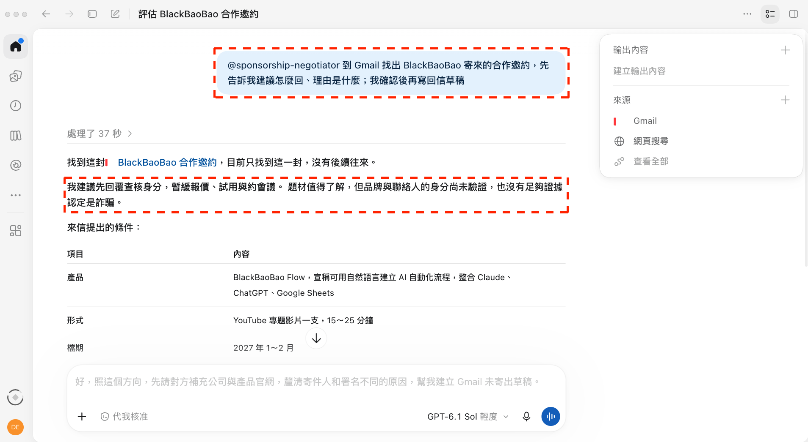

### 🔄 最好的 Skill，是從自己的工作流長出來的

[flow]
1. 先把事情做一次 — 用白話跟 AI 來回，回出一封自己滿意的信
2. 存成第一版 — 把剛剛的步驟與規則整理成 Skill，不用追求完整
3. 邊用邊補 — 哪裡不滿意，就把那條規則、那份資料補進去
4. 持續更新 — 報價變了、多了一種不接的類型，回寫進 Skill
[/flow]

> **不要想著一開始就完美**
> 別人的 SOP 可以參考，但最好的 Skill 是從`自己實際的工作流`出發，再慢慢調整到符合期待。
> **有持續在用的 Skill，一定會持續優化**；放著不改的，通常也是沒在用的。

### 🧑‍🏫 換成你：讓 AI 讀你寫過的信，整理成你的寫信 Skill

- 前兩個 Skill 的規則是`你告訴 AI 的`；這一個換成讓 AI `從你寫過的信裡找出規則`，做出來的就是只屬於你的版本
- 上一堂已經用`外掛程式`連上 Gmail，可以直接請它讀你最近寄出的信

```prompt [label="第一步：讀我最近寫的信，整理我的回信習慣"]
讀取我最近寄出的 20 封信，只看我自己寫的內容，整理我回信的習慣：
怎麼稱呼對方、開頭先講什麼、怎麼結尾與署名、最常回覆的幾種情況、哪些話我不會說。
先把整理結果給我確認；不要列出信裡的姓名、電話或其他個資。
```

```prompt [label="第二步：確認後變成 Skill"]
整理的結果我確認過了，幫我把它變成我的寫信 Skill
```

## 匯入別人做好的 Skill：用資訊卡示範

> **不是每個 Skill 都要自己從頭做**
> 前面三個 Skill 都是在對話裡生成的；別人做好的技能包，下載後`匯入`就能直接用。

### 🖼️ 把長長的通知，變成大家願意看完的 5 張卡

- 家長通知、活動公告、教材重點，字一多就沒人看完；做成`一卡一重點`的圖卡，貼到班級群組更好讀
- 資訊卡上的文字是`真的字`，不像 AI 生成的圖片偶爾會出現錯字
- 技能包流程：先給你`提煉摘要`確認 → 把內容排進固定版型 → 用寫網頁的方式產出一組 `1080×1350` 的圖片

[download dir="info-card-generator" label="下載「資訊卡」技能包" desc="info-card-generator.zip：SKILL.md＋版型模板＋產圖小程式"]

### 📥 匯入：在對話視窗上傳壓縮檔

```prompt [label="貼上技能壓縮檔"]
@skill-creator
```

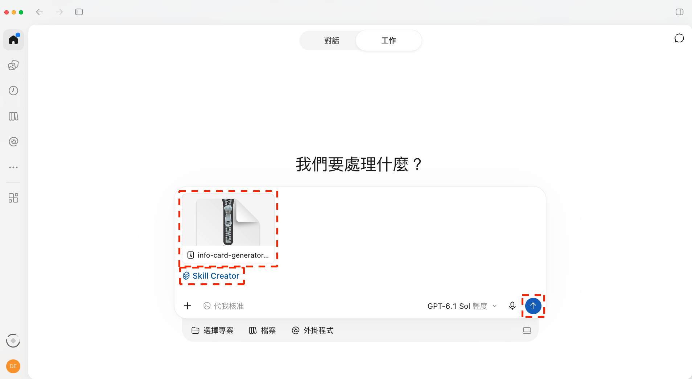

### ▶️ 用匯入的 Skill 做一組資訊卡

```prompt [label="在 ChatGPT 用 Skill 做資訊卡（講師示範）"]
@info-card-generator 把下面的通知做成給家長看的資訊卡。

【五年級校外教學行前通知】
各位家長您好：

本學期五年級校外教學訂於 12 月 23 日（星期三）前往海岸自然教育園區，配合自然課「水域環境」與社會課「家鄉的產業」單元，當天上午參觀潮間帶生態館並由園區解說員帶領分組導覽，下午進行漂流木吊飾 DIY，請家長協助孩子做好行前準備。

當天請於 07:40 前到教室集合，08:00 準時發車，逾時不候，預計 16:10 返抵學校、16:30 於校門口放學，安親班接送請自行調整時間；當天不上課後社團。

費用每人 550 元，包含車資 280 元、門票 150 元、DIY 材料費 90 元與旅遊平安保險 30 元，午餐由園區餐廳統一供應已含在門票內，素食或食物過敏請於同意書上註明；費用請於 12 月 14 日（星期一）前裝入信封、寫上班級座號交給導師，請自備剛好的金額，恕不找零，繳費後因個人因素取消僅退還門票與材料費共 240 元。家長同意書請於 12 月 11 日（星期五）前交回，未交同意書者依規定不能隨隊，當天留校由代課老師安排自習。

服裝請穿學校運動服與好走的運動鞋，園區部分步道濕滑請勿穿涼鞋或拖鞋；請攜帶水壺、帽子、薄外套、輕便雨衣、個人藥品與健保卡，容易暈車的孩子請先服藥並在同意書註明，由老師安排坐前排。請勿攜帶手機以外的電子產品與超過 100 元的零用錢，手機僅限緊急聯絡使用，遺失請自行負責。

每班徵求 2 位家長志工隨隊協助，意者請於 12 月 9 日（星期三）前在聯絡簿回覆，志工不需繳費。當天如遇豪雨特報，將改至 12 月 30 日（星期三）舉行，並於前一天 18:00 前在班級群組公告；小雨照常出發。活動當天緊急聯絡請撥學務處分機 21。

五年三班導師 王老師 敬上
```

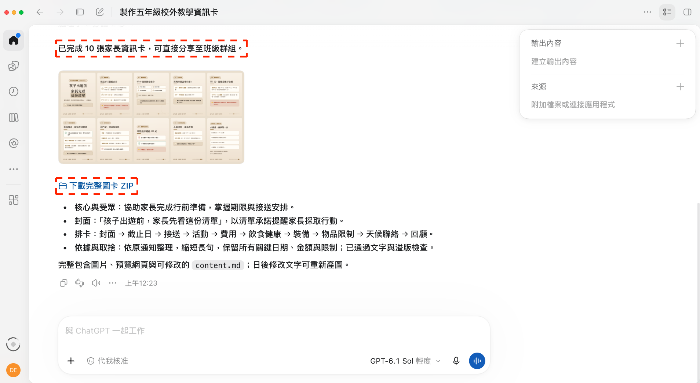

### 🧑‍💻 這份成品，其實是 AI 寫的程式

- 圖卡不是 AI 畫出來的：它先把內容寫成`網頁`，版面、配色、字體大小都寫在程式碼裡
- 技能包附的`小程式`再把網頁上的每一張卡轉成圖片
- 技能包裡除了 `SKILL.md`，還多了`版型模板`與`小程式`：樣式固定、AI 只填內容，所以`每次風格都一致`
- 你不需要看懂程式，只要知道：`這一類 Skill，AI 是在寫程式，不是在寫文章`

| Skill | 成品 | 用到程式嗎 | 建議在哪裡用 |
|---|---|---|---|
| 表單照片登記 | Excel 名單裡的新資料 | ❌（只有文字規則） | ChatGPT 或 Codex |
| 每週回顧 | 一份條列的回顧 | ❌（只有文字規則） | ChatGPT |
| 寫信風格 | 一段文字 | ❌（但要補上你的背景） | ChatGPT |
| 資訊卡 | 一組 PNG 圖卡 | ✅ 寫網頁，再執行小程式轉成圖片 | ChatGPT 可以，`Codex 更順` |
| 線上講義 | HTML 網頁檔 | ✅ 寫網頁 | Codex |
| 校園簡報 | PPTX 檔 | ✅ 還要執行小工具 | Codex |

> **為什麼要分辨 Skill 有沒有用到程式？**
> 因為這決定了`該交給誰做`。只有文字規則的，ChatGPT 的對話就很順；要寫檔案、跑程式的，交給擅長寫程式的 Codex 會更有效率。

---

# Codex：用到程式的 Skill，交給它更有效率

> **行政秘書 🆚 資訊組**
> 寫信、每週回顧找行政秘書（ChatGPT）；要寫網頁、跑小工具，找資訊組（Codex）。

## 為什麼換到 Codex？

### ⚡ 檔案直接寫進資料夾，改一句話就重做

| | ChatGPT（雲端執行） | Codex（在你的電腦執行） |
|---|---|---|
| 素材 | 貼上或上傳 | 直接讀資料夾裡的檔案 |
| 成品 | 產出後`下載`，再自己放進資料夾 | 直接`寫進 output` |
| 想修改 | 重新產出、重新下載 | 說一句「第 3 張改成…」，它改完你`重新整理`就好 |
| 需要的工具 | 由雲端環境決定 | 用你電腦上的工具；`缺什麼可以請它協助安裝` |
| 方案 | 技能需要付費版 | 所有方案都能用（免費版額度有限） |

- 這是我自己的使用經驗：會產出檔案、需要反覆修改的 Skill，在 Codex 來回的次數少很多
- Codex 和`工作`模式`共用同一份額度`，方法學會了，換到哪個模式都通用

### 🔀 切換到 Codex，開啟這一段的練習資料夾

[download dir="技能練習" label="下載「技能練習」練習素材" desc="三份虛構素材，一個 Skill 用一份：家長通知（資訊卡）、上課筆記（線上講義）、班親會資料（校園簡報）"]

- 從桌面版左上的選單切換到 `Codex`
- 解壓後開啟 `技能練習` 資料夾，權限一樣選`每次詢問`（Ask for approval）
- Codex 裡的`專案`，指的是`連到你電腦上的一個資料夾`；和上一堂 ChatGPT 放指令與文件的專案不是同一個東西（參考 [OpenAI 專案說明](https://learn.chatgpt.com/docs/projects)）
- 以前裝過獨立 Codex App 的人，更新成 ChatGPT 後，在裡面開啟 Codex 即可

<!-- 待補圖片：codex-open-folder.png｜切換到 Codex 並開啟「技能練習」資料夾的畫面，虛線紅框標出選單的 Codex 與目前資料夾 -->
<!-- 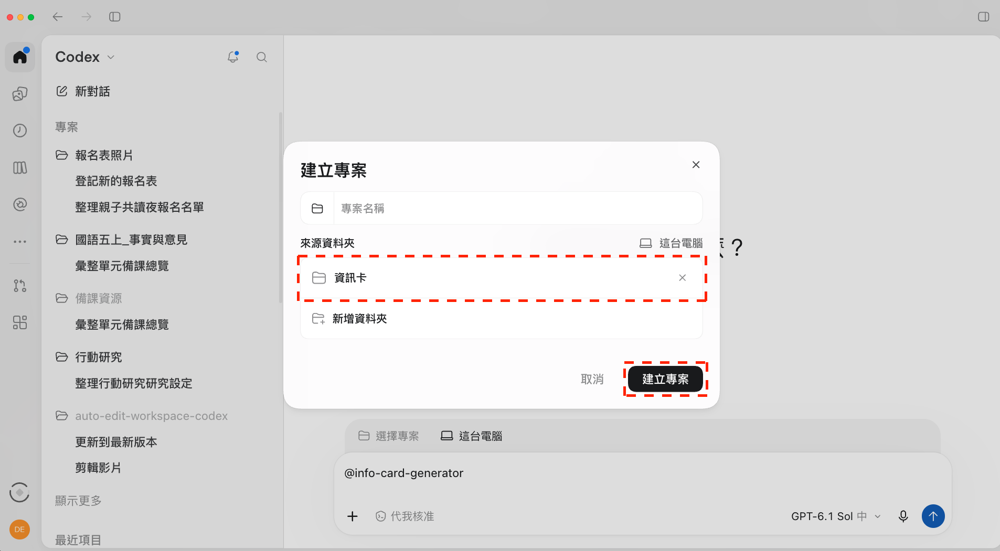 -->

### 🎬 我錄了一支 Codex 搭配 Skill 的完整示範

- 示範在 Codex 用 Skill，把`用完就丟`的一次性成果，變成`可以持續優化`的工作流程
- 課後想複習 Skill 的安裝、呼叫與調整，可以先看這支

[youtube id="0pZri5f_tfk" title="【ChatGPT Codex 實戰】將 Vibe Coding 成果從「用完就丟」，變成「可持續優化」的 Agent Skills"]

## 安裝也可以請 AI 協助

### 📥 請 Codex 把技能包搬進 Skill 資料夾

- 官方說明：個人 Skill 放在家目錄的 `.agents/skills` 資料夾（Mac 是 `~/.agents/skills`；Windows 是 `C:\Users\你的帳號\.agents\skills`）
- 資料夾名稱開頭有一個點，Finder 與檔案總管預設`看不到`；與其自己找，不如`請 Codex 幫你搬`
- 把剛剛下載的資訊卡，加上下面兩個技能包，放進剛剛的 `技能練習` 資料夾；Safari 可能會自動解壓縮成資料夾，直接放資料夾也可以

[download dir="teacher-class-handout" label="下載「線上課堂講義」技能包" desc="teacher-class-handout.zip：SKILL.md＋講義 HTML 模板，不需要安裝任何軟體"]

[download dir="teacher-slides" label="下載「校園簡報設計師」技能包" desc="teacher-slides.zip：SKILL.md＋14 種版型的校園 PPTX 模板＋產出小工具"]

```prompt [label="請 Codex 安裝技能包"]
請幫我安裝這個資料夾裡的三個技能包（info-card-generator、teacher-class-handout、teacher-slides）：
1. 是 zip 就先解壓縮；已經是資料夾就直接用
2. 複製到我的個人 Skill 資料夾 ~/.agents/skills/，每個 Skill 一個資料夾，打開就直接看得到 SKILL.md
3. 不要修改技能內容，也不要動其他資料夾
4. 完成後列出裝了哪些 Skill、放在哪裡，以及我需不需要重新開啟 App
```

<!-- 待補圖片：codex-skill-install.png｜Codex 安裝技能包時跳出的核准提示，虛線紅框標出要寫入的資料夾位置 -->
<!--  -->

### 🧰 缺工具時，先請它用白話說明再安裝

- 有些 Skill 需要額外的工具才能執行（ex: 資訊卡要用 Node.js 把網頁轉成圖片、校園簡報要用 Python 產出 PPTX）
- 過去遇到「請先安裝 ○○」就卡住；現在可以請 Codex `檢查、說明、協助安裝`
- 重點是`先說明、後安裝`：裝什麼、為什麼、裝在哪裡，你聽懂了再同意

```prompt [label="缺工具時，請 Codex 協助"]
執行這個 Skill 如果需要安裝其他工具，請先停下來，用白話告訴我：
1. 要安裝什麼、用途是什麼
2. 會裝在哪裡、之後怎麼移除
3. 不安裝的話，有沒有替代做法
等我回覆「同意」再安裝。
```

[warning title="安裝前先看清楚"]
- 安裝要寫入練習資料夾以外的位置，Codex 會跳出核准提示；看清楚它要`寫到哪裡`再按同意
- Skill 可能附帶小程式，只裝`信任來源`的技能包（官方、學校、講師提供）；來路不明的不要裝
- 學校配發的電腦可能`不允許自行安裝軟體`，遇到權限限制請先問資訊組
[/warning]

### ▶️ 在 Codex 呼叫 Skill

- **主動呼叫**：在輸入框打 `@`，從清單選技能，再接著寫需求（Codex 也支援輸入 `$` 叫出技能）
- **被動觸發**：直接描述需求，符合技能描述時，Codex 會自己選用
- Codex 會自動偵測新裝的技能；清單沒出現就重新開啟 App
- 側邊欄的`技能`頁面可以瀏覽目前有哪些技能

<!-- 講師備註：官方文件寫「In ChatGPT, type @ to select a skill」「Codex supports $ mentions for skills」；桌面版 Codex 輸入框打 @ 或 $ 何者列出技能、技能頁能否直接上傳 zip，官方未說明，授課前用授課帳號確認。 -->

<!-- 待補圖片：codex-skill-list.png｜在 Codex 輸入框打 @ 後出現的技能清單，虛線紅框標出 info-card-generator、teacher-class-handout、teacher-slides -->
<!--  -->

### 🖼️ 同一個資訊卡 Skill，在 Codex 再做一次

```prompt [label="在 Codex 把家長通知做成資訊卡"]
@info-card-generator 把「家長通知_親子共讀夜.md」做成給家長看的資訊卡，存到 output 子資料夾。
先給我提煉摘要，我確認後再做。
```

- **對得上**：日期、星期、時間、地點與通知逐字相同（12/11（五）18:30～20:00、12/4（五）前交回報名表）
- **沒多寫**：通知沒提到的資訊（ex: 停車、餐點、校長致詞）不能出現
- **有來源**：最後一張卡寫了這份內容的依據
- **用得上**：資料夾裡多了一組 1080×1350 的 PNG，可以直接貼到班級群組

> **和剛剛在 ChatGPT 做的差在哪？**
> 這次沒有貼通知、也沒有下載檔案：素材從資料夾讀，成品直接出現在 `output`。
> 想換顏色，說一句「改成天空藍」，它會重新產出一組圖。

## 線上課堂講義：把教案與筆記變成一頁式網頁

### 🧑‍🏫 你現在看的這份講義，就是這樣做出來的

- 過去我用 PPT 做講義，資訊常常`貼來貼去`，有時還找不到檔案在哪裡；三年前一場 6 小時的企業內訓，光準備講義就要 `20 小時`
- 現在我改用 Markdown 設計講義，並把流程寫成 Skill：結構發想 → 整理資訊 → 客製化案例 → 完成講義，時間縮短到 `3 小時`
- 我的講義 Skill 需要 Node.js 來 build；老師版簡化成`一個 HTML 模板`，Codex 直接寫出一個檔案，瀏覽器打開就能用

### 📄 老師版：一個 HTML 檔就是一份講義

- 自動目錄、重點卡、比較表、步驟、點開才看到答案的`想一想`、可勾選的回家任務
- 學生端可以用 `A＋` 放大字、切深色；列印時「想一想」的答案會自動展開
- 可以傳檔案給學生，或放到學校的雲端硬碟分享

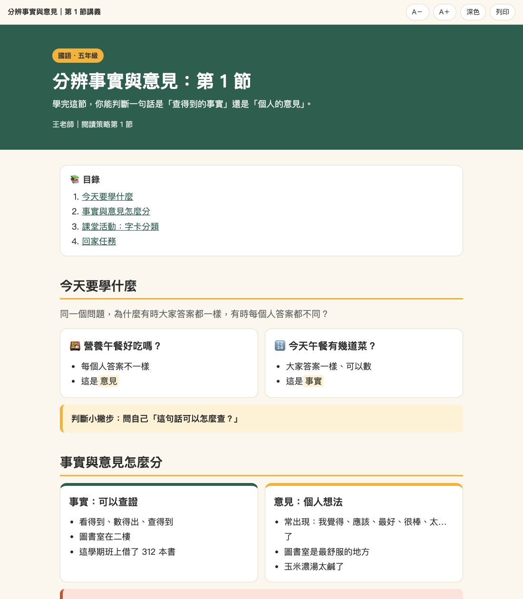

```prompt [label="把上課筆記整理成線上講義"]
@teacher-class-handout 把「上課筆記_事實與意見第一節.md」整理成給學生課後複習的線上講義，存到 output 子資料夾。
先給我段落大綱，確認後再製作。
```

### ✅ 驗收重點

- **對得上**：例句的分類與筆記一致（ex: 「榕樹種了 50 年，是最美的樹」是`事實＋意見都有`）
- **想一想**：每題都有參考答案與判斷理由
- **好操作**：目錄點得到、`A＋` 能放大、列印預覽時答案有展開
- **沒多寫**：沒有筆記以外的頁碼、例題或評分標準

## 校園簡報：參考模板，班親會簡報照校園版型做

### 📊 先大綱、再預覽、最後才產出

> **AI 生成很快，但我們要的是「精確」**
> 不要想一步到位，而是`設計出自己想要的結果`：先大綱 → 再預覽 → 給模板 → 才生成。

[flow]
1. 釐清需求 — 場合、聽眾、一句話結論、頁數，缺的一次問完
2. 生成大綱 — 頁碼、結論式標題、這頁的任務、建議版型，先確認方向
3. 逐頁預覽 — 用文字描述每頁長怎樣，在文字階段就能調整
4. 套模板產出 — 照校園模板產出可編輯的 PPTX，附待補清單
[/flow]

- 技能包內附`校園風格模板`：黑板綠、向日葵黃、紙張米白，14 種版型涵蓋流程、比較、時間軸、表格、請家長配合
- 適用場合：`班親會`、`教學觀摩或研習分享`、`學生活動說明`；技能會依聽眾挑版型與頁序

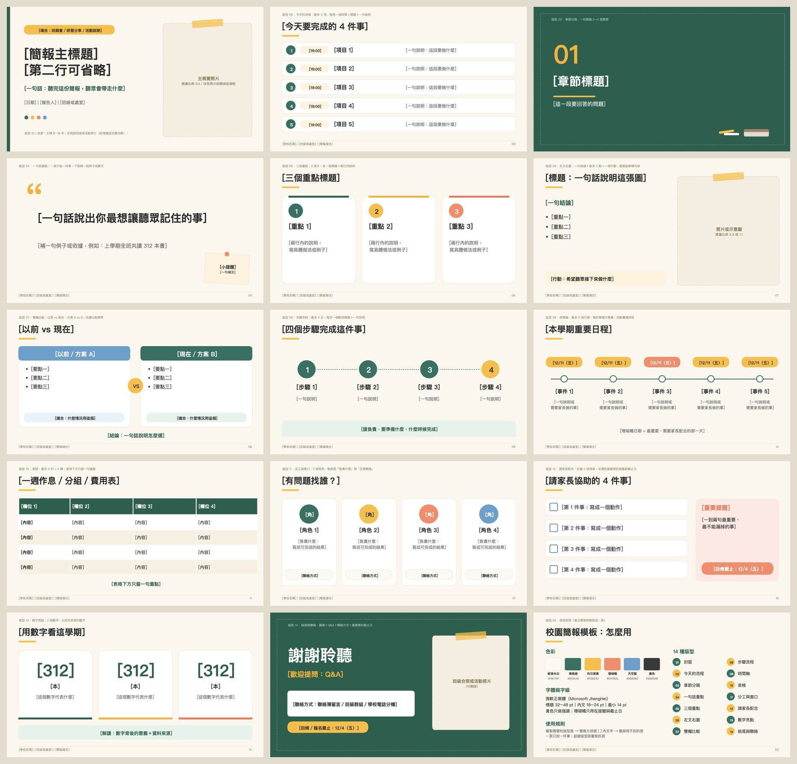

```prompt [label="用模板設計班親會簡報"]
@teacher-slides 用「班親會資料.md」設計下學期班親會簡報，聽眾是家長，10 頁內。
先給我大綱就好，確認後再逐頁預覽，最後才產出 PPTX 到 output 子資料夾。
```

```prompt [label="換成研習分享或活動說明"]
@teacher-slides 我要在校內研習分享[今天學到的 Codex 與 Skill]，聽眾是同事，15 分鐘。
素材是[我的筆記或檔案]，先給我大綱。
```

<!-- 待補圖片：codex-slides-outline.png｜Codex 依技能列出的班親會簡報大綱表格（頁碼、標題、任務、版型） -->
<!--  -->

### 🧰 PPTX 是怎麼做出來的？

- 產出 PPTX 要執行技能包附的小工具（只用 Python 內建功能，不需要另外安裝套件）
- 這就是`用到程式`的 Skill：SKILL.md 寫步驟，模板管版型，小工具負責把文字填進每一頁
- 官方沒有說明桌面版內建哪些執行環境；跑不動時，先用前面的 Prompt 請 Codex 說明缺什麼，或讓技能改交`逐頁文字稿`，讓你貼進模板
- 過程中 `output` 會多一個 `簡報計畫.json`，那是給小工具看的設計稿，可以不用理它
- **備案一**：把同一個 `teacher-slides.zip` 匯入 ChatGPT 的`技能`，在雲端產出
- **備案二**：額度不夠時，看講師的示範對話與成品就好，自己先練到「逐頁預覽」

<!-- 講師備註：授課前確認三件事。1. 以授課帳號在 Codex 實跑 teacher-slides，確認能執行 python3 產出 PPTX（第三方回報桌面版會下載自己的執行環境，也有下載失敗的案例，見 sources.md）。2. ChatGPT 技能上傳：官方文件把個人技能列在 Business／Enterprise／Edu，定價頁卻顯示 Plus 也有，以授課帳號確認。3. 準備一個示範對話分享連結，補在備案二。 -->

<!-- 待補圖片：codex-slides-result.png｜用 PowerPoint 打開 Codex 產出的班親會簡報，可直接編輯文字 -->
<!--  -->

> **小提醒：簡報很耗額度**
> - 用 Skill 生成簡報可行，但`消耗的額度非常多`：我之前在 ChatGPT Plus 實測，一份簡報大約用掉 70% 的額度（個人經驗，不是官方數字）
> - 官方說明：Codex 與工作模式共用同一份額度，`長任務會比短問題多用很多`；用量可在設定頁查看
> - 所以先把大綱和預覽確認好，再一次產出

### ✅ 驗收重點

- **打得開**：用 PowerPoint、Keynote 或 Google 簡報打開，文字可以直接編輯
- **對得上**：數字與日期都出自班親會資料（ex: 借閱 312 本、18 個家庭、學校分機`待確認`）
- **沒跑版**：字沒有超出框；照片框已放照片或刪掉
- **有清單**：附上待補清單（照片、待確認的日期與聯絡方式）

### 🌐 不同 AI Agent 都有 Skill

- Skill 已經是各家 AI Agent 的`對標功能`：ChatGPT 與 Codex、Claude、Antigravity、Manus 都有，學會一次，換工具也用得上
- 我也錄了其他 Agent 的 Skill 教學，想延伸學習可以看：
   - [【Antigravity Agent Skills 教學】當別人還在複製貼上，你的 AI 已經自動搞定](https://youtu.be/xe00zJEtuMo)
   - [【Manus Skill 技能教學】教會 AI 一次，他永遠記得！](https://youtu.be/lKiwb381mfU)

> **別人的 SOP 是參考，自己的工作流才是答案**
> 今天下載的技能包，你都可以打開 `SKILL.md` 看看它怎麼寫；但別停在「裝好了」，把它改成符合自己的版本，第 3 堂就換你從頭設計一個。

---

# 📌 課程總結：把整理交給 AI，把判斷留給自己

[summary]
- 📁 **資料夾取代上傳** | 安裝桌面版，每段練習只選那一包素材的資料夾；先盤點再提問，成品直接寫進 output
- 📚 **新學年備課** | 去年和今年、格式不同的資料一次讀完，分清哪些沿用、哪些要調整、哪些還沒確定
- 📷 **照片也能彙整** | AI 讀得懂圖片，但讀一次就轉成表格存起來重複利用；先少量試跑、補規則再加量，看不清楚的標黃不亂猜
- 🧩 **認識 Skill** | 專案放知識、Skill 放步驟；做法可以接受了，一句白話就能把它變成 Skill
- ✉️ **從公版到客製化** | 讓 AI 讀你寫過的信，整理成你的寫信 Skill；從實際工作流出發，邊用邊更新
- 🧑‍💻 **用到程式的 Skill** | 資訊卡、線上講義、校園簡報交給 Codex；安裝與缺工具都可以請 AI 協助
- 🔍 **打開驗收** | 日期、數字、來源逐一核對，責任在自己
[/summary]

### ✅ 本堂交付檢查

- **開得了**：Word、Markdown、CSV、Excel、HTML、PPTX 都能在預定工具打開
- **對得上**：信件、圖片、資訊卡、講義、簡報的日期與數字和素材一致；資料夾問答與備課總覽每筆都有出處
- **守得住**：沒有擴大到其他資料夾，原始資料沒有被改動；只裝信任來源的技能包
- **說得清**：不確定、待確認、讀不到的地方都有標出來

### 🔮 下一堂預告

- 第 3 堂換用 Claude：用 `Connector` 整理信件與行事曆、用 `Project` 建立活動知識庫
- 今天用白話生成了`第一版 Skill`，下一堂換你`把自己的流程設計得更完整`，例如家長通知

[bonus title="🎁 幕後製作心得"]
這個課程網頁的製作，走過了一段從「結果不可控」到「完全掌控」的歷程。

1. **遇到痛點** — Vibe Coding 出來的網頁，調整內容都要改 HTML，非常不方便
2. **逆推結構** — 讓 AI 把現有網頁拆解，對應成一套可用 Markdown 撰寫的格式
3. **內容與版型分離** — 只需改 Markdown，自動套用對應版型，細節完全可控
4. **設計 Agent Skill** — 不是讓 AI 生成網頁，而是讓 AI 學會「這份 Markdown 怎麼寫」
5. **模板生成器思維** — AI 負責生成結構化內容，程式再把內容轉成最終網頁

這個講義 Skill 到現在迭代超過 100 次：每次備課遇到不滿意的地方，就回頭改 Skill。它不是一開始就設計好的，而是用出來的。
[/bonus]

[qa-session title="Q&A 時間"]
- Q: 選了資料夾，就是所有內容都能讀嗎？
  A: 仍取決於權限、檔案格式與可用工具。先要求它列出實際讀取結果，讀不了就回報，不要假裝讀過。
- Q: 有了資料夾，上一堂的專案還需要嗎？
  A: 需要。專案適合跨裝置使用、和同事共用背景；資料夾適合在自己的電腦處理一整包檔案、直接交出成品。
- Q: 怎麼知道一個 Skill 有沒有用到程式？
  A: 看成品與技能包內容：成品是文字或圖片、技能包只有文字檔，通常不用程式；成品是 HTML、PPTX、Excel，或技能包裡有模板與 scripts 資料夾，就是用到程式，建議交給 Codex。
- Q: 裝了別人的 Skill，為什麼結果還是不像我做的？
  A: 因為它不知道你的背景。別人的 Skill 提供流程與格式，你的年級、稱呼習慣、學校規定、過去的範例要自己補進去；先從最常做的一件事開始，邊用邊改。
- Q: 網路上的 Skill 可以隨便裝嗎？
  A: 不建議。Skill 可能附帶程式，只裝官方、學校或信任的人提供的技能包；安裝前可以先請 AI 用白話說明這個技能會做什麼。
- Q: 我的電腦產不出 PPTX 怎麼辦？
  A: 先請 Codex 用白話說明缺什麼工具；不方便安裝的話，技能會改交逐頁文字稿讓你貼進模板，也可以把同一個技能包匯入 ChatGPT 的技能，在雲端產出。
- Q: 手寫字辨識不準怎麼辦？
  A: 先要求它把不確定的格子留空標黃，再人工對照原照片；重要資料以原件為準。
- Q: 免費版也可以跟著做嗎？
  A: 資料夾問答、照片轉 Excel 與 Codex 的 Skill，免費版切到 Codex 都能做，但額度有限；ChatGPT 的技能需要付費版，簡報這類長任務特別耗額度，建議先做資訊卡與講義。
[/qa-session]
