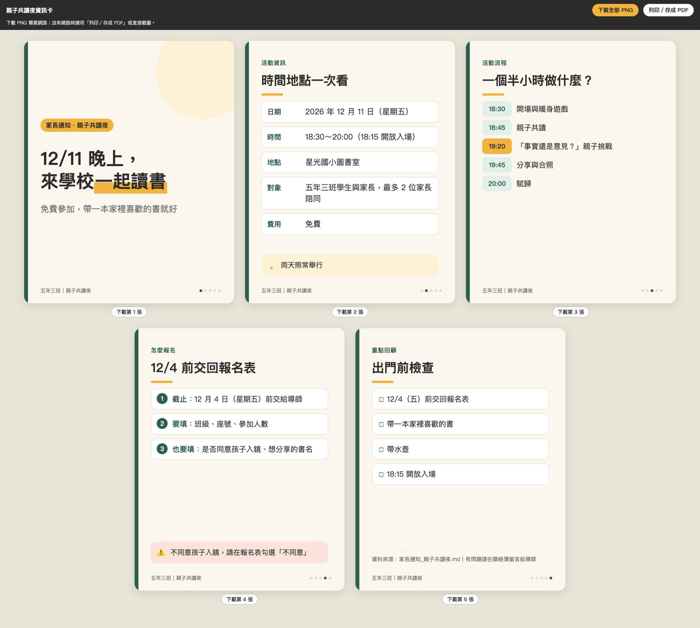

[time]
- label: 第 1 堂｜ChatGPT
  date: 11/23
  time: 19:00~21:00
  des: **釐清需求，建立專屬的教學助理**：認識網頁版與桌面版、三家 AI 功能對標，學會去識別化與 Prompt，生成教材圖片，再用記憶、外掛程式與專案打造教學助理。
  link: [查看講義](../chatgpt/index.html)
- label: 第 2 堂｜Codex
  date: 11/24
  time: 19:00~21:00
  des: **讓 AI 動手處理檔案，用 Skill 交付教材**：安裝 ChatGPT 桌面版，讓 AI 直接讀資料夾、把手寫報名表照片轉成 Excel；再用 Skill 固定寫信風格與教材配圖，最後切到 Codex，用資訊卡、線上講義、校園簡報 Skill 交出成品。
  link: [查看講義](../codex/index.html)
  active: true
- label: 第 3 堂｜Claude
  date: 11/26
  time: 19:00~21:00
  des: **串接工具、建立知識庫，把好方法變 SOP**：先把學生名冊去識別化，再用 Connector 整理信件與行事曆、用 Project 建立活動知識庫、把家長通知流程存成 Skill。
  link: [查看講義](../claude/index.html)
- label: 第 4 堂｜Cowork
  date: 11/27
  time: 19:00~21:00
  des: **讓 AI 交付成品，替自己做班級小工具**：用 Cowork 把簽收表照片轉 Excel、整理活動資料並設定排程，再用 Vibe Coding 做出班級抽籤分組工具，搭配 Git 存檔點，改壞了也能回到上一版。
  link: [查看講義](../cowork/index.html)
[/time]

# 🙋 課前回顧：第 1 堂的重點，快速補齊

## 認識 AI：它能做什麼、會錯在哪

### 🤖 它是文字接龍，答案不一定正確

- **生成式 AI 的本質是`文字接龍`**：ChatGPT、Claude、Gemini 都一樣，所以`相同的指令會有不同的結果`
- **幻覺依舊嚴重**：課綱條文、法規編號、考題解析都可能是錯的，`得到答案後一定要查證`
- **文件裡可以藏指令**：人看不到、AI 讀得到，就能左右 AI 的回答；關鍵文件永遠要人工複核
- **對話型 AI 是大腦，不是手腳**：你問它答；`AI Agent` 才會動手把事情做完，今天的主角就是它
- **先想清楚導入目標**：行政瑣事讓 AI `生成初版`、歷史文件讓 AI `歸檔查找`、備課命題讓 AI `產出草案`，你負責審核與決定

> **快，是 AI 的本事；對，是你的責任**
> 今天產出的每一份檔案，都要自己打開核對。

## 選對工具，守住資料

### 🧭 網頁版你把資料拿給 AI，桌面版 AI 走進你的資料夾

| | 💬 對話 | 🧳 工作 | 🧑‍💻 Codex |
|---|---|---|---|
| 擅長 | 快速問答、搜尋、發想 | 做出`文件、試算表、簡報` | 寫程式、執行指令 |
| 比喻 | 隨問隨答的同事 | 行政秘書 | 資訊組 |
| 電腦資料夾 | ❌ 要你上傳 | ✅ 桌面版可用 | ✅ 桌面版可用 |
| 方案 | 所有方案 | Plus 以上 | 所有方案（免費版額度有限） |

- **三家 AI 功能幾乎都有對標**：專案、記憶、連接外部工具、Skill，名字不同、邏輯相同；`熟悉一個最重要`

### 🛡️ 帳號、工具、資料，三道門都要守

- **工具**：從`官方連結`下載，少用來路不明的第三方工具
- **帳號**：頭像 → `個人化` → `資料控制`關閉模型訓練；`安全性與登入`開啟`多重驗證 (MFA)`
- **資料**：學生姓名、成績、輔導紀錄不要直接貼進 AI；真的要用，先用我設計的免費[資料去識別化工具](https://deanlin.net/data-deidentification)處理，檔案不會離開你的電腦
- 今天的練習`一律使用虛構資料`

## 把需求說清楚：Prompt 與圖片生成

### 💬 六個技巧，讓 AI 知道你要什麼

[flow]
1. 角色 — 請 AI 扮演具體的專家（ex: 國小高年級資深導師）
2. 語氣、風格、受眾 — 寫給誰看、用什麼口吻
3. 符號與格式 — 用 `[ ]`、標題、條列標出重點與輸出格式
4. 專有名詞 — 一個名詞帶出一整套方法（ex: 5E 教學模式、Rubric）
5. 請 AI 優化 Prompt — 不會寫，就先問 AI 該怎麼問
6. 先反問再動手 — 讓 AI 用選擇題把缺的資訊問清楚
[/flow]

```prompt [label="上一堂的完整範例：家長通知"]
我是[國小六年級導師]，要發一份[校外教學]的通知給[班上家長]。
- 日期：[12/18（五）]
- 時間：[08:00 校門口集合，16:00 返校]
- 地點：[台北市立動物園]
- 費用：[每人 350 元（含車資與門票）]

請扮演[資深導師]，寫成不超過 300 字的通知；你補充的細節請標上「建議補充」讓我確認。
如果執行前有任何問題，請先透過「選擇題」詢問我，不要直接產生。
```

> **提示詞中的 `[ ]` 是要換成自己情境的地方**
> 今天的 Prompt 也一樣，還會多寫清楚三件事：`讀哪裡、寫到哪、不能改什麼`。

### 🎨 同樣的技巧，也能用來畫圖

- **入口**：對話框左側的「+」→ `創作圖像`，把`用途、受眾、風格、比例`說清楚
- **老師最常用的四種圖**：懶人包、行程表、流程圖、活動海報
- **守住底線**：不生成知名角色、不拿真實學生的臉孔生圖；中文字、日期、地點生成後逐一核對
- 今天會把這些長 Prompt 存成 `Skill`，之後一句話就能生出同一種風格的圖

## 讓 AI 更懂你：個人化、外部工具與專案

### 🧠 三個功能，都是為了不用每次重講

| 功能 | 解決什麼 | 上一堂怎麼做 | 今天怎麼接 |
|---|---|---|---|
| 記憶與自訂 | AI 不認識你 | 在`個人化`填暱稱、職業與回覆偏好；不想被記住就用`臨時聊天` | Skill 也需要你的個人背景 |
| 外掛程式 | 工具切來切去 | 連上 Gmail 與 Google Calendar，彙整信件、建立行程 | 改成連到`你電腦上的資料夾` |
| 專案 | 背景每次重講 | 放進`指令`與`知識庫`，回答附出處 | 同一批文件，改成直接讀資料夾 |

- 上一堂的專案範例是`高年級閱讀理解行動研究`：上傳 4 份文件、貼上專案指令，再驗證三件事——`出處可追溯`、`決議與提議分得清`、`文件沒寫的會誠實說`
- **AI 是真的會動手**：行程會出現在參與者的日曆；今天它還會讀寫你的檔案，動手前先看清楚

## 今天怎麼接著用

### 🧳 這堂課會帶走的 5 個成果

[flow]
1. 資料夾問答與備課包 — 安裝桌面版，文件不用上傳直接讀，多格式備課資料彙整成附來源的備課包
2. 報名表轉 Excel — 手寫報名表照片批量變名單，看不清楚的格子標黃、不亂猜
3. 寫信風格 Skill — 看懂 Skill 為什麼要客製化，整理出「我的寫信背景」
4. 教材配圖 Skill — 懶人包、行程表、流程圖、海報，一句話生出同一套風格
5. Codex 交付教材 — 資訊卡、線上講義、校園簡報，用到程式的交給 Codex
[/flow]

---

# 桌面版起手式：不用上傳，AI 直接讀你的資料夾

> **網頁版 🆚 桌面版**
> **網頁版**處理你`貼進去或上傳的內容`，**桌面版**能直接在你`選定的電腦資料夾`裡讀檔、寫檔

## 安裝 ChatGPT 桌面版

### 💻 下載、登入、認識三個模式

- 到 [ChatGPT 下載頁](https://chatgpt.com/download) 安裝桌面版：支援 macOS（需 macOS 14 以上）、Windows（從 Microsoft Store 安裝）與 Linux
- 用上一堂的 ChatGPT 帳號登入，對話與專案會同步
- 輸入框上方可以切換`對話`與`工作`；左上的選單還可以切換到 `Codex`
- **今天前半段用`工作`模式**（Plus 以上）；免費版的同學請從選單切到 `Codex`，同樣可以選資料夾，下面的 Prompt `完全通用`

> **為什麼免費版要切到 Codex？**
> 上一堂提過：`工作`像行政秘書，擅長交出文件；`Codex` 像資訊組，擅長寫程式。兩者都能讀你的資料夾，差別在`工作`模式限 Plus 以上，Codex 則是所有方案都能用（免費版額度有限）。
> 兩個模式的差異，後半段講到 Skill 時會再說明。

<!-- 講師備註：官方入口說法已於 2026-11-10 核對（chatgpt.com/download、learn.chatgpt.com/codex/app）。定位依 OpenAI Help〈ChatGPT Work and Codex〉：Work 是 "an agent designed for longer, multi-step work and finished deliverables"、Codex "remains dedicated to software development and technical work"、"Work follows the same usage structure as Codex"。免費版／Go 實際能用多少 Codex 額度官方沒有公開，授課前確認；工作模式在桌面版選資料夾的入口名稱與位置，授課前以授課帳號確認。 -->

<!-- 待補圖片：chatgpt-desktop-modes.png｜ChatGPT 桌面版主畫面，虛線紅框標出輸入框上方的對話／工作切換，以及選單裡的 Codex 入口；可沿用第 1 堂同名截圖 -->
<!--  -->

### 📁 選一個資料夾，就是 AI 的工作範圍

- 下載下方練習包並解壓縮；Windows 用「全部解壓縮」，macOS 雙擊解壓
- 解壓後會得到 `codex-practice` 資料夾：`行動研究`、`報名表照片`、`技能包`、`技能練習`、`備課資源`、`output`，以及可列印的 `報名表範本.html`
- 在桌面版選擇這個資料夾，**只選這一個**，不選整個桌面或校務共用磁碟
- 出現權限選項時選`每次詢問`（Ask for approval）：AI 要改資料夾外的檔案或上網前，會先停下來問你

[download dir="codex-practice" label="下載「第 2 堂練習包」虛構素材" desc="上一堂的行動研究文件、技能練習素材、混合格式的單元備課資源與可列印的報名表範本"]

<!-- 待補圖片：codex-folder.png｜在桌面版選擇 codex-practice 資料夾後的畫面，虛線紅框標出目前資料夾與權限選項 -->
<!--  -->

[warning title="使用提醒"]
桌面版是有能力`新增、修改、刪除`電腦檔案的。

能力越大風險越大，你可以想想`如果事情做到一半，但額度沒了會發生什麼事`。

所以只選練習資料夾、原始資料另留副本；遇到看不懂的權限要求，先請它用白話解釋，不要一路按同意。按下同意，責任就是你的。
[/warning]

## 上一堂的專案，改成直接讀資料夾

### 🆚 同一批文件，兩種給 AI 的方式

| | 🌐 上一堂：網頁版專案 | 💻 今天：桌面版資料夾 |
|---|---|---|
| 怎麼給資料 | 建立專案 → 把 4 份文件`一份份拖進去` | 選一次資料夾，裡面的檔案`都讀得到` |
| 文件更新了 | 要重新上傳新版 | 改完存檔，AI 下次讀到的就是新版 |
| AI 的成品 | 在對話裡，要自己複製或下載 | 直接`寫成檔案`放進 `output` |
| 適合 | 跨裝置使用、和同事共用 | 檔案多、常更新、要交出檔案 |

> **專案沒有被取代**
> 人在外面想用手機查、想分享給同事，還是專案方便；在自己的電腦上處理一整包檔案，資料夾最直覺。

### 🔎 先盤點，再提問

```prompt [label="先盤點，不要急著改檔"]
請先盤點目前這個練習資料夾。
列出每個子資料夾裡的檔名、格式、每份可能提供什麼資訊。
先不要修改、移動、刪除或覆寫任何原檔。
如果讀不了某個格式，請列出原因，不要假裝讀過。
最後告訴我：成品應該放在哪裡、哪些資料夾只能讀不能改。
```

> **為什麼先盤點再開工？**
> 先讓你和 AI 看見同一批材料，後面才知道是資料缺了、讀取失敗，還是整理方式出了問題。

### ▶️ 用上一堂的問題驗證一次

上一堂的專案指令，今天直接寫在 Prompt 的最前面；`行動研究`資料夾裡就是那 4 份文件。

```prompt [label="驗證出處、決議與誠實度"]
請只根據「行動研究」資料夾裡的文件回答，規則如下：
- 每個答案標明出處（哪份文件）
- 文件找不到答案時，直接說「目前文件沒有記錄」，不要臆測
- 共備記錄裡的「提議」不能寫成正式決定

問題：
1. 這次行動研究的研究對象是誰？要教哪幾個閱讀策略？
2. 策略教學現在每週上幾節？後測確定改成線上施測了嗎？
3. 這個研究有申請經費嗎？金額是多少？
```

| 問題 | 應該出現的結果 |
|---|---|
| 研究對象與策略 | 答得出對象與四個閱讀策略，並附上文件名稱 |
| 節數與後測 | 節數已從每週 2 節改為 `1 節加晨讀`；線上施測只是`提議`，尚待確認 |
| 經費 | 回覆「目前文件沒有記錄」，而不是編一個數字 |

```prompt [label="多做一步：把成品寫成檔案"]
請依照「行動研究/評量規準與學習單格式.md」的學習單格式，設計第 3 週的學習單初稿；策略與負責老師請參考研究計畫書。
存成 Word 檔放進 output，檔名「第3週學習單初稿」；無法產生 Word 檔就改存成 .md。
不要修改「行動研究」資料夾裡的任何檔案，完成後告訴我用了哪些來源。
```

<!-- 待補圖片：folder-qa-result.png｜桌面版依「行動研究」資料夾回答三個問題的畫面，虛線紅框標出每個答案後面的出處檔名 -->
<!--  -->

> **為什麼要從上一堂的專案開始？**
> 同樣的文件、同樣的問題，你只要感受一個差別：`這次沒有上傳任何東西`。
> 而且 AI 不只回答，還把學習單`寫成檔案`放進你的資料夾。

## 多份格式不同的備課資料，一次讀完彙整

> **去年的教案一份、今年的進度表一份、共備紀錄又一份**
>
> - 想整理成一份`備課總覽`，得先弄清楚哪份資料是最新的
> - 人工整理常常`整理到一半就亂掉`：哪個是決議、哪個只是提議
> - 網頁版要`一份份上傳`，Word、Excel、掃描檔混在一起更讓人崩潰

### 🗂️ 選一個資料夾，讀完彙整成單元備課包

剛剛的`行動研究`都是文字檔；`備課資源`這包混了 Word、Excel、CSV 與掃描圖，一樣在資料夾裡，不用另外上傳，就能讀完彙整成你要的總覽與清單。

[flow]
1. 盤點與比對 — 逐份讀完，回報哪些一致、哪些衝突、哪些讀不到
2. 彙整輸出 — 寫成備課總覽、資源索引與待準備清單，放進 `output`
3. 打開驗收 — 每筆都能追到來源檔名，再決定要不要採用
[/flow]

| 檔案 | 格式 | 主要內容 | 用來檢查什麼 |
|---|---|---|---|
| 單元重點與教學目標.md | 文字 | 今年版重點、目標、3 節、新版頁碼 | 拿來當今年的標準 |
| 過往教案_去年版.docx | Word | 4 節課流程、舊版頁碼、舊補充閱讀 | 哪些內容已經過期 |
| 教學進度表_五上.xlsx | Excel（2 個工作表） | 國語進度、學校行事 | 第二個工作表有沒有讀到 |
| 共備會議紀錄.txt | 文字 | 決議、提議、負責人與期限 | 有沒有把提議誤寫成定案 |
| 影音與網站連結.csv | 表格 | 影片、線上測驗、網站 | 失效、重複、缺網址 |
| 學習單_事實或意見_掃描.jpg | 掃描圖 | 8 題分類題、延伸題 | 圖片裡的題目有沒有讀到 |
| 補充閱讀_午餐剩食短文.txt | 文字 | 今年的補充閱讀 | 和去年教案寫的是不是同一篇 |

> **為什麼要把備課資源整理成結構化文件？**
> 我自己用 Markdown 這種`結構化格式`寫講義後，AI 更容易檢索，過去講座的資訊都能變成素材。
> 備課包也一樣：整理成有標題、有來源的 `.md` 與 `.csv`，下學期再教同一個單元，AI 就能直接拿來用。

> **先當一次偵探**
> 在問 AI 之前，先自己看資料，找出三個坑：`節數對不上`、`頁碼新舊混用`、`提議還沒定案`。你先有判斷，才不會把 AI 的回答當標準答案。

```prompt [label="第一步：盤點備課資源與衝突"]
請讀取「備課資源」資料夾的所有檔案（包含 Word、Excel 的每個工作表、掃描圖），先回報：
1. 每個檔案實際讀到哪些內容；讀不到的請說明原因。
2. 哪些資訊一致、哪些互相衝突、哪些仍未確認。
3. 會議紀錄裡哪些是「決議」、哪些只是「提議」，不能把提議當成定案。
4. 學習單題目有沒有需要修改的地方。
每項附檔名。這一步只回報，先不要新增或修改任何檔案。
```

```prompt [label="第二步：產出單元備課包"]
依剛才確認的結果，在 output 新增三個檔案，不改動「備課資源」裡的原檔：
「備課總覽.md」：單元目標、節次規劃、各節使用資源、衝突與待確認事項、來源清單。
「資源索引.csv」：資源名稱、類型、檔名或網址、預計用在第幾節、狀態（可用／需更新／失效／待補）、來源檔名。
「待準備清單.csv」：事項、負責人、期限、狀態、來源檔名。
負責人與期限只依文件填寫，文件沒寫的就填「待確認」；提議不能寫成定案。
CSV 請存成 UTF-8（含 BOM）編碼，用 Excel 開啟時中文才不會變亂碼。
完成後列出新增的檔案、使用了哪些來源，以及讀取限制。
```

<!-- 待補圖片：prep-pack-result.png｜output 裡的備課總覽.md 與用 Excel 打開的資源索引.csv，虛線紅框標出「來源檔名」欄 -->
<!--  -->

### ✅ 對照預期結果，看它有沒有說得太確定

| 項目 | 應該出現的結果 | 資料來源 |
|---|---|---|
| 節數 | 今年 3 節；去年教案 4 節，需要調整 | 單元重點、進度表、過往教案 |
| 小組發表 | 「併入第 3 節」只是提議，待教學組長確認 | 共備會議紀錄 |
| 課本頁碼 | 新版第 48～55 頁；教案與學習單還是舊版第 52 頁 | 單元重點、過往教案、學習單 |
| 補充閱讀 | 已決議改用「午餐剩食」，教案還寫「海洋塑膠」 | 共備會議紀錄、過往教案 |
| 影片 | 「小偵探找線索」連結失效，陳老師 11/27 前找替代 | 連結清單、共備會議紀錄 |
| 連結清單 | 線上測驗重複一筆、需要教師帳號；朗讀音檔網址待補 | 影音與網站連結.csv |
| 學習單 | 第 7 題同時有事實與意見，卻只有兩個選項 | 學習單掃描圖 |
| 發表檢核表 | 附件找不到，負責人未定 | 過往教案、共備會議紀錄 |

- 最容易出錯的兩格：把`小組發表併入第 3 節`寫成已定案、把`學習單帶回家分享`寫進正式流程

> **把最多時間花在驗證**
> 我備課時，花最多時間的不是生成，而是`驗證`：案例合不合理、資訊對不對。
> 畢竟內容出錯，責任還是要自己承擔。

---

# 照片轉 Excel：一疊手寫紙本，變成一份名單

> **資料夾裡不只有文件，照片 AI 也看得懂**
> 剛剛讀的是文件與掃描檔；這一段換成`手機拍的照片`，讓 AI 把紙本上的字填進 Excel。

## 紙本資料，為什麼適合交給 AI

> **一疊回條、報名表、手寫問卷，要一張張 key 進 Excel**
>
> - 班級、人數、有沒有勾同意藏在紙上，得`人工一張張看、一格格打`
> - 手寫字又容易`看錯、漏打`
> - 量一大（一班三十張、全校幾百張），`整個下午都耗在 key-in`

### 📷 過去只能人工判讀，現在交給 AI 的眼睛

- 收據、手寫打勾的 PDF 表單：格式固定，內容卻是`圖片`，過去只能靠人工判斷勾了哪些、填了什麼
- 現在 AI 本身就有`圖片辨識`能力，可以先讓它處理，再做成`可重複使用的工作流`
- 關鍵是告訴它`遇到例外怎麼做`：看不清楚的欄位留白、標黃，不要自己猜

[flow]
1. 指定照片資料夾 — 一疊手機拍的報名表照片
2. 逐張辨識 — 抽出班級、座號、人數、勾選、書名與備註
3. 寫進表格 — 一張一列，最後一欄標明來源照片檔名
[/flow]

## 照片批量轉存 Excel

### ✍️ 準備練習照片

- 用瀏覽器打開練習包裡的 `報名表範本.html` 並列印，一張 A4 有 3 份；沒有印表機時，照著範本的欄位畫在白紙上也可以
- 手寫 3～5 張**虛構**報名表：班級、座號、陪同家長人數、孩子入鏡（同意／不同意）、想分享的書名、備註
- **故意留 1～2 處寫得潦草**（ex: 人數寫得像 1 又像 7、勾在兩格中間），等一下才看得到「不確定就標出來」的效果
- 用手機一張一張拍照，傳到電腦（ex: 用 LINE 傳給自己、雲端硬碟或傳輸線），放進 `報名表照片`；真實學生資料不要放進來

<!-- 待補圖片：signup-photos.png｜3 張用報名表範本手寫的虛構報名表手機照片，其中 1 張的人數寫得潦草 -->
<!--  -->

```prompt [label="把報名表照片批量寫入 Excel"]
請讀取「報名表照片」資料夾裡的所有照片，整理成一份報名名單：
① 逐張讀出：班級、座號、陪同家長人數、孩子入鏡（同意／不同意）、想分享的書名、備註
② 寫入 output 的「親子共讀夜報名名單.xlsx」，一張照片一列，最後一欄標明來源照片檔名
③ 看不清楚或不確定的格子先留空、標黃，不要自己猜；勾在兩格中間也算不確定
④ 最後告訴我：總共幾張、幾格標黃、哪一張最難讀
如果無法直接寫成 xlsx，請改存成 UTF-8（含 BOM）編碼的 CSV；CSV 不能標顏色，不確定的格子留空，並在備註寫「待人工確認」。
```

<!-- 講師備註：官方文件確認可以請它檢視電腦上的圖片、能建立試算表檔案；但有使用者回報本機產生 xlsx 的執行環境下載失敗（見 sources.md）。授課前用手寫照片在「工作」與 Codex 各實測一次辨識與 xlsx 輸出，CSV 是備案。 -->

<!-- 待補圖片：signup-excel-result.png｜辨識結果寫進 Excel，最後一欄是來源檔名，辨識不確定的格子標黃 -->
<!--  -->

> **先用 3～5 張試跑，再逐步加量**
> 剛開始先用少量資料試試看，確認它`會漏什麼、哪裡需要補規則`（ex: 勾在兩格中間算哪一個？），把規則補進 Prompt，再逐步增加數量。

> **AI 完成後，還是要人工驗證**
> 一格看錯，整張名單都要重對。別忘了，最後要為結果負責的是`你自己`。

### 🔁 同樣的事，換一個 Agent 也做得到

- 資料夾彙整、圖片辨識寫 Excel，不是 ChatGPT 的專利；能操作電腦的 AI Agent 都做得到
- 我錄過 Manus 桌面版的完整示範，想比較不同工具可以看：[【Manus 桌面版教學】讓 AI 操作電腦，從資料夾彙整報告、辨識圖片寫 Excel、自動填表單](https://youtu.be/WGHQuCI3iJk)

> **每次都要重貼這一大段規則，不累嗎？**
> 欄位、留白標黃、來源檔名……這些規則下次處理回條還要再講一遍。把它存起來重複使用，就是接下來要講的 `Skill`。

---

# 認識 Skill：把做事的步驟，存成 AI 的 SOP

> **Skill 是把你最好的一次，變成每一次**
> 你摸索出最順的流程後，只要成功過一次，就能把它存成 Skill，未來不用從零開始。

## 為什麼需要 Skill？

### 🤯 流程都在某個人腦袋裡

[flow]
- **關鍵人物不在，流程就卡住** - 「家長通知怎麼寫？校外教學的流程怎麼跑？」如果答案全在某位`資深老師`的腦袋；他一請假、調校，這一切就需要`重新摸索`。
- **交接靠口耳相傳，品質全憑運氣** - 新接手的老師只拿到`零散檔案`和`口頭經驗`；通知、公告、簡報……每個人的`格式、品質`都不一樣。
- **需要手把手教，難以擴散** - 好方法要`實際示範`才學得會，所以就算有人做得很好，也很難複製到`其他班級、其他處室`。
[/flow]

### 📋 提示詞一直複製貼上

[flow]
- **存了一堆 Prompt，要用時翻半天** - 提示詞散落在`記事本、LINE、聊天記錄`；真的要用時，光是找出`最後一版`就浪費一堆時間。
- **換個情境就得手動調整** - 同一套通知 Prompt，從校外教學換成班親會、從 Email 改成聯絡簿，都得`重新微調`。
- **規則改了，舊版本卻沒跟著改** - 多了一條`不能寫的話`，但同一段 Prompt 已經`被複製到十個地方`；漏改一處，錯的版本就`默默繼續產出`。
[/flow]

### 📝 Skill 就像學校的 SOP 手冊

- 新同事接手業務，最快的方法是拿到一本 `SOP 手冊`：步驟、範本、注意事項都寫好了
- Skill 就是給 AI 的 SOP：一個資料夾，裡面有 `SKILL.md`（步驟與規則）、範本與參考資料，必要時再附`小程式`
- AI 遇到符合的任務，會照著 SOP 做，`格式一致`、`不用每次重講`
- 技能包可以`下載與分享`：剛接觸的新手，用前輩設計好的技能也能做出符合期待的成果

### 🆚 Prompt、專案、Skill 各放什麼

| 功能 | 存什麼 | 比喻 | 校園例子 |
|---|---|---|---|
| Prompt | 這一次的需求 | 口頭交代 | 「幫我把這份通知改短」 |
| 專案（Project） | 背景知識與文件 | 活動資料夾 | 行動研究的計畫書與共備記錄 |
| Skill | 做事的步驟與範本 | SOP 手冊 | 「回覆家長」的步驟、語氣與不能說的話 |

> **專案放知識，Skill 設計流程**
> **專案讓 AI「知道事實」** — 你的角色、活動辦法、共備決議
> **Skill 讓 AI「知道步驟」** — 信件、配圖、資訊卡、簡報要遵守的 SOP

> **本堂先「用」，第 3 堂再「做」**
> 今天用我改好的`老師版技能包`，先體驗 Skill 帶來的穩定度；第 3 堂在 Claude，會帶你把自己的流程（例如家長通知）設計成 Skill。

## 在 ChatGPT 匯入與呼叫 Skill

[warning title="ChatGPT 的技能需要付費版"]
- 技能目前需要付費版，並在`工作`模式使用；免費版可能看不到技能頁面，以你當下的畫面為準
- 免費版的同學這一段先看講師示範；後半段切到 `Codex`，就能一起動手
[/warning]

<!-- 講師備註：安美諾課程（2026）實測為 Plus 帳號、工作模式才能使用技能；官方 Help 20001066 把個人技能列在 Business／Enterprise／Edu，定價頁卻顯示各方案都有 Skills。授課前以授課帳號與一個免費帳號各確認一次。 -->

### 📥 匯入：從技能頁面上傳 zip

- 點擊側邊欄`外掛程式`，切換到上方`技能`分頁
- 點擊「+」，選擇`從電腦上傳`，選下載好的 zip 檔（`不用解壓縮`）
- 匯入成功後，技能會出現在`已安裝`清單

<!-- 待補圖片：chatgpt-skill-upload.png｜ChatGPT「外掛程式 → 技能」頁面，虛線紅框標出「+」與「從電腦上傳」；需用授課帳號重拍（其他課程的截圖側邊欄有客戶專案名稱） -->
<!--  -->

### ▶️ 呼叫：輸入 @ 選技能，或直接說需求

- **主動呼叫**：在輸入框打 `@`，從清單選技能，再接著寫需求；一段對話想用多個技能時，這個方式比較穩定
- **被動觸發**：直接描述需求，符合技能描述時，AI 會自己選用；技能越來越多，要記住每個名稱並不現實

<!-- 待補圖片：chatgpt-skill-at.png｜在 ChatGPT 輸入框打 @ 後出現的技能清單，虛線紅框標出 teacher-letter-style 與 teacher-image-style -->
<!--  -->

---

# ChatGPT 的 Skill：先從不用寫程式的開始

> **Skill 不一定跟程式有關，但一定跟「你」有關**
> 很多 Skill 打開來只有`文字規則與範本`：怎麼稱呼、先講什麼、不能寫什麼。這一類在 ChatGPT 裡用最順手，也最需要換成自己的內容。

## 寫信風格：Skill 要客製化，不是裝了就好

### ✉️ 拿我自己舉例：每週都會收到的合作邀約

- 我常收到品牌的`合作邀約`，每一封都要回，但回法不只一種：`接受`、`婉拒`、`先詢問細節`、`討論時程`、`報價`
- 要回得好，AI 得先知道我的`個人背景`：
  - **報價**：不同合作形式各是多少、哪些可以談
  - **合作方式**：我接哪些形式、不接哪些類型、目前檔期排到什麼時候
  - **過去成效**：做過哪些案例、可以附上哪些成果當參考
- 這些資訊，網路上任何一個「寫信 Skill」都不會有

> **為什麼裝一個寫信的 Skill 還不夠？**
> 通用的 Skill 只懂`格式與禮貌`，不懂`你`。
> 它寫得出一封得體的信，卻不知道該接還是該拒、該報多少、該約什麼時候。

### 🗂️ 我的回信 Skill 裡放了什麼

這個 Skill 是從我 `46 封真實往來信件`歸納出來的，資料夾裡一樣只有文字檔：

| 檔案 | 內容 | 為什麼只有我自己寫得出來 |
|---|---|---|
| SKILL.md | 流程：解析來信 → 調查品牌 → 判斷回應類型 → 產出草稿 → 自我檢查 | 這是我實際回信的順序 |
| 決策框架 | 什麼情況接受、婉拒、詢問、先試用、報價 | 判斷標準來自我的頻道定位 |
| 報價紀錄 | 各種合作形式的現行報價與歷史紀錄 | 報價是我的，AI `不能自己編` |
| 回信模板 | 中文、英文各一份，每種回應類型的寫法 | 語氣是從我寄出去的信整理的 |
| 婉拒紀錄 | 不接的品類、過去婉拒過誰與原因 | 每次做完決定都會`回寫`一筆 |

- 規則也是我自己踩過坑才加的（ex: `絕不捏造價格與數據`、`婉拒一定附上祝福與未來合作的窗口`、`不代替我做最終決定`）

<!-- 講師備註：本段用講者自己的 sponsorship-negotiator 示範。報價金額、品牌名稱與婉拒紀錄屬於商業資訊，講義只寫「放了哪一類資料」；課堂要展示實際檔案時，先遮掉金額與品牌名稱。 -->

### 🆚 同一封邀約信，通用 Skill 與我的 Skill

```prompt [label="講師示範：一封虛構的合作邀約"]
幫我回這封合作邀約：

Dean 您好，我們是一款 AI 簡報工具的行銷團隊，很喜歡您頻道的教學影片。
想邀請您在 12 月製作一支長影片介紹我們的產品，請問您的合作方式與報價？
```

| | 通用的寫信 Skill | 我自己的 Skill |
|---|---|---|
| 第一步 | 直接寫一封禮貌的回信 | 先調查品牌，給我`建議的回應類型與理由` |
| 報價 | 寫「報價另行提供」，或`自己編一個數字` | 引用我的報價紀錄；查不到就留空請我填 |
| 檔期 | 不知道我 12 月有沒有空 | 依我目前的檔期，建議接、延後或婉拒 |
| 過去成效 | 只能寫「有豐富經驗」 | 附上我做過的參考案例 |
| 最後 | 交出一封信 | 等我決定後才寫草稿，決定還會`回寫進紀錄` |

<!-- 待補圖片：skill-sponsorship-compare.png｜同一封虛構邀約信，左邊是通用寫信 Skill 的回覆、右邊是講者 Skill 先給「建議回應類型＋理由」的畫面；金額與品牌名稱需遮蔽 -->
<!--  -->

### 🔄 最好的 Skill，是從自己的工作流長出來的

[flow]
1. 先把事情做一次 — 用白話跟 AI 來回，回出一封自己滿意的信
2. 存成第一版 — 把剛剛的步驟與規則整理成 Skill，不用追求完整
3. 邊用邊補 — 哪裡不滿意，就把那條規則、那份資料補進去
4. 持續更新 — 報價變了、多了一種不接的類型，回寫進 Skill
[/flow]

> **不要想著一開始就完美**
> 別人的 SOP 可以參考，但最好的 Skill 是從`自己實際的工作流`出發，再慢慢調整到符合期待。
> **有持續在用的 Skill，一定會持續優化**；放著不改的，通常也是沒在用的。

### 🧑‍🏫 換成你：先拿一份起點，再改成自己的

- 下面的技能包是我替老師準備的`起點`：稱呼、先回應再說明、條列配合事項、結尾署名，還有`不能說的話`（ex: 保證、一定、其他家長都…）
- 它不知道你教哪個年級、平常怎麼稱呼家長、學校有哪些規定；這些要`由你補上`

[download dir="teacher-letter-style" label="下載「老師版寫信風格」技能包（起點）" desc="teacher-letter-style.zip：SKILL.md＋語氣指南＋信件範例，純文字技能（下載後不用解壓縮，直接匯入）"]

```prompt [label="第一步：先用起點包回一封信"]
@teacher-letter-style 我是五年三班的王老師。家長在聯絡簿問：「親子共讀夜可以帶弟弟一起去嗎？」
活動是 12/11（五）18:30～20:00 在圖書室，每位學生最多 2 位家長陪同，報名表 12/4（五）前交回。
幫我寫一封 Email 回覆。
```

```prompt [label="第二步：請 AI 問出你的個人背景"]
這封信還不像我寫的。請先問我 5 個問題，了解我寫信的個人背景，一次問一題：
ex: 任教年級與職務、平常怎麼稱呼家長與署名、最常回覆的三種情況、學校有哪些一定要遵守的規定、哪些話我絕對不會說。
問完後整理成一份「我的寫信背景」清單，並用這份清單把剛剛的信重寫一次。
```

<!-- 待補圖片：skill-letter-result.png｜ChatGPT 用 teacher-letter-style 產出的回覆信，以及補上「我的寫信背景」後重寫的版本，虛線紅框標出兩版的差異 -->
<!--  -->

### ✅ 驗收重點

- **對得上**：日期、星期、時間、人數限制與你給的資料逐字相同
- **沒多寫**：沒有替學校承諾你沒說的事（ex: 可以帶弟弟、提供停車位）
- **像你寫的**：第二版的稱呼、署名、語氣，比第一版更接近你平常的信
- **留得下來**：把「我的寫信背景」清單存起來，打開技能包的 `語氣指南.md` 換成自己的說法再重新匯入；第 3 堂會帶你把它做成自己的 Skill

## 教材配圖：一句話，生出同一套風格的圖

### 🎨 上一堂的長 Prompt，變成一個模板

- 上一堂生成懶人包、行程表、流程圖、海報，每次都要寫一長串：風格、背景、比例、排版
- 技能包把這四種圖做成`模板`，再加上一組`固定風格`（溫暖手繪、黑板綠與向日葵黃、淺色背景），同一個班級的圖看起來就是`同一套`
- 一樣只有文字檔：`SKILL.md` 與 `圖片模板.md`；畫圖用的是 ChatGPT `內建的圖片生成`

[download dir="teacher-image-style" label="下載「老師版教材配圖」技能包" desc="teacher-image-style.zip：SKILL.md＋四種圖片 Prompt 模板，純文字技能（下載後不用解壓縮，直接匯入）"]

```prompt [label="用 Skill 把通知變成懶人包圖"]
@teacher-image-style 把下面的通知做成給家長看的懶人包圖：

五年三班親子共讀夜
日期：12/11（五）18:30～20:00（18:15 開放入場）
地點：圖書室
對象：五年三班學生與家長，每位學生最多 2 位家長陪同，免費
請攜帶：一本家裡喜歡的書、水壺
報名：12/4（五）前把報名表交給導師
```

```prompt [label="同一個活動，再要一張行程表"]
@teacher-image-style 同一個活動再做一張行程表：
18:30 開場與暖身遊戲、18:45 親子共讀、19:20 「事實還是意見？」親子挑戰、19:45 分享與合照、20:00 賦歸
```

<!-- 待補圖片：skill-image-result.png｜ChatGPT 用 teacher-image-style 產出的懶人包圖與行程表，兩張風格一致；下方可見「📝 使用的 Prompt」 -->
<!--  -->

### ✅ 驗收重點

- **同一套**：兩張圖的畫風、配色一致
- **對得上**：圖上的日期、時間、地點與資料逐字相同；`中文字有沒有錯字`要放大看
- **看得到 Prompt**：回覆附上這次使用的完整 Prompt，哪裡不對直接跟 AI 說，不用從頭描述
- **守底線**：沒有真實人物臉孔、知名角色

## 資訊卡：這個 Skill 用到了程式

### 🖼️ 一份長長的通知，變成家長願意看完的 5 張卡

- 家長通知、活動公告、教材重點，字一多就沒人看完；做成`一卡一重點`的圖卡，貼到班級群組更好讀
- 剛剛的懶人包是`一張圖`，文字由 AI 畫出來，偶爾會有錯字；資訊卡是`一組卡`，文字是真的字，`不會畫錯`
- 技能包流程：先給你`提煉摘要`確認 → 套用固定模板 → 輸出一個 `.html` 檔（網頁檔，雙擊就會用瀏覽器打開）

[download dir="teacher-info-cards" label="下載「老師版資訊卡」技能包" desc="teacher-info-cards.zip：SKILL.md＋資訊卡 HTML 模板，成品用瀏覽器就能打開"]



```prompt [label="在 ChatGPT 用 Skill 做資訊卡（講師示範）"]
@teacher-info-cards 把上面的親子共讀夜通知做成給家長看的資訊卡。
先給我提煉摘要，我確認後再做；完成後提供 HTML 檔讓我下載。
```

<!-- 待補圖片：skill-info-cards-chatgpt.png｜ChatGPT 產出資訊卡 HTML 檔的對話畫面，虛線紅框標出下載連結 -->
<!--  -->

### 🧑‍💻 這份成品，其實是 AI 寫的程式

- 成品 `.html` 是`網頁的程式碼`：版面、配色、字體大小都寫在裡面
- 卡片上的「下載全部 PNG」按鈕，背後是一段`小程式`在幫你把畫面轉成圖片
- 技能包裡除了 `SKILL.md`，還多了一份 `HTML 模板`：樣式寫死、AI 只填內容，所以`每次風格都一致`
- 你不需要看懂程式，只要知道：`這一類 Skill，AI 是在寫程式，不是在寫文章`

| Skill | 成品 | 用到程式嗎 | 建議在哪裡用 |
|---|---|---|---|
| 寫信風格 | 一段文字 | ❌（但要補上你的背景） | ChatGPT |
| 教材配圖 | 一張圖片 | ❌（用內建的圖片生成） | ChatGPT |
| 資訊卡 | HTML 網頁檔 | ✅ 寫網頁 | ChatGPT 可以，`Codex 更順` |
| 線上講義 | HTML 網頁檔 | ✅ 寫網頁 | Codex |
| 校園簡報 | PPTX 檔 | ✅ 還要執行小工具 | Codex |

> **為什麼要分辨 Skill 有沒有用到程式？**
> 因為這決定了`該交給誰做`。文字與圖片，ChatGPT 的對話就很順；要寫檔案、跑程式的，交給擅長寫程式的 Codex 會更有效率。

---

# Codex：用到程式的 Skill，交給它更有效率

> **行政秘書 🆚 資訊組**
> 寫信、配圖找行政秘書（ChatGPT）；要寫網頁、跑小工具，找資訊組（Codex）。

## 為什麼換到 Codex？

### ⚡ 檔案直接寫進資料夾，改一句話就重做

| | ChatGPT（雲端執行） | Codex（在你的電腦執行） |
|---|---|---|
| 素材 | 貼上或上傳 | 直接讀資料夾裡的檔案 |
| 成品 | 產出後`下載`，再自己放進資料夾 | 直接`寫進 output` |
| 想修改 | 重新產出、重新下載 | 說一句「第 3 張改成…」，它改完你`重新整理`就好 |
| 需要的工具 | 由雲端環境決定 | 用你電腦上的工具；`缺什麼可以請它協助安裝` |
| 方案 | 技能需要付費版 | 所有方案都能用（免費版額度有限） |

- 這是我自己的使用經驗：會產出檔案、需要反覆修改的 Skill，在 Codex 來回的次數少很多
- Codex 和`工作`模式`共用同一份額度`，方法學會了，換到哪個模式都通用

### 🔀 切換到 Codex，開啟同一個資料夾

- 從桌面版左上的選單切換到 `Codex`
- 開啟剛剛的 `codex-practice` 資料夾，權限一樣選`每次詢問`（Ask for approval）
- Codex 裡的`專案`，指的是`連到你電腦上的一個資料夾`；和上一堂 ChatGPT 放指令與文件的專案不是同一個東西（參考 [OpenAI 專案說明](https://learn.chatgpt.com/docs/projects)）
- 以前裝過獨立 Codex App 的人，更新成 ChatGPT 後，在裡面開啟 Codex 即可

<!-- 待補圖片：codex-open-folder.png｜切換到 Codex 並開啟 codex-practice 資料夾的畫面，虛線紅框標出選單的 Codex 與目前資料夾 -->
<!--  -->

### 🎬 我錄了一支 Codex 搭配 Skill 的完整示範

- 示範在 Codex 用 Skill，把`用完就丟`的一次性成果，變成`可以持續優化`的工作流程
- 課後想複習 Skill 的安裝、呼叫與調整，可以先看這支

[youtube id="0pZri5f_tfk" title="【ChatGPT Codex 實戰】將 Vibe Coding 成果從「用完就丟」，變成「可持續優化」的 Agent Skills"]

## 安裝也可以請 AI 協助

### 📥 請 Codex 把技能包搬進 Skill 資料夾

- 官方說明：個人 Skill 放在家目錄的 `.agents/skills` 資料夾（Mac 是 `~/.agents/skills`；Windows 是 `C:\Users\你的帳號\.agents\skills`）
- 資料夾名稱開頭有一個點，Finder 與檔案總管預設`看不到`；與其自己找，不如`請 Codex 幫你搬`
- 把剛剛下載的資訊卡，加上下面兩個技能包，放進練習資料夾的 `技能包`；Safari 可能會自動解壓縮成資料夾，直接放資料夾也可以

[download dir="teacher-class-handout" label="下載「線上課堂講義」技能包" desc="teacher-class-handout.zip：SKILL.md＋講義 HTML 模板，不需要安裝任何軟體"]

[download dir="teacher-slides" label="下載「校園簡報設計師」技能包" desc="teacher-slides.zip：SKILL.md＋14 種版型的校園 PPTX 模板＋產出小工具"]

```prompt [label="請 Codex 安裝技能包"]
請幫我安裝「技能包」資料夾裡的 Skill：
1. 是 zip 就先解壓縮；已經是資料夾就直接用
2. 複製到我的個人 Skill 資料夾 ~/.agents/skills/，每個 Skill 一個資料夾，打開就直接看得到 SKILL.md
3. 不要修改技能內容，也不要動其他資料夾
4. 完成後列出裝了哪些 Skill、放在哪裡，以及我需不需要重新開啟 App
```

<!-- 待補圖片：codex-skill-install.png｜Codex 安裝技能包時跳出的核准提示，虛線紅框標出要寫入的資料夾位置 -->
<!--  -->

### 🧰 缺工具時，先請它用白話說明再安裝

- 有些 Skill 需要額外的工具才能執行（ex: 校園簡報要用 Python 產出 PPTX）
- 過去遇到「請先安裝 ○○」就卡住；現在可以請 Codex `檢查、說明、協助安裝`
- 重點是`先說明、後安裝`：裝什麼、為什麼、裝在哪裡，你聽懂了再同意

```prompt [label="缺工具時，請 Codex 協助"]
執行這個 Skill 如果需要安裝其他工具，請先停下來，用白話告訴我：
1. 要安裝什麼、用途是什麼
2. 會裝在哪裡、之後怎麼移除
3. 不安裝的話，有沒有替代做法
等我回覆「同意」再安裝。
```

[warning title="安裝前先看清楚"]
- 安裝要寫入練習資料夾以外的位置，Codex 會跳出核准提示；看清楚它要`寫到哪裡`再按同意
- Skill 可能附帶小程式，只裝`信任來源`的技能包（官方、學校、講師提供）；來路不明的不要裝
- 學校配發的電腦可能`不允許自行安裝軟體`，遇到權限限制請先問資訊組
[/warning]

### ▶️ 在 Codex 呼叫 Skill

- **主動呼叫**：在輸入框打 `@`，從清單選技能，再接著寫需求（Codex 也支援輸入 `$` 叫出技能）
- **被動觸發**：直接描述需求，符合技能描述時，Codex 會自己選用
- Codex 會自動偵測新裝的技能；清單沒出現就重新開啟 App
- 側邊欄的`技能`頁面可以瀏覽目前有哪些技能

<!-- 講師備註：官方文件寫「In ChatGPT, type @ to select a skill」「Codex supports $ mentions for skills」；桌面版 Codex 輸入框打 @ 或 $ 何者列出技能、技能頁能否直接上傳 zip，官方未說明，授課前用授課帳號確認。 -->

<!-- 待補圖片：codex-skill-list.png｜在 Codex 輸入框打 @ 後出現的技能清單，虛線紅框標出 teacher-info-cards、teacher-class-handout、teacher-slides -->
<!--  -->

### 🖼️ 同一個資訊卡 Skill，在 Codex 再做一次

```prompt [label="在 Codex 把家長通知做成資訊卡"]
@teacher-info-cards 把「技能練習/家長通知_親子共讀夜.md」做成給家長看的資訊卡，存到 output。
先給我提煉摘要，我確認後再做。
```

- **對得上**：日期、星期、時間、地點與通知逐字相同（12/11（五）18:30～20:00、12/4（五）前交回報名表）
- **沒多寫**：通知沒提到的資訊（ex: 停車、餐點、校長致詞）不能出現
- **有來源**：最後一張卡寫了「資料來源：檔名」
- **用得上**：按「下載全部 PNG」得到 1080×1350 的圖（需要網路），沒網路就用「列印／存成 PDF」

> **和剛剛在 ChatGPT 做的差在哪？**
> 這次沒有貼通知、也沒有下載檔案：素材從資料夾讀，成品直接出現在 `output`。
> 想換顏色，說一句「改成天空藍」，回到瀏覽器按重新整理就看得到。

## 線上課堂講義：把教案與筆記變成一頁式網頁

### 🧑‍🏫 你現在看的這份講義，就是這樣做出來的

- 過去我用 PPT 做講義，資訊常常`貼來貼去`，有時還找不到檔案在哪裡；三年前一場 6 小時的企業內訓，光準備講義就要 `20 小時`
- 現在我改用 Markdown 設計講義，並把流程寫成 Skill：結構發想 → 整理資訊 → 客製化案例 → 完成講義，時間縮短到 `3 小時`
- 我的講義 Skill 需要 Node.js 來 build；老師版簡化成`一個 HTML 模板`，Codex 直接寫出一個檔案，瀏覽器打開就能用

### 📄 老師版：一個 HTML 檔就是一份講義

- 自動目錄、重點卡、比較表、步驟、點開才看到答案的`想一想`、可勾選的回家任務
- 學生端可以用 `A＋` 放大字、切深色；列印時「想一想」的答案會自動展開
- 可以傳檔案給學生，或放到學校的雲端硬碟分享


```prompt [label="把上課筆記整理成線上講義"]
@teacher-class-handout 把「技能練習/上課筆記_事實與意見第一節.md」整理成給學生課後複習的線上講義，存到 output。
先給我段落大綱，確認後再製作。
```

### ✅ 驗收重點

- **對得上**：例句的分類與筆記一致（ex: 「榕樹種了 50 年，是最美的樹」是`事實＋意見都有`）
- **想一想**：每題都有參考答案與判斷理由
- **好操作**：目錄點得到、`A＋` 能放大、列印預覽時答案有展開
- **沒多寫**：沒有筆記以外的頁碼、例題或評分標準

## 校園簡報：參考模板，班親會簡報照校園版型做

### 📊 先大綱、再預覽、最後才產出

> **AI 生成很快，但我們要的是「精確」**
> 不要想一步到位，而是`設計出自己想要的結果`：先大綱 → 再預覽 → 給模板 → 才生成。

[flow]
1. 釐清需求 — 場合、聽眾、一句話結論、頁數，缺的一次問完
2. 生成大綱 — 頁碼、結論式標題、這頁的任務、建議版型，先確認方向
3. 逐頁預覽 — 用文字描述每頁長怎樣，在文字階段就能調整
4. 套模板產出 — 照校園模板產出可編輯的 PPTX，附待補清單
[/flow]

- 技能包內附`校園風格模板`：黑板綠、向日葵黃、紙張米白，14 種版型涵蓋流程、比較、時間軸、表格、請家長配合
- 適用場合：`班親會`、`教學觀摩或研習分享`、`學生活動說明`；技能會依聽眾挑版型與頁序


```prompt [label="用模板設計班親會簡報"]
@teacher-slides 用「技能練習/班親會資料.md」設計下學期班親會簡報，聽眾是家長，10 頁內。
先給我大綱就好，確認後再逐頁預覽，最後才產出 PPTX 到 output。
```

```prompt [label="換成研習分享或活動說明"]
@teacher-slides 我要在校內研習分享[今天學到的 Codex 與 Skill]，聽眾是同事，15 分鐘。
素材是[我的筆記或檔案]，先給我大綱。
```

<!-- 待補圖片：codex-slides-outline.png｜Codex 依技能列出的班親會簡報大綱表格（頁碼、標題、任務、版型） -->
<!--  -->

### 🧰 PPTX 是怎麼做出來的？

- 產出 PPTX 要執行技能包附的小工具（只用 Python 內建功能，不需要另外安裝套件）
- 這就是`用到程式`的 Skill：SKILL.md 寫步驟，模板管版型，小工具負責把文字填進每一頁
- 官方沒有說明桌面版內建哪些執行環境；跑不動時，先用前面的 Prompt 請 Codex 說明缺什麼，或讓技能改交`逐頁文字稿`，讓你貼進模板
- 過程中 `output` 會多一個 `簡報計畫.json`，那是給小工具看的設計稿，可以不用理它
- **備案一**：把同一個 `teacher-slides.zip` 匯入 ChatGPT 的`技能`，在雲端產出
- **備案二**：額度不夠時，看講師的示範對話與成品就好，自己先練到「逐頁預覽」

<!-- 講師備註：授課前確認三件事。1. 以授課帳號在 Codex 實跑 teacher-slides，確認能執行 python3 產出 PPTX（第三方回報桌面版會下載自己的執行環境，也有下載失敗的案例，見 sources.md）。2. ChatGPT 技能上傳：官方文件把個人技能列在 Business／Enterprise／Edu，定價頁卻顯示 Plus 也有，以授課帳號確認。3. 準備一個示範對話分享連結，補在備案二。 -->

<!-- 待補圖片：codex-slides-result.png｜用 PowerPoint 打開 Codex 產出的班親會簡報，可直接編輯文字 -->
<!--  -->

> **小提醒：簡報很耗額度**
> - 用 Skill 生成簡報可行，但`消耗的額度非常多`：我之前在 ChatGPT Plus 實測，一份簡報大約用掉 70% 的額度（個人經驗，不是官方數字）
> - 官方說明：Codex 與工作模式共用同一份額度，`長任務會比短問題多用很多`；用量可在設定頁查看
> - 所以先把大綱和預覽確認好，再一次產出

### ✅ 驗收重點

- **打得開**：用 PowerPoint、Keynote 或 Google 簡報打開，文字可以直接編輯
- **對得上**：數字與日期都出自班親會資料（ex: 借閱 312 本、18 個家庭、學校分機`待確認`）
- **沒跑版**：字沒有超出框；照片框已放照片或刪掉
- **有清單**：附上待補清單（照片、待確認的日期與聯絡方式）

### 🌐 不同 AI Agent 都有 Skill

- Skill 已經是各家 AI Agent 的`對標功能`：ChatGPT 與 Codex、Claude、Antigravity、Manus 都有，學會一次，換工具也用得上
- 我也錄了其他 Agent 的 Skill 教學，想延伸學習可以看：
   - [【Antigravity Agent Skills 教學】當別人還在複製貼上，你的 AI 已經自動搞定](https://youtu.be/xe00zJEtuMo)
   - [【Manus Skill 技能教學】教會 AI 一次，他永遠記得！](https://youtu.be/lKiwb381mfU)

> **別人的 SOP 是參考，自己的工作流才是答案**
> 今天的五個技能包，你都可以打開 `SKILL.md` 看看它怎麼寫；但別停在「裝好了」，把它改成符合自己的版本，第 3 堂就換你從頭設計一個。

---

# 📌 課程總結：把整理交給 AI，把判斷留給自己

[summary]
- 📁 **資料夾取代上傳** | 安裝桌面版，只選練習資料夾；先盤點再提問，成品直接寫進 output
- 📚 **多格式彙整** | Word、Excel、掃描圖一次讀完，分清決議與提議，每筆附來源
- 📷 **照片轉 Excel** | 先少量試跑、補規則再加量，看不清楚的標黃不亂猜
- 🧩 **認識 Skill** | 專案放知識、Skill 放步驟；先用現成的技能包，照 SOP 交出一致的成品
- ✉️ **Skill 要客製化** | 寫信、配圖只有文字規則，但要補上自己的背景；從實際工作流出發，邊用邊更新
- 🧑‍💻 **用到程式的 Skill** | 資訊卡、線上講義、校園簡報交給 Codex；安裝與缺工具都可以請 AI 協助
- 🔍 **打開驗收** | 日期、數字、來源逐一核對，責任在自己
[/summary]

### ✅ 本堂交付檢查

- **開得了**：Word、Markdown、CSV、Excel、HTML、PPTX 都能在預定工具打開
- **對得上**：信件、圖片、資訊卡、講義、簡報的日期與數字和素材一致；資料夾問答與備課包每筆都有出處
- **守得住**：沒有擴大到其他資料夾，原始資料沒有被改動；只裝信任來源的技能包
- **說得清**：不確定、待確認、讀不到的地方都有標出來

### 🔮 下一堂預告

- 第 3 堂換用 Claude：用 `Connector` 整理信件與行事曆、用 `Project` 建立活動知識庫
- 今天是`用別人的 Skill`，下一堂換你`把自己的流程做成 Skill`，例如家長通知

[bonus title="🎁 幕後製作心得"]
這個課程網頁的製作，走過了一段從「結果不可控」到「完全掌控」的歷程。

1. **遇到痛點** — Vibe Coding 出來的網頁，調整內容都要改 HTML，非常不方便
2. **逆推結構** — 讓 AI 把現有網頁拆解，對應成一套可用 Markdown 撰寫的格式
3. **內容與版型分離** — 只需改 Markdown，自動套用對應版型，細節完全可控
4. **設計 Agent Skill** — 不是讓 AI 生成網頁，而是讓 AI 學會「這份 Markdown 怎麼寫」
5. **模板生成器思維** — AI 負責生成結構化內容，程式再把內容轉成最終網頁

這個講義 Skill 到現在迭代超過 100 次：每次備課遇到不滿意的地方，就回頭改 Skill。它不是一開始就設計好的，而是用出來的。
[/bonus]

[qa-session title="Q&A 時間"]
- Q: 選了資料夾，就是所有內容都能讀嗎？
  A: 仍取決於權限、檔案格式與可用工具。先要求它列出實際讀取結果，讀不了就回報，不要假裝讀過。
- Q: 有了資料夾，上一堂的專案還需要嗎？
  A: 需要。專案適合跨裝置使用、和同事共用背景；資料夾適合在自己的電腦處理一整包檔案、直接交出成品。
- Q: 怎麼知道一個 Skill 有沒有用到程式？
  A: 看成品與技能包內容：成品是文字或圖片、技能包只有文字檔，通常不用程式；成品是 HTML、PPTX、Excel，或技能包裡有模板與 scripts 資料夾，就是用到程式，建議交給 Codex。
- Q: 裝了別人的 Skill，為什麼結果還是不像我做的？
  A: 因為它不知道你的背景。別人的 Skill 提供流程與格式，你的年級、稱呼習慣、學校規定、過去的範例要自己補進去；先從最常做的一件事開始，邊用邊改。
- Q: 網路上的 Skill 可以隨便裝嗎？
  A: 不建議。Skill 可能附帶程式，只裝官方、學校或信任的人提供的技能包；安裝前可以先請 AI 用白話說明這個技能會做什麼。
- Q: 我的電腦產不出 PPTX 怎麼辦？
  A: 先請 Codex 用白話說明缺什麼工具；不方便安裝的話，技能會改交逐頁文字稿讓你貼進模板，也可以把同一個技能包匯入 ChatGPT 的技能，在雲端產出。
- Q: 手寫字辨識不準怎麼辦？
  A: 先要求它把不確定的格子留空標黃，再人工對照原照片；重要資料以原件為準。
- Q: 免費版也可以跟著做嗎？
  A: 資料夾問答、照片轉 Excel 與 Codex 的 Skill，免費版切到 Codex 都能做，但額度有限；ChatGPT 的技能需要付費版，簡報這類長任務特別耗額度，建議先做資訊卡與講義。
[/qa-session]
