[time]
- label: 第 1 堂｜ChatGPT
  date: 11/23
  time: 19:00~21:00
  des: **釐清需求，建立專屬的教學助理**：認識網頁版與桌面版、三家 AI 功能對標，學會去識別化與 Prompt，生成教材圖片，再用記憶、外掛程式與專案打造教學助理。
  link: [查看講義](../chatgpt/)
- label: 第 2 堂｜Codex
  date: 11/24
  time: 19:00~21:00
  des: **讓 AI 動手處理檔案，用 Skill 交付教材**：手寫報名表拍張照就變 Excel；把常做的事存成 Skill，照你的語氣寫信，交出資訊卡、講義與簡報。
  link: [查看講義](../codex/)
  active: true
- label: 第 3 堂｜Claude
  date: 11/26
  time: 19:00~21:00
  des: **串接工具、建立知識庫，把好方法變 SOP**：先把學生名冊去識別化，再用 Connector 整理信件與行事曆、用 Project 建立活動知識庫、把家長通知流程存成 Skill。
  link: [查看講義](../claude/)
- label: 第 4 堂｜Claude Code
  date: 11/27
  time: 19:00~21:00
  des: **讓 AI 動手整理檔案，做出班級官網**：把雜亂的班級資料夾整理乾淨，再做出改文字就能更新、改壞也能還原的班級官網，家長用手機就能看。
  link: [查看講義](../claudecode/)
[/time]

# 🙋 課前回顧：5 分鐘掌握上一堂的重點

## 它能做什麼、會錯在哪

### 🤖 它是文字接龍，答案不一定正確

[flow]
- **生成式 AI 的本質是文字接龍** - ChatGPT、Claude、Gemini 都一樣，所以`相同的指令會有不同的結果`
- **幻覺依舊嚴重** - 課綱條文、法規編號、考題解析都可能是錯的，`得到答案後一定要查證`
- **文件裡可以藏指令** - 人看不到、AI 讀得到，就能左右 AI 的回答；`關鍵文件永遠要人工複核`
- **對話型 AI 是大腦，不是手腳** - 你問它答；`AI Agent` 才會動手把事情做完，今天的主角就是它
- **先想清楚導入目標** - 行政瑣事讓 AI `生成初版`、歷史文件讓 AI `歸檔查找`、備課命題讓 AI `產出草案`，你負責審核與決定
[/flow]

> **快，是 AI 的本事；對，是你的責任**
> 今天產出的每一份檔案，都要自己打開核對。

## 選對工具，守住資料

### 🧭 網頁版你把資料拿給 AI，桌面版 AI 走進你的資料夾

| | 💬 對話 | 🧳 工作 | 🧑‍💻 Codex |
|---|---|---|---|
| 擅長 | 快速問答、搜尋、發想 | 做出`文件、試算表、簡報` | 寫程式、執行指令 |
| 比喻 | 隨問隨答的同事 | 行政秘書 | 資訊組 |
| 電腦資料夾 | ❌ 要你上傳 | ✅ 桌面版可用 | ✅ 桌面版可用 |
| 方案 | 所有方案 | Plus 以上 | 所有方案（免費版額度有限） |

> **三家 AI 功能幾乎都有對標**
> 專案、記憶、連接外部工具、Skill，名字不同、邏輯相同；`熟悉一個最重要`

### 🛡️ 帳號、工具、資料，三道門都要守

[flow]
- **工具** - 從`官方連結`下載，少用來路不明的第三方工具
- **帳號** - 頭像 → `個人化` → `資料控制`關閉模型訓練；`安全性與登入`開啟`多重驗證 (MFA)`
- **資料** - 學生姓名、成績、輔導紀錄不要直接貼進 AI；真的要用，先用我設計的免費[資料去識別化工具](https://deanlin.net/data-deidentification)處理，檔案不會離開你的電腦
[/flow]

## 把需求說清楚：Prompt 與圖片生成

### 💬 六個技巧，讓 AI 知道你要什麼

[flow]
1. 角色 — 請 AI 扮演具體的專家（ex: 國小高年級資深導師）
2. 語氣、風格、受眾 — 寫給誰看、用什麼口吻
3. 符號與格式 — 用 `[ ]`、標題、條列標出重點與輸出格式
4. 專有名詞 — 一個名詞帶出一整套方法（ex: 5E 教學模式、Rubric）
5. 請 AI 優化 Prompt — 不會寫，就先問 AI 該怎麼問
6. 先反問再動手 — 讓 AI 用選擇題把缺的資訊問清楚
[/flow]

### 🎨 同樣的技巧，也能用來畫圖

- **入口**：對話框左側的「+」→ `創作圖像`，把`用途、受眾、風格、比例`說清楚
- **最實用的圖片種類**：懶人包、行程表、流程圖、活動海報
- **守住底線**：不生成知名角色、不拿真實學生的臉孔生圖；中文字、日期、地點生成後逐一核對
- **常用的提示詞、對話流程**：可以存成 `Skill`，之後一句話就能重複使用；今天會示範怎麼做

## 讓 AI 更懂你：個人化、外部工具與專案

### 🧠 三個功能，都是為了不用每次重講

| 功能 | 解決什麼 | 上一堂怎麼做 |
|---|---|---|
| 記憶與自訂 | AI 不認識你 | 在`個人化`填暱稱、職業與回覆偏好；不想被記住就用`臨時聊天` |
| 外掛程式 | 工具切來切去 | 連上 Gmail 與 Google Calendar，彙整信件、建立行程 |
| 專案 | 背景每次重講 | 放進`指令`與`知識庫`，回答附出處 |

> **AI 是真的會動手**
> 上一堂我們讓 AI 能`讀取信件脈絡撰寫回覆草稿`，甚至`建立行程發送邀請信`。
> 今天要讓 AI `走進你的電腦`，讀寫檔案`完成任務`。

## 今天會學到的技巧

### 🧳 這堂課會帶走的 5 個成果

[flow]
1. 資料夾問答與資料彙整 — 安裝桌面版，文件不用上傳直接讀，彙整格式不同的備課資料，再用視覺化呈現
2. 照片彙整成 Excel — 手機拍的報名表轉存到 Excel，看不清楚的格子標黃、不亂猜
3. 在對話裡生成 Skill — 報名表登記的規則直接存起來、用一段白話描述每週回顧、讓 AI 從你寄出的信整理出寫信風格
4. 匯入別人做好的 Skill — 用資訊卡技能包，把長長的通知變成家長願意看完的圖卡
5. Codex 交付教材 — 資訊卡 Skill 搬過去照樣能用，再生成線上簡報、把 Word 講義照模板變成 PPTX
[/flow]

---

# 桌面版起手式：不用上傳，AI 直接讀你的資料夾

> **網頁版 🆚 桌面版**
> **網頁版**處理你`貼進去或上傳的內容`，**桌面版**能直接在你`選定的電腦資料夾`裡讀檔、寫檔

## 安裝 ChatGPT 桌面版

### 💻 下載、登入、認識三種模式

- 到 [ChatGPT 官網](https://chatgpt.com/download) 安裝桌面版
- 輸入框上方可以切換`對話`與`工作`；左上的選單還可以切換到 `Codex`

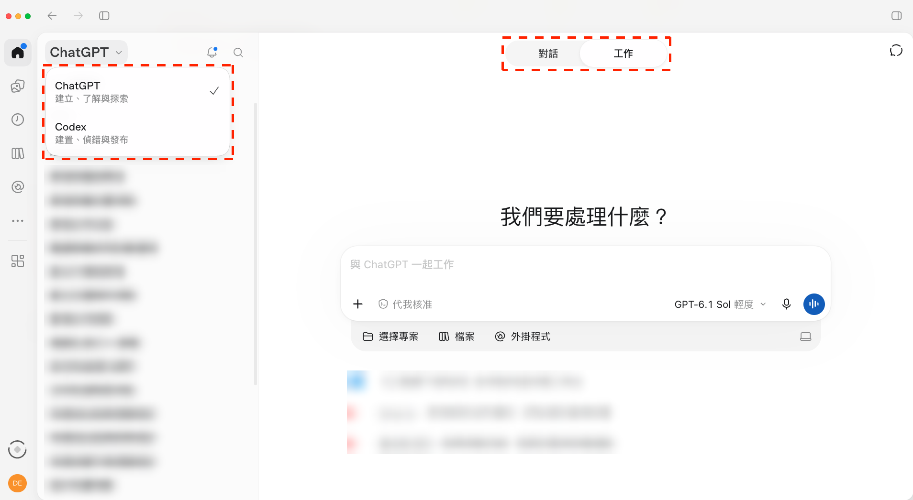

### 📁 選一個 AI 工作範圍的資料夾

[download dir="行動研究" label="下載「行動研究」練習素材" desc="上一堂放進專案的 4 份虛構文件：研究計畫書、分工與共備記錄、文獻與背景資料、評量規準與學習單格式"]

- 解壓後會得到 `行動研究` 資料夾，裡面就是上一堂的 4 份文件
- 在桌面版選擇這個資料夾，**只選這一個**，不選整個桌面或校務共用磁碟
- 預設權限為`代我核准`，若不放心可調整為`要求核准`

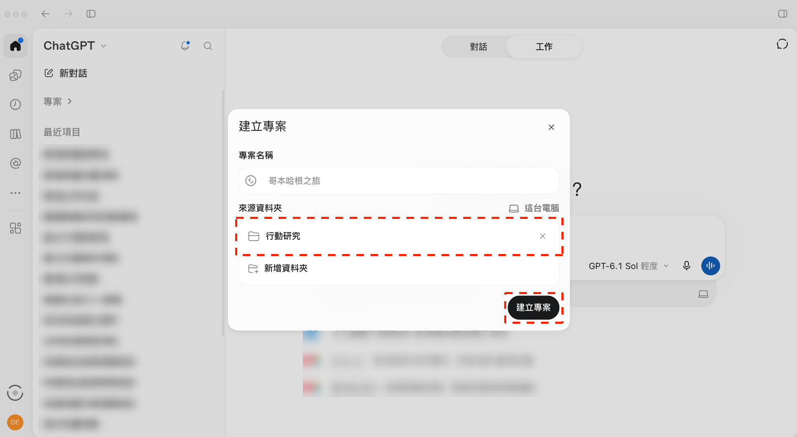

[warning title="使用提醒"]
桌面版是有能力`新增、修改、刪除`電腦檔案的。

能力越大風險越大，你可以想想`如果事情做到一半，但額度沒了會發生什麼事`。

所以原始資料要另留副本；遇到看不懂的權限要求，先請它用白話解釋，不要一路按同意。`按下同意，責任就是你的。`
[/warning]

## 上一堂的專案，改成直接讀資料夾

### 🆚 同一批文件，兩種給 AI 的方式

| | 🌐 上一堂：網頁版專案 | 💻 今天：桌面版資料夾 |
|---|---|---|
| 怎麼給資料 | 建立專案 → 把 4 份文件`一份份拖進去` | 選一次資料夾，裡面的檔案`都讀得到` |
| 文件更新了 | 要重新上傳新版 | 改完存檔，AI 下次讀到的就是新版 |
| AI 的成品 | 在對話裡，要自己複製或下載 | 直接新增、更新文件 |
| 適合 | 跨裝置使用、和同事共用 | 檔案多、常更新、要交出檔案 |

> **線上專案沒有被取代**
> `人在外面`想用手機查、想分享給同事，還是`線上專案方便`；而在`電腦上`處理一整包檔案，使用專案`資料夾`最直覺。

### ▶️ 用上一堂的問題驗證一次

```prompt [label="驗證出處、決議與誠實度"]
1. 這次行動研究的研究對象是誰？要教哪幾個閱讀策略？
2. 策略教學現在每週上幾節？後測確定改成線上施測了嗎？
3. 這個研究有申請經費嗎？金額是多少？
```

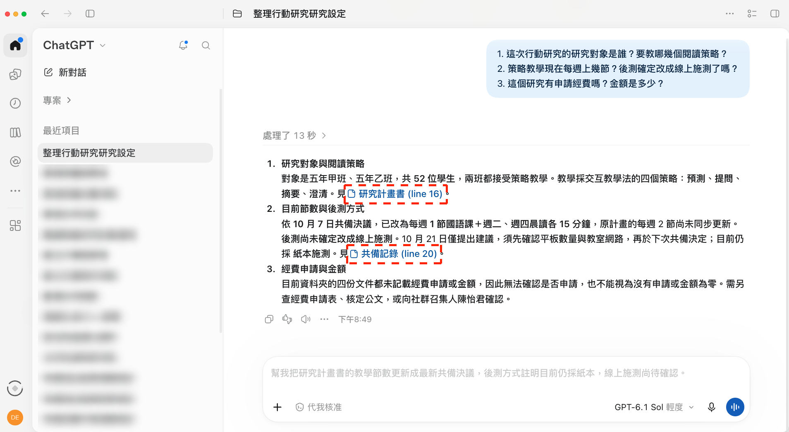

```prompt [label="把成品寫成檔案"]
設計第 3 週的學習單初稿，存成 Word 檔。
```

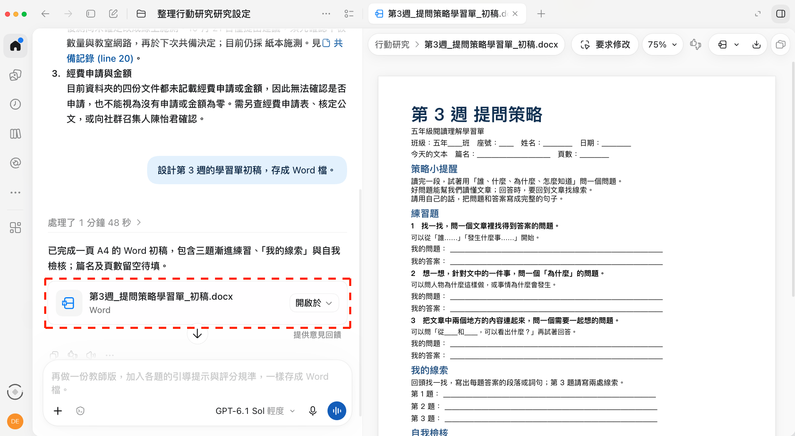

> **為什麼要使用相同素材？**
> 同樣的文件、同樣的問題，`但這次沒有上傳任何東西`。
> 而且 AI 不只回答，還會把成果`寫成檔案`放進你的資料夾。

## 新學年備課：同一個單元，今年要再教一次

> **新學年備課，常遇到的狀況**
> - 去年的教案是 `4 節`，今年只有 `3 節`
> - 課本改版，`頁碼和補充閱讀`都換了
> - 教學經驗散落在多個檔案：`課後省思`在教案裡、`錯題統計`在 Excel 裡
> - 共備會議又多了幾件`還沒定案`的事

### 🗂️ 把這個單元的資料夾交給 AI

[download dir="國語課備課資料" label="下載「國語課備課資料」練習素材" desc="五年級國語「事實與意見」單元，去年與今年的 8 份備課資料：Word、Excel、CSV、文字檔與掃描圖混在一起"]

- 剛剛的`行動研究`只有文字檔，這次難度升級：`兩個學年、五種格式`混在同一個資料夾
- 解壓後開一個`新對話`，資料夾改選 `國語課備課資料`

| 檔案 | 格式 | 哪一年 | 備課時想從裡面知道什麼 |
|---|---|---|---|
| 教案-事實與意見-114.docx | Word | 去年 | 去年怎麼上、課後省思寫了什麼 |
| 學習單-事實與意見-114.jpg | 掃描圖 | 去年 | 學習單出了哪些題目 |
| 作答統計-事實與意見-114.xlsx | Excel（2 個工作表） | 去年 | 學生哪幾題錯最多 |
| 教師手冊重點-事實與意見-115.docx | Word | 今年 | 新版課本的目標、節數與頁碼 |
| 教學進度表-五上國語-115.xlsx | Excel（2 個工作表） | 今年 | 哪一週上、有幾節、會不會撞到學校活動 |
| 會議紀錄-共備1117-115.txt | 文字 | 今年 | 哪些已經決議、哪些只是提議、誰負責 |
| 補充閱讀-吃不完的營養午餐-115.txt | 文字 | 今年 | 今年要換的補充閱讀短文 |
| 資源連結-影音與網站-共用.csv | 表格 | 兩年共用 | 影片和線上資源還能不能用 |

```prompt [label="彙整成今年的備課總覽"]
我今年要再教這個單元。把去年和今年的資料彙整成一份備課總覽，哪些可以沿用、哪些要調整、哪些還沒確定，幫我標出來
```

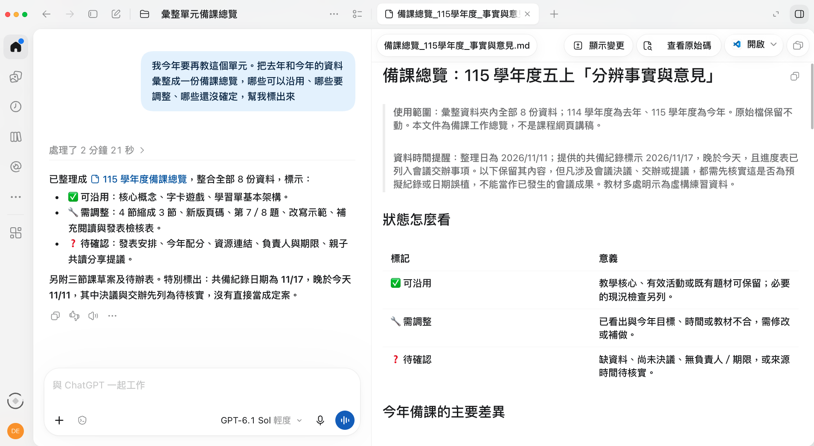

```prompt [label="變成好讀的視覺化內容"]
用視覺化的方式呈現資訊，讓我更容易了解
```

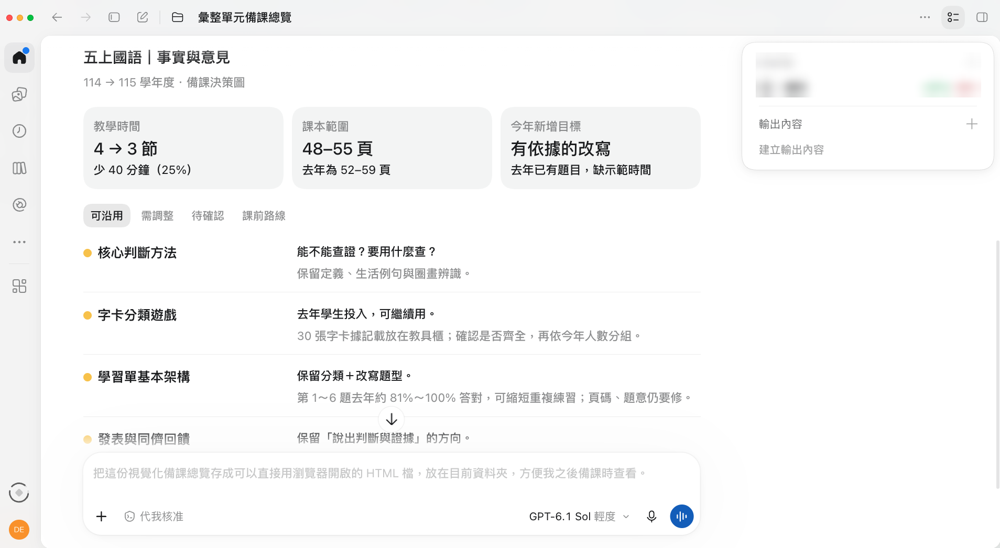

> **把最多時間花在驗證**
> 我備課時，花最多時間的不是生成，而是`驗證`：案例合不合理、資訊對不對。
> 畢竟內容出錯，責任還是要自己承擔。

---

# 照片也能彙整：掃描檔、手機拍的文件，直接彙整到 Excel

> **很多文件是以照片形式存在**
> 掃描存檔的文件、手機拍下來的回條和報名表，都是`圖片`，不能搜尋、也不能複製。

## 過去要手動彙整掃描檔和照片

> **一疊掃描檔、一堆照片，要用的時候只能一張張打開**
>
> - 想找某一筆資料，得`一張張翻`
> - 想統計或彙整，只能`看著照片重新打一次`，手寫字又容易看錯、漏打
> - 量一大（一班三十張、全校幾百張），`一整天都耗在 key-in`

### 📷 是照片也沒關係，AI 看得懂

[flow]
- **過去只能靠人工判讀** - 掃描的文件、手機拍的回條、手寫打勾的表單，內容都是`圖片`
- **AI 本身有圖片辨識能力** - 剛剛備課資料夾裡的`學習單掃描圖`，它就是這樣讀出題目的
- **不建議每一次都重新讀圖片** - 讀圖片消耗的額度比讀文字高
- **讀一次，轉成文字或表格存起來** - 之後要查詢、統計、彙整，都用這份檔案，可以`重複利用`
- **告訴它遇到例外怎麼做** - 看不清楚的欄位留白、標黃，不要自己猜
[/flow]

## 用一疊報名表照片練習

### 📥 下載 6 張報名表照片與名單範例

[download dir="報名表照片" label="下載「報名表照片」練習素材" desc="6 張手機拍的虛構手寫報名表，加上一份有欄位、內容空白的 Excel"]

- 解壓後會得到 `報名表照片` 資料夾：6 張家長交回的`親子共讀夜報名表`照片，都是手機拍的，有的歪、有的暗
- `報名名單範例.xlsx` 只有第一列的欄位、內容是空的；它是給 AI 看的`格式範例`，等一下請 AI 照這些欄位`建立一份新的名單`
- 開一個`新對話`，資料夾改選 `報名表照片`

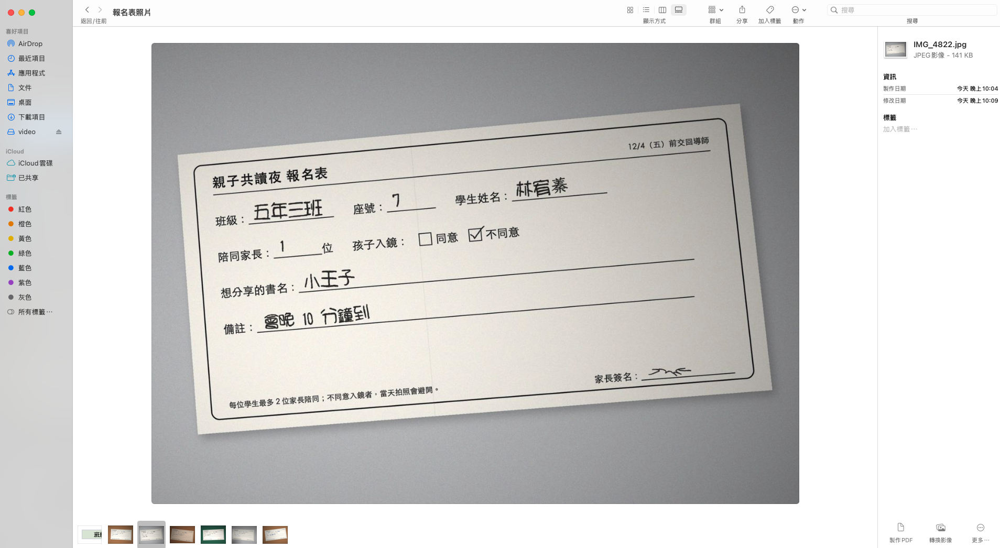

```prompt [label="把報名表照片寫進新的名單"]
請讀取這個資料夾裡的報名表照片，建立一份新的「親子共讀夜報名名單.xlsx」：
① 欄位照「報名名單範例.xlsx」的第一列，一張照片一列
② 「來源照片」填照片檔名
③ 看不清楚或不確定的格子留空、標黃，不要自己猜，原因寫在「待確認事項」；勾在兩格中間也算不確定
④ 最後告訴我：總共幾筆、哪幾格需要我確認
```

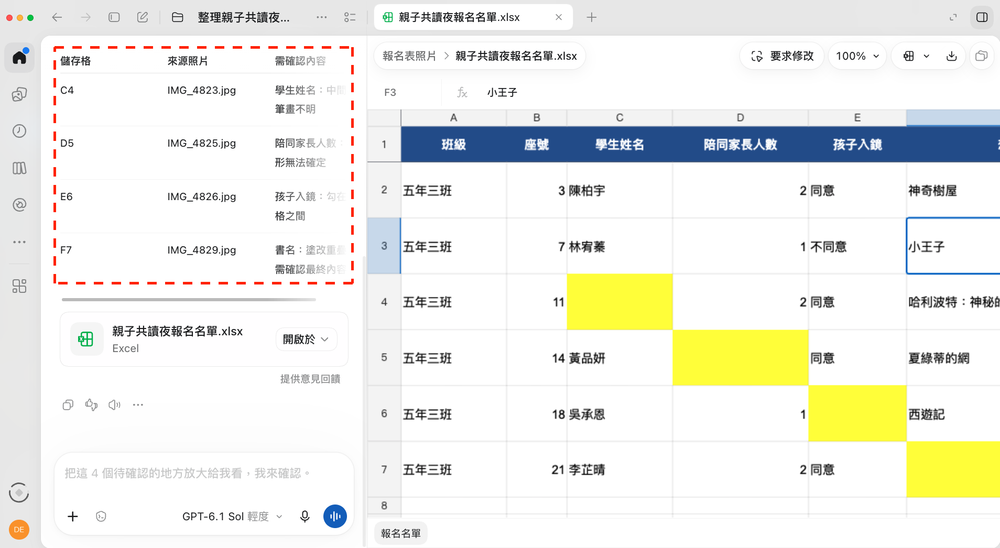

### ⚠️ 辨識圖片要注意的事項

[flow]
- **先用 3～5 張試跑** - 剛開始先用少量照片，確認它`會漏什麼、哪裡需要補規則`，再逐步增加數量
- **把例外怎麼處理講清楚** - 字跡潦草、勾在兩格中間、有塗改，都要先說好`留空標黃、不要猜`；試跑時發現新的狀況，就把規則補進 Prompt
- **標黃的格子，回頭對照原照片** - AI 標出來的是它沒把握的地方，由你來決定該填什麼
- **沒標黃的也要抽查** - AI 很有把握不代表一定正確，姓名、數字這類不能錯的欄位要多看幾筆
[/flow]

> **AI 完成後，還是要人工驗證**
> 一格看錯，整張名單都要重對。別忘了，最後要為結果負責的是`你自己`。

### 🔁 同樣的事，換一個 AI Agent 也做得到

- **不是 ChatGPT 的專利**：`資料夾彙整`、`辨識照片彙整成 Excel`，大部分能操作電腦的 AI Agent 都做得到
- **學會的是方法，不是工具**：今天的做法換到其他 Agent 一樣適用，差別只在介面
- **想看另一個工具怎麼做**：我錄過 `Manus 桌面版`的完整示範，同樣的任務可以對照著看

[youtube id="WGHQuCI3iJk" title="【Manus 桌面版教學】讓 AI 操作電腦，從資料夾彙整報告、辨識圖片寫 Excel、自動填表單"]

---

# 認識 Skill：把做事的步驟，存成 AI 的 SOP

> **Skill 是把你最好的一次，變成每一次**
> 你摸索出最順的流程後，只要成功過一次，就能把它存成 Skill，未來不用從零開始。

## 為什麼需要 Skill？

### 🤯 流程都在某個人腦袋裡

[flow]
- **關鍵人物不在，流程就卡住** - 「家長通知怎麼寫？校外教學的流程怎麼跑？」如果答案全在某位`資深老師`的腦袋；他一請假、調校，這一切就需要`重新摸索`。
- **交接靠口耳相傳，品質全憑運氣** - 新接手的老師只拿到`零散檔案`和`口頭經驗`；通知、公告、簡報……每個人的`格式、品質`都不一樣。
- **需要手把手教，難以擴散** - 好方法要`實際示範`才學得會，所以就算有人做得很好，也很難複製到`其他班級、其他處室`。
[/flow]

### 📋 提示詞一直複製貼上

[flow]
- **存了一堆 Prompt，要用時翻半天** - 提示詞散落在`記事本、LINE、聊天記錄`；真的要用時，光是找出`最後一版`就浪費一堆時間。
- **換個地方發，就得重新交代** - 同一則運動會通知，貼到班級 LINE 群組要`簡短、重點放最前面`，印成紙本要`正式、附回條`；每換一次，這些要求都得`再打一遍`。
- **規則改了，舊版本卻沒跟著改** - 多了一條`不能寫的話`，但同一段 Prompt 已經`被複製到十個地方`；漏改一處，錯的版本就`默默繼續產出`。
[/flow]

## Skill 和 Prompt、專案差在哪

### 📝 Skill 就像學校的 SOP 手冊

| | 📖 學校的 SOP 手冊[width:30%] | 🧩 給 AI 的 Skill[width:45%] |
|---|---|---|
| 給誰用 | 新接手業務的同事 | AI |
| 裡面有什麼 | 步驟、範本、注意事項 | 一個資料夾：`SKILL.md`（步驟與規則）、範本與參考資料，必要時再附`小程式` |
| 什麼時候用 | 遇到這項業務就翻開 | 遇到符合的任務，AI 會照著做 |
| 帶來什麼 | 換人接手，做法也一樣 | `格式一致`、`不用每次重講` |
| 怎麼傳下去 | 交接給下一位同事 | 技能包可以`下載與分享` |

> **新手也能用前輩的方法**
> 新手用前輩設計好的技能，也能做出品質一致的結果。

### 🆚 Prompt、專案、Skill 各放什麼

| 功能 | 存什麼 | 比喻 | 校園例子 |
|---|---|---|---|
| Prompt | 這一次的需求 | 口頭交代 | 「幫我把這份通知改短」 |
| 專案（Project） | 背景知識與文件 | 活動資料夾 | 行動研究的計畫書與共備記錄 |
| Skill | 做事的步驟與範本 | SOP 手冊 | 「發活動通知」：LINE 群組、紙本各要多長、用什麼格式、要注意什麼 |

> **專案放知識，Skill 設計流程**
> **專案讓 AI「知道事實」** — 你的角色、活動辦法、共備決議
> **Skill 讓 AI「知道步驟」** — 報名表登記、每週回顧、信件、資訊卡、簡報要遵守的 SOP

---

# 如何使用 Skill：用白話文就能生成，也可匯入別人做好的

[warning title="ChatGPT 的技能需要付費版"]
技能目前需要付費版，並在`工作`模式使用，免費版看不到技能頁面。
[/warning]

> **Skill 怎麼來？四種做法，由淺入深**

[flow]
1. 把既有流程變成 Skill — **報名表登記**：做完後如果覺得成果可接受，未來會多次使用就請 AI 存起來
2. 用白話生成 Skill — **每週回顧**：用白話說清楚資料從哪裡讀、要整理成什麼格式
3. 建立自己的 Skill — **寫信風格**：讓 AI 讀你寫信的風格、語氣、判斷基準，做出適合自己的版本
4. 匯入別人做好的 Skill — **資訊卡**：下載技能包，匯入就能用
[/flow]

## 把既有流程變成 Skill

### 💬 成果符合期待、會重複使用，就請 AI 把它變成 Skill

- 報名表、同意書、調查表：表單不一樣，`登記的規則都一樣`
- 剛剛我們已經驗證流程符合預期；回到`剛剛登記報名表的對話`，直接用白話說

```prompt [label="把判斷邏輯設計成 Skill"]
幫我把流程變成 Skill [form-photos-to-excel]，之後想把報名表、同意書、調查表寫入 Excel 時可以共用
```

- AI 會把對話裡的規則整理成一份 Skill，內容看過沒問題，就依畫面提示`儲存`

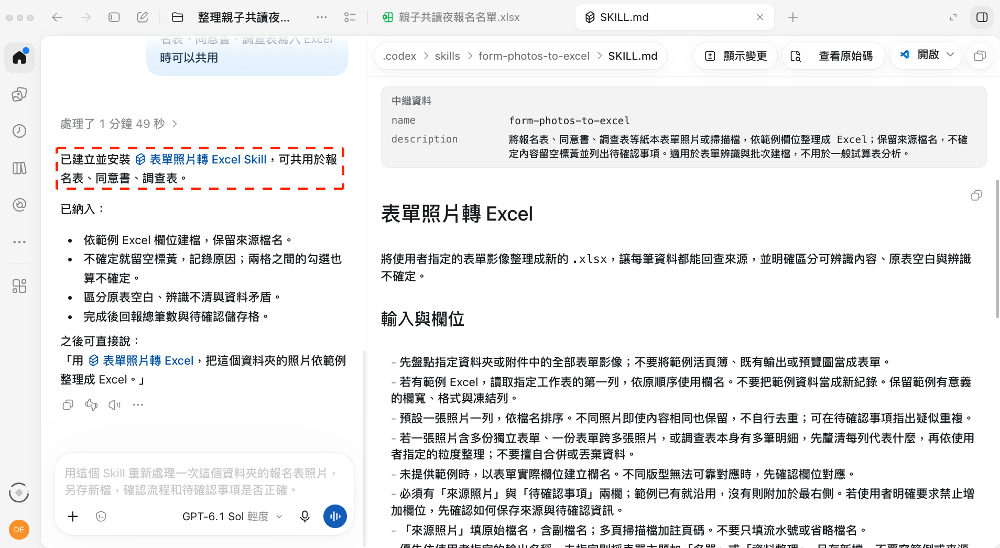

### ▶️ 呼叫：直接說需求，或輸入 @ 選技能

- **被動觸發**：直接描述需求，符合技能描述時，AI 會自己選用；技能越來越多，要記住每個名稱並不現實
- **主動呼叫**：在輸入框打 `@`，從清單選技能，再接著寫需求；一段對話想用多個技能時，這個方式比較穩定

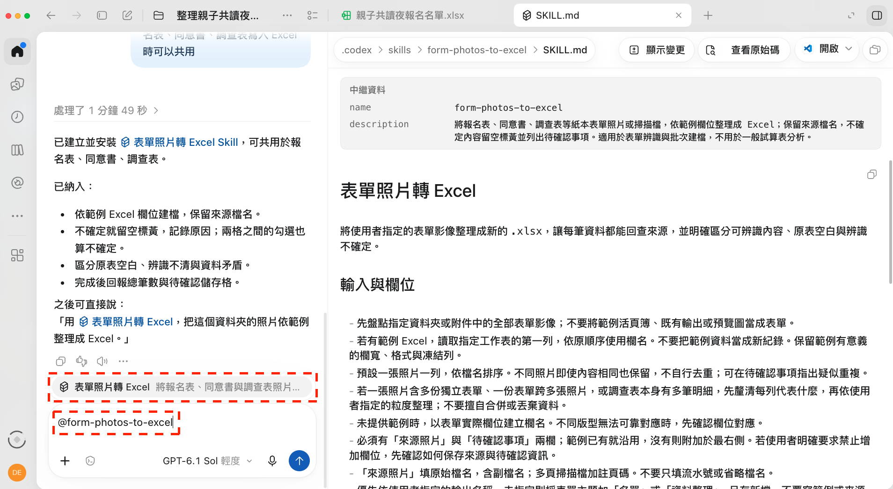

### ✅ 驗證：隔天又收到 4 張報名表

[download dir="報名表照片_第二批" label="下載「報名表照片（第二批）」練習素材" desc="4 張新的報名表照片"]

- 在同個資料夾中`開啟新對話`
- 把這些照片拖曳到前面`報名表照片`資料夾中

```prompt [label="用一句話登記新的報名表"]
把新的報名表登記到名單
```

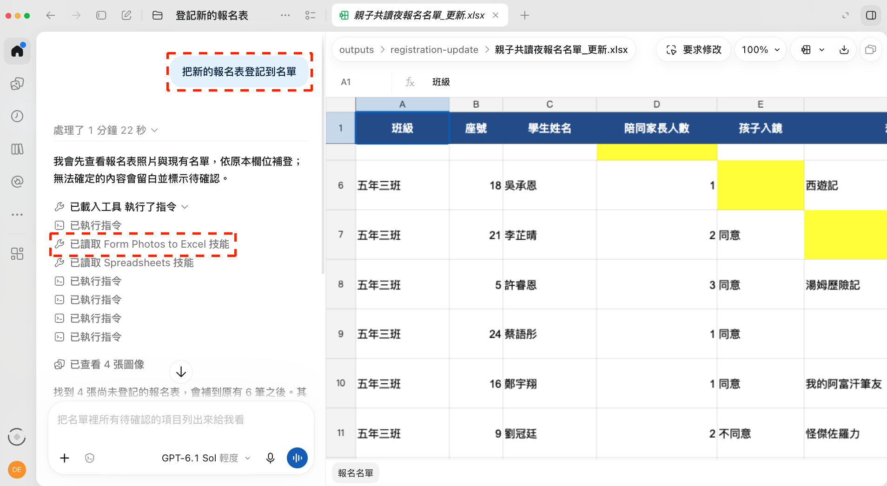

## 用白話生成 Skill

### 🆚 和報名表的 Skill 差在哪

| | 📋 報名表登記 | 🗓️ 每週回顧 |
|---|---|---|
| 怎麼來 | 把`做過的流程`存起來 | 還沒有流程，用`一段白話`描述你要的結果 |
| 資料從哪裡讀 | 資料夾裡的`照片與名單` | `對話紀錄`，加上外掛程式連好的 `Gmail`、`Google Calendar` |
| 在哪裡做 | 開在`報名表照片`資料夾 | `開新對話`就好，不用選資料夾 |

> **Skill 跟著情境走**
> 要讀寫檔案的，在`資料夾`裡用；資料在信件、行事曆裡的，`一般對話`就能用。

### 📝 把期待的格式講清楚，而不是讓 AI 自由發想

- 描述裡寫清楚四件事：`資料來源`、`預設期間`、`分成哪幾個部分`、`不能做的事`

```prompt [label="用一段白話建立每週回顧 Skill"]
我想要建立一個 Skill：[weekly-review]
根據我與 AI 的對話紀錄、Gmail 的往來信件、Google Calendar 的行程，幫我回顧這段時間做了什麼，這份回顧是寫給我自己看的
只整理工作方面的資訊，產出前請先取得當下時間；沒有指定期間時，預設回顧[最近一週]，我也可以指定上週或這個月
內容分成四個部分：[完成了哪些事、推進了哪些事、做了什麼重要決策、下一步是什麼]，並遵循下面規則：
- 避免流水帳，同一件事的信件、會議與對話合併成一項
- 不要把未完成的事寫成已完成，也不要編造對話、信件與行事曆中沒有的內容
- 讀不到 Gmail 或行事曆時先告訴我，不要用猜的補上
- 請使用繁體中文，用條列呈現，讓我一分鐘內看完
- 直接輸出回顧，不需要額外解釋
```

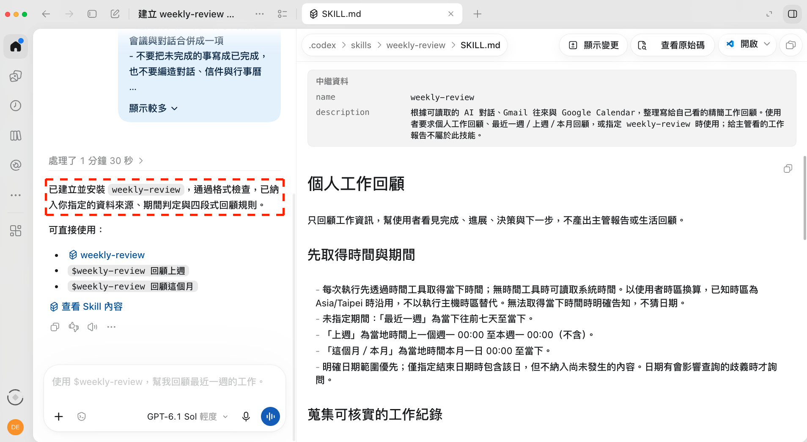

> **個人心得**
> AI 設計的 Skill 有時會有`過度設計、冗贅資訊`的問題，可以根據實戰結果`調整細節`。

### ✅ 開新對話驗證

```prompt [label="測試被動觸發"]
回顧我上週做了什麼
```

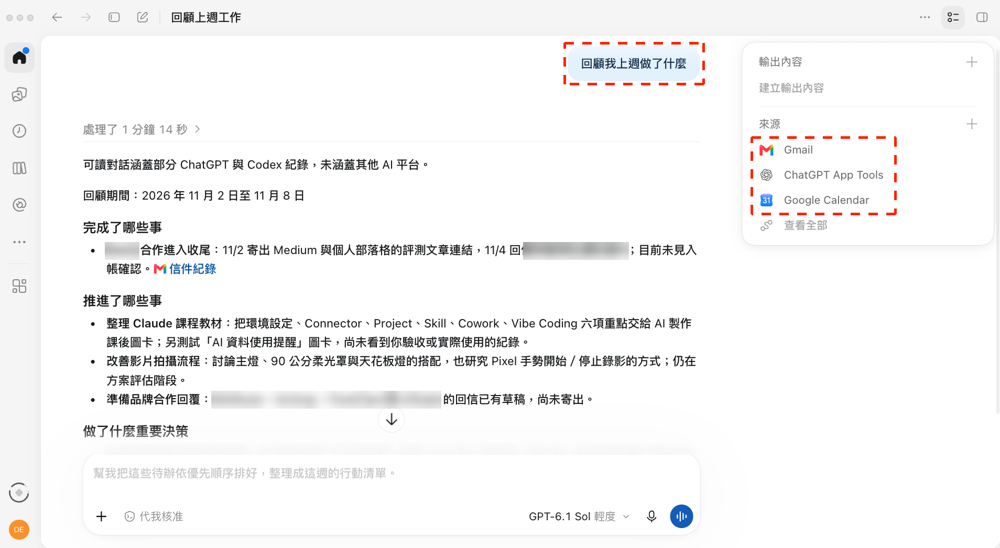

## 建立自己的 Skill

### ✉️ 拿我自己舉例：合作邀約

- 我常收到品牌的`合作邀約`，每一封都要回，但回法不只一種：`接受`、`婉拒`、`先詢問細節`、`討論時程`、`報價`
- 要回得好，AI 得先知道我的`個人背景`：
  - **報價**：不同合作形式各是多少、哪些可以談
  - **合作方式**：我接哪些形式、不接哪些類型、目前檔期排到什麼時候
  - **過去成效**：做過哪些案例、可以附上哪些成果當參考
- 這些資訊，別人的「寫信 Skill」都不會有

### 🗂️ 我的回信 Skill 裡放了什麼

這個 Skill 是從我 `真實往來信件`歸納出來的：

| 檔案 | 內容 | 為什麼只有我自己寫得出來 |
|---|---|---|
| SKILL.md | 流程：解析來信 → 調查品牌 → 判斷回應類型 → 產出草稿 → 自我檢查 | 實際回信的流程 |
| 決策框架 | 什麼情況接受、婉拒、詢問、先試用、報價 | 判斷標準來自我的頻道定位 |
| 報價紀錄 | 各種合作形式的現行報價與歷史紀錄 | 報價是我的，AI `不能自己編` |
| 回信模板 | 中文、英文各一份，每種回應類型的寫法 | 語氣是從我寄出去的信整理的 |
| 婉拒紀錄 | 不接的品類、過去婉拒過誰與原因 | 每次做完決定都會`回寫`一筆 |

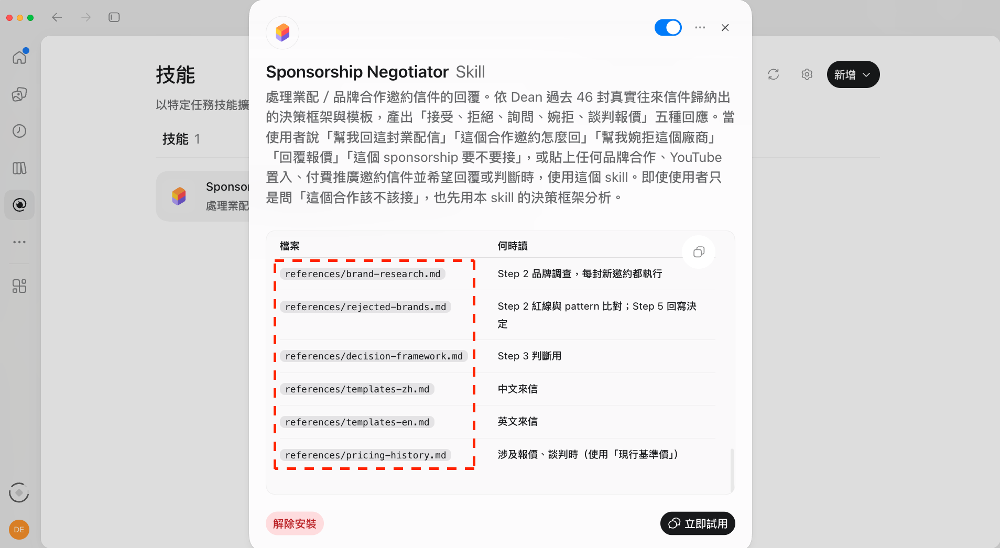

### ▶️ 示範：從 Gmail 找出邀約信，交給我的 Skill

```prompt [label="講師示範：用 @ 叫出 Skill，直接從 Gmail 找信"]
@sponsorship-negotiator 到 Gmail 找出 BlackBaoBao 寄來的合作邀約，先告訴我建議怎麼回、理由是什麼；我確認後再寫回信草稿
```

[flow]
1. 找到信件 — 從 Gmail 讀出這封邀約，整理對方要的合作形式、時程與提問
2. 調查與判斷 — 先調查品牌，給我`建議的回應類型與理由`
3. 對照我的資料 — 報價引用我的`報價紀錄`，查不到就留空請我填；檔期依我目前的排程建議接、延後或婉拒；附上我做過的參考案例
4. 等我決定 — 我確認後才寫回信草稿，決定還會`回寫進紀錄`
[/flow]

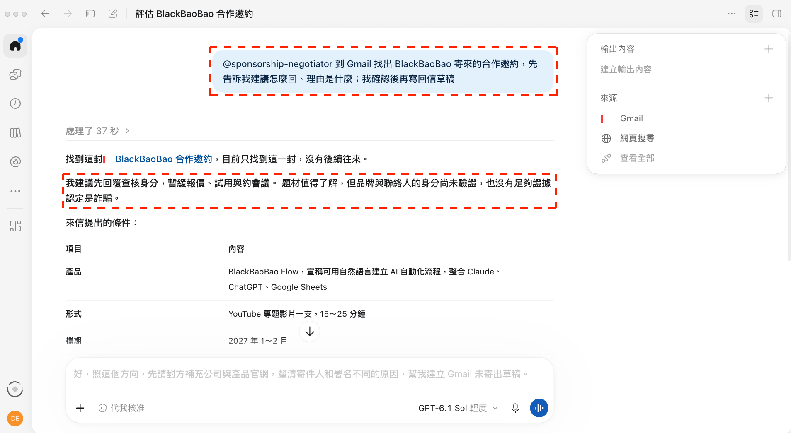

### 🔄 最順手的 Skill，是從自己的工作流設計出來的

[flow]
1. 先把事情做一次 — 用白話跟 AI 來回，回出一封自己滿意的信
2. 存成第一版 — 把剛剛的步驟與規則整理成 Skill，不用追求完整
3. 邊用邊補 — 哪裡不滿意，就把那條規則、那份資料補進去
4. 持續更新 — 報價變了、多了一種不接的類型，回寫進 Skill
[/flow]

> **不要想著一開始就完美**
> 別人的 SOP 可以參考，但最好的 Skill 是從`自己實際的工作流`出發，再慢慢調整到符合期待。
> **有持續在用的 Skill，一定會持續優化**；放著不改的，通常也是沒在用的。

### 🧑‍🏫 換成你：讓 AI 讀你寫過的信，整理成你的寫信 Skill

- 前兩個 Skill 的規則是`你告訴 AI 的`；這一個換成讓 AI `從你寫過的信裡找出規則`，做出來的就是只屬於你的版本
- 上一堂已經用`外掛程式`連上 Gmail，可以直接請它讀你最近寄出的信

```prompt [label="第一步：讀我最近寫的信，整理我的回信習慣"]
讀取我最近寄出的 20 封信，只看我自己寫的內容，整理我回信的習慣：
怎麼稱呼對方、開頭先講什麼、怎麼結尾與署名、最常回覆的幾種情況、哪些話我不會說。
先把整理結果給我確認；不要列出信裡的姓名、電話或其他個資。
```

```prompt [label="第二步：確認後變成 Skill"]
整理的結果我確認過了，幫我把它變成我的寫信 Skill
```

## 匯入別人做好的 Skill：用資訊卡示範

> **不是每個 Skill 都要自己從頭做**
> 前面三個 Skill，都是跟 AI `聊出來的`；
> 別人已經做好的技能包，`下載、匯入`就能直接用。

### 🖼️ 把長長的通知，變成大家願意看完的 5 張卡

- 家長通知、活動公告、教材重點，字一多就沒人看完；做成`一卡一重點`的圖卡，貼到班級群組更好讀
- 資訊卡上的文字是`真的字`，不像 AI 生成的圖片偶爾會出現錯字
- 技能包流程：先給你`提煉摘要`確認 → 把內容排進固定版型 → 用寫網頁的方式產出一組 `1080×1350` 的圖片

[download dir="info-card-generator" label="下載「資訊卡」技能包" desc="info-card-generator.zip：SKILL.md＋版型模板＋產圖小程式"]

### 📥 匯入：在對話視窗上傳壓縮檔

[flow]
1. 開新對話 — 在`工作`模式開一個新對話
2. 拖進壓縮檔 — 把剛下載的 `info-card-generator.zip` 拖進輸入框，`不用解壓縮`
3. 叫出 Skill Creator — 輸入 `@skill-creator` 後送出；這是內建、專門用來`建立與安裝技能`的 Skill
[/flow]

```prompt [label="拖進壓縮檔後，輸入這一行再送出"]
@skill-creator
```

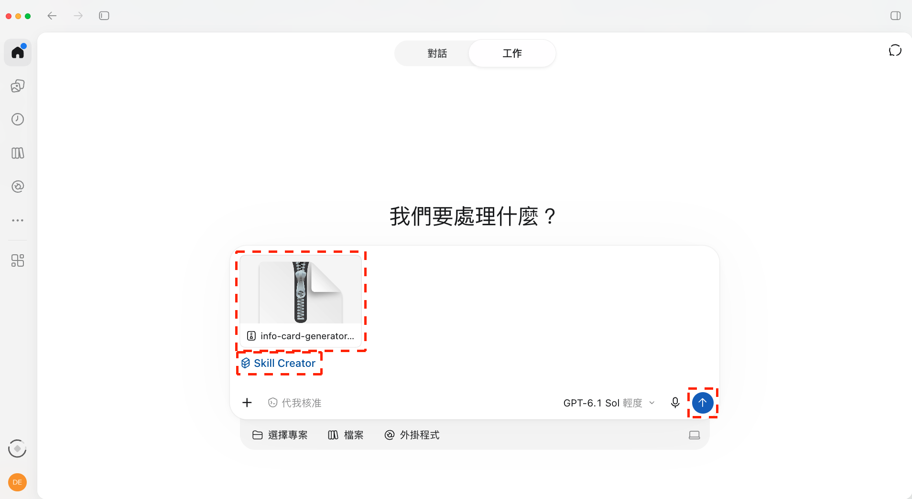

### ▶️ 用匯入的 Skill 做一組資訊卡

```prompt [label="在 ChatGPT 用 Skill 做資訊卡（講師示範）"]
@info-card-generator 把下面的通知做成給家長看的資訊卡。

【五年級校外教學行前通知】
各位家長您好：

本學期五年級校外教學訂於 12 月 23 日（星期三）前往海岸自然教育園區，配合自然課「水域環境」與社會課「家鄉的產業」單元，當天上午參觀潮間帶生態館並由園區解說員帶領分組導覽，下午進行漂流木吊飾 DIY，請家長協助孩子做好行前準備。

當天請於 07:40 前到教室集合，08:00 準時發車，逾時不候，預計 16:10 返抵學校、16:30 於校門口放學，安親班接送請自行調整時間；當天不上課後社團。

費用每人 550 元，包含車資 280 元、門票 150 元、DIY 材料費 90 元與旅遊平安保險 30 元，午餐由園區餐廳統一供應已含在門票內，素食或食物過敏請於同意書上註明；費用請於 12 月 14 日（星期一）前裝入信封、寫上班級座號交給導師，請自備剛好的金額，恕不找零，繳費後因個人因素取消僅退還門票與材料費共 240 元。家長同意書請於 12 月 11 日（星期五）前交回，未交同意書者依規定不能隨隊，當天留校由代課老師安排自習。

服裝請穿學校運動服與好走的運動鞋，園區部分步道濕滑請勿穿涼鞋或拖鞋；請攜帶水壺、帽子、薄外套、輕便雨衣、個人藥品與健保卡，容易暈車的孩子請先服藥並在同意書註明，由老師安排坐前排。請勿攜帶手機以外的電子產品與超過 100 元的零用錢，手機僅限緊急聯絡使用，遺失請自行負責。

每班徵求 2 位家長志工隨隊協助，意者請於 12 月 9 日（星期三）前在聯絡簿回覆，志工不需繳費。當天如遇豪雨特報，將改至 12 月 30 日（星期三）舉行，並於前一天 18:00 前在班級群組公告；小雨照常出發。活動當天緊急聯絡請撥學務處分機 21。

五年三班導師 王老師 敬上
```

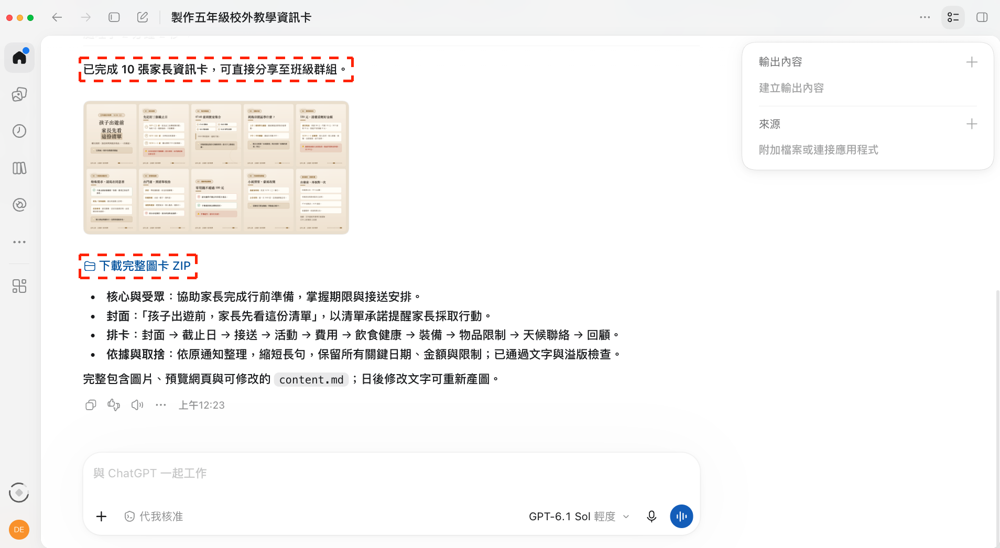

### 🧑‍💻 圖卡不是畫出來的，是程式套版做出來的

[flow]
1. AI 整理重點 — 把通知拆成`一卡一重點`，照約定的格式寫好
2. 套進版型 — 版面、配色、字體大小，都固定在技能包的`版型模板`裡
3. 轉成圖片 — 技能包附的`小程式`，把每一張卡輸出成 PNG
[/flow]

> **就像學校的空白獎狀**
> 框線、圖案、字體都印好了，每次只填上不同的名字，所以`每張風格都一致`。
> 你不需要看懂程式，只要知道：`這一類 Skill 要跑程式`，不只是寫文章。

| Skill | 成品 | 用到程式嗎 | 建議在哪裡用 |
|---|---|---|---|
| 表單照片登記 | Excel 名單裡的新資料 | ❌（只有文字規則） | ChatGPT 或 Codex |
| 每週回顧 | 一份條列的回顧 | ❌（只有文字規則） | ChatGPT |
| 寫信風格 | 一段文字 | ❌（但要補上你的背景） | ChatGPT |
| 資訊卡 | 一組 PNG 圖卡 | ✅ 寫網頁，再執行小程式轉成圖片 | ChatGPT 可以，`Codex 更順` |
| 線上簡報 | HTML 網頁檔 | ✅ 執行小程式產出網頁 | Codex |
| 模板簡報 | PPTX 檔 | ✅ 還要執行小工具 | Codex |

> **為什麼要分辨 Skill 有沒有用到程式？**
> 因為這決定了`該交給誰做`。只有文字規則的，ChatGPT 的對話就很順；要寫檔案、跑程式的，交給擅長寫程式的 Codex 會更有效率。

---

# Codex：用到程式的 Skill，交給它更有效率

> **行政秘書 🆚 資訊組**
> 寫信、每週回顧找行政秘書（ChatGPT）；要寫網頁、跑小工具，找資訊組（Codex）。

## 程式在雲端跑，還是在你的電腦跑

### 🆚 在哪裡跑，效率差很多

| [width:110] | ☁️ 雲端（ChatGPT） | 💻 你的電腦（Codex） |
|---|---|---|
| 是什麼 | 雲端的`沙盒`：一台臨時借你用的電腦 | `你正在用的這台電腦` |
| 可用的資源 | 雲端分配的`有限資源` | 整台電腦的`效能`都能用 |
| 環境 | 只有預先裝好的`基本工具` | 你電腦上的字型、瀏覽器、軟體都用得到，`環境更完整` |
| 缺工具時 | 每次開新對話，可能都要`重新下載` | `下載一次`，之後一直都在 |

> **今天用 Codex 的「這台電腦」模式**
> Codex 也能切到`雲端`執行，適合程式碼放在 GitHub、想`關上電腦也繼續跑`的開發者。
> 今天要讀寫你資料夾裡的檔案、跑 Skill 附的小程式，選`這台電腦`最快；第一次把工具裝好，之後就`越用越順`。

## 前面的 Skill，在 Codex 可以直接使用

### 🔁 Codex 可以使用前面的 Skill

[flow]
1. 切換到 Codex — 從桌面版左上的選單切換
2. 輸入 `@info-card-generator` — 可以使用先前建立的 Skill
[/flow]

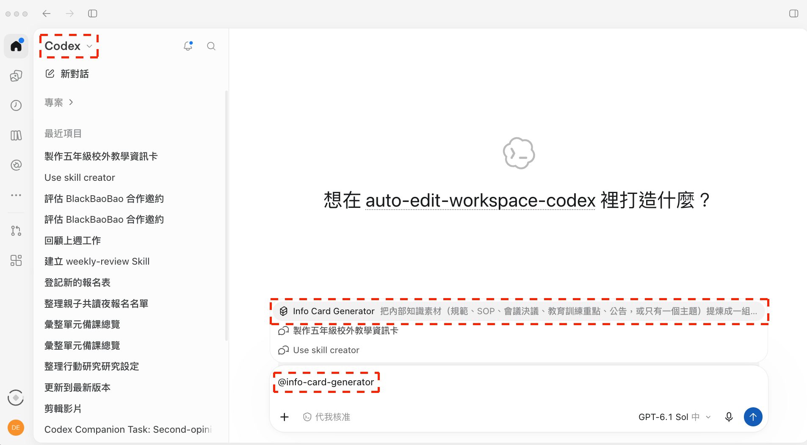

### ▶️ 用資訊卡驗證：建立新資料夾，貼上通知

[flow]
1. 開一個資料夾 — 新增一個資料夾，取名 `資訊卡`
2. 在 Codex 新專案開啟 — 工作範圍就是你開啟的`那一個資料夾`：素材從裡面讀，成品也寫進去
3. 確認權限 — 設定和前面一樣，不放心就調整為`要求核准`
[/flow]

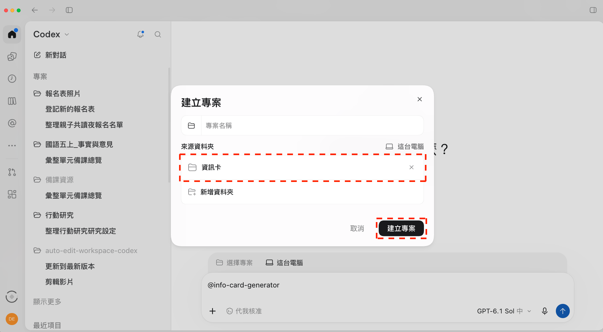

```prompt [label="在 Codex 用同一個 Skill，把通知直接做成資訊卡"]
@info-card-generator 根據內容命名資料夾後，只要儲存生成的圖片，設定檔與壓縮檔都不需要

【五年三班 親子共讀夜 活動通知】
親愛的家長您好：
這學期孩子在國語課學習「分辨事實與意見」，為了讓孩子把讀書的樂趣帶回家，班上將舉辦親子共讀夜，歡迎全家一起來。

活動資訊：2026 年 12 月 11 日（星期五）18:30～20:00（18:15 開放入場），地點在星光國小圖書室；對象是五年三班學生與家長，每位學生最多 2 位家長陪同，費用免費，請攜帶一本家裡喜歡的書與水壺。

活動流程：18:30 開場與暖身遊戲、18:45 親子共讀、19:20「事實還是意見？」親子挑戰、19:45 分享與合照、20:00 賦歸。

報名方式：請於 12 月 4 日（星期五）前把報名表交給導師，報名表請填班級、座號、參加人數、是否同意孩子入鏡、想分享的書名。

注意事項：當天會拍照記錄，若不同意孩子入鏡，請在報名表勾選「不同意」；雨天照常舉行；有任何問題，請在聯絡簿留言給導師王老師。
```

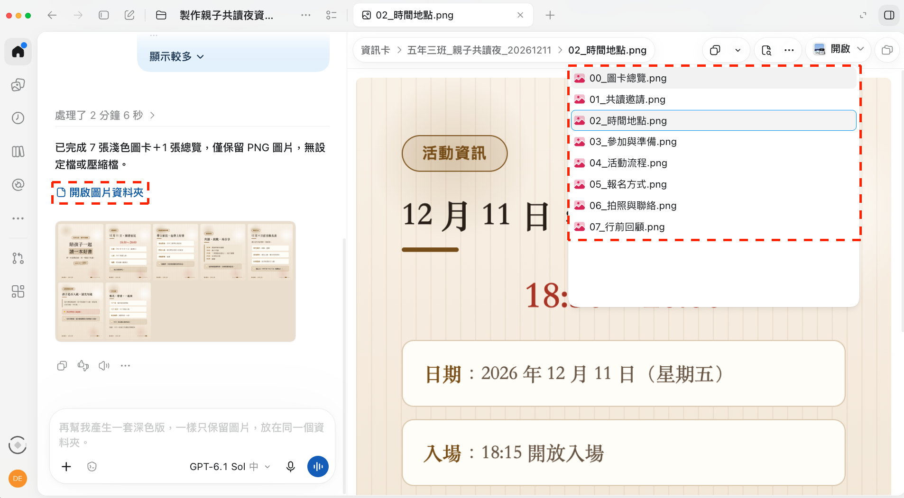

> **Tips**
> 原本預設會有壓縮檔跟複雜的資料夾，但可以直接用白話文讓他輸出成自己期待的結構。

### 🧰 Skill 第一次在 Codex 執行，可能遇到的問題

[flow]
- **讓 Codex 在本機執行** - 用的是`你電腦上的工具`，第一次執行時可能會缺東西
- **缺東西就請 AI 裝** - 過去環境安裝很折磨人，但現在 AI 可以直接`幫你的電腦設定好`
[/flow]

[warning title="安裝前先看清楚"]
- 安裝時 Codex 會跳出核准提示；如果看不懂請詢問 AI `這個工具是做什麼用的`，不要全部同意
- Skill 可能附帶小程式，只裝`信任來源`的技能包（官方、學校、講師提供）；來路不明的不要裝
[/warning]

## 用程式碼生成線上簡報

### 🧑‍💻 簡報不一定要開 PowerPoint，也可以是一個網頁

[flow]
- **過去：用 PPT、Gamma 做講義** - 資訊常常`貼來貼去`，有時還找不到檔案在哪裡；三年前一場 6 小時的企業內訓，光準備講義就要 `20 小時`
- **現在：把流程寫成 Skill** - 結構發想 → 整理資訊 → 客製化案例 → 完成講義；內容寫成文字、版面交給程式碼，準備時間縮短到 `3 小時`
- **成果：你現在看的這份講義** - 就是用程式碼生成的，上課投影當簡報，課後傳連結當講義
[/flow]

### 😓 直接請 AI 寫網頁，會遇到三個挑戰

| 遇到的挑戰 | Skill 的做法 |
|---|---|
| 每次長得都不一樣 | AI 不直接寫網頁，而是把內容寫成`約定格式的文字`；版型固定在模板裡，由程式轉成網頁 |
| 內容空泛，誰都能看、誰都用不上 | 動手前先確認`受眾、主題、目標、時間`，缺的一次問完 |
| 想改一句話，得回去改程式碼 | 說一句「第 2 章改成…」，AI 調整文字就好 |

- 這個技能包就是`我自己在用的講義 Skill`，你可以請 AI 把資訊調整成自己的版本
- 產出網頁的小程式需要電腦有 `Node.js`

[download dir="course-page-generator" label="下載「線上簡報」技能包" desc="course-page-generator.zip：SKILL.md＋語法說明＋頁面模板＋產出網頁的程式（需要 Node.js）"]

### ▶️ 示範：準備一份給老師的 ChatGPT 桌面版教學

[flow]
1. 開資料夾 — 一樣先開一個新的資料夾（ex: `線上簡報`），在 Codex 開啟它
2. 講清楚需求 — 提示詞涵蓋`受眾、主題、目標、情境`會有更精準的結果
3. 確認大綱 — Skill 會先給章節大綱，方向對了再讓它動手
4. 打開成品 — 資料夾裡多了 `index.html`，用瀏覽器打開就是講義，按 `P` 變成簡報
[/flow]

```prompt [label="講清楚受眾與主題，請 Skill 用程式碼生成"]
@course-page-generator 幫我準備一份上課用的線上簡報，先給我章節大綱，確認後再製作。
- 主題：[ChatGPT 桌面版入門]
- 受眾：[國中小老師，用過網頁版 ChatGPT，沒有程式背景]
- 目標：[看完能自己安裝桌面版，選個資料夾讓 AI 直接讀檔，問問題會附出處檔名、文件沒寫的不亂編，最後把成果存成新檔案]
- 情境：[校內研習 40 分鐘，學員跟著操作]
- 一定要有：[網頁版與桌面版的差別、安裝與登入、選資料夾與權限、安全提醒、課後任務]
```

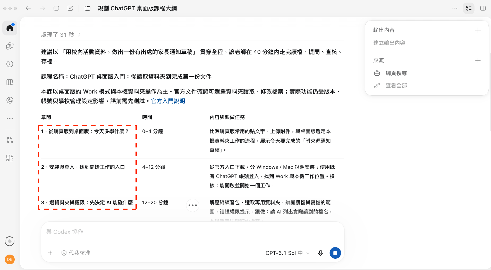


> **受眾講得越清楚，內容越不像罐頭**
> 我同一個 AI 主題，會講給科技、金融、教育，甚至軍方；`案例`要換成他們每天的工作，`限制`也不一樣（ex: 有些單位資料不能上雲）。
> **老師也一樣**：低年級用故事引導、高年級加入討論案例。
> AI 負責寫程式與初稿，`寫給誰看、要帶走什麼`，只有你能決定。

### 🛠️ 這個 Skill 是為了解決我的痛點

[flow]
- **遇到痛點** - Vibe Coding 出來的網頁，調整內容都要改 HTML，非常不方便
- **逆推結構** - 讓 AI 把現有網頁拆解，對應成一套可用 Markdown 撰寫的格式
- **內容與版型分離** - 只需改 Markdown，自動套用對應版型，細節完全可控
- **設計 Agent Skill** - 不是讓 AI 生成網頁，而是讓 AI 學會「這份 Markdown 怎麼寫」
- **模板生成器思維** - AI 負責生成結構化內容，程式再把內容轉成最終網頁，可以大幅節省 Token 消耗
[/flow]

> **沒有一開始就完美的 Skill**
> 這個講義 Skill 到現在迭代超過 `100 次`：每次備課遇到不滿意的地方，就直接調整，讓我越用越順手。
> 也分享這個工具生成的[第一版講義](https://deanlin.net/course/cake)。

## 提供簡報模板，讓 AI 照著生成

### 😓 沒給模板，AI 每次都自己設計一套

[flow]
- **版型不是你要的** - 請 AI 直接生成 PowerPoint 很快，但每次風格都不同
- **還得自己重套一次** - 自己、學校、處室有固定的簡報格式時，生成完要再搬一遍
- **圖表常常不見** - 原本教材裡的圖片與表格，生成後不見了，或被改寫成別的內容
[/flow]

> **AI 生成很快，但我們要的是「精確」**
> 把`模板`交給 Skill，先大綱 → 再預覽 → 最後才生成。

### 📐 給了模板，AI 只負責把內容放進對的版型

[flow]
1. 讀素材 — 圖片、Markdown 或 Word 都可以；Word 會先拆出文字、表格與圖片
2. 生成大綱 — 頁碼、結論式標題、建議版型、用哪張圖，先確認方向
3. 逐頁預覽 — 用文字描述每頁長怎樣，在文字階段就能調整
4. 套模板產出 — 文字填進版型、圖片放進照片框，產出`可編輯的 PPTX`，附待補清單
[/flow]

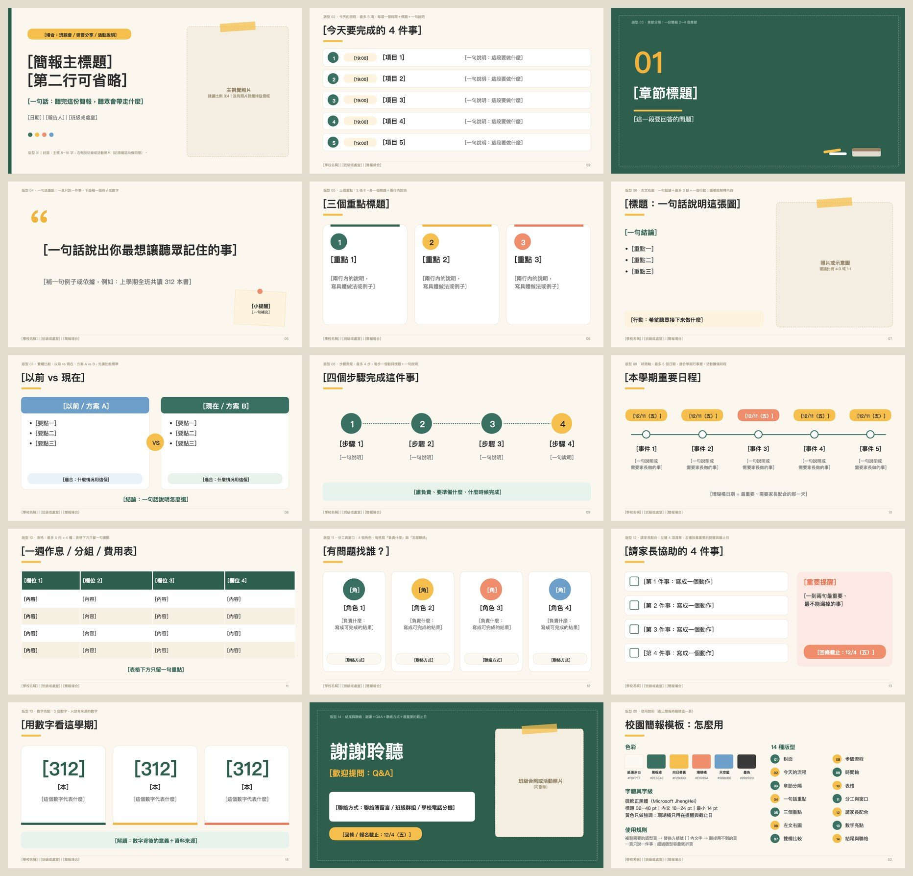

[download dir="teacher-slides" label="下載「模板簡報設計師」技能包" desc="teacher-slides.zip：14 種版型的 PPTX 模板"]

### 🧪 練習：把累積多年的 Word 講義，照模板變成簡報

[flow]
- **素材都在 Word 裡** - 很多人習慣用 Word 累積素材：文字、表格、圖片都在裡面
- **自己動手很花時間** - 要一頁頁`複製貼上、重新排版`，圖片還得一張張另存再插入
- **模擬情境** - 化學老師想把這幾年的講義，變成`上課用的簡報`
[/flow]

[download dir="化學課教材" label="下載「化學課教材」練習素材" desc="國中理化「酸、鹼、鹽」的 4 份 Word 圖文講義：有表格、化學式、實驗步驟與 9 張圖"]

解壓後會得到 `化學課教材` 資料夾，在 Codex 開啟它

```prompt [label="把一份 Word 講義，照模板做成上課簡報"]
@teacher-slides 把「114下_3-2_常見的酸與鹼_講義.docx」做成上課用的簡報，聽眾是八年級學生，10 頁內。
這份是教師版，紅字答案不要放進簡報；講義裡的圖片請放進對應的頁面。
先給我大綱就好，確認後再逐頁預覽，最後才產出 PPTX。
```

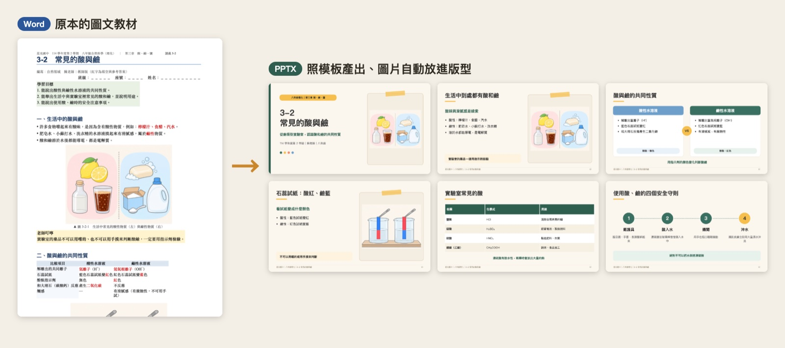

### ✅ 驗收重點

[flow]
- **打得開** - 用 PowerPoint 或 Google 簡報打開，文字可以直接編輯
- **照模板** - 配色、字體、版型都來自模板，沒有自己多設計一套
- **對得上** - 定義、化學式、表格內容都出自講義，沒有多寫講義以外的內容
- **圖放對** - 每張圖都在講那件事的頁面
- **沒跑版** - 字沒有超出框；空的照片框已放照片或刪掉
[/flow]

## Skill 使用經驗

### 🧩 Skill 不是越多，AI 就越強

`同一類型的 Skill 裝了兩個以上，當需求命中時，常常會一起觸發`；這不只會增加 Token 消耗，也容易讓 AI 在執行過程中卡住或走偏。

**在提示詞的世界裡，1 + 1 不一定大於 2，甚至可能小於 1。**

> **同類型的 Skill，建議擇優安裝一個**
> 像生成簡報這類需求，如果同時安裝多個相近 Skill，AI 反而要花更多成本判斷該遵循哪一套規則，結果未必更好。

### 🤔 網路上很多 Skill 只是看起來有用

- 有些 Skill 描述看起來很厲害，實際使用時`效果卻不穩定`
- 過多的 Skill 只會`增加上下文負擔`，卻沒有提供足夠的專業價值
- 安裝`太多沒有用到的 Skill`，甚至會讓 AI 的行為變得更難預測

### 🛡️ 匯入第三方 Skill 的資安風險

[flow]
- **SKILL.md** - 可能被寫入危險指令，例如偷偷把個人資訊傳到某個網址，造成隱私外洩
- **Skill 的程式腳本（Script）** - 腳本一樣有機會被動手腳；Codex 用的是你電腦上的工具，等於直接`操作你的檔案`
- **判斷原則** - 看發佈者是否可信、專案的 Star 數，作為初步篩選；來路不明的不要裝
[/flow]

### 🌐 不同 AI Agent 都有 Skill

[flow]
- **Skill 已是各家 AI Agent 的基礎功能** - ChatGPT 與 Codex、Claude、Antigravity、Manus 都有，學會一次，換工具也用得上
- **延伸學習** - 其他 Agent 的 Skill 教學
   - [【Antigravity Agent Skills 教學】當別人還在複製貼上，你的 AI 已經自動搞定](https://youtu.be/xe00zJEtuMo)
   - [【Manus Skill 技能教學】教會 AI 一次，他永遠記得！](https://youtu.be/lKiwb381mfU)
[/flow]

> **別人的 SOP 是參考，自己的工作流才是答案**
> 今天下載的技能包，你都可以打開 `SKILL.md` 看看它怎麼寫；但別停在「裝好了」，可以嘗試把它改成符合自己的版本。

---

# 用 AI 放大自己：把你的積累，變成不同形式的分享

> **我是工程師、講師、作家、YouTuber**
> `斜槓不是從零開始，而是從自己的專業延伸`
> AI 幫我把想法轉為工具、文章、影片、簡報、課程，分享給不同的人。

## 從寫文章到拍影片

### ✍️ 同一份內容，換個形式繼續發揮

[flow]
- **過去：寫技術文章** - 從 2020 年開始[經營部落格](https://dean-lin.medium.com/)，但在 `AI 出現後流量腰斬`
- **現在：改拍影片** - 2025 年開始[拍 YouTube](https://www.youtube.com/@dlcorner)，文章變成`輔助教材`
- **文章怎麼來** - 影片的`逐字稿`生成，圖片讓 AI 直接抓影片截圖
[/flow]

> **AI 讓過去繁瑣的任務變輕鬆**
> 拍完影片再寫一篇文章、截圖、排版，等於同一件事做兩次，光想就覺得麻煩。
> 現在內容已經在逐字稿裡，Skill 負責換形式，而我負責`確認內容品質`。

## 一個工具，在既有的基礎上一路延伸

### 🎬 一開始，只是給自己用的剪片工具

[flow]
- **過去：剪一支影片要 1 天** - 10 分鐘的影片，要剪掉 NG、上字幕、加資訊卡、做動畫、配音效，`繁瑣又重複`
- **現在：用白話文就能剪片** - 照自己的習慣做了一套 `AI 剪輯工作流`，把重複的步驟交給 AI
[/flow]

### 🌱 同一個工具，長出三種分享

| 階段[width:110] | 場合[width:230] | 在原有的基礎上多做了什麼 |
| --- | --- | --- |
| 自己用 | 剪自己的 YouTube 影片 | 用了一段時間，覺得`真的好用` |
| 業配 | MiniMax 找我業配 | 直接把剪片工具和 MiniMax Code 這個 AI Agent 結合，`展示實際的應用方式` |
| 分享 | [AI 郵報](https://academy.aiposthub.com/p/skill-shot-27-ai-auto-video-editing)邀請我分享實戰應用 | 深入分享`背後的設計`：為什麼要分成四道關卡、專案架構為什麼這樣規劃 |


> **工具一直在用，就會一直變好**
> [這套剪輯工具](https://github.com/dean9703111/auto-edit-workspace)到現在更新了 `70 多次`
> 發現哪裡可以做得更好，就把經驗寫回工作流，下一支影片就能`站在更高的起點`。

## 一堂 6 小時的線上課程

### 💰 原本打算外包，最後自己剪

[flow]
- **業界行情** - 6 小時的課程，背後通常有 `18 小時左右`的素材，外包剪輯的報價大多在 `50 萬元`上下
- **過去外包** - 和其他單位合作，6 小時的成品，我光是看片、給修改意見就要 `30 小時以上`，還要來回好幾輪，花上好幾個月。
- **這次自己剪** - 最近和 PressPlay 合作的 `6 小時`線上課程，宣傳影片、試閱影片、短影音`全都是我自己剪的`；下面這支試閱影片，也是用 AI 剪輯工作流完成的
[/flow]

[youtube id="lP3sqNUVm_I" title="《Claude AI 實戰落地｜打造高效AI 團隊，從日常雜務到系統化SOP》線上課程｜試閱影片"]

> **無情工商**
> 對課程有興趣的話，可以透過[這個連結](https://www.pressplay.cc/project/84BFC1B5E869F28BA50CE3A6784905CE/about?focus_reward_id=D31E86EBC25F2CD448F53FE162B8CD6E)購買，有`專屬優惠`。

### 🆚 外包剪輯 vs 與 AI 協作

| | 🤝 過去：外包給剪輯團隊 | 🤖 現在：自己 + AI 工作流 |
| --- | --- | --- |
| 誰最懂內容 | 剪輯師要先理解內容，才知道哪段重要 | `我最清楚`資訊要怎麼表達、哪些片段重要 |
| 想改的時候 | 寫回饋、等對方改，`來回好幾次` | 想怎麼改，就`直接調整` |
| 能做到什麼 | 受限於溝通與預算 | 做得出過去`做不到的設計` |

> **自己剪，不只是為了省錢**
> 老實說，現在用 AI 剪輯不只快，也已經有不錯的品質；但真正的關鍵，是我`最清楚自己要表達什麼`。

## 你的積累，也能用 AI 放大

### 📣 今天學的 Skill，就是你的三個放大器

[flow]
- **資訊卡** - 長長的通知 → 家長願意看完的`圖卡`
- **模板簡報** - 多年的 Word 講義 → 照模板排好的`上課簡報`
- **線上簡報** - 一個想教的主題 → 生成能投影、傳連結的`網頁講義`
[/flow]

### 👥 一份教案，分享給三種人

- 拿今天下載的 `教案-事實與意見-114.docx` 當例子：同一份教案，換個對象，需要的`長度、形式、重點`都不一樣

| 給誰看[width:110] | 成品[width:140] | 內容要怎麼調整 | Skill[width:130] |
|---|---|---|---|
| 👪 家長 | 資訊卡 | 用白話說明孩子在學什麼、`在家可以怎麼陪` | 資訊卡 |
| 🧒 學生 | 上課簡報 | 一頁一個重點，多放`例句和練習` | 模板簡報 |
| 🧑‍🏫 同事 | 共備簡報 | 教學流程、`去年學生卡住的地方`、今年怎麼調整 | 線上簡報 |

> **內容要自己累積，AI 負責放大**
> AI 轉換形式（文字、影片、簡報）很快，但沒有內容，換再多形式也只是空殼。
> 把做過的東西`留下來`，你的累積就會一次比一次值錢。

---

# 📌 課程總結：把整理交給 AI，把判斷留給自己

[summary]
- 📁 **資料夾取代上傳** | 安裝桌面版，不同主題資料夾個別建立專案，直接存取資訊
- 📚 **彙整多格式檔案資訊** | 去年和今年、格式不同的資料一次讀完，分清哪些沿用、哪些要調整、哪些還沒確定
- 📷 **照片也能彙整** | AI 讀得懂圖片，但讀一次就轉成表格存起來重複利用；先少量試跑、補規則再加量，看不清楚的標黃不亂猜
- 🧩 **認識 Skill** | 把最好的一次變成每一次；專案放知識、Skill 放步驟
- 🛠️ **Skill 的四種建立方式** | 把既有流程存起來、用白話文生成、讓 AI 讀取個人習慣做出自己的版本、匯入別人做好的技能包
- 🧑‍💻 **Codex 接手用到程式的 Skill** | 前面的 Skill 切到 Codex 直接能用，成品寫進資料夾；缺工具時可以請 AI 說明再安裝
- 🖥️ **用程式碼生成簡報** | 線上簡報先講清楚受眾、主題、目標、情境；有固定格式就提供模板，先大綱 → 再預覽 → 最後才生成
- 🛡️ **Skill 使用經驗** | 同類型擇優安裝一個，來路不明的不要裝；別人的 SOP 是參考，從自己的工作流出發、邊用邊更新
- 📣 **用 AI 放大自己** | 內容自己累積，讓 AI 幫你換成文章、影片、簡報、課程，分享給更多人
[/summary]

[qa-session title="Q&A 時間"]
[/qa-session]
