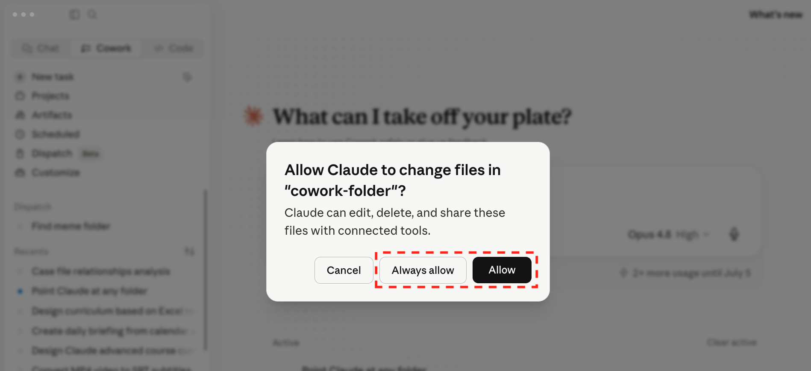
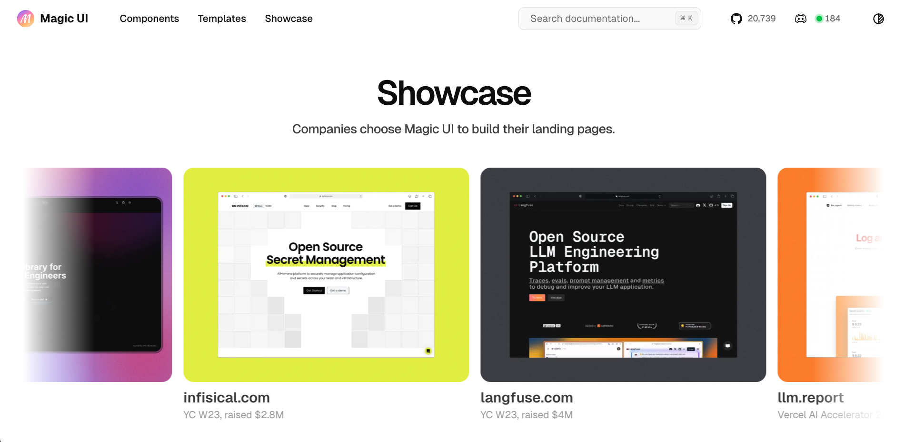
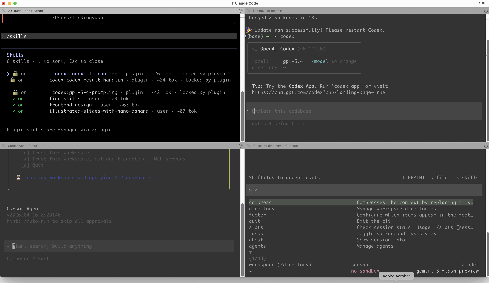

[time]
- label: 第 1 堂｜ChatGPT
  date: 11/23
  time: 19:00~21:00
  des: **釐清需求，建立專屬的教學助理**：認識網頁版與桌面版、三家 AI 功能對標，學會去識別化與 Prompt，生成教材圖片，再用記憶、外掛程式與專案打造教學助理。
  link: [查看講義](../chatgpt/index.html)
- label: 第 2 堂｜Codex
  date: 11/24
  time: 19:00~21:00
  des: **讓 AI 動手處理檔案，用 Skill 交付教材**：安裝 ChatGPT 桌面版，讓 AI 直接讀資料夾、把手寫報名表照片轉成 Excel；再用 Skill 固定寫信風格與教材配圖，最後切到 Codex，用資訊卡、線上講義、校園簡報 Skill 交出成品。
  link: [查看講義](../codex/index.html)
- label: 第 3 堂｜Claude
  date: 11/26
  time: 19:00~21:00
  des: **串接工具、建立知識庫，把好方法變 SOP**：先把學生名冊去識別化，再用 Connector 整理信件與行事曆、用 Project 建立活動知識庫、把家長通知流程存成 Skill。
  link: [查看講義](../claude/index.html)
- label: 第 4 堂｜Cowork
  date: 11/27
  time: 19:00~21:00
  des: **讓 AI 交付成品，替自己做班級小工具**：用 Cowork 把簽收表照片轉 Excel、整理活動資料並設定排程，再用 Vibe Coding 做出班級抽籤分組工具，搭配 Git 存檔點，改壞了也能回到上一版。
  link: [查看講義](../cowork/index.html)
  active: true
[/time]

<!-- 編寫依據與範例改編對照見 sources.md；所有學生、活動資料均為虛構。 -->

# 🙋 課前回顧：上一堂學了什麼？

> **上一堂，我們讓 Claude 開始認識你的工作**
> 今天不用記得上一堂的每個操作，只要記得三個名詞，就跟得上。
> 沒跟上上一堂也沒關係，今天的練習都附資料包，可以獨立完成。

## 開始前，快速確認三件事

### 🔌 Connector：讓 Claude 在授權範圍內，看得到你的資料

- 透過授權，讓 Claude 操作信件、行事曆等線上工具
- 動手之前，先確認它能看到什麼、能改什麼

### 🗂️ Project：把背景放進去，不用每次重新交代

- 把活動草案、決議等資料放進 Project，Claude 就知道你在忙什麼
- 定版的檔案直接上傳，會變動的放雲端用連結

### ⚙️ Skill：把驗證過的好做法，變成 SOP

- 流程跑順之後，請 Claude 設計成 Skill，下次不用從頭交代
- 今天在 Cowork 跑順的流程，一樣可以存成 Skill

### 🧳 這堂課會帶走的 5 個成果

[flow]
1. 簽收表轉 Excel — 手寫的作業繳交登記表，拍照後交給 Cowork 整理成 Excel
2. 閱讀日籌備摘要 — 讀完一包散落的檔案，交出有來源的摘要
3. 輪值安排 — 讓 AI 先釐清條件，再排出老師輪值表
4. 班級抽籤工具 — 不用寫程式，從抽一人、分組到一次抽多人，做出雙擊就能用的網頁小工具
5. 存檔點 — 用 Git 存下每一版，AI 改壞了也能回到上一版
[/flow]

---

# 照片轉 Excel：讓 AI 直接操作你電腦上的檔案

> **Claude Chat 🆚 Cowork**
> **Chat** 只能處理`線上檔案`，但 **Cowork** 能直接幫你`操作電腦上的檔案`

## 初探 Cowork

### 📁 可以直接選資料夾，不用一個個上傳

<!-- 待補圖片：claude-cowork-ui.png｜Cowork 對話框，標出「Cowork」分頁與「Manually approve」選項（需用乾淨帳號重拍，原圖側欄含企業專案名稱） -->

- 打開上一堂安裝的 Claude 桌面 App（還沒安裝的話，到[官網下載](https://claude.ai/downloads)）
- 在新對話選「Cowork」，再用「Add folder」選擇要處理的資料夾
- 剛開始使用時，授權方式選「Manually approve」較為保險



[warning title="使用提醒"]
Cowork 是有能力`新增/修改/刪除`電腦檔案的。

能力越大風險越大，你可以想想`如果事情做到一半，但額度沒了會發生什麼事`。

練習資料夾只放自己確認過的虛構資料，不要授權整個桌面或下載資料夾。
[/warning]

### 🎬 延伸參考：同一類的桌面 Agent

- 我有錄一支影片完整示範 Manus 桌面版，從資料夾彙整報告、辨識圖片寫 Excel 到自動填表單：[【Manus 桌面版教學】讓 AI 操作電腦，從資料夾彙整報告、辨識圖片寫 Excel、自動填表單](https://youtu.be/WGHQuCI3iJk)
- 換成 Claude 就是今天的 Cowork：`工具不同，能力是同一類`，熟悉一個最重要

## 照片批量轉存 Excel

> **一疊作業簽收表、手寫成績登記表、板書照片，要一張張 key 進 Excel**
>
> - 特徵值（座號、日期、分數、勾選狀態）藏在照片裡，得`人工一張張看、一格格打`
> - 經過人工處理，還`容易看錯數字、打錯欄位`
> - 量一大（幾班、幾週的簽收表），`整個下午都耗在 key-in`

### 📷 批量讀取照片，直接寫進 Excel

把一疊有特徵值的照片（ex: 作業簽收表、手寫成績登記表、白板上的分組名單）丟給 Cowork，它會`逐張讀出關鍵欄位`，直接整理進 Excel，不用你一張張 key。

[flow]
1. 指定照片資料夾 — 一疊手寫登記表的照片
2. 逐張辨識 — 抽出座號、繳交日期、繳交狀態等欄位
3. 寫進 Excel — 簽收表上的每一列各填一列，並標明來源是哪張照片
[/flow]

### ✍️ 先準備三張虛構的手寫簽收表

[download dir="homework-sheet" label="下載「作業繳交登記」空白簽收表" desc="可列印的空白簽收表（座號、繳交日期、狀態）與使用說明"]

- 用空白簽收表手寫 3 張「數學作業繳交登記」：欄位有座號、繳交日期、狀態（已繳／未繳／補交），每張寫 5 列左右
- 只用座號，不寫學生姓名；日期、狀態自己編，三張的座號不要重複（ex: 1〜5、6〜10、11〜15）
- 用手機各拍一張，其中一張故意歪一點或有反光
- 把 3 張照片傳到電腦（ex: 雲端硬碟、寄信給自己），放進桌面的 `簽收表照片` 資料夾
- 手邊沒有印好的簽收表，就拿任何一張紙，照同樣的三個欄位手寫

[warning title="真實的學生資料，不要這樣處理"]
照片丟給 AI，內容就會被它讀取。這個練習只用自己編的資料；真實的成績與名冊，要依校方規範處理。
[/warning]

<!-- 待補圖片：cowork-choose-folder.png｜新對話選「Add folder」，選取「簽收表照片」資料夾（需重拍，原圖側欄含企業專案名稱） -->

```prompt [label="把一疊簽收表照片批量寫入 Excel"]
逐張辨識「簽收表照片」資料夾內的照片，整理成 Excel：
1. 在同一個資料夾新增「作業繳交登記.xlsx」，欄位：座號、繳交日期、狀態（已繳／未繳／補交）、來源檔名
2. 一張照片裡的每一列，各填成 Excel 的一列
3. 看不清楚或不確定的欄位留空並標黃，不要猜
4. 核對沒有遺漏後存檔，並告訴我有哪幾格標黃
```

<!-- 待補圖片：claude-cowork-photo-excel.png｜辨識結果寫進「作業繳交登記.xlsx」，辨識不準的格子標黃（用虛構簽收表重拍） -->

> **將驗證有效的 SOP 轉換 Skill**
> `如果流程會重複使用，就可以把它設計為 Skill`，這樣 AI 日後遇到類似問題時，不需要從頭再來。

```prompt [label="將驗證過可重複使用的流程轉換為 Skill"]
幫我將這個工作流設計為 Skill
```

<!-- 待補圖片：claude-cowork-photo-excel-skill.png｜Skill 設計完成，標出「Save」按鈕（用簽收表流程重拍） -->

> **血淚紀錄**
> Skill 設計完建議還看一眼結構，因為有時 AI 只生成了`SKILL.md`；而這份文件只管流程，不包含程式腳本。
> 如果發現程式腳本不存在，就直接跟 AI 說`剛剛建立的程式腳本也要放進去`。

---

# 檔案分析與排班：讀完一包散落資料，交出有來源的成品

## 讀取多格式檔案分析資訊

> **陌生的主題如何開始**
> 接手一個活動，手上常常是`一包散落的檔案`：草案、會議決議、郵件、行事曆。
> 我做的第一件事，是下載後把整個資料夾交給 Cowork，請它先讀過一遍。

### 🗂️ 先請 AI 讀完整包，整理已確認與待確認

[flow]
1. 列檔案 — 先列出資料夾裡每份檔案的檔名，以及能不能讀取
2. 讀內容 — 逐一讀取 `input` 裡的檔案，找出各檔重點，以及`不同檔案之間互相矛盾的地方`（ex: 草案與決議）
3. 給摘要 — 整理成「已確認、版本變更、待確認」，每一項附上來源文件
[/flow]

[download dir="reading-day" label="下載「閱讀日」虛構資料包" desc="草案、決議、郵件串、模擬行事曆、物資 CSV、輪值條件與空白測試表，全部為虛構資料"]

- 解壓縮後，在桌面建立 `school-ai-demo` 資料夾，裡面再建 `input`（放原始資料）與 `output`（放 AI 交付的成品）
- 把 `01`〜`05` 與 `07` 共六份檔案放進 `input`，不要混入真實校務文件
- `00` 是使用說明、`06` 是後面做抽籤工具用的練習名單與測試紀錄表，這兩份留在原本的資料夾就好
- 在 Cowork 開新對話，用「Add folder」選取 `school-ai-demo`

<!-- 待補圖片：cowork-choose-folder-one.png｜Cowork 選取「school-ai-demo」單一資料夾，標出已勾選的資料夾（需重拍） -->

```prompt [label="先看檔案清單，再交付閱讀日籌備摘要"]
只處理 school-ai-demo 的 input 資料夾，不讀其他位置。
先列檔名、可讀狀態與預定步驟，遇到讀不到的檔案要說明。
依來源整理「閱讀日籌備摘要」，新增到 output/閱讀日摘要.md。
欄位：已確認事項、版本變更、待確認問題、來源文件。
來源未提供就寫待確認；版本衝突不自行猜核定結果。
不要修改、刪除或搬走 input，完成後列出新增檔案與尚未完成項目。
```

### ✅ 開檔核對，才算交付

- 到 `output` 自己打開摘要，不只看 AI 在對話說「完成」
- 場地應該是多功能教室（決議取代了草案的圖書室），報名方式應該是待確認
- 每一項都能回查到來源檔案；缺一份檔案不能假裝已全部彙整

## 案例：閱讀日的老師輪值安排

### 📅 直接把檔案與問題交給 AI

- 摘要核對完，接著處理閱讀日當天的人力：沿用同一個 `school-ai-demo`，不用重新選資料夾
- 輪值條件寫在 `input` 的 `07-輪值條件.md`：8 位老師（代號）、3 個站點、3 節，每節每站 2 人，備註裡還有幾條限制

```prompt [label="提出需求，直接請 AI 排"]
讀取 input 的「02-閱讀日決議.md」與「07-輪值條件.md」，確認活動時間與場地後，
幫我安排閱讀日當天的老師輪值：
8 位老師、三個站點、三節，每節每站需要 2 位老師，同一節一位老師不能同時在兩站。
有需要釐清的部分，先跟我討論，不要直接排。
討論完再排，把輪值表存到 output/閱讀日輪值表.md，不要修改 input。
```

<!-- 待補圖片：cowork-discuss.png｜Cowork 主動反問條件的畫面（用輪值需求重拍） -->

<!-- 待補圖片：cowork-not-ok-result.png｜AI 初步排出的輪值表（用輪值需求重拍） -->

> **這個結果讓人滿意嗎？**
> - 每節 3 站 × 2 人是 6 人，8 位老師有 2 位休息，輪到誰休息公平嗎？
> - 同一位老師連續三節都在書籤站，合理嗎？
> - 備註寫的限制有照做嗎？（新進老師不單獨顧報到站、老師C 第 1 節有課、每人最多休息 1 節）
> - 如果希望無縫接軌，是否要請它再寫一份給輪值老師的通知草稿？（只寫草稿，不寄出）
> - 排班週期雖短，是否還有只存在你腦中的`隱性規則`可以提供（ex: 每節換站、誰熟悉哪一站）？

---

# 排程：固定要做的事，讓 AI 時間到自己跑

> **每週都要做的事，為什麼每週都要自己記得？**
> 追蹤教育公告、蒐集研習資訊、彙整活動進度，這類工作`內容每次不同、做法每次一樣`。
> 把任務說明存成`排程（Scheduled）`，時間到 Claude 就會自己跑一次。

## 排程任務怎麼運作與建立

### ⏰ 排程任務怎麼運作

[flow]
- 在雲端執行 - 時間到就會跑，`電腦睡眠或 App 關閉也照常執行`
- 執行頻率 - 每小時、每天、每週、平日，或設成手動、需要時再按
- 資料來源 - 網路研究、已授權的 Connector
- 檢視結果 - 每次執行都是一個獨立的 Cowork 任務，完成後回來看結果就好
[/flow]

### 🛠️ 建立排程任務

1. 左側欄點「Scheduled」→「New task」
2. 選「Create with Claude」— Claude 會反問細節，再提出任務名稱、頻率與指令；熟悉後也可以選「Set up manually」自己填
3. 確認內容後按「Schedule」— 之後可以在同一頁`暫停、修改、刪除`，或手動立即執行

<!-- 待補圖片：claude-scheduled-task.png｜左側欄「Scheduled」→「New task」→「Create with Claude」（需重拍，原圖側欄含企業專案名稱） -->

## 建立排程前，先想好四個答案

### 📝 「Create with Claude」會問你四個問題，先想好答案

| Claude 會問[width:180] | 要寫清楚什麼 | 範例：每週追蹤教育部最新公告 |
| --- | --- | --- |
| 想讓 Claude 做什麼 | 去哪裡找、用什麼條件找、結果長什麼樣、哪些留給人判斷 | 搜尋教育部官網最近 7 天新增的公告，整理成表格：發布日期、標題、三句話重點、可能與哪個處室有關、來源連結。沒有新資料就回覆「本週無新增」，不要拿舊資料湊數 |
| 希望它多久跑一次、什麼時間？ | 頻率與時間點，配合你看結果的習慣 | 每週一早上 8 點 |
| 跑完之後，結果要送到哪裡？ | 留在 Cowork 看，還是寄信、寫進其他系統 | 留在該次任務中 |
| 執行時的核准模式要設成哪一種？ | 只讀不改的任務可以全自動；會寄信、改檔案的要逐步確認 | 自動核准 |

也可以把四個答案一次講完，直接複製下面這段：

```prompt [label="一次講清楚四個答案，建立每週公告追蹤"]
幫我建立一個排程任務：
每週一早上 8 點，搜尋教育部官網最近 7 天新增的公告，整理成表格：
發布日期、標題、三句話重點、可能與哪個處室有關、來源連結。
沒有新資料就回覆「本週無新增」，不要拿舊資料湊數。
結果留在該次任務中；這個任務只讀不改，核准模式設為自動核准。
```

[warning title="使用提醒"]
排程會`自動執行、自動消耗額度`，建議先`手動執行幾次`，確認結果穩定再開啟排程。
如果任務會`寄信、發訊息或更新其他系統`，先確認 Connector 的權限範圍；按下同意，責任就是你的。
[/warning]

## 先手動跑順，再交給排程

### 🖐️ 手動觸發排程來測試

<!-- 待補圖片：claude-scheduled-test.png、claude-scheduled-test-result.png｜點擊排程後選「Run now」，並確認結果是否符合需求（用教育部公告追蹤任務重拍） -->

> **先手動跑順，再交給排程**
> 排程只會把流程`重複執行`，不會幫你把流程`變正確`。
> 如果流程、結果不符預期，可以自由調整。

> **有固定規則的前提下，Skill 並非最佳選項**
> Cowork 的邏輯是`從頭讀檔`，即使設計了 Skill 也很燒 Token（AI 的用量額度）
> 規則固定、每學期重複、多人要用的事，建議把它`做成工具，建一次就能一直用`。這是接下來要做的事。

---

# 工具思維：同一件事做第三次，就該做成工具

<!-- 講師備註：Vibe Coding 單元（本章到「規格驅動開發」）合計約 48 分鐘：工具思維 8、第一版抽籤 9、第二版分組 11、Git 觀念與第一個存檔點 7、第三版多人抽籤的存檔循環 11、規格驅動開發 2。本章 8 分鐘：Vibe Coding 概念與畢業時機 2、風險與邊界 2、排班故事與班級小工具清單 4。時間不夠時先縮短概念與風險，保留三次實作與「故意改壞」練習。 -->

> **學 Vibe Coding 不是為了成為工程師**
> 是為了解決`你目前遇到的痛點`，這個痛點可能存在於`班級、處室、學年團隊、個人`，但一直沒有解決。
> 而這個單元，就是讓大家了解，在 AI 時代`我們能靠自己`踏出第一步。

## Vibe Coding 是什麼？

> **透過白話文跟 AI 對話，逐步完善工具的流程**
> - **優點**：可以快速完成初版
> - **缺點**：結果較不可控、未來較難維護
> 若沒有程式背景，`把想做的事、期待的結果講清楚`是最重要的事
> 先在 `Cowork` 做出工具：AI 直接在你指定的資料夾寫程式，`雙擊 html（網頁檔）就能用`；要替工具留存檔點時，再交給 `Claude Code`

### 🆚 Cowork 每次都要花 Token，工具做一次就能一直用

| | Cowork 直接做 | 做成工具 |
| --- | --- | --- |
| 每次執行 | 重新讀檔、重新推理，`Token 每次都燒` | 開啟網頁就好，`零 Token` |
| 結果 | 每次可能`略有不同` | 固定、可驗證 |
| 誰能用 | 要有 Claude 帳號、要會下 prompt | 同事`雙擊 html` 就能用 |
| 適合 | 一次性、規則還在摸索 | 規則固定、每學期重複、多人要用 |

> **什麼時候該從 Cowork 畢業，改做工具？**
> 像「抽籤、分組」這種`每堂課、每個班都要做`的事，就是該做成工具的訊號。
> 判斷標準只有一條：`同一件事你會做第三次嗎？`

## 了解風險與邊界

### 🧪 是「玩具」還是能用的「工具」？

[flow]
- 一句話就能生成「看起來可以動」的系統 — 這樣的東西，你真的敢`直接用在教學現場`嗎？
- 改壞不是最可怕的 — 最可怕的是`你不知道它被改壞了`；過去人寫程式也會有一樣的問題，只是 AI `速度太快`，把問題加倍放大
- 等一下做的`班級抽籤工具` — 重點並不是做出來好開心，而是`審視 AI 犯了哪些錯誤`
[/flow]

> **看起來能動的東西，才是最危險的**
> `AI 的快，不是你的快；但 AI 的錯，會全部算在你頭上`。所以關鍵邏輯，還是需要人來把關。

## 從自己的需求出發

### 🏥 我做的排班工具，護理長一試就找出問題

[flow]
1. 第一版很快 — 幫醫院的 Vibe Coding 課準備教材時，我用 Claude Code 很快就做出「排班工具」第一版
2. 試用才浮現 — 哪些班別不能接在一起、包班人員怎麼安排、跨月的夜班接白班怎麼檢查，這些細節我`完全沒想到`
3. 現場最懂規則 — 護理長卻能明確說出`調整方向與背後的規則`
[/flow]

> **為什麼班級工具，由老師自己做最合適？**
> 過去要會寫程式才能做工具，`做工具的人往往不是真正的使用者`；就像一位主管在課前訪談跟我說的：「**開發的人不用系統，用系統的人不會開發。**」
> 現在懂現場的人，也能用 Vibe Coding 做出幫助自己的工具，並`根據使用細節持續優化`。
> 班級也有隱性規則：哪些學生`不適合同組`、哪些條件要`平均分配`，最清楚的就是老師。

## 班級小工具，原來可以自己做

### 🧰 你的班級，可能用得到這些小工具

| 小工具[width:110] | 用在哪裡 | 只有你知道的隱性規則（ex） |
| --- | --- | --- |
| 🎲 抽籤 | 點人回答、決定上台順序 | 剛被抽過的人，這節先跳過 |
| 👥 分組 | 小組討論、分組競賽 | 哪些學生不適合同組、男女要平均 |
| ⏱️ 計時器 | 小組討論、考試倒數 | 最後 1 分鐘要提醒 |
| 🪑 座位表 | 排座位、換座位 | 視力、身高、需要坐在老師附近的學生 |
| 🧹 輪值表 | 值日生、打掃區域 | 每個人輪到的次數要平均 |
| 🏆 計分板 | 小組加分、課堂競賽 | 加減分要留紀錄，避免爭議 |
| ✅ 點名 | 出缺席、作業繳交 | 公假、病假要分開標記 |

- 別再拿「記帳軟體、番茄鐘」當練習題，`缺少挫折的練習幫助有限`；從班上真的用得到的開始，你才`分辨得出對錯`，遇到錯誤也`有動力解決`
- 這些工具網路上都找得到，但`你班上的規則`只有你清楚，這正是自己做的價值
- 今天先挑`抽籤`開始，再一步步長出`分組`與`一次抽多人`

[interactive title="是什麼驅動你嘗試"]
**Vibe Coding 最需要什麼？**
`A` 有程式基礎 `B` 熟悉多種 AI 工具
`C` 擅長與人溝通 `D` 眼前有困擾許久的問題
[/interactive]

---

# 動手實作：用白話文做出班級抽籤工具

<!-- 講師備註：本章約 20 分鐘：第一版抽籤 9（講解 3、實作 6）、第二版分組 11（講解 4、實作 7）。兩版都在 Cowork 操作；「不能同組」是本堂唯一實作的隱性規則，其他規則只舉例。 -->

> **為什麼要先做 MVP？**
> `先求有、再求好`。MVP（Minimum Viable Product）是`最小可行產品`：先做出一個「能動的最簡版本」，再一次加一個功能。
> 今天的範例會跨三個版本延續：`抽一人 → 分組 → 一次抽多人`，每一版都要親手驗收。

## 第一版：輸入名單，抽出一個人 | branch:v1-抽一人

### 📋 把「抽籤工具」說具體

| 項目 | 第一版的範圍 |
| --- | --- |
| 使用者 | 老師在課堂操作，學生看投影 |
| 輸入 | 名單，一行一個；練習時只用座號（ex: 1號〜10號） |
| 輸出 | 隨機抽出一個人，字放大、適合投影 |
| 例外 | 空白行不算一個人；名單是空的就顯示提醒 |
| 邊界 | 不連網、不儲存名單，關掉網頁就清空 |

- 在桌面新建 `class-tool` 資料夾，專門放這個工具
- 在 Cowork 開新對話，用「Add folder」選取 `class-tool`，再貼上下面的 prompt
- 練習名單與驗收紀錄表都在「閱讀日」資料包的 `06-測試紀錄空白表.md`，用記事本開啟就能複製

```prompt [label="第一版：輸入名單，抽出一個人"]
請在資料夾內新增 class-tool.html，做一個單一 HTML 的班級抽籤工具。
老師用瀏覽器開啟，在文字框貼上名單（一行一個），按「抽籤」隨機抽出一個人，結果放大顯示、適合投影。
空白行不算一個人；名單是空的時，顯示清楚的中文提醒。
只用內嵌 HTML/CSS/JavaScript，不用外部套件、API 或網路請求，不保存名單與結果。
請實際建立檔案，並告訴我怎麼開啟、你做了哪些檢查。
```

<!-- 待補圖片：cowork-class-tool-v1.png｜Cowork 做出的 class-tool.html 第一版：貼上 1號〜10號的名單、按「抽籤」後放大顯示抽中的座號（用 Cowork 實際產出的畫面拍攝） -->

#### 親手驗收第一版

到 `class-tool` 資料夾雙擊 `class-tool.html`，用瀏覽器開啟（不是只看 Claude 對話裡的預覽），照下表逐項按按看，實際結果記在 `06-測試紀錄空白表.md`：

| 測試輸入 | 應有結果 |
| --- | --- |
| 貼上 1號〜10號，按抽籤 | 抽出名單裡的一個人 |
| 連按 5 次 | 結果會變，而且都在名單裡 |
| 名單中間夾一行空白 | 不會抽出空白 |
| 名單全部清空再按 | 顯示提醒，不產生結果 |

## 第二版：同一個工具，加上分組 | branch:v2-分組

> **分組，才是隱性規則最多的地方**
> 隨機分組很容易，難的是老師心裡那些規則：哪些學生`不適合同組`、`男女要平均`、`能力高低要搭配`、`特殊需求的學生要分散`。
> 這些規則 AI 不會知道，只有你說得出來；先挑`最常用的一條`加進去，用順了再加下一條。今天示範「不能同組」。

### 👥 在同一個工具加上分組

```prompt [label="第二版：同一個工具加上分組"]
請在 class-tool.html 加上「分組」功能，原本的抽籤功能不能改變：
- 使用同一份名單，輸入組數後按「分組」，每個人恰好出現一次，各組人數差距最多 1
- 可以設定「不能同組」：一行一組、用逗號分隔（全形、半形都要接受），同一行的人都要分在不同組（ex: 1號,2號）
- 組數必須是 1 到名單人數之間的整數；條件排不出來時，顯示中文提醒，不要硬排
完成後告訴我改了哪些地方、你做了哪些檢查。
```

<!-- 待補圖片：cowork-class-tool-v2.png｜第二版 class-tool.html：10 人分 3 組的結果，以虛線紅框標出「不能同組」設定欄（填 1號,2號）與分組結果 -->

#### 親手驗收第二版

| 測試輸入 | 應有結果 |
| --- | --- |
| 10 人分 3 組 | 各組 4、3、3 人，每個人只出現一次 |
| 10 人分 11 組 | 提醒組數不能大於人數，不產生結果 |
| 設定「1號,2號」不能同組，連分 5 次 | 1 號和 2 號每次都在不同組 |
| 設定「1號,2號,3號」不能同組，只分 2 組 | 提醒條件排不出來，不硬排 |
| 回到抽籤，按一次 | 抽一人照常運作 |

發現錯誤時，用「輸入、實際結果、預期結果」回報，請 AI 只修那一處：

```prompt [label="用可重現的錯誤回報請 AI 修正"]
class-tool.html 有一個錯誤：
輸入：[你輸入的名單、組數與不能同組的設定]
實際結果：[畫面上實際看到什麼]
預期結果：[依驗收表應該看到什麼]
請先找原因，再只修正這一處，維持原本介面與無外部連線的要求。
修改前先另存目前檔案的備份，修完請用驗收表的每一項重新檢查並回報結果。
```

### 🔒 純前端＝資料不出你的電腦

今天的抽籤工具是`純前端網頁`：只靠瀏覽器就能運作，`沒有後端伺服器、也沒有資料庫`。

- 名單只在`你自己的瀏覽器`裡運算，不上傳任何伺服器，`關掉網頁就清空`
- 這也是我們在 prompt 裡要求「不用外部套件、不用網路請求、不保存資料」的原因
- 但開發過程中貼給 AI 的內容，仍會送到雲端，所以練習只用座號，不放真實的學生資料

> **想存資料、分權限、串校務帳號，就是另一個世界了**
> 那會碰到個人資料與帳號權限，`雛形可以 Vibe Coding，隱私請交給專業工程師`，這條界線要分清楚。

---

# 版本控制：存檔點，就是 AI 時代的後悔藥 | branch:none

<!-- 講師備註：本章約 18 分鐘：Git 觀念 3、換到 Code 分頁並建立第一個存檔點 4、第三版多人抽籤的存檔循環 11（講解 3、實作 8）。存檔點在 Code 分頁（Claude Code 本機工作階段）操作，不在 Cowork 做：社群已有多則回報，Cowork 掛載的資料夾執行 Git 會留下清不掉的鎖定檔（見 sources.md）。授課前確認：① 學員電腦能否自行安裝軟體，Windows 學員請課前裝好 Git；② 用授課帳號在 Mac、Windows 各跑一次「建立第一個存檔點」與「回到上一個存檔點」；③ Code 分頁的權限模式名稱與位置（官方說明目前是 Manual／Accept edits，舊版叫 Ask permissions／Auto accept edits）。今天不實作 branch、PR、GitHub，只在章末帶過。 -->

## 認識 Git：替工具加上存檔點

### 🎮 Git 就像遊戲的存檔點

- 打 Boss 前先存檔，打輸了就`讀檔重來`；Git 就是替資料夾裡的檔案`存檔`的工具
- AI 改程式很快，改壞也很快；有了存檔點，`改壞了就回到上一版`
- 第二版時我們「修改前先另存備份」，有了 Git，就`不用再手動複製檔案`

| 你想做的事[width:180] | 跟 Claude 這樣說 | Git 的說法 |
| --- | --- | --- |
| 把目前的版本存起來 | 「幫我存檔，說明寫…」 | commit（提交） |
| 看過去存了哪些版本 | 「列出所有存檔點」 | log（紀錄） |
| 這次改壞了，不要了 | 「回到上一個存檔點」 | restore（還原） |

> **你不用背指令，但要掌握三個時機**
> `驗收通過才存檔`、`動手改之前確認有存檔`、`驗收沒過就回到上一版`。
> 指令交給 Claude，判斷留給你。

## 換到 Code 分頁，建立第一個存檔點

### 💻 為什麼換到 Code 分頁？

- Cowork 擅長整理文件與檔案；要替程式留存檔點，交給專門寫程式的 `Claude Code`，也就是 Claude App 的「Code」分頁
- App 已經內建 Claude Code，`不用另外安裝`；和 Cowork 一樣需要付費方案
- 它直接在你選的資料夾裡工作，剛剛做好的 `class-tool.html` 就在那裡

**操作路徑**: 左側欄上方「Code」→ 輸入框下方的環境選「Local」→ 旁邊的資料夾選「Open folder…」→ 選桌面的 `class-tool`

- 權限模式選「Accept edits」：改檔案會直接進行，但執行 Git 這類指令前`還是會先問你`，看清楚再允許

<!-- 待補圖片：claude-code-open-folder.png｜Claude App 的 Code 分頁，以虛線紅框標出輸入框下方的環境「Local」、資料夾「class-tool」與權限模式（用乾淨帳號拍攝，側欄不要出現其他專案） -->

### 🔧 先確認電腦有 Git

- **Mac**：多數已經內建；沒有的話，依 [Git 官網](https://git-scm.com/install/mac)安裝 Xcode Command Line Tools（在「終端機」輸入 `xcode-select --install`）
- **Windows**：到 [Git 官網](https://git-scm.com/install/windows)下載 Git for Windows 安裝檔，照預設選項安裝，裝好後重新開啟 Claude App
- 不確定有沒有裝，直接請 Claude 檢查就好（下面 prompt 的第 1 步）
- 我有錄一支影片完整示範 Git 的安裝與操作：[【Cursor 教學】安裝 3 款讓 Vibe Coding 效率翻倍的工具（13:56 起）](https://www.youtube.com/watch?v=5DEV_K0JauQ&t=836s)，影片用的是 Cursor，Git 的觀念相同

```prompt [label="建立第一個存檔點"]
這個資料夾是我的班級抽籤工具，請幫我用 Git 替它建立存檔點：
1. 先確認這台電腦有沒有安裝 Git；沒有的話，告訴我怎麼安裝，先不要做其他事
2. 在這個資料夾啟用 Git，把目前的檔案存成第一個存檔點，說明寫「v2：抽一人＋分組」
3. 需要設定名稱與信箱時，只設定在這個資料夾，名稱用 class-tool、信箱用 teacher@example.com
4. 完成後，用白話列出目前所有的存檔點
```

<!-- 待補圖片：claude-code-first-save.png｜Code 分頁中 Claude 回報已建立第一個存檔點「v2：抽一人＋分組」並列出存檔紀錄（虛線紅框標出存檔說明） -->

## 第三版：一次抽出多個人，走完一次存檔循環 | branch:v3-抽多人

### 🔁 改之前先存檔，驗收後再決定

[flow]
1. 確認有存檔 — 動手前，先確認目前的版本已經存檔
2. 請 AI 加功能 — 一次只加`一個功能`
3. 親手驗收 — 新功能要測，`舊功能也要再測一次`
4. 通過就存檔 — 存成新的存檔點，寫清楚這一版做了什麼
5. 沒過就回到上一版 — 不用跟 AI 拉扯，`讀檔重來`
[/flow]

```prompt [label="第三版：加上「一次抽出多個人」"]
請在 class-tool.html 的抽籤功能加上「一次抽出多個人」：
- 新增「抽出人數」欄位，預設 1；同一次抽出的人不能重複
- 抽出人數必須是 1 到名單人數之間的整數，超出範圍時顯示中文提醒
- 原本的抽一人與分組功能、介面與無外部連線的要求都不能改變
完成後告訴我改了哪些地方；先不要存檔，等我驗收後再決定。
```

#### 親手驗收第三版

| 測試輸入 | 應有結果 |
| --- | --- |
| 10 人抽 3 人 | 出現 3 個不重複的人 |
| 10 人抽 11 人 | 提醒人數超過名單，不產生結果 |
| 抽出人數填 1 | 和第二版一樣只抽一人 |
| 第二版的五項驗收 | 分組與不能同組照常，`全部再通過一次` |

驗收通過，就存成新的存檔點；沒通過，就回到上一個存檔點：

```prompt [label="驗收通過：存成新的存檔點"]
驗收通過了，請把目前的檔案存成新的存檔點，說明寫「v3：一次抽多人」，再列出所有存檔點。
```

```prompt [label="驗收沒過：回到上一個存檔點"]
這次的修改我不要了，請把資料夾還原成最近一個存檔點的樣子。
還原後告訴我目前是哪一個存檔點，不要刪除任何存檔紀錄。
```

> **為什麼不直接請 AI 修好就好？**
> 小錯誤可以請它修；但改了兩三輪還越修越亂，就該`回到上一版重新交代`，比在壞掉的版本上縫縫補補更快。
> 有存檔點，你才`敢放手讓 AI 試`。

### 💊 故意改壞一次，體驗後悔藥

就算第三版一次就過，也要親手體驗一次「回到上一版」：先請 AI 做一個你不想要的修改，打開網頁確認畫面真的變了，再用上面的「回到上一個存檔點」還原。

```prompt [label="故意改壞：練習回到上一版"]
請把 class-tool.html 的畫面改成黑底紅字，按鈕文字全部改成英文。
```

<!-- 待補圖片：claude-code-restore.png｜故意改成黑底紅字的抽籤工具，與「回到上一個存檔點」後恢復原樣的畫面左右對照 -->

## 案例回顧 | branch:none

### 🧭 我們到底做了什麼

[flow]
1. 先把需求說具體 — 輸入、輸出、例外與邊界，`寫成一張表`再交給 AI
2. 先做最小版本 — 第一版只抽一人，`能動再說`
3. 一次加一個功能 — 分組、一次抽多人，`每次只改一件事`
4. 親手驗收 — 不看 AI 說「完成」，新功能、舊功能`自己按一遍`
5. 存檔點當後悔藥 — `驗收通過才存檔`，改壞了就回到上一版
6. 畫出資安邊界 — 純前端`資料不出電腦`；要存資料、分權限，就交給專業工程師
[/flow]

### 💡 Vibe Coding 重要心法

- **驗收要在真實環境**：AI 的「驗證通過」是用它自己的工具量的，`成品一定要親手打開`
- **修 Bug 靠方法，不靠運氣**：描述不出技術細節沒關係，`換個問法、附上證據、調高 Model 與 Effort、或是開一個新對話`
- **專業是最後一哩路**：你對教學現場的熟悉度（ex: 哪些學生不適合同組），正是把工具`從 80 分推到 100 分的關鍵`

> **你不需要會寫程式，但一定要驗收**
> 整個過程我們`沒有寫一行程式`；但結果需要`親自驗收`，並在遇到問題時`引導 AI`。

> **進階：放上 GitHub、分支與 PR**
> 今天的存檔點只存在`你的電腦`；想讓同事用網址開啟、換電腦也找得回來，可以再把專案放上 `GitHub`。
> 多人一起改同一個工具時，才需要`分支（branch）`與 `PR（Pull Request）`：先在草稿分支改，確認沒問題再合併回正式版。個人的班級小工具，`存檔點就夠用了`。

---

# 規格驅動開發：複雜的工具，先畫設計圖再蓋房子

<!-- 講師備註：約 2 分鐘，只分享觀念、不實作；兩支影片是課後延伸，課堂不播放。 -->

> **蓋小木屋可以邊做邊改，蓋大樓一定要先有設計圖**
> 抽籤工具很小，用白話文一次加一個功能就夠了。
> 但功能一多、規則一複雜，就適合先寫好`規格`（要做什麼、規則是什麼、怎麼驗收），再請 AI 照規格開工，這就是`規格驅動開發（SDD，Spec-Driven Development）`。

### 📐 其實你今天已經寫過迷你規格

- 第一版前的那張需求表（輸入、輸出、例外、邊界），就是`最小的規格`
- 每一版的驗收表，就是規格裡的`驗收標準`
- SDD 把這些寫成文件，讓 AI `每次迭代都有依據`，換了對話也不會走偏

### 🎬 延伸學習：用 Claude Code 實作規格驅動開發

- 我有錄一支影片完整示範：用 Claude Code 搭配 Spec-Kit，從寫規格開始做出全端專案
- 想看另一套規格工具 OpenSpec，可以看這支：[【Claude Code 實戰】一次搞懂 OpenSpec，讓專案每次迭代都有依據](https://youtu.be/FeQv7mngg6Q)

[youtube id="16IIi5uNx_M" title="【Claude Code × Spec-Kit 教學】用規格驅動開發全端專案"]

---

[interactive title="AI 時代的焦慮指數"]
**Q1｜看到一堆新工具、新名詞冒出來，你的想法是？**
`A` 興奮，想趕快學　`B` 焦慮，怕跟不上
`C` 無感，先觀望

**Q2｜你最大的擔心是？**
`A` 學不完、學了就忘　`B` 自己會被取代
`C` 不知從何開始
[/interactive]

# 📌 課程總結：Work Smart, Don't Work Hard

## 技術更新好快，我好焦慮

> **在未來，工具學習成本應該越來越低**
> AI 工具更新，通常是為了**降低學習難度**
> 我們其實`不需要去背`工具有哪些功能，大多時候有需要時`AI 會自動調用`
> 很多時候`不是因為工具更新焦慮，而是因為看到販賣焦慮的文章`

### 😰 出現新名詞很焦慮

Hermes Agent、loop engineering、Agency Agent、HyperFrames...

[flow]
1. 先觀察一段時間 - 工具剛推出時往往`不完善、沒有教學，上手難度也高`
2. 是否有具體案例 - 是話題性產品，還是有具體的成功案例
3. 對你有幫助嗎 - 工具再好，也要自己用得上才有意義
[/flow]

> **培養批判性思考能力**
> 人的精力有限，`技術是學不完的`；要先培養出辨識問題的能力，然後思考如何解決，`工具只是在過程中學會罷了`。
> 現場遇到的問題都是不同的，沒有現成的解決方案，就要`自己設計`出來。

### 🪞 「是我太爛嗎？」不，Demo 都是挑過的

- 滑社群覺得人人都是 AI 大神，自己一試卻`處處碰壁`
- 網路上漂亮的展示，是`精心挑選過`的結果，不是日常
- 教學看不懂不代表你不行，很多時候只是每個人的`背景與基礎`不一樣

#### 漂亮精美的網頁其實是框架的功勞：[Magic](https://magicui.design/)、[Aceternity](https://ui.aceternity.com/)



#### 一堆 AI Agent 同時執行，未必會更好



> **導入 AI，不代表全交給 AI**
> 把`AI 能做到的事`跟`人必須負責的判斷`分清楚。
> 讓 AI Agent 執行很久，不一定最強；我不認為對專案毫無掌控度是件好事。
> **好的結果，不該靠消耗 Token 拼運氣；而是靠清楚的方向、可重複的工作流、以及人類在關鍵節點的決策。**

### 🔄 經驗不會歸零，只是換了賽道

> **讓自己變得「獨特」，比讓自己變得「更強」更重要**
> AI 對新人來說是`彎道超車`的機會，而對資深老師與行政同仁來說是`放大自己`的時機。

[flow]
- 過去累積的判斷力，正是 AI 缺乏的 - AI 的出現，不是把你過去十年清空，而是給你一個`放大過去十年的機會`
- 過去職業是單一價值體系 - 技術強不強，對就對、錯就錯，比較很簡單
- 現在偏向多價值體系 - 教學現場熟悉度 × 會不會說故事 × 能不能設計流程 × 願不願意分享 × 能否自己做出工具
- 單一技能容易比高下，綜合技能不容易比 - 這對資深的老師反而是機會
[/flow]

### 🔧 AI 降低「踏出第一步」的成本

- 過去想要一個小工具，得排隊`等工程師`，甚至需要花上`幾萬到數十萬`；現在 AI 讓你有機會先`自己做出雛形`
- 別因為「怕犯錯」就不敢碰：做中學，你才會真正知道 `AI 能做什麼、不能做什麼`

> **AI 就像一面鏡子，它會放大你原本的樣子**
> 如果思維清晰，AI 會放大你的清晰；如果思維混亂，AI 也會忠實放大這份混亂。
>
> 關鍵從來`不是工具多強，而是你是否了解自己要什麼`。

## Work Smart, Don't Work Hard

### ⚡ 把該省的力氣省下來

- 在 AI 時代，做`只有人才能辦到的事`更有價值
- 不要讓你對教學的熱情，被那些`不難但很煩的瑣事`一點點消耗掉

### 🙌 不要有預設立場，先讓 AI 試試看

[flow]
- 我不確定 AI 能不能做到 - 如果腦海冒出這個想法，就`直接讓 AI 嘗試看看`
- 把執行交給 AI，把判斷留給自己 — 這才是`從容的節奏`
[/flow]

## 回顧：這個系列走過的路

### 🧭 從聊天工具，升級成工作幫手

[flow]
1. 第 1 堂 ChatGPT — 認識網頁版與桌面版、三家 AI 功能對標，練習 Prompt 與圖片生成，再用記憶、外掛程式與專案建立教學助理
2. 第 2 堂 Codex — 讓 AI 直接讀資料夾、把手寫報名表照片轉成 Excel，再用現成 Skill 交付信件、配圖、資訊卡、線上講義與校園簡報
3. 第 3 堂 Claude — 用 Connector 串接工具、Project 固定背景，再把好方法做成 Skill
4. 第 4 堂 Cowork — 指定資料夾讓 AI 交付成品（簽收表轉 Excel、閱讀日摘要與輪值），把定期工作交給排程
5. 做出工具 — 規則固定的事，用 Vibe Coding 做成雙擊就能用的純前端網頁，親手驗收
6. 保留存檔點 — 用 Git 存下每一版，AI 改壞了也能回到上一版
[/flow]

[summary]
- 💬 **ChatGPT** | 把需求說清楚，用 Prompt、圖片生成、記憶、外部工具與專案建立專屬教學助理
- 🖥️ **Codex** | 用現成 Skill 交付教材，讓 AI 動手處理資料夾裡的檔案
- 🔌 **Connector／Project／Skill** | 串接工具、固定背景、把好流程變 SOP
- 🗂️ **Cowork** | 指定電腦資料夾，讓 Claude 接手電腦上的任務；固定要做的事交給排程
- 🛠️ **Vibe Coding** | 從自己的需求出發做出小工具，AI 負責做、你負責驗收
- 💾 **Git 存檔點** | 驗收通過才存檔，AI 改壞了就回到上一版；複雜的工具再搭配規格驅動開發
[/summary]

### 🪞 AI 就像是一面鏡子：讓它回頭看看「你」

這個系列都在分享`AI 的技巧`，但如果你已經使用了一段時間，過去`問過的問題、踩過的坑、在意的細節`都已經默默被 AI 記錄了。

你可以讓 AI 幫你**復盤**：看清自己怎麼思考、如何解決問題，再把那些`一再重複的提問，變成下一個專屬於你的 Skill`。

> **你問 AI 的問題，藏著你最想解決的事**
> 成長，不是學會多少新功能，而是越來越`清楚自己要什麼`。

這段 prompt 要在`你平常使用的帳號`執行，累積的對話越多，復盤越有內容；才剛開始用的話，過一個月再回來跑。

```prompt [label="讓 AI 復盤你的成長軌跡"]
把最近一個月我跟你的對話抓出來，著重在使用者（我）的問題。

幫我復盤最近學了什麼，並回答以下問題：

1. 我向你詢問哪些種類的知識
2. 我使用了哪些工具
3. 我正在解決什麼樣的問題
4. 我是怎麼解決問題的？切入點是什麼？在意的地方是什麼？都是怎麼下指令？
5. 有哪些我很常問的問題，但沒有建立成 Skill 的？
6. 你對我，有什麼有趣的洞見/長期的觀察

把以上的復盤，寫成 6 份不同的 .md 報告，並且裡面會需要把對話紀錄分門別類。
```

<!-- 待補圖片：ai-summary.png｜Claude 產出 6 份復盤報告的畫面（要用有一個月以上對話紀錄的帳號重拍，全新帳號沒有歷史、跑不出結果；原圖含講師個人工作內容，重拍後遮蔽客戶名稱與個資再放） -->

### 🚀 下課後的第一步：先把一件小事跑順

[flow]
1. 挑一件事 — 經常重複、格式固定，而且`你有能力判斷對錯`的任務（ex: 行政週報、作業繳交登記、家長通知）
2. 跑順第一個流程 — 跑順一次，就會知道`怎麼跟 AI 交代任務、怎麼驗證結果`
3. 套用到其他情境 — 把這套方法帶到下一件事，好用的流程存成 Skill 或做成工具
[/flow]

> **最後要為結果負責的，是你自己**
> AI 完成任務後，還是要`親自驗證`資訊是否正確；這是四堂課一路提醒的事，也是我最想留給你的一句話。

[qa-session title="Q&A 時間"]
- Q: 離線 HTML 就能直接處理正式學生資料嗎？
  A: 先確認程式無外部請求、沒有不必要儲存，並依校方核准方式使用；正式資料不要交給 AI 協助開發或除錯。
- Q: 第一版不能用，是不是工具選錯？
  A: 先釐清需求與實際錯誤，用可重現案例修正；若需求涉及登入、跨人協作或正式系統，需資訊人員評估。
[/qa-session]
