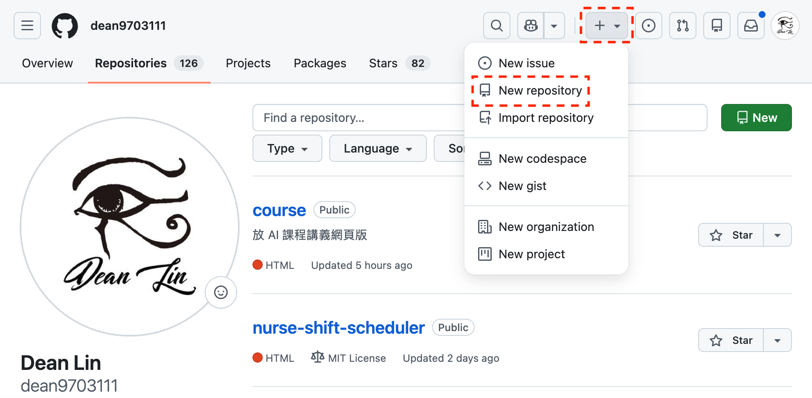
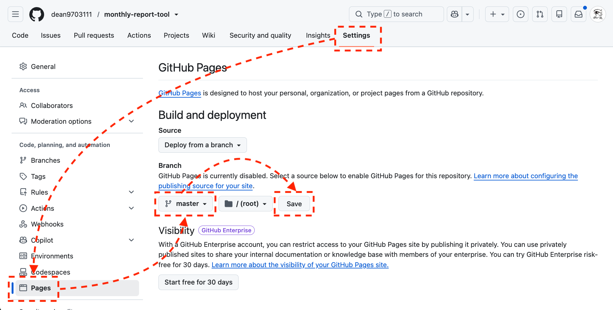

[time]
- label: 第 1 堂｜ChatGPT
  date: 11/23
  time: 19:00~21:00
  des: **釐清需求，建立專屬的教學助理**：認識 AI 的能力與限制，學會資料去識別化，練習 Prompt、記憶與自訂，連接外部工具，再用專案保存活動背景。
  link: [查看講義](../chatgpt/index.html)
- label: 第 2 堂｜Codex
  date: 11/24
  time: 19:00~21:00
  des: **讓 AI 動手處理檔案，為教材生成圖片**：指定資料夾彙整活動資料、回條照片轉 Excel、自動填表，並生成學習單與海報圖片。
  link: [查看講義](../codex/index.html)
- label: 第 3 堂｜Claude
  date: 11/26
  time: 19:00~21:00
  des: **串接工具、建立知識庫，把好方法變 SOP**：先把學生名冊去識別化，再用 Connector 整理信件與行事曆、用 Project 建立活動知識庫、把家長通知流程存成 Skill。
  link: [查看講義](../claude/index.html)
- label: 第 4 堂｜Cowork
  date: 11/27
  time: 19:00~21:00
  des: **讓 AI 交付成品，替自己做班級小工具**：用 Cowork 把簽收表照片轉 Excel、整理活動資料並設定排程，再用 Vibe Coding 做出班級分組器。
  link: [查看講義](../cowork/index.html)
  active: true
[/time]

<!-- 編寫依據與範例改編對照見 sources.md；所有學生、活動資料均為虛構。 -->

# 🙋 課前回顧：上一堂學了什麼？

> **上一堂，我們讓 Claude 開始認識你的工作**
> 今天不用記得上一堂的每個操作，只要記得三個名詞，就跟得上。
> 沒跟上上一堂也沒關係，今天的練習都附資料包，可以獨立完成。

## 開始前，快速確認三件事

### 🔌 Connector：讓 Claude 在授權範圍內，看得到你的資料

- 透過授權，讓 Claude 操作信件、行事曆等線上工具
- 動手之前，先確認它能看到什麼、能改什麼

### 🗂️ Project：把背景放進去，不用每次重新交代

- 把活動草案、決議等資料放進 Project，Claude 就知道你在忙什麼
- 定版的檔案直接上傳，會變動的放雲端用連結

### ⚙️ Skill：把驗證過的好做法，變成 SOP

- 流程跑順之後，請 Claude 設計成 Skill，下次不用從頭交代
- 今天在 Cowork 跑順的流程，一樣可以存成 Skill

### 🧳 這堂課會帶走的 5 個成果

[flow]
1. 簽收表轉 Excel — 手寫的作業繳交登記表，拍照後交給 Cowork 整理成 Excel
2. 閱讀日籌備摘要 — 讀完一包散落的檔案，交出有來源的摘要
3. 輪值安排 — 讓 AI 先釐清條件，再排出老師輪值表
4. 班級分組器 — 不用寫程式，做出雙擊就能用的網頁小工具
5. 保存點 — 放上 GitHub，改壞了也有回頭路
[/flow]

---

# 照片轉 Excel：讓 AI 直接操作你電腦上的檔案

> **Claude Chat 🆚 Cowork**
> **Chat** 只能處理`線上檔案`，但 **Cowork** 能直接幫你`操作電腦上的檔案`

## 初探 Cowork

### 📁 可以直接選資料夾，不用一個個上傳

<!-- 待補圖片：claude-cowork-ui.png｜Cowork 對話框，標出「Cowork」分頁與「Manually approve」選項（需用乾淨帳號重拍，原圖側欄含企業專案名稱） -->

- 打開上一堂安裝的 Claude 桌面 App（還沒安裝的話，到[官網下載](https://claude.ai/downloads)）
- 在新對話選「Cowork」，再用「Add folder」選擇要處理的資料夾
- 剛開始使用時，授權方式選「Manually approve」較為保險


[warning title="使用提醒"]
Cowork 是有能力`新增/修改/刪除`電腦檔案的。

能力越大風險越大，你可以想想`如果事情做到一半，但額度沒了會發生什麼事`。

練習資料夾只放自己確認過的虛構資料，不要授權整個桌面或下載資料夾。
[/warning]

## 照片批量轉存 Excel

> **一疊作業簽收表、手寫成績登記表、板書照片，要一張張 key 進 Excel**
>
> - 特徵值（座號、日期、分數、勾選狀態）藏在照片裡，得`人工一張張看、一格格打`
> - 經過人工處理，還`容易看錯數字、打錯欄位`
> - 量一大（幾班、幾週的簽收表），`整個下午都耗在 key-in`

### 📷 批量讀取照片，直接寫進 Excel

把一疊有特徵值的照片（ex: 作業簽收表、手寫成績登記表、白板上的分組名單）丟給 Cowork，它會`逐張讀出關鍵欄位`，直接整理進 Excel，不用你一張張 key。

[flow]
1. 指定照片資料夾 — 一疊手寫登記表的照片
2. 逐張辨識 — 抽出座號、繳交日期、繳交狀態等欄位
3. 寫進 Excel — 簽收表上的每一列各填一列，並標明來源是哪張照片
[/flow]

### ✍️ 先準備三張虛構的手寫簽收表

[download dir="homework-sheet" label="下載「作業繳交登記」空白簽收表" desc="可列印的空白簽收表（座號、繳交日期、狀態）與使用說明"]

- 用空白簽收表手寫 3 張「數學作業繳交登記」：欄位有座號、繳交日期、狀態（已繳／未繳／補交），每張寫 5 列左右
- 只用座號，不寫學生姓名；日期、狀態自己編，三張的座號不要重複（ex: 1〜5、6〜10、11〜15）
- 用手機各拍一張，其中一張故意歪一點或有反光
- 把 3 張照片傳到電腦（ex: 雲端硬碟、寄信給自己），放進桌面的 `簽收表照片` 資料夾
- 手邊沒有印好的簽收表，就拿任何一張紙，照同樣的三個欄位手寫

[warning title="真實的學生資料，不要這樣處理"]
照片丟給 AI，內容就會被它讀取。這個練習只用自己編的資料；真實的成績與名冊，要依校方規範處理。
[/warning]

<!-- 待補圖片：cowork-choose-folder.png｜新對話選「Add folder」，選取「簽收表照片」資料夾（需重拍，原圖側欄含企業專案名稱） -->

```prompt [label="把一疊簽收表照片批量寫入 Excel"]
逐張辨識「簽收表照片」資料夾內的照片，整理成 Excel：
1. 在同一個資料夾新增「作業繳交登記.xlsx」，欄位：座號、繳交日期、狀態（已繳／未繳／補交）、來源檔名
2. 一張照片裡的每一列，各填成 Excel 的一列
3. 看不清楚或不確定的欄位留空並標黃，不要猜
4. 核對沒有遺漏後存檔，並告訴我有哪幾格標黃
```

<!-- 待補圖片：claude-cowork-photo-excel.png｜辨識結果寫進「作業繳交登記.xlsx」，辨識不準的格子標黃（用虛構簽收表重拍） -->

> **將驗證有效的 SOP 轉換 Skill**
> `如果流程會重複使用，就可以把它設計為 Skill`，這樣 AI 日後遇到類似問題時，不需要從頭再來。

```prompt [label="將驗證過可重複使用的流程轉換為 Skill"]
幫我將這個工作流設計為 Skill
```

<!-- 待補圖片：claude-cowork-photo-excel-skill.png｜Skill 設計完成，標出「Save」按鈕（用簽收表流程重拍） -->

> **血淚紀錄**
> Skill 設計完建議還看一眼結構，因為有時 AI 只生成了`SKILL.md`；而這份文件只管流程，不包含程式腳本。
> 如果發現程式腳本不存在，就直接跟 AI 說`剛剛建立的程式腳本也要放進去`。

[lab-session title="實戰演練" duration="10 分鐘" hint="將簽收表照片批量寫入 Excel"]
- 準備好 3 張虛構的手寫簽收表照片，放進桌面的 `簽收表照片` 資料夾
- 請 Cowork 逐張辨識，寫入 Excel（一張照片的每一列對應一列、標來源檔名）
- 核對辨識結果，特別看座號、日期有沒有讀錯
- 確認辨識不準的格子有留空標黃，而不是自己猜
- 將流程設計為 Skill
[/lab-session]

---

# 檔案分析與排班：讀完一包散落資料，交出有來源的成品

## 讀取多格式檔案分析資訊

> **陌生的主題如何開始**
> 接手一個活動，手上常常是`一包散落的檔案`：草案、會議決議、郵件、行事曆。
> 我做的第一件事，是下載後把整個資料夾交給 Cowork，請它先讀過一遍。

### 🗂️ 先請 AI 讀完整包，整理已確認與待確認

[flow]
1. 列檔案 — 先列出資料夾裡每份檔案的檔名，以及能不能讀取
2. 讀內容 — 逐一讀取 `input` 裡的檔案，找出各檔重點，以及`不同檔案之間互相矛盾的地方`（ex: 草案與決議）
3. 給摘要 — 整理成「已確認、版本變更、待確認」，每一項附上來源文件
[/flow]

[download dir="reading-day" label="下載「閱讀日」虛構資料包" desc="草案、決議、郵件串、模擬行事曆、物資 CSV、輪值條件與空白測試表，全部為虛構資料"]

- 解壓縮後，在桌面建立 `school-ai-demo` 資料夾，裡面再建 `input`（放原始資料）與 `output`（放 AI 交付的成品）
- 把 `01`〜`05` 與 `07` 共六份檔案放進 `input`，不要混入真實校務文件
- `00` 是使用說明、`06` 是後面測試分組器用的紀錄表，這兩份留在原本的資料夾就好
- 在 Cowork 開新對話，用「Add folder」選取 `school-ai-demo`

<!-- 待補圖片：cowork-choose-folder-one.png｜Cowork 選取「school-ai-demo」單一資料夾，標出已勾選的資料夾（需重拍） -->

```prompt [label="先看檔案清單，再交付閱讀日籌備摘要"]
只處理 school-ai-demo 的 input 資料夾，不讀其他位置。
先列檔名、可讀狀態與預定步驟，遇到讀不到的檔案要說明。
依來源整理「閱讀日籌備摘要」，新增到 output/閱讀日摘要.md。
欄位：已確認事項、版本變更、待確認問題、來源文件。
來源未提供就寫待確認；版本衝突不自行猜核定結果。
不要修改、刪除或搬走 input，完成後列出新增檔案與尚未完成項目。
```

### ✅ 開檔核對，才算交付

- 到 `output` 自己打開摘要，不只看 AI 在對話說「完成」
- 場地應該是多功能教室（決議取代了草案的圖書室），報名方式應該是待確認
- 每一項都能回查到來源檔案；缺一份檔案不能假裝已全部彙整

## 案例：閱讀日的老師輪值安排

### 📅 直接把檔案與問題交給 AI

- 摘要核對完，接著處理閱讀日當天的人力：沿用同一個 `school-ai-demo`，不用重新選資料夾
- 輪值條件寫在 `input` 的 `07-輪值條件.md`：8 位老師（代號）、3 個站點、3 節，每節每站 2 人，備註裡還有幾條限制

```prompt [label="提出需求，直接請 AI 排"]
讀取 input 的「02-閱讀日決議.md」與「07-輪值條件.md」，確認活動時間與場地後，
幫我安排閱讀日當天的老師輪值：
8 位老師、三個站點、三節，每節每站需要 2 位老師，同一節一位老師不能同時在兩站。
有需要釐清的部分，先跟我討論，不要直接排。
討論完再排，把輪值表存到 output/閱讀日輪值表.md，不要修改 input。
```

<!-- 待補圖片：cowork-discuss.png｜Cowork 主動反問條件的畫面（用輪值需求重拍） -->

<!-- 待補圖片：cowork-not-ok-result.png｜AI 初步排出的輪值表（用輪值需求重拍） -->

> **這個結果讓人滿意嗎？**
> - 每節 3 站 × 2 人是 6 人，8 位老師有 2 位休息，輪到誰休息公平嗎？
> - 同一位老師連續三節都在書籤站，合理嗎？
> - 備註寫的限制有照做嗎？（新進老師不單獨顧報到站、老師C 第 1 節有課、每人最多休息 1 節）
> - 如果希望無縫接軌，是否要請它再寫一份給輪值老師的通知草稿？（只寫草稿，不寄出）
> - 排班週期雖短，是否還有只存在你腦中的`隱性規則`可以提供（ex: 每節換站、誰熟悉哪一站）？

[lab-session title="實戰演練" duration="10 分鐘"]
- 下載「閱讀日」資料包，把 `01`〜`05` 與 `07` 放進 `school-ai-demo/input`
- 先請 Cowork 整理閱讀日籌備摘要，開檔核對場地與報名方式
- 請 AI 在排輪值前，釐清相關細節
- 打開 `output` 的輪值表，對照 `07` 的備註，判斷結果是否為自己要的
[/lab-session]

---

# 排程：固定要做的事，讓 AI 時間到自己跑

> **每週都要做的事，為什麼每週都要自己記得？**
> 追蹤教育公告、蒐集研習資訊、彙整活動進度，這類工作`內容每次不同、做法每次一樣`。
> 把任務說明存成`排程（Scheduled）`，時間到 Claude 就會自己跑一次。

## 排程任務怎麼運作與建立

### ⏰ 排程任務怎麼運作

[flow]
- 在雲端執行 - 時間到就會跑，`電腦睡眠或 App 關閉也照常執行`
- 執行頻率 - 每小時、每天、每週、平日，或設成手動、需要時再按
- 資料來源 - 網路研究、已授權的 Connector
- 檢視結果 - 每次執行都是一個獨立的 Cowork 任務，完成後回來看結果就好
[/flow]

### 🛠️ 建立排程任務

1. 左側欄點「Scheduled」→「New task」
2. 選「Create with Claude」— Claude 會反問細節，再提出任務名稱、頻率與指令；熟悉後也可以選「Set up manually」自己填
3. 確認內容後按「Schedule」— 之後可以在同一頁`暫停、修改、刪除`，或手動立即執行

<!-- 待補圖片：claude-scheduled-task.png｜左側欄「Scheduled」→「New task」→「Create with Claude」（需重拍，原圖側欄含企業專案名稱） -->

## 建立排程前，先想好四個答案

### 📝 「Create with Claude」會問你四個問題，先想好答案

| Claude 會問[width:180] | 要寫清楚什麼 | 範例：每週追蹤教育部最新公告 |
| --- | --- | --- |
| 想讓 Claude 做什麼 | 去哪裡找、用什麼條件找、結果長什麼樣、哪些留給人判斷 | 搜尋教育部官網最近 7 天新增的公告，整理成表格：發布日期、標題、三句話重點、可能與哪個處室有關、來源連結。沒有新資料就回覆「本週無新增」，不要拿舊資料湊數 |
| 希望它多久跑一次、什麼時間？ | 頻率與時間點，配合你看結果的習慣 | 每週一早上 8 點 |
| 跑完之後，結果要送到哪裡？ | 留在 Cowork 看，還是寄信、寫進其他系統 | 留在該次任務中 |
| 執行時的核准模式要設成哪一種？ | 只讀不改的任務可以全自動；會寄信、改檔案的要逐步確認 | 自動核准 |

也可以把四個答案一次講完，直接複製下面這段：

```prompt [label="一次講清楚四個答案，建立每週公告追蹤"]
幫我建立一個排程任務：
每週一早上 8 點，搜尋教育部官網最近 7 天新增的公告，整理成表格：
發布日期、標題、三句話重點、可能與哪個處室有關、來源連結。
沒有新資料就回覆「本週無新增」，不要拿舊資料湊數。
結果留在該次任務中；這個任務只讀不改，核准模式設為自動核准。
```

[warning title="使用提醒"]
排程會`自動執行、自動消耗額度`，建議先`手動執行幾次`，確認結果穩定再開啟排程。
如果任務會`寄信、發訊息或更新其他系統`，先確認 Connector 的權限範圍；按下同意，責任就是你的。
[/warning]

## 先手動跑順，再交給排程

### 🖐️ 手動觸發排程來測試

<!-- 待補圖片：claude-scheduled-test.png、claude-scheduled-test-result.png｜點擊排程後選「Run now」，並確認結果是否符合需求（用教育部公告追蹤任務重拍） -->

> **先手動跑順，再交給排程**
> 排程只會把流程`重複執行`，不會幫你把流程`變正確`。
> 如果流程、結果不符預期，可以自由調整。

[lab-session title="實戰演練" duration="10 分鐘" hint="把一項定期工作設定成排程"]
- 挑一項固定要做的事（ex: 教育公告追蹤、研習資訊整理、活動進度彙整）
- 用「Create with Claude」建立排程，讓 Claude 反問細節
- 先手動執行一次，確認結果符合預期再設定頻率
[/lab-session]

> **有固定規則的前提下，Skill 並非最佳選項**
> Cowork 的邏輯是`從頭讀檔`，即使設計了 Skill 也很燒 Token（AI 的用量額度）
> 規則固定、每學期重複、多人要用的事，建議把它`做成工具，建一次就能一直用`。這是接下來要做的事。

---

# 工具思維：同一件事做第三次，就該做成工具

> **學 Vibe Coding 不是為了成為工程師**
> 是為了解決`你目前遇到的痛點`，這個痛點可能存在於`班級、處室、學年團隊、個人`，但一直沒有解決。
> 而這個單元，就是讓大家了解，在 AI 時代`我們能靠自己`踏出第一步。

## Vibe Coding 是什麼？

> **透過白話文跟 AI 對話，逐步完善工具的流程**
> - **優點**：可以快速完成初版
> - **缺點**：結果較不可控、未來較難維護
> 若沒有程式背景，`把想做的事、期待的結果講清楚`是最重要的事
> 這個單元全程在 `Cowork` 裡做：AI 直接在你指定的資料夾寫程式，`雙擊 html（網頁檔）就能用`，不用安裝任何東西

> **工程師的角色，也在改變**
> 當「把功能寫出來」越來越容易，工程師真正的價值，就從「會不會寫程式」移到`懂不懂這個產業、能判斷出最適合的方案、知道為什麼要這樣做`。
> 大家在教學與行政現場累積的 know-how，就屬於這類`最難被取代的價值`。

### 🆚 Cowork 每次都要花 Token，工具做一次就能一直用

| | Cowork 直接做 | 做成工具 |
| --- | --- | --- |
| 每次執行 | 重新讀檔、重新推理，`Token 每次都燒` | 開啟網頁就好，`零 Token` |
| 結果 | 每次可能`略有不同` | 固定、可驗證 |
| 誰能用 | 要有 Claude 帳號、要會下 prompt | 同事`雙擊 html` 就能用 |
| 適合 | 一次性、規則還在摸索 | 規則固定、每學期重複、多人要用 |

> **什麼時候該從 Cowork 畢業，改做工具？**
> 像「課堂分組」這種`每堂課、每個班都要做`的事，就是該做成工具的訊號。
> 判斷標準只有一條：`同一件事你會做第三次嗎？`

## 了解風險與邊界

### 🧪 是「玩具」還是能用的「工具」？

[flow]
- 一句話就能生成「看起來可以動」的系統 — 這樣的東西，你真的敢`直接用在教學現場`嗎？
- 改壞不是最可怕的 — 最可怕的是`你不知道它被改壞了`；過去人寫程式也會有一樣的問題，只是 AI `速度太快`，把問題加倍放大
- 等一下生成的`班級分組器` — 重點並不是做出來好開心，而是`審視 AI 犯了哪些錯誤`
[/flow]

> **看起來能動的東西，才是最危險的**
> `AI 的快，不是你的快；但 AI 的錯，會全部算在你頭上`。所以關鍵邏輯，還是需要人來把關。

## 從自己的需求出發

### 🐛 Vibe Coding 遇到錯誤是很正常的

[flow]
- 遇到錯誤 - Vibe Coding 過程`一定會遇到錯誤`
- 解決錯誤 - 如果沒有開發背景，能不能解決錯誤，是看`這個痛點對你來說夠不夠痛`
- 讓自己多嘗試一點 - 如果成功解決問題，這個`成就感與經驗`是非常寶貴的。
[/flow]

> **可以有野心，但先從 MVP（最小可行產品）開始**
> 在做出改變世界的產品前，先嘗試把`手邊麻煩的任務`交給 AI 做自動化。

### 🎯 用日常工作開始嘗試，因為你有分辨對錯的能力

[flow]
- 別再做「記帳軟體、番茄鐘」這類專案了 — 儘管 AI 能幫你輕鬆搞定，`但缺少挫折的練習幫助有限`，因為思考解決問題的步驟最為珍貴。
- 從「日常工作」的痛點出發 - 你有能力`分辨對錯`，並且在遇到錯誤時`不會輕易放棄、有解決的動力`
- 陌生領域你不知道 AI 犯錯 - AI 有能力做出`看起來正確的產品`，就像我幫醫院做排班工具時以為是對的；但`護理長試用後馬上就發現問題`
[/flow]

> **課前訪談小故事**
> 教學前為了讓`內容更符合單位需求`，我會先跟窗口做需求訪談。
> 有次一位主管說會安排這堂課是因為：「**開發的人不用系統，用系統的人不會開發。**」
> - **原因**: 內部系統年代久遠，很難操作；但提出需求後，基本上要`等數週甚至幾個月才修正`
> - **方案**: 讓用系統的人也能自己做出雛形，並了解開發團隊`使用的技術`，這樣未來才能銜接、維護

[interactive title="是什麼驅動你嘗試"]
**Vibe Coding 最需要什麼？**
`A` 有程式基礎 `B` 熟悉多種 AI 工具
`C` 擅長與人溝通 `D` 眼前有困擾許久的問題
[/interactive]

---

# 動手實作：用白話文做出班級分組器

## 把班級分組器做成網頁

### 🛠️ 先設計網頁 MVP

> **為什麼要先做 MVP？**
> `先求有、再求好`。MVP（Minimum Viable Product）是`最小可行產品`：先做出一個「能動的最簡版本」，再逐步優化。

### 📋 把「做分組器」說具體

| 項目 | 這次的範圍 |
| --- | --- |
| 使用者 | 老師在課堂操作，學生可看投影 |
| 輸入 | 參加人數與組數，不輸入姓名或學號 |
| 輸出 | 臨時編號 1 至 N 的分組清單 |
| 條件 | 每個編號恰好出現一次，各組人數差距最多 1 |
| 例外 | 空白、非整數、負數、組數大於人數都顯示清楚提醒 |
| 邊界 | 隨機分組不保證符合教學上的異質分組需求 |

- 在桌面新建 `class-group-tool` 資料夾，專門放這個工具
- 在 Cowork 開新對話，用「Add folder」選取 `class-group-tool`，再貼上下面的 prompt

```prompt [label="做出可以開啟的課堂分組器"]
請在資料夾內新增 group-tool.html，製作單一 HTML 的課堂分組器。
目標：老師用瀏覽器開啟，輸入人數 N 與組數 K，按按鈕後分組。
只使用臨時數字編號 1 至 N，不提供姓名或學號輸入。
每個編號恰好出現一次，每組人數差距最多 1，結果清楚適合投影。
人數限 1 到 100 的整數；組數限 1 到 N 的整數。
空白、小數、負數、超出範圍時顯示明確中文提醒。
只用內嵌 HTML/CSS/JavaScript，不用外部套件、API 或網路請求，不保留輸入與結果。
請實際建立檔案，並告訴我怎麼開啟、你做了哪些檢查。
```

> **補充說明**
> 網頁版使用 `HTML、CSS、JS` 處理，不用終端機，雙擊網頁即可。如果看不懂 AI 的建議，也可以詢問它。

<!-- 待補圖片：分組器人數／組數輸入、正常分組結果與錯誤提醒三個狀態；建議檔名 assets/cowork-group-tool-states.png -->

#### 驗證是否可以運作

到 `class-group-tool` 資料夾找到 `group-tool.html`，雙擊用瀏覽器開啟（不是只看 Claude 對話裡的預覽），這樣我們就完成了`工具雛形`。先照下表逐項按按看：

| 測試輸入 | 應有結果 |
| --- | --- |
| 10 人分 3 組 | 人數為 4、3、3，各編號只出現一次 |
| 8 人分 8 組 | 每組一人，沒有空組 |
| 10 人分 11 組 | 提醒組數不能大於人數，不產生新結果 |
| 空白、0、負數、小數 | 顯示錯誤，不自行四捨五入 |

每一項的實際結果，記在「閱讀日」資料包的 `06-測試紀錄空白表.md`（用記事本開啟填寫，或照表格抄在紙上），之後每次修改都照同一張表重測。

全部通過就不用修；發現錯誤時，用「輸入、實際結果、預期結果」這個格式回報，請 AI 只修那一處（ex: 輸入 10 人、3 組 → 實際有編號出現兩次 → 預期每個編號恰好一次）：

```prompt [label="用可重現的錯誤回報請 AI 修正"]
group-tool.html 有一個錯誤：
輸入：[你輸入的人數與組數]
實際結果：[畫面上實際看到什麼]
預期結果：[依測試表應該看到什麼]
請先找原因，再只修正這一處，維持原本介面與無外部連線的要求。
修改前另存目前檔案的備份，修完請用這幾組輸入重新檢查並回報結果：
10 人 3 組、8 人 8 組、10 人 11 組、空白、0、負數、小數。
```

[lab-session title="實戰演練" duration="20 分鐘" hint="從需求到可驗收的班級工具"]
- 請 Cowork 建立分組器，確認檔案真的出現在資料夾
- 雙擊開啟，依測試表逐項檢查，把實際結果記在 `06-測試紀錄空白表.md`
- 找到一項缺陷或操作不便（ex: 最後一排看不清楚結果），用輸入、實際結果、預期結果回報
- 修改後重測所有案例；如果卡住，換個問法、附上錯誤截圖，或開一個新對話重來
[/lab-session]

## 純前端減少資安疑慮

### 🔒 純前端＝資料不出你的電腦

今天的班級分組器是`純前端網頁`：只靠瀏覽器就能運作，`沒有後端伺服器、也沒有資料庫`。

- 所有運算都在`你自己的瀏覽器`裡跑，不上傳任何伺服器
- 不需要安裝任何軟體，`雙擊 html 就能用`，離線也能開
- 這也是我們在 prompt 裡要求「不用外部套件、不用網路請求、不保留資料」的原因
- 但開發過程中貼給 AI 的內容，仍會送到雲端，所以練習不放真實的學生資料

> **想存資料、分權限、串校務帳號，就是另一個世界了**
> 那會碰到個人資料與帳號權限，`雛形可以 Vibe Coding，隱私請交給專業工程師`，這條界線要分清楚。

## 案例回顧

### 🧭 我們到底做了什麼

[flow]
1. 先把需求說具體 — 輸入、輸出、例外與邊界，`寫成一張表`再交給 AI
2. 指定交付形式 — 指定`單一 html、不用外部套件`，同事`雙擊就能用`，讓 AI 先做出初版
3. 親手按測試案例 — 不看 AI 說「完成」，`自己輸入 10 人 3 組`確認真的能跑
4. 留下測試紀錄 — 每一項的實際結果`寫進測試紀錄表`，下次修改照同一張表重測
5. 修了再測一次 — 回報錯誤用`輸入、實際結果、預期結果`，修完重跑所有案例
6. 畫出資安邊界 — 純前端`資料不出電腦`；要存資料、分權限，就交給專業工程師
[/flow]

### 💡 Vibe Coding 重要心法

- **驗收要在真實環境**：AI 的「驗證通過」是用它自己的工具量的，`成品一定要親手打開`
- **修 Bug 靠方法，不靠運氣**：描述不出技術細節沒關係，`換個問法、附上證據、調高 Model 與 Effort、或是開一個新對話`
- **專業是最後一哩路**：你對教學現場的熟悉度，正是把工具`從 80 分推到 100 分的關鍵`

> **你不需要會寫程式，但一定要驗收**
> 整個過程我們`沒有寫一行程式`；但結果需要`親自驗收`，並在遇到問題時`引導 AI`。

---

# 版本控制：給成品一個家，還附贈後悔藥

## 建立 Git 版本控制

### 🗂️ 給成品一個「家」，還附贈後悔藥

- 今天做出來的 html 若只放在桌面，`換電腦、重灌就找不回來`，也不知道哪一版才是對的
- 放上 **GitHub**（存放檔案每一版紀錄的網站）之後，`每次上傳都是一個「還原點」`，哪天 AI 改壞了，隨時可以`退回上一版`，這正好治「不知道被改壞」的痛
- 再開啟 **GitHub Pages**，工具就會`變成一個網址`，傳給同事就能直接用，不用再傳 html 檔

> **不用打指令，也能用 GitHub**
> `Git` 是替檔案記下每一版的工具，可以想成`後悔藥`；`GitHub` 則是存放這些版本的網站。
> GitHub 並非工程師專用，只要跟著下面步驟操作，就能建立專案的第一個保存點。

把 `group-tool.html` 複製一份並改名為 `index.html`，它就是要上傳的檔案（Pages 會把 `index.html` 當成首頁）。沒跟到前面實作的話，先請 Cowork 照上面的 prompt 做出 `group-tool.html`。

[flow]
1. 建立專案 — 到 [github.com](https://github.com) 註冊，點右上角「＋」→「New repository」（repository 就是專案，常簡稱 repo），取英文名稱（ex: `class-group-tool`）、選 Public（公開）後，點擊「Create repository」
2. 拖拉上傳 — 點「uploading an existing file」，把 `index.html` 拖進去，按「Commit changes」，這就是`第一個還原點`
3. 開啟 Pages — Settings → Pages → Source 選「Deploy from a branch」→ Branch 選清單裡的預設分支（`main` 或 `master`，新專案通常只有這一個）→ Save
4. 拿到網址 — 等 1 到 2 分鐘，工具就有了專屬網址 `https://你的帳號.github.io/專案名稱/`
[/flow]

<!-- 待換圖：github-new-repo.png｜頁面露出三總課程範例 repo「nurse-shift-scheduler」；重拍時捲到不顯示其他 repo 的位置，或裁掉下方列表 -->


<!-- 待換圖：github-pages-setting.png｜repo 名稱是三總課程的「monthly-report-tool」，和講義的 class-group-tool 不同，圖中分支顯示 master；用 class-group-tool 重拍後可拿掉圖說的「僅為示範」 -->


> **注意：程式碼公開，但資料還不會公開**
> 免費版的 Pages `需要公開專案`，但公開的只有程式碼；工具依然是純前端，`所有資料還是只在使用者自己的瀏覽器裡運算`。
> **但如果運算的邏輯是機密，就不適合公開**；也不要把學生名冊上傳到公開專案。

### 💻 之後想優化，讓 Claude Code 接手

程式放上 GitHub 還有一個好處：Claude App 裡的「**Code**」功能可以`直接連接你的 GitHub 專案`，之後想優化工具，用說的就好。

- 在 Claude App 點選「**Code**」，選擇要連接的 GitHub 專案，用文字描述想要的優化
- Claude 會`讀懂專案裡的程式`後動工，改好的版本`直接更新回 GitHub`，網址不變，`工具自動變成新版`
- 就算改壞了也不怕，`每一版都在 GitHub 留著`，隨時退得回去

```prompt [label="提出想優化的細節"]
請加一個「投影模式」按鈕：切換時收起輸入區、結果編號放大，可以按返回恢復。
原本的分組邏輯與測試案例的結果不能改變。
```

<!-- 待補圖片：claude-code-optimize.png、claude-code-merge.png｜Claude Code 讀取分組器專案並完成優化、確認執行完畢（需用分組器專案重拍） -->

Claude 改好的內容會先放在`另一條草稿分支`上，不會直接動到正式版；要`合併（merge）回主線`，Pages 上的工具才會更新成新版。`PR（Pull Request）`就是「請把這份草稿合併進正式版」的申請：

```prompt [label="請 Claude 建立 PR 並完成合併"]
幫我 create PR 並完成 merge
```

<!-- 待補圖片：claude-code-merge2.png、claude-code-result.png｜建立 PR 並合併到主線（main 或 master），優化完成後的分組器投影畫面（需重拍） -->

[warning title="雲端改程式很方便，但有它的缺陷"]
- 透過雲端變更程式，`消耗 Token 的速度較快、執行速度也較慢`，適合小幅度的優化
- 如果是對外的服務，`錯了後其他使用者會受到影響`
- 這裡主要是讓大家`初步了解版本控制與迭代的方向`
- 未來想完成`更複雜的功能`，還是要回到`終端機（地端）搭配程式碼編輯器`的方式處理，那是另一堂課的範圍
[/warning]

---

[interactive title="AI 時代的焦慮指數"]
**Q1｜看到一堆新工具、新名詞冒出來，你的想法是？**
`A` 興奮，想趕快學　`B` 焦慮，怕跟不上
`C` 無感，先觀望

**Q2｜你最大的擔心是？**
`A` 學不完、學了就忘　`B` 自己會被取代
`C` 不知從何開始
[/interactive]

# 📌 課程總結：Work Smart, Don't Work Hard

## 技術更新好快，我好焦慮

> **在未來，工具學習成本應該越來越低**
> AI 工具更新，通常是為了**降低學習難度**
> 我們其實`不需要去背`工具有哪些功能，大多時候有需要時`AI 會自動調用`
> 很多時候`不是因為工具更新焦慮，而是因為看到販賣焦慮的文章`

### 😰 出現新名詞很焦慮

Hermes Agent、loop engineering、Agency Agent、HyperFrames...

[flow]
1. 先觀察一段時間 - 工具剛推出時往往`不完善、沒有教學，上手難度也高`
2. 是否有具體案例 - 是話題性產品，還是有具體的成功案例
3. 對你有幫助嗎 - 工具再好，也要自己用得上才有意義
[/flow]

> **培養批判性思考能力**
> 人的精力有限，`技術是學不完的`；要先培養出辨識問題的能力，然後思考如何解決，`工具只是在過程中學會罷了`。
> 現場遇到的問題都是不同的，沒有現成的解決方案，就要`自己設計`出來。

### 🪞 「是我太爛嗎？」不，Demo 都是挑過的

- 滑社群覺得人人都是 AI 大神，自己一試卻`處處碰壁`
- 網路上漂亮的展示，是`精心挑選過`的結果，不是日常
- 教學看不懂不代表你不行，很多時候只是每個人的`背景與基礎`不一樣

#### 漂亮精美的網頁其實是框架的功勞：[Magic](https://magicui.design/)、[Aceternity](https://ui.aceternity.com/)


#### 一堆 AI Agent 同時執行，未必會更好


> **導入 AI，不代表全交給 AI**
> 把`AI 能做到的事`跟`人必須負責的判斷`分清楚。
> 讓 AI Agent 執行很久，不一定最強；我不認為對專案毫無掌控度是件好事。
> **好的結果，不該靠消耗 Token 拼運氣；而是靠清楚的方向、可重複的工作流、以及人類在關鍵節點的決策。**

### 🔄 經驗不會歸零，只是換了賽道

> **讓自己變得「獨特」，比讓自己變得「更強」更重要**
> AI 對新人來說是`彎道超車`的機會，而對資深老師與行政同仁來說是`放大自己`的時機。

[flow]
- 過去累積的判斷力，正是 AI 缺乏的 - AI 的出現，不是把你過去十年清空，而是給你一個`放大過去十年的機會`
- 過去職業是單一價值體系 - 技術強不強，對就對、錯就錯，比較很簡單
- 現在偏向多價值體系 - 教學現場熟悉度 × 會不會說故事 × 能不能設計流程 × 願不願意分享 × 能否自己做出工具
- 單一技能容易比高下，綜合技能不容易比 - 這對資深的老師反而是機會
[/flow]

### 🔧 AI 降低「踏出第一步」的成本

- 過去想要一個小工具，得排隊`等工程師`，甚至需要花上`幾萬到數十萬`；現在 AI 讓你有機會先`自己做出雛形`
- 別因為「怕犯錯」就不敢碰：做中學，你才會真正知道 `AI 能做什麼、不能做什麼`

> **AI 就像一面鏡子，它會放大你原本的樣子**
> 如果思維清晰，AI 會放大你的清晰；如果思維混亂，AI 也會忠實放大這份混亂。
>
> 關鍵從來`不是工具多強，而是你是否了解自己要什麼`。

## Work Smart, Don't Work Hard

### ⚡ 把該省的力氣省下來

- 在 AI 時代，做`只有人才能辦到的事`更有價值
- 嘗試把工作的某個環節變順，讓自己`少踩坑、少重工、少在無聊`的事情上浪費時間
- 不要讓你對教學的熱情，被那些`不難但很煩的瑣事`一點點消耗掉

### 🙌 不要有預設立場，先讓 AI 試試看

[flow]
- 我不確定 AI 能不能做到 - 如果腦海冒出這個想法，就`直接讓 AI 嘗試看看`
- 把執行交給 AI，把判斷留給自己 — 這才是`從容的節奏`
[/flow]

## 回顧：這個系列走過的路

### 🧭 從聊天工具，升級成工作幫手

[flow]
1. 第 1 堂 ChatGPT — 認識 AI 的能力與限制，練習 Prompt、記憶與自訂，連接外部工具，再用專案保存活動背景
2. 第 2 堂 Codex — 讓 AI 動手處理資料夾裡的檔案（活動摘要與待辦、回條照片轉 Excel、自動填表），再生成學習單與海報圖片
3. 第 3 堂 Claude — 用 Connector 串接工具、Project 固定背景，再把好方法做成 Skill
4. 第 4 堂 Cowork — 指定資料夾讓 AI 交付成品（簽收表轉 Excel、閱讀日摘要與輪值），把定期工作交給排程
5. 做出工具 — 規則固定的事，用 Vibe Coding 做成雙擊就能用的純前端網頁，親手驗收
6. 保留還原點 — 放上 GitHub，改壞了也有回頭路
[/flow]

[summary]
- 💬 **ChatGPT** | 把需求說清楚，用 Prompt、記憶、自訂、外部工具與專案建立專屬教學助理
- 🖥️ **Codex** | 讓 AI 動手處理資料夾裡的檔案，並生成學習單與海報圖片
- 🔌 **Connector／Project／Skill** | 串接工具、固定背景、把好流程變 SOP
- 🗂️ **Cowork** | 指定電腦資料夾，讓 Claude 接手電腦上的任務；固定要做的事交給排程
- 🛠️ **Vibe Coding** | 從自己的需求出發做出小工具，AI 負責做、你負責驗收
- 💾 **Git 版控** | 放上 GitHub 留還原點、變成網址傳給同事，之後的迭代交給 Claude Code
[/summary]

### 🪞 AI 就像是一面鏡子：讓它回頭看看「你」

這個系列都在分享`AI 的技巧`，但如果你已經使用了一段時間，過去`問過的問題、踩過的坑、在意的細節`都已經默默被 AI 記錄了。

你可以讓 AI 幫你**復盤**：看清自己怎麼思考、如何解決問題，再把那些`一再重複的提問，變成下一個專屬於你的 Skill`。

> **你問 AI 的問題，藏著你最想解決的事**
> 成長，不是學會多少新功能，而是越來越`清楚自己要什麼`。

這段 prompt 要在`你平常使用的帳號`執行，累積的對話越多，復盤越有內容；才剛開始用的話，過一個月再回來跑。

```prompt [label="讓 AI 復盤你的成長軌跡"]
把最近一個月我跟你的對話抓出來，著重在使用者（我）的問題。

幫我復盤最近學了什麼，並回答以下問題：

1. 我向你詢問哪些種類的知識
2. 我使用了哪些工具
3. 我正在解決什麼樣的問題
4. 我是怎麼解決問題的？切入點是什麼？在意的地方是什麼？都是怎麼下指令？
5. 有哪些我很常問的問題，但沒有建立成 Skill 的？
6. 你對我，有什麼有趣的洞見/長期的觀察

把以上的復盤，寫成 6 份不同的 .md 報告，並且裡面會需要把對話紀錄分門別類。
```

<!-- 待補圖片：ai-summary.png｜Claude 產出 6 份復盤報告的畫面（要用有一個月以上對話紀錄的帳號重拍，全新帳號沒有歷史、跑不出結果；原圖含講師個人工作內容，重拍後遮蔽客戶名稱與個資再放） -->

[qa-session title="Q&A 時間"]
- Q: 離線 HTML 就能直接處理正式學生資料嗎？
  A: 先確認程式無外部請求、沒有不必要儲存，並依校方核准方式使用；正式資料不要交給 AI 協助開發或除錯。
- Q: 第一版不能用，是不是工具選錯？
  A: 先釐清需求與實際錯誤，用可重現案例修正；若需求涉及登入、跨人協作或正式系統，需資訊人員評估。
[/qa-session]
